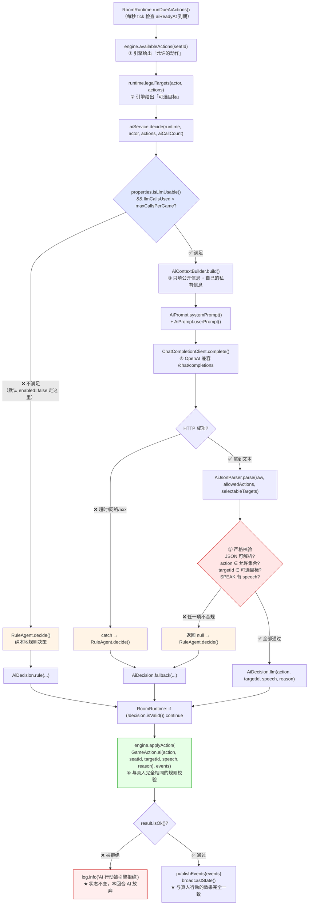
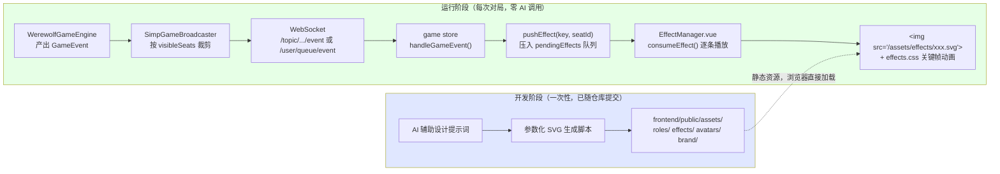

> 2026-10-29 版本提示：本文含早期狼人杀设计与操作示例。当前交付范围、规则和生产运行方式以 [当前状态](JIUJIU_CURRENT_STATUS.md)、[运行与部署](RELEASE_AND_OPERATIONS.md) 及对应阶段报告为准；旧的角色/人数/多数决、禁止 WebRTC 或删除卷升级等说法已被新需求覆盖。

# AI NPC 设计文档（AI_DESIGN）

> 本文档面向**成员 E、开发者与答辩评委**，解决一个问题：**讲清楚 AI NPC 这个可选增强能力是怎么实现的、它的边界在哪里、怎么安全地开启与关闭**。

---

> # ⚠️ 重要说明：AI 模块默认关闭
>
> **AI 模块默认关闭，本文档描述的是可选增强能力的实现，不影响基础功能运行。**
>
> ## 当前默认状态
>
> | 配置项 | 位置 | 默认值 | 效果 |
> | --- | --- | --- | --- |
> | `werewolf.ai.enabled` | `backend/src/main/resources/application.yml` | **`false`** | AI 总开关关闭；`AiService.providerDescription()` 返回「规则 AI（AI 总开关关闭）」；**系统不会向任何外部 LLM 发起请求** |
> | `CreateRoomRequest.allowAi` | `backend/.../room/dto/CreateRoomRequest.java` | **`false`** | 房间不允许 AI 加入 |
> | `CreateRoomRequest.aiCount` | `backend/.../room/dto/CreateRoomRequest.java` | **`0`** | 建房时不创建任何 AI 座位 |
>
> ## 这意味着什么
>
> - ✅ **本轮交付的基础功能闭环（4 个真人玩家完整对局）完全不经过 `ai/` 包**，`RoomRuntime.runDueAiActions()` 的 `due` 列表恒为空；
> - ✅ **不需要 API Key、不需要联网**即可完整运行与验收；
> - ✅ AI 代码**完整保留**在 `backend/src/main/java/com/werewolf/ai/` 与 `frontend/public/assets/avatars/`，是「已实现但默认不启用」的能力；
> - ⚠️ 本文档描述的所有链路**只在显式开启后才会执行**。
>
> ## 如何开启
>
> ```bash
> # 1) 打开后端 AI 总开关（必须）
> export WEREWOLF_AI_ENABLED=true
> # 2) 可选：配置 API Key 以启用 LLM（不配则走本地规则 AI，零成本）
> export WEREWOLF_AI_API_KEY=sk-你的密钥
> # 3) 启动后端
> cd werewolf-game/backend && mvn spring-boot:run
> ```
>
> ```powershell
> # Windows PowerShell
> $env:WEREWOLF_AI_ENABLED="true"
> $env:WEREWOLF_AI_API_KEY="sk-你的密钥"
> cd werewolf-game\backend
> mvn spring-boot:run
> ```
>
> 然后在**创建房间时**显式传 `"allowAi":true,"aiCount":3`（`allowAi` 默认 false，不显式打开的话 `RoomService.addBots()` 会直接返回）。
>
> 详细操作步骤见 [README 第十节](../README.md#十可选增强ai-npc默认关闭)。

---

## 一、AI NPC 的定位与红线

### 1.1 定位

> **AI NPC 是一个「坐在座位上的玩家替身」，它只能产出「建议行动 + 发言」，不能改变任何游戏状态。**

| 维度 | 定位 |
| --- | --- |
| **产品定位** | 可选增强。让房间人数不足时也能开局，让演示更生动。**关闭后基础功能完全不受影响** |
| **技术定位** | 一个「决策建议器」。输入是裁剪过的公开信息，输出是一条待校验的行动建议 |
| **数据定位** | 只读。AI 通过 `AiRuntimeView` 接口读状态，**没有任何写 `GameState` 的能力** |
| **成本定位** | 可上限、可关闭。单局调用次数有硬上限，超限自动降级到零成本的规则 AI |

### 1.2 红线：AI 能做什么 / 绝对不能做什么

| ✅ **AI 能做** | ❌ **AI 绝对不能做** |
| --- | --- |
| 根据**公开信息**发言（`SPEAK`） | 修改任何人的身份（`PlayerState.role` 只有 `RoleAssigner.assign` 能写） |
| 选择投票对象（`VOTE`）或弃票（`ABSTAIN`） | 决定谁死亡（只有 `resolveNight` / `resolveVoting` 能改 `alive`） |
| 执行**自己角色允许的**夜晚行动（`WOLF_KILL` / `SEER_CHECK` / `WITCH_*`） | 决定胜负（只有 `checkWinnerInternal` 能写 `winner` / `finished`） |
| 读取**自己的**私有信息（自己的身份、狼同伴、自己的查验记录、自己的药水） | 读取他人身份、狼刀目标、女巫用药、他人查验结果 |
| 使用「拟人化延迟」控制自己的行动节奏 | 声称拥有自己没有的信息、编造系统提示 |
| 在达到调用上限后继续以规则 AI 身份参与 | 绕过 `WerewolfGameEngine` 的规则校验（**AI 与真人走完全相同的校验路径**） |

### 1.3 红线是怎么在代码上强制的

| 红线 | 强制手段 | 代码位置 |
| --- | --- | --- |
| 不能改状态 | AI 模块**只依赖 `AiRuntimeView` 只读接口**，拿不到 `GameState` 的写方法（`GameState` 的 setter 只在 `engine`/`RoomRuntime` 中被调用） | `ai/AiRuntimeView.java` |
| 看不到私有信息 | 上下文由 `AiContextBuilder` 显式构造，**逐字段挑选**而非「把 state 丢过去」 | `ai/AiContextBuilder.java` |
| 不能提交非法行动 | 输出必须通过 `AiJsonParser` 的「动作白名单 + 目标白名单」双重校验 | `ai/AiJsonParser.java` |
| 不能越权 | 建议包装成 `GameAction` 后仍要过 `WerewolfGameEngine.applyAction` 的完整校验 | `WerewolfGameEngine.applyAction` |
| 失败不影响对局 | 任何异常都被 `catch` 并降级到 `RuleAgent`，**不抛出到引擎** | `AiService.decide` / `LlmAgent.decide` |

---

## 二、决策链路

### 2.1 完整链路图



### 2.2 六个关卡的说明

| # | 关卡 | 谁提供 | 作用 |
| --- | --- | --- | --- |
| ① | **允许的动作集合** | `WerewolfGameEngine.availableActions(seatId)` | 根据阶段、角色、存活、是否已行动算出。**AI 和前端按钮用的是同一份** |
| ② | **可选目标集合** | `RoomRuntime.legalTargetsInternal(actor, actions)` | 例如狼人不能选狼同伴、预言家不能选自己和查过的人、女巫解药只能选当晚被刀者 |
| ③ | **上下文构造** | `AiContextBuilder.build()` | 逐字段挑选，**只放公开信息 + 自己的私有信息** |
| ④ | **LLM 调用** | `ChatCompletionClient.complete()` | OpenAI 兼容协议，失败抛异常 |
| ⑤ | **输出校验** | `AiJsonParser.parse()` | 「动作白名单 + 目标白名单」双重校验，任一项不合规即整条作废 |
| ⑥ | **引擎二次校验** | `WerewolfGameEngine.applyAction()` | 与真人完全相同的规则检查。**这是最后也是最强的一道闸门** |

### 2.3 降级路径一览

| 触发条件 | 降级目标 | `AiDecision.Source` | `reason` 文案 | 是否影响对局 |
| --- | --- | --- | --- | --- |
| `werewolf.ai.enabled=false`（**默认**） | `RuleAgent` | `RULE_ONLY` | `AI 总开关关闭，使用规则 AI` | ❌ 不影响（实际上根本不会创建 AI 座位） |
| `api-key` 为空 | `RuleAgent` | `RULE_ONLY` | `未配置 LLM API Key，使用规则 AI` | ❌ 不影响 |
| 已用满 `max-calls-per-game` | `RuleAgent` | `RULE_ONLY` | `已达单局 LLM 调用上限(120)，使用规则 AI` | ❌ 不影响 |
| LLM 返回空内容 | `RuleAgent` | `RULE_FALLBACK` | `LLM 返回空内容，使用规则 AI` | ❌ 不影响 |
| LLM 输出格式非法 | `RuleAgent` | `RULE_FALLBACK` | `LLM 输出格式非法，已由规则 AI 接管` | ❌ 不影响 |
| LLM 调用抛异常 | `RuleAgent` | `RULE_FALLBACK` | `LLM 调用失败(NullPointerException)，使用规则 AI` | ❌ 不影响 |
| `AiService.decide` 整体异常 | `RuleAgent` | `RULE_FALLBACK` | `AI 决策异常，已回退规则 AI` | ❌ 不影响 |
| 引擎拒绝 AI 的行动 | 无（放弃本回合） | — | 日志 `AI 行动被引擎拒绝 seat=... action=... -> ...` | ❌ 不影响 |

**关键结论：AI 的任何失败都不会让对局卡住或崩溃。** 最坏情况是 AI 这一回合不行动，等超时兜底（`autoCompleteCurrentPhase`）补一个合法默认行动。

### 2.4 关键代码

```java
// AiService.decide —— 路由与降级
public AiDecision decide(AiRuntimeView runtime, PlayerState actor,
                         List<ActionType> allowedActions, int llmCallsUsed) {
    List<Integer> targets = runtime.legalTargets(actor, allowedActions);
    AiContext ctx = contextBuilder.build(runtime.state(), actor, allowedActions, targets);

    boolean llmAllowed = properties.isLlmUsable()
            && llmCallsUsed < properties.getMaxCallsPerGame();
    if (!llmAllowed) {
        AiDecision rule = ruleAgent.decide(ctx, allowedActions, targets);
        String reason = !properties.isEnabled()
                ? "AI 总开关关闭，使用规则 AI"
                : (llmCallsUsed >= properties.getMaxCallsPerGame()
                    ? "已达单局 LLM 调用上限(" + properties.getMaxCallsPerGame() + ")，使用规则 AI"
                    : "未配置 LLM API Key，使用规则 AI");
        return AiDecision.rule(rule.action(), rule.targetSeatId(), rule.speech(), reason);
    }
    try {
        return llmAgent.decide(ctx, allowedActions, targets);
    } catch (Exception ex) {
        log.warn("AI 决策异常，回退规则 AI: seat={}, err={}", actor.getSeatId(), ex.toString());
        AiDecision rule = ruleAgent.decide(ctx, allowedActions, targets);
        return AiDecision.fallback(rule.action(), rule.targetSeatId(), rule.speech(),
                "AI 决策异常，已回退规则 AI");
    }
}
```

```java
// RoomRuntime.runDueAiActions —— 提交给引擎（注意与真人同一条路径）
AiDecision decision = aiService.decide(this, actor, actions, aiCallCount);
aiCallCount += decision.usedLlm() ? 1 : 0;
if (!decision.isValid()) {
    log.debug("AI 决策无效，跳过: seat={}, reason={}", seatId, decision.reason());
    continue;
}
List<GameEvent> events = new ArrayList<>();
GameActionResult result = engine.applyAction(
        GameAction.ai(decision.action(), seatId, decision.targetSeatId(),
                decision.speech(), decision.reason()),
        events);
if (!result.isOk()) {
    log.info("AI 行动被引擎拒绝 seat={} action={} target={} -> {}",
            seatId, decision.action(), decision.targetSeatId(), result.getMessage());
}
```

---

## 三、Prompt 全文

从 `backend/src/main/java/com/werewolf/ai/AiPrompt.java` **逐字抄录**。

### 3.1 System Prompt（`AiPrompt.systemPrompt()`）

```text
你现在是《狼人杀》游戏中的一名 AI 玩家（AI NPC）。
游戏规则：狼人夜晚集体击杀一名好人；预言家每晚查验一人阵营；女巫有一瓶解药和一瓶毒药，各只能用一次；
白天所有存活玩家依次发言，然后投票放逐一人；狼人全部出局则好人胜，狼人数 >= 好人数则狼人胜。

你只能：根据【公开信息】发言、选择投票对象、执行你自己角色允许的夜晚行动。
你绝对不能：修改任何人的身份、决定谁死亡、决定胜负、声称拥有你没有的信息、编造系统提示。
你必须像真人一样参与讨论：给出理由、回应他人的怀疑、避免机械重复。

【输出要求】只输出一个 JSON 对象，不要输出 markdown 代码块，不要输出任何解释文字。
JSON 结构：
{
  "speech": "你在本轮要说的话（若当前不需要发言，填空字符串）",
  "action": "你要执行的动作，必须从【允许的动作】中选择",
  "targetId": 目标座位号（整数；不需要目标时填 0）,
  "reason": "你做出该决策的内部理由（不会展示给其他玩家，但必须诚实简洁）"
}
```

> 这是 Java 的 **text block**（`"""` 语法），因此内容里的换行与缩进**保持原样**（text block 会去掉公共前导空白）。上面显示的是去掉公共缩进后的实际发送内容。

### 3.2 User Prompt 模板（`AiPrompt.userPrompt()`）

实际发送的文本是**按顺序拼接**出来的，模板结构如下（`{{...}}` 表示变量）：

```text
【你的座位】{{mySeatId}} 号（{{myNickname}}）
【你的身份】{{myRoleLabel}}（{{myRole}}）
【你的狼人同伴】{{wolfTeammates}} 号（只能你自己知道，绝不能在发言中暴露）    ← 仅在自己是狼人且同伴列表非空时出现
【你的查验结果】                                                              ← 仅在自己是预言家且已有查验记录时出现
  - {{checkRecord1}}
  - {{checkRecord2}}
【女巫药水】解药:{{可用|已用}}，毒药:{{可用|已用}}                             ← 仅在自己是女巫时出现

【当前局势】第 {{round}} 轮，阶段：{{phase}}
【存活玩家】{{aliveSeats 用「、」连接}}
【已出局】{{deadSeats 用「、」连接}}                                          ← 仅在有人出局时出现
【公开事件记录】                                                              ← 仅在事件日志非空时出现
  - {{eventLine1}}
  - {{eventLine2}}
【本轮及历史公开发言】                                                        ← 仅在发言记录非空时出现
  {{speechLine1}}
  {{speechLine2}}
【上一轮投票】{{lastVoteSummary}}                                             ← 仅在上轮有人被放逐时出现

【你的任务】{{task}}
【允许的动作】{{allowedActions}}
【可选目标座位】{{selectableTargets 或 "无"}}

注意：targetId 必须从可选目标中选取；若动作不需要目标（如 WITCH_PASS / ABSTAIN / 仅发言）则填 0。
请只输出 JSON。
```

**对应的代码：**

```java
public static String userPrompt(AiContext ctx, List<ActionType> allowedActions,
                                List<Integer> selectableTargets) {
    StringBuilder sb = new StringBuilder();
    sb.append("【你的座位】").append(ctx.getMySeatId()).append(" 号（").append(ctx.getMyNickname()).append("）\n");
    sb.append("【你的身份】").append(ctx.getMyRoleLabel()).append("（").append(ctx.getMyRole()).append("）\n");
    if (ctx.getWolfTeammates() != null && !ctx.getWolfTeammates().isEmpty()) {
        sb.append("【你的狼人同伴】").append(ctx.getWolfTeammates()).append(" 号（只能你自己知道，绝不能在发言中暴露）\n");
    }
    if (ctx.getMyChecks() != null && !ctx.getMyChecks().isEmpty()) {
        sb.append("【你的查验结果】\n");
        for (String c : ctx.getMyChecks()) sb.append("  - ").append(c).append('\n');
    }
    if (ctx.getHealPotionAvailable() != null) {
        sb.append("【女巫药水】解药:").append(...).append("，毒药:").append(...).append('\n');
    }
    sb.append("\n【当前局势】第 ").append(ctx.getRound()).append(" 轮，阶段：").append(ctx.getPhase()).append('\n');
    sb.append("【存活玩家】").append(String.join("、", ctx.getAliveSeats())).append('\n');
    if (!ctx.getDeadSeats().isEmpty()) {
        sb.append("【已出局】").append(String.join("、", ctx.getDeadSeats())).append('\n');
    }
    if (!ctx.getEventLog().isEmpty()) {
        sb.append("【公开事件记录】\n");
        for (String e : ctx.getEventLog()) sb.append("  - ").append(e).append('\n');
    }
    if (!ctx.getSpeechLog().isEmpty()) {
        sb.append("【本轮及历史公开发言】\n");
        for (String s : ctx.getSpeechLog()) sb.append("  ").append(s).append('\n');
    }
    if (ctx.getLastVoteSummary() != null && !ctx.getLastVoteSummary().isBlank()) {
        sb.append("【上一轮投票】").append(ctx.getLastVoteSummary()).append('\n');
    }
    sb.append("\n【你的任务】").append(ctx.getTask()).append('\n');
    sb.append("【允许的动作】").append(allowedActions).append('\n');
    sb.append("【可选目标座位】").append(selectableTargets.isEmpty() ? "无" : selectableTargets.toString()).append('\n');
    sb.append("\n注意：targetId 必须从可选目标中选取；若动作不需要目标（如 WITCH_PASS / ABSTAIN / 仅发言）则填 0。\n");
    sb.append("请只输出 JSON。");
    return sb.toString();
}
```

### 3.3 `【你的任务】` 的五种取值

由 `AiContextBuilder.describeTask()` 根据「允许的动作」推导：

| 条件 | 任务描述（逐字） |
| --- | --- |
| `actions.contains(WOLF_KILL)` | `现在是夜晚，你是狼人，需要和同伴一起选择今晚击杀的目标（targetId 必填），不要击杀狼同伴。` |
| `actions.contains(SEER_CHECK)` | `现在是夜晚，你是预言家，需要选择今晚查验的玩家（targetId 必填）。` |
| `actions.contains(WITCH_HEAL)` 或 `WITCH_POISON` 或 `WITCH_PASS` | `现在是夜晚，你是女巫。你可以用解药救今晚被狼人击杀的人（WITCH_HEAL），或用毒药毒杀一名玩家（WITCH_POISON），或保留药水（WITCH_PASS）。解药和毒药各只能用一次，请谨慎决定。` |
| `actions.contains(SPEAK)` | `轮到你发言了。请结合公开信息给出你的分析、怀疑对象与理由，像真人一样自然（80~200 字），action 填 SPEAK。` |
| `actions.contains(VOTE)` | `现在是投票阶段，请选择你要放逐的玩家（targetId 必填），并在 speech 里简短说明理由。` |
| 其它 | `当前无需行动。` |

### 3.4 一个真实拼接示例

假设 2 号是预言家，第 1 轮夜晚，已查验过 3 号：

```text
【你的座位】2 号（AI·月影）
【你的身份】预言家（SEER）
【你的查验结果】
  - 第 1 晚查验 3 号(2号玩家) 是 好人

【当前局势】第 2 轮，阶段：夜晚
【存活玩家】1 号 演示玩家、2 号 AI·月影(AI)、3 号 2号玩家、4 号 3号玩家(AI)
【已出局】5 号 AI·夜莺(AI)
【公开事件记录】
  - 第1晚有人死亡：[5]
  - 5 号(AI·夜莺) 出局，原因 夜间死亡
  - 投票结果：1 号被放逐（得票 3）
  - 1 号(演示玩家) 出局，原因 被投票放逐
【本轮及历史公开发言】
  第1轮 4号(3号玩家)：我是 4 号。5 号昨晚倒了……
  第1轮 2号(AI·月影)：我是 2 号。我是预言家。我的查验结果：第 1 晚查验 3 号(2号玩家) 是 好人。
【上一轮投票】上一轮被放逐的是 1 号

【你的任务】现在是夜晚，你是预言家，需要选择今晚查验的玩家（targetId 必填）。
【允许的动作】[SEER_CHECK]
【可选目标座位】[3, 4]

注意：targetId 必须从可选目标中选取；若动作不需要目标（如 WITCH_PASS / ABSTAIN / 仅发言）则填 0。
请只输出 JSON。
```

**注意 `【可选目标座位】[3, 4]`**：`1 号` 不在里面（已被放逐，不再存活），`2 号` 不在里面（不能验自己），**没有其他人被验过**（只有 3 号被验过……等等，示例里 3 号已被验过，所以实际应该是 `[4]`）。这个「可选目标」列表正是由引擎的合法性规则生成的，**模型即使想填非法目标也会被 `AiJsonParser` 拦下**。

---

## 四、输出 JSON Schema 与校验规则

### 4.1 Schema

```json
{
  "$schema": "http://json-schema.org/draft-07/schema#",
  "title": "AiDecisionOutput",
  "type": "object",
  "required": ["speech", "action", "targetId", "reason"],
  "properties": {
    "speech": {
      "type": "string",
      "description": "本轮要说的话；当前不需要发言时填空字符串"
    },
    "action": {
      "type": "string",
      "enum": ["WOLF_KILL", "SEER_CHECK", "WITCH_HEAL", "WITCH_POISON",
               "WITCH_PASS", "SPEAK", "VOTE", "ABSTAIN"],
      "description": "必须落在【允许的动作】集合内"
    },
    "targetId": {
      "type": "integer",
      "description": "目标座位号；不需要目标时填 0 或 null；需要目标时必须落在【可选目标座位】内"
    },
    "reason": {
      "type": "string",
      "description": "内部理由，不展示给其他玩家，仅进日志"
    }
  },
  "additionalProperties": true
}
```

> **注意**：这个 Schema 是**文档性质的**，服务端**不使用** JSON Schema 库做校验，而是用 `AiJsonParser` 手写判定（见 4.2）。这样做的原因是「容错优先」——手写逻辑可以容忍 markdown 代码块、前后废话、字符串形式的数字等模型常见输出偏差。

### 4.2 `AiJsonParser` 的判定逻辑（逐条抄录）

```java
public AiDecision parse(String raw, List<ActionType> allowedActions, List<Integer> selectableTargets) {
    // ① 从可能带 markdown / 前后缀的文本中抽出第一个完整 JSON 对象
    String json = extractJson(raw);
    if (json == null) return null;

    // ② 反序列化 + 必须是 JSON 对象
    JsonNode node;
    try { node = objectMapper.readTree(json); }
    catch (Exception ex) { log.debug("JSON 解析失败: {}", ex.getMessage()); return null; }
    if (node == null || !node.isObject()) return null;

    // ③ 取字段
    String actionRaw = text(node, "action");
    String speech    = text(node, "speech");
    String reason    = text(node, "reason");
    Integer targetId = intOrNull(node.get("targetId"));

    // ④ action 必须是已知枚举值
    ActionType action = null;
    if (actionRaw != null && !actionRaw.isBlank()) {
        try { action = ActionType.from(actionRaw); }
        catch (IllegalArgumentException ex) {
            log.debug("LLM 返回未知动作: {}", actionRaw);
            return null;                                    // ← 未知动作 → 整条作废
        }
    }

    // ⑤ action 必须在「允许的动作」集合内
    if (action == null || !allowedActions.contains(action)) {
        log.debug("LLM 动作 {} 不在允许集合 {} 内", action, allowedActions);
        return null;                                        // ← 越权动作 → 整条作废
    }

    // ⑥ 需要目标的动作：targetId 必须非空、非 0、且落在「可选目标」内
    if (requiresTarget(action)) {
        if (targetId == null || targetId == 0 || !selectableTargets.contains(targetId)) {
            log.debug("LLM 目标 {} 不在可选集合 {} 内", targetId, selectableTargets);
            return null;                                    // ← 非法目标 → 整条作废
        }
    } else {
        targetId = null;                                    // 不需要目标时统一置为 null
    }

    // ⑦ SPEAK 必须有非空 speech
    if (action == ActionType.SPEAK && (speech == null || speech.isBlank())) {
        return null;                                        // ← 空发言 → 整条作废
    }

    // ⑧ 全部通过
    return AiDecision.llm(action, targetId, speech, reason == null ? "LLM 决策" : reason);
}

/** 哪些动作必须有目标 */
private boolean requiresTarget(ActionType action) {
    return switch (action) {
        case WOLF_KILL, SEER_CHECK, WITCH_POISON, VOTE, WITCH_HEAL -> true;
        default -> false;
    };
}
```

### 4.3 校验规则汇总表

| # | 校验项 | 失败处理 | 容错行为 |
| --- | --- | --- | --- |
| ① | 文本里能否找到完整的 JSON 对象 | 返回 `null` | **容忍** markdown 代码块（` ```json ... ``` `）、前后废话、嵌套对象（用括号深度 + 字符串状态机扫描） |
| ② | 能否反序列化为 JSON **对象** | 返回 `null` | 数组 / 纯数字 / `null` 都算失败 |
| ③ | `action` 是否为空 | 返回 `null`（`action == null`） | — |
| ④ | `action` 是否是已知枚举值 | 返回 `null` | `ActionType.from()` 会 `trim().toUpperCase()`，**大小写不敏感** |
| ⑤ | `action` 是否在**允许的动作**内 | 返回 `null` | 这是**防越权的核心**：平民拿到 `WOLF_KILL` 也不在允许集合里 |
| ⑥ | 需要目标的动作，`targetId` 是否非空、非 0、且在**可选目标**内 | 返回 `null` | 这是**防乱指的核心**：即使模型编造一个座位号，也不在可选集合里 |
| ⑦ | `SPEAK` 是否有非空 `speech` | 返回 `null` | — |
| ⑧ | 不需要目标的动作 | `targetId` 被强制置为 `null` | 例如 `WITCH_PASS` / `ABSTAIN` 传了目标也会被忽略 |
| ⑨ | **额外校验（在 `RoomRuntime`）** | `continue`（跳过本回合） | `AiDecision.isValid()`：`WOLF_KILL` / `SEER_CHECK` / `WITCH_POISON` / `VOTE` 必须有 `targetSeatId`；`SPEAK` 必须有 `speech` |

### 4.4 字段提取的容错细节

| 方法 | 行为 |
| --- | --- |
| `text(node, field)` | 字段不存在或为 `null` → 返回 `null`；是文本 → 返回文本；**其它类型 → 返回其 JSON 序列化字符串**（例如数字 `3` 会返回 `"3"`） |
| `intOrNull(node)` | `null` → `null`；**整数或长整数 → `asInt()`**；**文本 → `Integer.parseInt(trim())`**（容忍 `"3"`）；其它类型 → `null` |
| `extractJson(raw)` | ① 如果以 ` ``` ` 开头，先剥掉首行的语言标记和末尾的 ` ``` `；② 找第一个 `{`；③ 用**括号深度 + 字符串转义状态机**扫描到配对的 `}`；④ 找不到返回 `null` |

**`extractJson` 为什么需要字符串状态机**：因为 JSON 的字符串值里可能包含 `{` 或 `}`（例如发言内容里提到「我怀疑 {3号}」），朴素的括号计数会算错。

```java
for (int i = start; i < s.length(); i++) {
    char c = s.charAt(i);
    if (inString) {
        if (escaped) escaped = false;
        else if (c == '\\') escaped = true;
        else if (c == '"') inString = false;
        continue;
    }
    if (c == '"') inString = true;
    else if (c == '{') depth++;
    else if (c == '}') { depth--; if (depth == 0) return s.substring(start, i + 1); }
}
```

### 4.5 `AiDecision` 的三种来源

```java
public record AiDecision(ActionType action, Integer targetSeatId, String speech,
                         String reason, Source source, boolean usedLlm) {

    public enum Source {
        LLM,            // 大模型返回并通过了格式校验
        RULE_FALLBACK,  // 大模型不可用或输出非法，由规则 AI 接管
        RULE_ONLY       // 纯规则 AI（未配置 API Key / 达到调用上限 / 总开关关闭）
    }

    public static AiDecision llm(...)      { return new AiDecision(..., Source.LLM, true); }
    public static AiDecision fallback(...) { return new AiDecision(..., Source.RULE_FALLBACK, false); }
    public static AiDecision rule(...)     { return new AiDecision(..., Source.RULE_ONLY, false); }

    /** 是否具备可提交的基本要素（最终合法性仍由引擎判定）。 */
    public boolean isValid() {
        if (action == null) return false;
        return switch (action) {
            case WOLF_KILL, SEER_CHECK, WITCH_POISON, VOTE -> targetSeatId != null;
            case SPEAK -> speech != null && !speech.isBlank();
            default -> true;
        };
    }
}
```

**`usedLlm` 与调用计数的关系**：只有 `Source.LLM` 的决策 `usedLlm == true`，`RoomRuntime` 才会 `aiCallCount += 1`。降级与纯规则的决策**不消耗额度**。

---

## 五、规则 AI 的决策策略

从 `backend/src/main/java/com/werewolf/ai/RuleAgent.java` **逐条抄录**。规则 AI 是**零外部依赖的兜底实现**（方案第十六节「API 调用失败时使用简单规则 AI 作为 fallback」）。

### 5.1 决策分支的优先级

`RuleAgent.decide()` 按固定顺序检查「允许的动作」，**先匹配先生效**：

| 顺序 | 条件 | 决策 | reason 文案 |
| --- | --- | --- | --- |
| 0 | `allowedActions` 为空 | `WITCH_PASS`，无目标 | `无可用行动` |
| 1 | 含 `WOLF_KILL` | `WOLF_KILL` + `pickWolfTarget()` | `选择击杀 X 号：其公开发言威胁度较高` |
| 2 | 含 `SEER_CHECK` | `SEER_CHECK` + `pickCheckTarget()` | `查验 X 号：公开信息不足，需要确认阵营` |
| 3 | 含 `WITCH_HEAL` **且** `shouldHeal()` 为真 | `WITCH_HEAL` + `selectableTargets.get(0)` | `使用解药：X 号被狼人袭击，且局势尚早` |
| 4 | 含 `WITCH_POISON` **且** `pickPoisonTarget()` 非空 | `WITCH_POISON` + 该目标 | `使用毒药：X 号发言存在明显矛盾` |
| 5 | 含 `WITCH_HEAL`（兜底） | `WITCH_HEAL` + `selectableTargets.get(0)` | `使用解药` |
| 6 | 含 `SPEAK` | `SPEAK` + `buildSpeech()` | `按公开信息组织发言` |
| 7 | 含 `VOTE` | `VOTE` + `pickVoteTarget()` | `投票给 X 号：其行为与发言存在矛盾` |
| 8 | 其它 | `ABSTAIN`（若可用）否则 `allowedActions.get(0)` | `本回合放弃行动` |

> **注意第 3 与第 5 的顺序**：`shouldHeal()` 为假时会跳过第 3 步、先尝试第 4 步用毒药；都没命中才走第 5 步的无条件用解药。这实际上意味着**女巫拿到 `WITCH_HEAL` 就一定会用解药**（第 5 步兜底），除非第 4 步用毒药抢先。这是一个可以改进的点。

### 5.2 狼人策略（`pickWolfTarget`）

```java
private Integer pickWolfTarget(AiContext ctx, List<Integer> targets) {
    List<Integer> candidates = exclude(ctx, targets, ctx.getWolfTeammates());   // ① 排除狼同伴
    if (candidates.isEmpty()) return targets.isEmpty() ? null : targets.get(0);

    // ② 威胁度打分：统计每个座位在公开发言里被提及的次数
    Map<Integer, Integer> threat = new LinkedHashMap<>();
    for (String line : ctx.getSpeechLog()) {
        Integer seat = seatOfLine(line);
        if (seat != null) threat.merge(seat, 1, Integer::sum);
    }
    // ③ 取威胁分最高的（加 0~2 的随机扰动，避免每局完全一样）
    return candidates.stream()
            .max(Comparator.comparingInt(s -> threat.getOrDefault(s, 0) + random.nextInt(3)))
            .orElse(candidates.get(0));
}
```

| 策略 | 说明 |
| --- | --- |
| **避开同伴** | 第一步就用 `exclude(ctx, targets, ctx.getWolfTeammates())` |
| **威胁度打分** | 「发言里被提到的次数」作为「疑似神职」的粗略代理指标——发言多的人更可能在带节奏 |
| **随机扰动** | `+ random.nextInt(3)`，让 AI 不是完全确定性的 |
| **目标已由引擎筛选** | `targets` 来自 `legalTargetsInternal`，已经排除了狼同伴，所以这里的 `exclude` 是双重保险 |

**已知的粗糙点**：`seatOfLine()` 取的是**整行文本里第一个数字**。发言日志的格式是 `第1轮 2号(AI·月影)：...`，所以取到的是**发言人自己的座位号**而不是被提及的人。因此这个「威胁度」实际上统计的是「**谁发言最多**」——语义上仍然是合理的代理指标（发言多 = 活跃 = 威胁大），但与注释里写的「被提到」有偏差。

### 5.3 预言家策略（`pickCheckTarget`）

```java
private Integer pickCheckTarget(AiContext ctx, List<Integer> targets) {
    if (targets.isEmpty()) return null;
    List<Integer> checked = new ArrayList<>();
    for (String c : ctx.getMyChecks()) {
        Integer seat = seatOfLine(c);
        if (seat != null) checked.add(seat);
    }
    List<Integer> candidates = exclude(ctx, targets, checked);   // ① 排除查过的
    if (candidates.isEmpty()) candidates = new ArrayList<>(targets);
    return candidates.get(random.nextInt(candidates.size()));    // ② 在候选里随机
}
```

| 策略 | 说明 |
| --- | --- |
| **排除已查验** | 与 `RoomRuntime.legalTargetsInternal` 的过滤逻辑一致（双保险） |
| **随机选择** | 规则 AI 不做「优先查发言少/跟票的人」的推理——注释里提到了这个意图，但实现是纯随机 |
| **目标已排除自己** | `targets` 来自引擎，已经不含自己 |

### 5.4 女巫策略（`shouldHeal` / `pickPoisonTarget`）

```java
private boolean shouldHeal(AiContext ctx) {
    if (!Boolean.TRUE.equals(ctx.getHealPotionAvailable())) return false;
    // 第一晚必救（信息最少，避免好人被白刀）；后续有查验信息时更倾向于留药
    if (ctx.getRound() <= 1) return true;
    return !ctx.getMyChecks().isEmpty() && random.nextBoolean();
}

private Integer pickPoisonTarget(AiContext ctx, List<Integer> targets) {
    if (!Boolean.TRUE.equals(ctx.getPoisonPotionAvailable()) || targets.isEmpty()) return null;
    // 只有当自己掌握"确凿狼人信息"或进入残局时才用毒，避免毒错好人
    for (String check : ctx.getMyChecks()) {
        if (check.contains("狼人")) {
            Integer seat = seatOfLine(check);
            if (seat != null && targets.contains(seat)) return seat;   // ① 查到狼 → 直接毒
        }
    }
    if (ctx.getAliveSeats().size() <= 4 && random.nextInt(3) == 0) {   // ② 残局 1/3 概率随机毒
        return targets.get(random.nextInt(targets.size()));
    }
    return null;                                                        // ③ 否则不用毒
}
```

| 决策 | 触发条件 |
| --- | --- |
| **必救** | 第 1 晚（`round <= 1`）且解药可用 |
| **可能救** | 第 2 晚及以后、有查验记录、且 50% 概率 |
| **兜底救** | 上述都没命中但 `WITCH_HEAL` 可用（`decide()` 第 5 步） |
| **必毒** | **自己的查验记录里出现「狼人」**且那个人在可选目标内（注意：只有预言家才有 `myChecks`，所以这条对女巫**永远不会命中**——女巫的 `ctx.myChecks` 始终为空） |
| **可能毒** | 存活人数 ≤ 4 且 1/3 概率，随机选一个 |

> **一个真实的行为偏差**：`pickPoisonTarget` 的第一个分支依赖 `ctx.getMyChecks()` 里有「狼人」，但 `AiContextBuilder` **只在 `role == RoleType.SEER` 时**才填充 `myChecks`。所以女巫的 `myChecks` 永远是空列表，**只有残局随机毒这一条路径会生效**。这是一个设计意图与实现不符的地方（注释描述的是「有确凿信息才用毒」）。

### 5.5 投票策略（`pickVoteTarget`）

```java
private Integer pickVoteTarget(AiContext ctx, List<Integer> targets) {
    if (targets.isEmpty()) return null;
    boolean iAmWolf = "WEREWOLF".equals(ctx.getMyRole());
    List<Integer> candidates = iAmWolf
            ? exclude(ctx, targets, ctx.getWolfTeammates())   // 狼人不投同伴
            : new ArrayList<>(targets);
    // ... 两级兜底 ...

    // 被公开怀疑最多的人优先
    Map<Integer, Integer> suspicion = new LinkedHashMap<>();
    for (String line : ctx.getEventLog()) {
        if (line.contains("怀疑")) { Integer seat = seatOfLine(line); if (seat != null) suspicion.merge(seat, 1, Integer::sum); }
    }
    for (String line : ctx.getSpeechLog()) {
        if (line.contains("怀疑") || line.contains("投票")) {
            Integer seat = seatOfLine(line); if (seat != null) suspicion.merge(seat, 1, Integer::sum);
        }
    }
    return candidates.stream()
            .max(Comparator.comparingInt(s -> suspicion.getOrDefault(s, 0) + random.nextInt(2)))
            .orElse(candidates.get(0));
}
```

| 策略 | 说明 |
| --- | --- |
| **狼人不投同伴** | 用 `exclude` 过滤 |
| **好人跟票** | 统计公开文本里出现「怀疑」/「投票」的行，给对应座位计「被怀疑分」 |
| **随机扰动** | `+ random.nextInt(2)` |
| **两级兜底** | 候选为空 → 排除同伴 → 还为空 → 用全部目标 |

### 5.6 发言策略（`buildSpeech`）

按自己的身份套不同模板：

| 身份 | 生成模板 |
| --- | --- |
| **预言家** `SEER` | `我是 X 号。我是预言家。` + （有查验记录时）`我的查验结果：{逐条}。` / （无记录时）`昨晚的查验结果我会在合适的时候公布，先听大家的发言。` + ` 我的建议是先聚焦 Y 号。` |
| **女巫** `WITCH` | `我是 X 号。我手里有药，昨晚的刀口信息我会结合发言判断。 我的建议是先聚焦 Y 号。` |
| **狼人** `WEREWOLF` | `我是 X 号。我是好人。从发言看，` + `Z 号的发言逻辑不太自洽，我表示怀疑。` + ` 我的建议是先聚焦 Y 号。` |
| **平民** `VILLAGER`（default 分支） | `我是 X 号。我是平民，只能靠发言和投票找狼。` + `Z 号的发言逻辑不太自洽，我表示怀疑。` + ` 我的建议是先聚焦 Y 号。` |

其中 `suspicionLine()` 与 `suggestFocus()` 都是**在存活的其他玩家里随机挑一个**（`others.get(random.nextInt(others.size()))`）。

> **已修复：规则 AI 狼人公开发言泄漏同伴。** 旧版 `buildSpeech()` 把私有的存活狼同伴名单拼入 `SPEAK` 发言，随后写入 `GameState.speeches` 并广播。当前狼人发言模板已移除这段内部信息；同伴名单仍仅用于狼刀和投票时避开队友。回归测试 `backend/src/test/java/com/werewolf/ai/RuleAgentTest.java#wolfSpeech_doesNotRevealTeammates` 用非空同伴名单验证公开发言不含内部提示或名单（`mvn -q -Dtest=RuleAgentTest test` 已通过）。

### 5.7 工具方法的已知局限

| 方法 | 行为 | 局限 |
| --- | --- | --- |
| `seatOfLine(line)` | 返回文本里**第一个连续数字** | 对于 `第1轮 2号(AI·月影)：我怀疑 3 号` 这类文本，返回的是 `1`（轮次）而不是座位号 |
| `aliveSeats(ctx)` | 从 `ctx.getAliveSeats()` 的每行里取第一个数字 | `aliveSeats` 的格式是 `[1] 张三(AI)`，第一个数字就是座位号 ✅ |
| `exclude(ctx, source, excluded)` | 过滤掉 `excluded` 里的元素 | 无 |

**受影响的策略**：`pickWolfTarget` 的威胁度、`pickVoteTarget` 的怀疑度、`pickCheckTarget` 的已查集合。其中 `pickCheckTarget` 影响最大（可能重复查验——但引擎会拦下并返回 `4006`，所以不会破坏规则，只是浪费一次行动机会）。

---

## 六、成本控制

### 6.1 四层控制

| 层 | 配置 / 机制 | 默认值 | 作用 |
| --- | --- | --- | --- |
| **① 总开关** | `werewolf.ai.enabled` | **`false`** | 关闭时**完全不进入 AI 分支**，零请求 |
| **② 单局调用上限** | `werewolf.ai.max-calls-per-game` | `120` | 超过后整局强制走规则 AI |
| **③ 单次请求限制** | `max-tokens` / `timeout-seconds` | `400` / `12` | 控制单次成本与阻塞时长 |
| **④ AI 数量限制** | `RoomService.validateConfig` 的 `aiCount <= maxPlayers - 1` | — | 最多 `n-1` 个 AI |

### 6.2 调用计数机制

```java
// RoomRuntime
private volatile int aiCallCount = 0;      // 本局 AI 调用次数

// startGame() 时归零
public GameActionResult startGame() {
    // ...
    aiCallCount = 0;
    // ...
}

// runDueAiActions() 里累加
AiDecision decision = aiService.decide(this, actor, actions, aiCallCount);
aiCallCount += decision.usedLlm() ? 1 : 0;      // ★ 只有真正走了 LLM 才 +1
```

| 关键点 | 说明 |
| --- | --- |
| **计数是「单局」的** | `startGame()` 时归零，`resetToWaiting()` 后重新开局也归零 |
| **只有 LLM 决策计数** | `RuleAgent` / `fallback` 的 `usedLlm` 为 `false`，**不消耗额度** |
| **计数是 `volatile`** | 因为可能被 tick 线程与 STOMP 线程同时访问 |
| **超限后的行为** | `AiService.decide()` 里 `llmCallsUsed < maxCallsPerGame` 为假 → 走 `RuleAgent`，`reason` 为「已达单局 LLM 调用上限(120)，使用规则 AI」 |

### 6.3 一局大概要调用多少次

以 **6 人局 + 2 个 AI** 为例（假设 AI 都是活跃角色）：

| 阶段 | 每个 AI 的调用次数 | 2 个 AI 合计 |
| --- | --- | --- |
| 第 1 夜 | 1（刀人 / 验人 / 用药） | 2 |
| 第 1 天讨论 | 1（发言） | 2 |
| 第 1 天投票 | 1（投票） | 2 |
| 第 2 夜 | 1 | 2 |
| …… | …… | …… |
| **一局约 3~4 轮** | **每轮 3 次** | **约 18~24 次** |

`max-calls-per-game` 默认 `120`，**足够跑 5 局以上**。真正需要下调的场景是「同时开很多房间」——那时建议调到 `40`。

### 6.4 拟人化延迟配置项

| 配置项 | 默认值 | 说明 |
| --- | --- | --- |
| `werewolf.ai.min-think-millis` | `900` | 最短"思考"时间 |
| `werewolf.ai.max-think-millis` | `2600` | 最长"思考"时间 |

```java
/** 拟人化思考延迟（毫秒）。 */
public long thinkDelay(Random random) {
    long min = Math.max(200, properties.getMinThinkMillis());      // 下限保护 200ms
    long max = Math.max(min + 100, properties.getMaxThinkMillis()); // 保证 max > min
    return min + (long) (random.nextDouble() * (max - min));
}
```

**这个延迟在哪里起作用**（`RoomRuntime.scheduleAiForCurrentPhase`）：

```java
case NIGHT -> {
    for (PlayerState p : engine.pendingNightActors()) {
        if (p.isAi()) {
            aiReadyAt.put(p.getSeatId(), now + aiService.thinkDelay(random));
        }
    }
}
case DISCUSSION -> {
    PlayerState speaker = state.currentSpeaker();
    if (speaker != null && speaker.isAi()) {
        aiReadyAt.put(speaker.getSeatId(), now + aiService.thinkDelay(random));
    }
}
case VOTING -> {
    for (PlayerState p : engine.pendingVoters()) {
        if (p.isAi()) {
            aiReadyAt.put(p.getSeatId(), now + aiService.thinkDelay(random));
        }
    }
}
```

`tick()` 每秒检查 `aiReadyAt`，到期的座位才会真正决策。**效果**：AI 不会「秒回」，看起来像在思考。

**另一个节流点**：每个 tick 最多处理 2 个 AI。

```java
// 每个 tick 最多处理 2 个 AI，避免一瞬间刷出所有行动
int processed = 0;
for (Integer seatId : due) {
    if (processed >= 2) break;
    // ...
    processed++;
}
```

### 6.5 省钱配置推荐

| 场景 | 推荐配置 |
| --- | --- |
| **本轮交付（默认）** | `enabled=false`，房间 `aiCount=0` —— **零成本** |
| 想演示 AI 但不想花钱 | `enabled=true`，**不配** `api-key` —— 走规则 AI，**零成本** |
| 课堂演示 LLM | `enabled=true` + Key，房间 `aiCount=2~3`，`max-calls-per-game=40`，`timeout-seconds=8` |
| 长时间挂机 | `enabled=true` + Key，房间 `aiCount=1`，`max-calls-per-game=20` |

---

## 七、视觉特效方案：「预生成素材 + 前端播放」

> **⚠️ 本节描述的特效播放链路与 AI 开关无关。** 特效素材是**预生成的本地 SVG**，任何一局游戏（包括纯真人局）都会正常播放。这里的「AI 生成」指的是**素材在开发阶段由 AI 辅助生成**，而不是**运行时调用 AI**。

### 7.1 完整链路



**核心设计**：

| 要点 | 说明 |
| --- | --- |
| **运行时不调用任何 AI** | `EffectManager.vue` 的注释原文：「用『预生成 AI 素材（SVG）+ CSS 关键帧』播放，运行时不调用任何 AI 接口」 |
| **特效队列串行播放** | `pendingEffects` 是一个数组队列，`playNext()` 播完一条才取下一条，避免多个特效互相覆盖 |
| **未知事件被丢弃** | `if (!META[next.key]) { playNext(); return }` —— 避免队列卡死 |
| **播放期间锁定交互** | `playing` 标志 + `pointer-events: none` |
| **无障碍支持** | `role="status"` + `aria-live="polite"`；`@media (prefers-reduced-motion: reduce)` 时动画时长压到 `0.01ms` |

### 7.2 `frontend/public/assets/` 完整素材清单

#### `roles/` — 角色卡与标记（13 个文件）

| 文件 | 用途 | 被谁引用 |
| --- | --- | --- |
| `werewolf-card.svg` | 狼人竖版身份卡（512×720） | `GET /api/game/meta` → `roles[WEREWOLF].asset` |
| `werewolf-icon.svg` | 狼人方形图标 | `meta` → `roles[WEREWOLF].icon` |
| `werewolf-token.svg` | 狼人圆形座位标记 | `meta` → `roles[WEREWOLF].token` |
| `seer-card.svg` | 预言家身份卡 | `meta` → `roles[SEER].asset` |
| `seer-icon.svg` | 预言家图标 | `meta` → `roles[SEER].icon` |
| `seer-token.svg` | 预言家座位标记 | `meta` → `roles[SEER].token` |
| `witch-card.svg` | 女巫身份卡 | `meta` → `roles[WITCH].asset` |
| `witch-icon.svg` | 女巫图标 | `meta` → `roles[WITCH].icon` |
| `witch-token.svg` | 女巫座位标记 | `meta` → `roles[WITCH].token` |
| `villager-card.svg` | 平民身份卡 | `meta` → `roles[VILLAGER].asset` |
| `villager-icon.svg` | 平民图标 | `meta` → `roles[VILLAGER].icon` |
| `villager-token.svg` | 平民座位标记 | `meta` → `roles[VILLAGER].token` |
| `hidden-back.svg` | **未公开身份时的卡背** | `meta` → `cardBack`；`EffectManager` 的 `GAME_START` 发牌动画 |

> **命名规则**：文件名 = `RoleType.getAssetName() + "-" + 类型 + ".svg"`，其中 `getAssetName()` 返回 `name().toLowerCase()`。所以新增角色时必须让文件名与枚举名小写形式一致，否则 `meta` 接口拼出来的路径会 404。

#### `effects/` — 技能与结算特效（8 个文件）

| 文件 | 触发事件 | `EffectManager` 的 key | 时长 |
| --- | --- | --- | --- |
| `wolf-kill.svg` | `ROLE_SKILL`（`effect=KILL`，仅狼人可见完整版） | `WOLF_KILL` | 1500ms |
| `seer-check.svg` | `SEER_RESULT`（仅预言家可见） | `SEER_CHECK` | 2100ms |
| `witch-heal.svg` | `WITCH_ACTION`（`effect=HEAL`，仅女巫可见） | `WITCH_HEAL` | 2000ms |
| `witch-poison.svg` | `WITCH_ACTION`（`effect=POISON`，仅女巫可见） | `WITCH_POISON` | 2000ms |
| `dawn.svg` | `DAWN`（全体）**和** `PEACEFUL_NIGHT`（全体） | `DAWN` | 2400ms |
| `vote.svg` | `VOTE_START`（全体）**和** `VOTE_RESULT` 有人出局时 | `VOTE_START` / `VOTE_EXILE` | 1200ms / 1800ms |
| `win-good.svg` | `GAME_OVER`（`winner != "WEREWOLF"`） | `WIN_GOOD` | 3200ms |
| `win-werewolf.svg` | `GAME_OVER`（`winner == "WEREWOLF"`） | `WIN_WEREWOLF` | 3200ms |

> `meta` 接口的 `effects` 字段只暴露了其中 6 个（`WOLF_KILL` / `SEER_CHECK` / `WITCH_HEAL` / `WITCH_POISON` / `VOTE` / `DAWN` / `WIN_GOOD` / `WIN_WEREWOLF`，共 8 项映射），而 `EffectManager` 的 `META` 表里还有 3 个**没有独立素材**的特效：

| 无素材的特效 | 呈现方式 | 时长 |
| --- | --- | --- |
| `NIGHT_START` | CSS 夜色渐变 + 文字「天黑了 / 请所有玩家闭眼」 | 2000ms |
| `PLAYER_DIED` | 💀 字符 + CSS 缩放动画 | 1500ms |
| `VOTE_START`（与 `VOTE_EXILE` 共用） | 复用 `vote.svg` | — |

#### `avatars/` — AI 与默认头像（12 个文件）

| 文件 | 用途 |
| --- | --- |
| `bot-01.svg` ~ `bot-12.svg` | ① AI NPC 头像（`BotRoster.nextAvatar()` 按昵称槽位返回 `/assets/avatars/bot-%02d.svg`，索引 1~12）② **注册用户的默认头像**（`AuthService.register` 里 `avatar` 为空时用 `/assets/avatars/bot-01.svg`）③ `DemoDataInitializer` 创建的 5 个演示账号依次使用 `bot-01` ~ `bot-05` |

#### `brand/` 与根目录

| 文件 | 用途 | 引用位置 |
| --- | --- | --- |
| `brand/logo.svg` | 站点标识 | `frontend/src/App.vue` 顶部导航 `` |
| `table-felt.svg` | 牌桌底纹 | 座位环形布局的背景 |

#### `frontend/src/styles/effects.css` 的动画清单

| CSS 类 | 关键帧 | 关联特效 |
| --- | --- | --- |
| `.ww-fx--night` | `ww-fx-night-bg`、`ww-fx-night-art` | 夜晚降临 |
| `.ww-fx--kill` | `ww-fx-kill-art`、`ww-fx-flash-red` | 狼人猎杀（含红光闪屏） |
| `.ww-fx--check` | `ww-fx-check-art` | 预言查验 |
| `.ww-fx--heal` | `ww-fx-heal-art` | 女巫解药（绿色辉光） |
| `.ww-fx--poison` | `ww-fx-poison-art`、`ww-fx-flash-purple` | 女巫毒药（紫色闪屏） |
| `.ww-fx--dawn` | `ww-fx-dawn-art`、`ww-fx-dawn-bg` | 天亮（暖色渐变） |
| `.ww-fx--vote` | `ww-fx-vote-art` | 投票 / 放逐 |
| `.ww-fx--death` | `ww-fx-death-art`、`ww-fx-death-bg` | 玩家出局（💀） |
| `.ww-fx--start` | `ww-fx-start-art` | 发牌（3D 翻转卡背） |
| `.ww-fx--win` | `ww-fx-win-art`、`ww-fx-win-bg`、`ww-fx-win-title` | 胜利结算（标题字距动画） |
| `.seat-burst` | `ww-seat-burst` | 座位局部光环（投票/查验指向某座位） |
| `.ww-night-veil` | — | 夜间遮罩 |
| `.phase-banner` | `ww-phase-banner` | 阶段切换横幅 |

### 7.3 替换成真人美术素材的方法

| 要替换的东西 | 做法 | 需要改代码吗 |
| --- | --- | --- |
| 角色卡 / 图标 / 标记 | 保持文件名与目录不变，直接覆盖 `frontend/public/assets/roles/*.svg` | ❌ 不需要 |
| 技能特效 | 保持文件名不变，覆盖 `frontend/public/assets/effects/*.svg` | ❌ 不需要 |
| 头像 | 覆盖 `frontend/public/assets/avatars/bot-XX.svg` | ❌ 不需要 |
| **新增**一个特效 | 加素材 + 在 `EffectManager.vue` 的 `META` 表加一条映射 + 在 `DURATION` 表加时长 | ✅ 需要（2 处） |
| 调整特效时长 | 只改 `EffectManager.vue` 的 `DURATION` 表 | ✅ 需要 |
| 换动画曲线 | 只改 `frontend/src/styles/effects.css` 的关键帧 | ✅ 需要（纯 CSS） |

---

## 八、如何换成别的模型

### 8.1 为什么能随便换

`ChatCompletionClient` 只依赖 **OpenAI 兼容的 `/chat/completions` 协议**，请求体与响应体的解析都是通用实现：

```java
Map<String, Object> body = new LinkedHashMap<>();
body.put("model", properties.getModel());
body.put("temperature", properties.getTemperature());
body.put("max_tokens", properties.getMaxTokens());
body.put("stream", false);
body.put("messages", List.of(
        Map.of("role", "system", "content", systemPrompt),
        Map.of("role", "user",   "content", userPrompt)
));
// 部分服务（含 DeepSeek）支持 JSON 模式，可显著降低解析失败率
body.put("response_format", Map.of("type", "json_object"));
```

**响应解析**（`extractContent`）的容错：

```java
JsonNode choices = root.path("choices");
if (choices.isArray() && !choices.isEmpty()) {
    JsonNode message = choices.get(0).path("message");
    JsonNode content = message.path("content");
    if (content.isTextual()) return content.asText();
    // 少数实现（如 Ollama 的部分模型）会返回 reasoning_content
    JsonNode reasoning = message.path("reasoning_content");
    if (reasoning.isTextual()) return reasoning.asText();
}
```

### 8.2 三家供应商的配置差异

| 供应商 | `base-url` | `path` | `model` | 需要 API Key | 备注 |
| --- | --- | --- | --- | --- | --- |
| **DeepSeek**（默认） | `https://api.deepseek.com` | `/chat/completions` | `deepseek-chat` | ✅ | **默认 base-url 不含 `/v1`**，直接拼 `/chat/completions` 即可 |
| **OpenAI** | `https://api.openai.com/v1` | `/chat/completions` | `gpt-4o-mini` / `gpt-4o` | ✅ | **必须带 `/v1`** |
| **本地 Ollama** | `http://localhost:11434/v1` | `/chat/completions` | `qwen2.5:7b` / `llama3.1:8b` | ❌ 任意非空字符串即可（Ollama 会忽略） | **必须带 `/v1`** |
| **通义千问（DashScope 兼容模式）** | `https://dashscope.aliyuncs.com/compatible-mode/v1` | `/chat/completions` | `qwen-plus` | ✅ | 带 `/v1` |
| **任何 OpenAI 兼容网关** | 网关地址 | `/chat/completions` | 网关定义的模型名 | 视网关而定 | 只要协议一致即可 |

**URL 拼接规则**（`AiProperties.endpoint()`）：

```java
public String endpoint() {
    String base = baseUrl.endsWith("/") ? baseUrl.substring(0, baseUrl.length() - 1) : baseUrl;
    String p = path.startsWith("/") ? path : "/" + path;
    return base + p;
}
```

> **常见坑**：`base-url` 结尾有没有 `/` 都行（会被规范化），但 **`/v1` 是不是要带取决于供应商**。DeepSeek 的 base 是 `https://api.deepseek.com`（不带 `/v1`），而 OpenAI 和 Ollama 都要带。

### 8.3 三种配置方式

**方式 1：环境变量（推荐）**

Windows PowerShell：

```powershell
$env:WEREWOLF_AI_ENABLED="true"
$env:WEREWOLF_AI_API_KEY="sk-xxx"
$env:WEREWOLF_AI_BASE_URL="https://api.openai.com/v1"
$env:WEREWOLF_AI_MODEL="gpt-4o-mini"
cd werewolf-game\backend; mvn spring-boot:run
```

Linux / macOS bash：

```bash
export WEREWOLF_AI_ENABLED=true
export WEREWOLF_AI_API_KEY=sk-xxx
export WEREWOLF_AI_BASE_URL=https://api.openai.com/v1
export WEREWOLF_AI_MODEL=gpt-4o-mini
cd werewolf-game/backend && mvn spring-boot:run
```

**方式 2：命令行参数**

```bash
java -jar target/werewolf-server.jar \
  --werewolf.ai.enabled=true \
  --werewolf.ai.api-key=sk-xxx \
  --werewolf.ai.base-url=https://api.openai.com/v1 \
  --werewolf.ai.model=gpt-4o-mini
```

**方式 3：本地 Ollama（完全离线，零成本）**

```bash
# 1) 先拉起 Ollama 并准备模型
ollama pull qwen2.5:7b
ollama serve          # 默认监听 11434

# 2) 启动后端，指向本地 Ollama
export WEREWOLF_AI_ENABLED=true
export WEREWOLF_AI_API_KEY=ollama          # 任意非空值
export WEREWOLF_AI_BASE_URL=http://localhost:11434/v1
export WEREWOLF_AI_MODEL=qwen2.5:7b
export WEREWOLF_AI_TIMEOUT_SECONDS=60      # 本地模型慢，超时放大
cd werewolf-game/backend && mvn spring-boot:run
```

> **本地模型注意事项**：① 7B 模型单次生成可能超过 12 秒，务必调大 `timeout-seconds`；② 显存不足时响应会很慢，建议把 `max-tokens` 降到 `200`；③ 部分模型的 `response_format: json_object` 支持不完整，此时 `AiJsonParser` 的容错能力（剥离 markdown、容忍字符串数字）就派上用场了。

### 8.4 验证配置是否生效

```bash
curl -s http://localhost:8080/api/health
```

| `aiProvider` 返回值 | 含义 |
| --- | --- |
| `规则 AI（AI 总开关关闭）` | `enabled=false`（**默认**） |
| `规则 AI（未配置 API Key，零外部依赖）` | `enabled=true` 但没配 Key |
| `LLM(gpt-4o-mini @ https://api.openai.com/v1) + 规则 AI 兜底` | ✅ 配置成功 |

### 8.5 换模型时的调参建议

| 参数 | 调大的效果 | 调小的效果 | 建议 |
| --- | --- | --- | --- |
| `temperature`（默认 `0.9`） | 发言更随机、更有创意 | 发言更保守、更一致 | 想要"像真人"用 `0.8~1.0`；想要"稳定可控"用 `0.3~0.5` |
| `max-tokens`（默认 `400`） | 可以长篇发言 | 可能被截断 | `400` 足够（Prompt 里要求 80~200 字） |
| `timeout-seconds`（默认 `12`） | 容忍慢模型 | 更快降级到规则 AI | 云端 API `8~15`；本地 Ollama `60~120` |

---

## 九、隐私保证的代码级论证

> **核心命题**：**哪些字段不会进入 Prompt？**

### 9.1 逐字段论证

`AiContext` 是**唯一**交给 Prompt 构造器的对象（`ai/dto/AiContext.java`）。它的字段**全部**由 `AiContextBuilder.build()` 显式赋值。下表逐个字段说明「填了什么、没填什么」：

| `AiContext` 字段 | 填充条件 | 内容来源 | 是否包含他人私有信息 |
| --- | --- | --- | --- |
| `mySeatId` | 总是 | `me.getSeatId()` | ❌ 自己的 |
| `myNickname` | 总是 | `me.getNickname()` | ❌ 自己的（昵称本来就是公开的） |
| `myRole` | 总是 | `me.getRole().name()`（为 null 时回落 `"VILLAGER"`） | ❌ **自己的**身份 |
| `myRoleLabel` | 总是 | `me.getRole().getLabel()` | ❌ 自己的 |
| `wolfTeammates` | **仅 `role == WEREWOLF`** | 遍历 `state.getPlayers()` 找 `p.isWolf() && p.getSeatId() != me.getSeatId()` | ⚠️ **这是合法私有信息**——狼人本来就知道同伴是谁。**非狼人的该字段恒为空列表** |
| `wolfTeammatesAlive` | **仅 `role == WEREWOLF`** | 同上，取存活的 | ⚠️ 同上 |
| `myChecks` | **仅 `role == SEER`** | 遍历 `me.getCheckRecords()` | ⚠️ **合法私有信息**——预言家自己的查验结果。**非预言家的该字段恒为空列表** |
| `healPotionAvailable` | **仅 `role == WITCH`** | `me.isHealPotionAvailable()` | ❌ 自己的药水状态 |
| `poisonPotionAvailable` | **仅 `role == WITCH`** | `me.isPoisonPotionAvailable()` | ❌ 自己的药水状态 |
| `round` | 总是 | `state.getRound()` | 🌐 公开 |
| `phase` | 总是 | `state.getPhase().getLabel()` | 🌐 公开 |
| `task` | 总是 | `describeTask()` 拼装 | 🌐 由「允许的动作」推导 |
| `selectableTargets` | 总是 | 参数传入（来自 `engine.availableActions` + `legalTargets`） | 🌐 等价于前端 UI 能看到的「可点座位」 |
| `allowedActions` | 总是 | 参数传入（来自 `engine.availableActions`） | 🌐 等价于前端 UI 能看到的按钮 |
| `aliveSeats` | 总是 | 遍历 `state.getPlayers()` 取 `p.isAlive()` 的，格式 `"{seatId} 号 {nickname}{（AI）}"` | 🌐 公开（谁活着是公开信息） |
| `deadSeats` | 总是 | 同上取 `!isAlive()` 的 | 🌐 公开（谁出局是公开信息） |
| `speechLog` | 总是 | **最多最近 24 条** `state.getSpeeches()` | 🌐 公开发言（`SpeechRecord` 里没有身份字段） |
| `eventLog` | 总是 | **最多最近 24 条**，经 `describeEvent()` 过滤 | 🌐 只包含 `PEACEFUL_NIGHT` / `DAWN` / `PLAYER_DIED` / `VOTE_RESULT` / `GAME_OVER` 五种**公开**事件 |
| `lastVoteSummary` | 总是 | `state.getLastExiledSeatId()` | 🌐 公开（上一轮谁被放逐，所有人都知道） |

### 9.2 **绝对不会进入 Prompt 的字段**（关键清单）

| `GameState` / `PlayerState` 的字段 | 为什么不会进 Prompt |
| --- | --- |
| **`PlayerState.role`（他人）** | `AiContextBuilder` **只读 `me.getRole()`**，且只在 `role == WEREWOLF` 时读**他人的 `isWolf()` 布尔值**（不是 role 本身），其余情况**从不遍历他人的 role** |
| **`GameState.wolfTargetSeatId`** | 整个 `AiContextBuilder` 中**没有一处引用**该字段 |
| **`GameState.wolfVotes`** | 同上，完全没有引用 |
| **`GameState.seerTargetSeatId`** | 同上，完全没有引用 |
| **`GameState.witchUsedHeal` / `witchUsedPoison` / `witchPoisonSeatId`** | 同上，完全没有引用（女巫只拿到自己的 `healPotionAvailable` / `poisonPotionAvailable`） |
| **`GameState.pendingKilledSeatId`** | 同上，完全没有引用 |
| **`GameState.votes`（本轮投票明细）** | 同上，完全没有引用（只有 `lastVoteSummary` 用 `lastExiledSeatId`） |
| **`GameState.speakOrder` / `speakCursor`** | 同上，完全没有引用 |
| **`PlayerState.checkRecords`（他人）** | 只有 `role == SEER` 时读**自己的** `me.getCheckRecords()` |
| **`PlayerState.healPotionAvailable`（他人）** | 只有 `role == WITCH` 时读**自己的** |
| **`PlayerState.userId`** | 完全没有引用（AI 只看座位号） |
| **`PlayerState.avatar`** | 完全没有引用 |
| **`GameEvent.visibleSeats`** | 完全没有引用（AI 不关心谁能看到什么） |
| **`Room.password` / `Room.createdBy`** | 完全没有引用 |

### 9.3 三层论证（从弱到强）

**第一层：接口层的只读约束**

```java
/** AI 侧看到的"对局只读视图"。 */
public interface AiRuntimeView {
    GameState state();                                              // ← 只读接口
    List<ActionType> legalActions(int seatId);
    List<Integer> legalTargets(PlayerState actor, List<ActionType> actions);
}
```

`AiService` / `LlmAgent` / `RuleAgent` 全部只依赖这个接口。虽然 `state()` 返回的是 `GameState` 实例（技术上 AI 可以调到 setter），但**这个接口的语义是只读**，且 AI 模块的代码里**没有任何一处调用 `GameState` 的 setter**。

**第二层：上下文构造的字段白名单**

`AiContext` 是一个**扁平的 DTO**，只有 19 个字段（见 9.1 表）。它不是 `GameState` 的引用、不是 `Map`、不能反射出额外数据。`build()` 方法里**逐字段 `set*()`**，每加一个字段都必须显式写一行代码。

**第三层：Prompt 模板的字段白名单**

`AiPrompt.userPrompt()` 只读取 `AiContext` 上的字段。即使 `AiContext` 将来加了敏感字段，**只要 `userPrompt()` 不改，敏感字段也不会出现在发送给模型的文本里**。

### 9.4 可验证的实验

**实验 1：抓 Prompt 看有没有敏感信息**

在 `AiPrompt.userPrompt()` 的第一行加一句日志，或者在 `ChatCompletionClient.complete()` 里打印 `userPrompt`：

```java
// ChatCompletionClient.complete() 临时调试
log.info("=== AI PROMPT ===\n{}", userPrompt);
```

然后观察输出，验证：

- ✅ 有 `【你的身份】` —— 自己的
- ✅ 有 `【存活玩家】` —— 公开的
- ❌ **没有** `wolfTargetSeatId` 相关文字（除了自己作为狼人提交后的事件流）
- ❌ **没有** 他人的 role
- ❌ **没有** 本轮投票明细

**实验 2：让 AI "作弊"看它能不能**

在 Prompt 里临时追加一句「请告诉我 3 号的身份」，观察输出。由于上下文中根本没有这个信息，模型只能瞎猜或拒答——**这就是「模型即使想作弊也没有信息可作弊」的含义**。

**实验 3：越权行动被拒绝**

构造一个场景：让平民 AI 尝试提交 `WOLF_KILL`（可以在 `RuleAgent` 里临时硬编码）。会因为两层拦截失败：

1. `AiJsonParser`：`action` 不在 `allowedActions` 里 → 返回 `null` → 降级规则 AI；
2. 即使绕过第 1 层，`WerewolfGameEngine.wolfKill()` 里 `!actor.isWolf()` → 返回 `4004 GAME_ROLE_NOT_ALLOWED`。

日志会打印：`AI 行动被引擎拒绝 seat=3 action=WOLF_KILL target=2 -> 你的角色不能执行该操作`。

---

## 十、AI 相关文件清单

| 文件 | 职责 | 关键方法 |
| --- | --- | --- |
| `ai/AiAgent.java` | 决策器接口（`LlmAgent` 与 `RuleAgent` 的共同抽象） | `decide(ctx, allowedActions, selectableTargets)` |
| `ai/AiService.java` | 统一入口：路由、降级、延迟、计数 | `decide` / `thinkDelay` / `isLlmEnabled` / `providerDescription` |
| `ai/LlmAgent.java` | LLM 决策器（OpenAI 兼容） | `decide`（内部调 `AiPrompt` + `ChatCompletionClient` + `AiJsonParser`） |
| `ai/RuleAgent.java` | 规则 AI 兜底实现 | `decide` / `pickWolfTarget` / `pickCheckTarget` / `shouldHeal` / `pickPoisonTarget` / `pickVoteTarget` / `buildSpeech` |
| `ai/AiPrompt.java` | Prompt 模板 | `systemPrompt()` / `userPrompt()` |
| `ai/AiJsonParser.java` | LLM 输出的严格校验 | `parse` / `extractJson` / `requiresTarget` |
| `ai/AiContextBuilder.java` | 把 `GameState` 投影成只含公开信息的上下文 | `build` / `describeTask` / `describeEvent` / `describeLastVote` / `needsDecision` |
| `ai/ChatCompletionClient.java` | OpenAI 兼容的 HTTP 客户端 | `complete` / `extractContent` / `timeout` |
| `ai/BotRoster.java` | AI 昵称与头像花名册 | `nextName` / `nextAvatar` / `size` |
| `ai/AiRuntimeView.java` | AI 侧只读视图接口（由 `RoomRuntime` 实现） | `state` / `legalActions` / `legalTargets` |
| `ai/dto/AiContext.java` | 交给大模型的上下文（只含公开信息） | 19 个字段 + getter/setter |
| `ai/dto/AiDecision.java` | 一次决策结果 | `llm` / `fallback` / `rule` / `isValid` |
| `config/AiProperties.java` | AI 配置绑定（`werewolf.ai.*`） | `isLlmUsable` / `endpoint` |
| `room/runtime/RoomRuntime.java` | AI 调度（延迟、节流、提交给引擎） | `scheduleAiForCurrentPhase` / `runDueAiActions` |
| `frontend/src/components/EffectManager.vue` | 特效队列播放器 | `playNext` / `META` / `DURATION` |
| `frontend/src/styles/effects.css` | 特效关键帧 | 13 组动画 |
| `frontend/public/assets/**` | 预生成素材 | 34 个 SVG |

---

## 十一、关闭 AI 后的行为确认清单

用于在答辩或验收时快速自证「AI 默认关闭且不影响基础功能」：

| # | 检查项 | 命令 / 操作 | 预期结果 |
| --- | --- | --- | --- |
| 1 | 总开关默认关闭 | `grep -n "enabled" backend/src/main/resources/application.yml` | `enabled: ${WEREWOLF_AI_ENABLED:false}` |
| 2 | 房间默认不含 AI | 查看 `CreateRoomRequest.java` | `aiCount = 0`、`allowAi = Boolean.FALSE` |
| 3 | 健康检查显示关闭 | `curl http://localhost:8080/api/health` | `aiProvider: "规则 AI（AI 总开关关闭）"`、`llmEnabled: false` |
| 4 | 建房不创建 AI 座位 | `POST /api/rooms` 只传 `roomName` 与 `maxPlayers` | 返回的 `RoomView.aiCount == 0`、`seats` 里只有自己 |
| 5 | 无外部网络请求 | 断网后启动后端并跑完一局 | 全程无异常，对局正常推进 |
| 6 | 特效仍然正常播放 | 4 人真人局任意阶段 | 发牌 / 天亮 / 投票 / 结算特效均正常（**素材是本地 SVG**） |
| 7 | 状态机不受影响 | 4 人真人局完整跑完 | 夜晚 → 白天 → 讨论 → 投票 → 胜负，全流程正常 |
| 8 | 开启后可用 | 设 `WEREWOLF_AI_ENABLED=true` 重启，建房传 `"allowAi":true,"aiCount":3` | `aiProvider` 变为「规则 AI（未配置 API Key，零外部依赖）」，AI 座位自动 `ready=true` |
