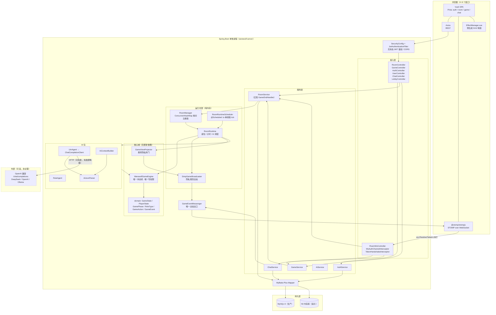
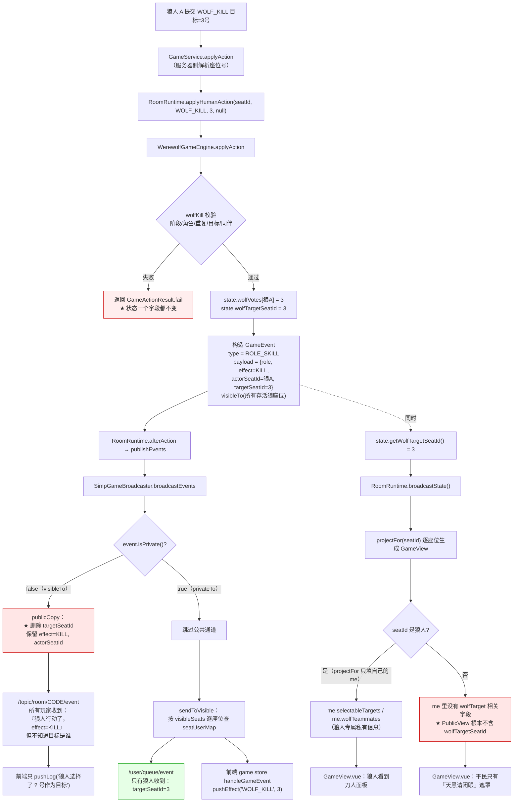

> 2026-10-29 版本提示：本文含早期狼人杀设计与操作示例。当前交付范围、规则和生产运行方式以 [当前状态](JIUJIU_CURRENT_STATUS.md)、[运行与部署](RELEASE_AND_OPERATIONS.md) 及对应阶段报告为准；旧的角色/人数/多数决、禁止 WebRTC 或删除卷升级等说法已被新需求覆盖。

# 系统架构设计（ARCHITECTURE）

> 本文档面向**开发者与答辩评委**，解决一个问题：**讲清楚这个系统为什么这样分层、服务器权威原则到底落在哪几行代码上、状态存在哪里、上限在哪里**。

---

## 一、总体架构

系统是**单体应用**：一个 Spring Boot 进程同时提供 REST 与 WebSocket，前端是一个 Vue3 单页应用。没有微服务、没有消息队列、没有 Redis 集群。



**关键点**：外部 AI 服务是**虚线**的——它是**可选增强**、**默认关闭**（`werewolf.ai.enabled=false`）、可失败的，失败后整条链路自动切到 `RuleAgent`，不影响任何游戏逻辑。本轮交付的基础功能闭环（4 个真人玩家）**完全不经过 AI 包**。

---

## 二、分层说明

依赖方向是**单向向下**的，不允许反向依赖：

```
Controller  →  Service  →  RoomRuntime  →  WerewolfGameEngine  →  domain
   ↓             ↓             ↓                  ↓
WebSocket 出站  MyBatis-Plus  GameBroadcaster   GameEvent / GameViewProjector
```

| 层 | 包 / 类 | 职责 | 明确不做的事 |
| --- | --- | --- | --- |
| **接入层** | `room/RoomController`、`game/GameController`、`auth/AuthController`、`user/UserController`、`websocket/ChatController`、`websocket/LobbyController` | 参数绑定与校验（`@Valid`）、取当前用户（`CurrentUser.id()`）、把结果包成 `ApiResponse` | 不写业务规则、不碰 `GameState` |
| **STOMP 接入** | `websocket/RoomWsController`、`config/WsAuthChannelInterceptor`、`config/TokenHandshakeInterceptor` | 鉴权、路由到 Service、把异常转成 `/user/queue/error` | 不直接改游戏状态 |
| **服务层** | `auth/AuthService`、`room/RoomService`、`game/GameService`、`websocket/ChatService` | 房间生命周期、座位管理、落库、聊天投递 | `GameService` 不含任何规则判断，规则全在引擎 |
| **AI 包（可选增强，默认关闭）** | `ai/AiService`、`LlmAgent`、`RuleAgent`、`AiContextBuilder`、`AiJsonParser`、`BotRoster` | 生成「建议行动 + 发言」，经引擎校验后执行 | 不能修改 `GameState`；默认 `enabled=false`、房间 `aiCount=0` 时根本不会被触发 |
| **运行时层** | `room/runtime/RoomManager`、`RoomRuntime`、`RoomRuntimeScheduler`、`SimpGameBroadcaster`、`WerewolfGameEngineFactory` | 每个房间一个运行时对象；持有引擎、计时器、AI 调度、在线状态 | `RoomRuntime` **不直接改 `GameState`**，只通过引擎方法 |
| **核心域** | `game/engine/WerewolfGameEngine`、`game/domain/*` | 状态机、角色分配、夜晚结算、投票、胜负 | 零 Spring 依赖，可 `new` 出来跑完整对局 |
| **视图投影** | `game/dto/GameViewProjector`、`game/dto/GameView`、`room/dto/RoomView` | 把 `GameState` 裁剪成对客户端安全的视图 | 绝不直接序列化 `GameState` |
| **出站出口** | `websocket/GameEventMessenger`、`room/runtime/GameBroadcaster`（接口）+ `SimpGameBroadcaster`（实现） | 统一报文结构 + 隐私裁剪 + 投递 | 换 Redis 广播时只需换实现 |
| **持久层** | `user/mapper`、`room/mapper`、`websocket/mapper`、`game/mapper` | 单表 CRUD | 不含业务逻辑 |

### 依赖倒置的两个具体例子

**例子 1：`GameBroadcaster` 接口**

`RoomRuntime` 依赖的是 `room/runtime/GameBroadcaster` 这个**接口**，而不是 `SimpGameBroadcaster`。这样引擎逻辑可以在**没有 WebSocket 的单元测试里**跑完整对局：

```java
public interface GameBroadcaster {
    void broadcastGameState(Room room, GameView publicView,
                            IntFunction<GameView> perSeat, Map<Integer, Long> seatUserMap);
    void broadcastEvents(Room room, List<GameEvent> events, Map<Integer, Long> seatUserMap);
    // ...
}
```

**例子 2：`GameEndHandler` 回调**

`RoomRuntime` 需要在结束时落库，但不能依赖 `RoomService`（会形成 `RoomService → RoomManager → RoomRuntime → RoomService` 的循环）。解决办法是定义 `room/runtime/GameEndHandler` 接口，由 `RoomService` 在 `@PostConstruct registerGameEndHandler()` 时把自己注册进去：

```java
// RoomService.java
@PostConstruct
void registerGameEndHandler() {
    roomManager.setGameEndHandler(this);
}
```

> 附带好处：单元测试里 `gameEndHandler` 为 `null` 也能正常工作（`RoomRuntime.onGameEnd()` 有空值判断）。

---

## 三、服务器权威原则的落地

这是整个项目最重要的一条设计约束：**客户端只能"请求"，不能"决定"**。

### 3.1 客户端能做什么 / 不能做什么

| 客户端**可以** | 客户端**不可以** |
| --- | --- |
| 请求创建/加入/退出房间 | 决定自己的座位号（`RoomRuntime.nextFreeSeat()` 分配） |
| 请求准备 / 取消准备 | 决定自己的身份（`RoleAssigner.assign()` 分配） |
| 请求开始游戏（仅房主） | 决定谁存活（只有 `resolveNight` / `resolveVoting` 能改 `alive`） |
| 提交 `WOLF_KILL / SEER_CHECK / WITCH_* / SPEAK / VOTE / ABSTAIN` | 提交任意 `action` 字符串（`ActionType.from` 白名单） |
| 提交目标座位号 | 指定任意目标（必须通过 `GAME_TARGET_INVALID` 校验） |
| 请求全量状态（`sync` / `resync`） | 请求他人身份（`GameViewProjector` 会裁剪掉） |

### 3.2 代码中的具体拦截点

按一次「平民伪造狼人刀人」请求的完整路径，逐个拦截点：

| 顺序 | 拦截点（类.方法） | 检查内容 | 失败错误码 |
| --- | --- | --- | --- |
| 1 | `SecurityConfig.filterChain` + `JwtAuthenticationFilter.doFilterInternal` | Token 是否有效 | `1001 UNAUTHORIZED` |
| 2 | `GameService.applyAction` → `roomService.requireRuntimeOf(userId)` | 该用户是否在房间中 | `3004 NOT_IN_ROOM` |
| 3 | `GameService.applyAction` | 阶段是否为 `WAITING` | `4000 GAME_NOT_FOUND` |
| 4 | `ActionType.from(request.getAction())` | 动作名是否在枚举内 | `1000 BAD_REQUEST` |
| 5 | `RoomRuntime.applyHumanAction(seatId, ...)` | 用**服务器侧座位号**构造 `GameAction`，忽略客户端传来的任何身份信息 | — |
| 6 | `WerewolfGameEngine.applyAction` → `state.bySeat(actorSeatId)` | 座位是否存在 | `4005 GAME_PLAYER_DEAD` |
| 7 | `WerewolfGameEngine.applyAction` → `actor.isAlive()` | 玩家是否存活 | `4005 GAME_PLAYER_DEAD` |
| 8 | `WerewolfGameEngine.wolfKill` → `state.getPhase() != NIGHT` | 阶段是否允许 | `4003 GAME_WRONG_PHASE` |
| 9 | `WerewolfGameEngine.wolfKill` → `!actor.isWolf()` | **角色是否允许** | `4004 GAME_ROLE_NOT_ALLOWED` |
| 10 | `WerewolfGameEngine.wolfKill` → `actedThisRound.containsKey(...)` | 是否重复行动 | `4007 GAME_ALREADY_ACTED` |
| 11 | `WerewolfGameEngine.wolfKill` → `target == null \|\| !target.isAlive()` | 目标是否合法 | `4006 GAME_TARGET_INVALID` |
| 12 | `WerewolfGameEngine.wolfKill` → `target.isWolf()` | 不能刀狼同伴 | `4006 GAME_TARGET_INVALID` |

**结论**：一次非法行动会在这条链的某一环被拒绝，且**在此之前的任何写操作都没有发生**——`GameActionResult.fail()` 直接返回，`GameState` 一个字段都不变。

### 3.3 三个「唯一」

| 唯一性 | 位置 | 说明 |
| --- | --- | --- |
| **唯一写入口** | `WerewolfGameEngine.applyAction` / `startGame` / `nextPhase` | 所有 `GameState` 的写操作都只在这三个方法（及其私有辅助方法）里发生 |
| **唯一行动入口** | `GameService.applyAction`（HTTP）+ `RoomWsController.action`（STOMP） | 两条通道**都**调用 `GameService.applyAction` / `RoomRuntime.applyHumanAction`，走同一套校验 |
| **唯一出站出口** | `GameEventMessenger` | 所有下发给客户端的消息都在这里组装报文；换成 Redis 广播时只改这一个类 |

### 3.4 AI 与真人同一条校验路径

`GameAction` 有一个 `fromAi` 标志，但它**只用于日志**：

```java
// WerewolfGameEngine.applyAction —— AI 与真人完全同一条路径
public GameActionResult applyAction(GameAction action, List<GameEvent> events) {
    if (action == null || action.getType() == null) return GameActionResult.fail(ErrorCode.BAD_REQUEST);
    PlayerState actor = state.bySeat(action.getActorSeatId());
    if (actor == null) return GameActionResult.fail(ErrorCode.GAME_PLAYER_DEAD, "座位不存在");
    if (!actor.isAlive()) return GameActionResult.fail(ErrorCode.GAME_PLAYER_DEAD);
    return switch (action.getType()) { /* ... */ };
}
```

AI 的输出先经过 `AiJsonParser`（格式校验），再经过 `AiService`（失败降级），最后仍然要过 `applyAction` 这一关。**AI 无法绕过规则**。

---

## 四、实时通信方案选型

### 4.1 为什么是 STOMP，而不是原生 WebSocket / RabbitMQ / SSE

| 方案 | 优点 | 为什么不选 / 为什么选 |
| --- | --- | --- |
| **原生 WebSocket + 自定义 JSON 协议** | 无依赖、最灵活 | 需要自己实现订阅管理、心跳、重连、消息路由、用户定向投递。狼人杀有「同一事件给不同人不同内容」的需求（狼刀目标只有狼知道），自研容易出错 |
| **SSE（Server-Sent Events）** | 简单、自动重连 | **单向**。玩家行动必须另开 HTTP 通道，反而更复杂 |
| **轮询 / 长轮询** | 无新依赖 | 4 人同时操作时延迟与服务器压力都不可接受，倒计时会明显跳动 |
| **RabbitMQ / Kafka + STOMP Relay** | 支持多实例横向扩展 | **方案明确禁止**（课程项目要求单体、低复杂度）。单机 SimpleBroker 已足够 |
| **✅ STOMP + 内存 SimpleBroker** | ① 有标准帧协议，`@MessageMapping` 声明式路由；② 内置 `/topic`（广播）与 `/user/queue`（定向）两类目的地，天然适配「公开状态 + 私有状态」；③ Spring 官方一等支持，与 Security 集成顺畅；④ 不引入任何新中间件 | **选它** |

### 4.2 目的地模型

```java
// WebSocketConfig.java
registry.enableSimpleBroker(WsDestinations.BROKER_PREFIX /* /topic */,
                            WsDestinations.USER_PREFIX /* /user */);
registry.setApplicationDestinationPrefixes(WsDestinations.APP_PREFIX /* /app */);
registry.setUserDestinationPrefix(WsDestinations.USER_PREFIX);
```

| 前缀 | 方向 | 语义 |
| --- | --- | --- |
| `/app/**` | 客户端 → 服务器 | `@MessageMapping` 处理，等价于 WebSocket 版的 Controller |
| `/topic/**` | 服务器 → 全部订阅者 | 广播（房间状态、公开事件、聊天） |
| `/user/queue/**` | 服务器 → 单个用户 | 定向投递，路由键是 `Principal#getName()` |

### 4.3 `/user/queue` 能工作的关键

`UserPrincipal` 实现了 `java.security.Principal`，并且 **`getName()` 返回 `userId` 的字符串**：

```java
@Override
public String getName() {
    return String.valueOf(id);   // 必须与 convertAndSendToUser(String.valueOf(userId), ...) 一致
}
```

`WsAuthChannelInterceptor.preSend()` 在 STOMP `CONNECT` 帧里把 `UserPrincipal` 设成 session 的 user：

```java
accessor.setUser(principal);
```

这样 `GameEventMessenger.sendToUser(userId, ...)` 才能真正投递到「那个人」的连接上。**这是隐私裁剪链路能成立的底层前提**。

### 4.4 两个端点

```java
registry.addEndpoint("/ws")          // 原生 WebSocket（前端默认）
        .setAllowedOrigins(...)
        .addInterceptors(new TokenHandshakeInterceptor());

registry.addEndpoint("/ws")          // 同名端点 + SockJS 兜底
        .setAllowedOrigins(...)
        .addInterceptors(new TokenHandshakeInterceptor())
        .withSockJS();
```

> `WsDestinations` 里还定义了 `NATIVE_ENDPOINT = "/ws-native"`，但 `WebSocketConfig` 当前**只注册了 `/ws`**。前端通过 `VITE_USE_SOCKJS=true` 在同一个 `/ws` 上切到 SockJS 传输。

---

## 五、状态存放策略

### 5.1 内存态 vs 持久态的边界

| 数据 | 存放位置 | 为什么 |
| --- | --- | --- |
| 房间座位、谁在线、谁准备 | **内存** `RoomRuntime` / `GameState.players` | 读写频率极高（每秒 tick、每次行动），且掉线即失效 |
| 当前阶段、倒计时、轮次 | **内存** `GameState.phase` / `phaseSecondsLeft` / `round` | 纯瞬时状态 |
| **真实身份** `PlayerState.role` | **内存** | 绝不能在对局中落库——落库就有泄露风险 |
| 狼刀目标、狼人内部票型 | **内存** `GameState.wolfTargetSeatId` / `wolfVotes` | 每夜重置 |
| 预言家查验记录 | **内存** `PlayerState.checkRecords` | 仅本人可见 |
| 女巫药水状态 | **内存** `PlayerState.healPotionAvailable` / `poisonPotionAvailable` | 每局重置 |
| 发言记录、事件流 | **内存** `GameState.speeches` / `events` | 一局结束随 `game_records` 一起落库 |
| 用户账号 | **落库** `users` | 需要跨会话、跨重启 |
| 房间配置与状态标记 | **落库** `rooms` | 需要在大厅列表里看到，且要防房间码碰撞 |
| 座位快照 | **落库** `room_players` | 服务重启后能恢复房间；`role` 只在 `phase == END` 时回写 |
| 聊天记录 | **落库** `messages` | 需要历史记录，且要按频道做可见性过滤 |
| 对局结果 | **落库** `game_records`（结束时一次性写入） | 复盘与战绩统计 |

### 5.2 为什么对局状态不落库

1. **性能**：4~12 人的房间，夜晚阶段每秒可能有 3 个 AI 决策 + 若干玩家操作。写库会引入数量级的延迟。
2. **一致性**：内存态是**唯一真相**。如果内存和数据库都有身份信息，就必须处理「写库成功但广播失败」这类同步问题。
3. **安全**：`role` 一旦落库，任何能读数据库的人（包括做演示时打开的 H2 控制台）都能看到全部身份。内存态在进程外无法访问。
4. **课程项目规模**：单机单进程，没有多实例共享状态的需求。若将来要多实例，正确做法是把 `RoomManager` 换成 Redis 实现，而不是把对局状态落 MySQL。

### 5.3 落库时机

| 时机 | 触发方法 | 写入内容 |
| --- | --- | --- |
| 创建房间 | `RoomService.createRoom` → `persistSeats` | `rooms` + `room_players` |
| 有人加入/离开/被踢 | `RoomService.joinRoom` / `leaveRoom` / `kick` → `persistSeats` | 重建 `room_players` 全部座位 |
| 准备状态变化 | `RoomService.setReady` → `persistSeats` | 同上 |
| 开局 | `RoomService.startGame` → `persistSeats` | 同上（此时 `role` 仍为 `null`） |
| 发聊天 | `ChatService.send` → `messageMapper.insert` | `messages` |
| **对局结束** | `RoomRuntime.onGameEnd()` → `GameEndHandler` → `RoomService.onGameEnd()` | ① `persistSeats`（此时 `phase == END`，**回写真实身份**）；② `saveGameRecord` 写 `game_records`；③ 更新每个真人的 `users.total_games` / `win_games` |
| 房间解散 | `RoomService.dissolve` | `rooms.game_status = 'ENDED'`，删除 `room_players` |

> `persistSeats` 的实现是「先删后插」，即每次都是全量重建。座位数最多 12，代价可忽略，胜在逻辑简单、不会出现脏数据。

---

## 六、并发模型

### 6.1 单线程 @Scheduled tick

```java
@Component
public class RoomRuntimeScheduler {
    @Scheduled(fixedDelay = 1000L, initialDelay = 1000L)
    public void tickAll() {
        for (RoomRuntime runtime : roomManager.all()) {
            try {
                runtime.tick();
            } catch (Exception ex) {
                log.error("房间 tick 异常 roomCode={}", runtime.getRoom().getRoomCode(), ex);
            }
        }
    }
}
```

`RoomRuntime.tick()` 每秒做两件事：

```java
public void tick() {
    if (!gameStarted) return;
    GameState state = getState();
    if (state.getPhase() == GamePhase.END) return;

    // 1) AI 行动（真人随时可行动，两者互不阻塞）
    runDueAiActions();

    // 2) 倒计时
    int left = state.getPhaseSecondsLeft() - 1;
    if (left <= 0) { onPhaseTimeout(); return; }
    state.setPhaseSecondsLeft(left);
}
```

### 6.2 为什么这么设计

| 理由 | 说明 |
| --- | --- |
| **天然避免房间间的并发写冲突** | 所有房间的倒计时推进、超时兜底在同一个线程里串行执行，不存在「两个房间同时操作同一个对象」的问题 |
| **代码简单可验证** | 不需要 `synchronized`、不需要分布式锁、不需要考虑重入 |
| **工作量确实很小** | 每个房间每秒只做：一次倒计时减法、一次 `aiReadyAt` 扫描（最多 12 个 entry）、最多 2 次 AI 决策 |
| **符合方案约束** | 方案要求单体 + 低复杂度，明确不要「每房间一个线程」这种重型方案 |

### 6.3 并发写冲突怎么兜底

即使有单线程 tick，**玩家操作走的是 STOMP 消息线程**，仍然可能与 tick 并发。兜底策略是**乐观校验**：

| 冲突场景 | 兜底机制 |
| --- | --- |
| 两个玩家同时提交行动 | 各自独立座位，互不影响 |
| 同一玩家连点两次「投票」 | `voteCast.containsKey(actor.getSeatId())` → `4009 GAME_ALREADY_VOTED` |
| 同一狼人连点两次「刀人」 | `actedThisRound.containsKey(...)` → `4007 GAME_ALREADY_ACTED` |
| 玩家操作与超时兜底撞车 | **两个**独立字段：`nightActorsDone`（本晚行动是否收集齐）+ `nightSettled`（幂等开关），`resolveNight()` 开头 `if (state.getPhase() != GamePhase.NIGHT \|\| nightSettled) return;`，重复结算被静默忽略。<br/>⚠️ 早期版本把两者合并成一个 `nightResolved`，导致夜晚永不结算（见 [docs/TEST_PLAN.md](TEST_PLAN.md) 缺陷 F-01） |
| 房间被销毁时玩家还在操作 | `roomManager.requireByCode()` → `3000 ROOM_NOT_FOUND` |

`RoomManager` 的两个注册表用 `ConcurrentHashMap`：

```java
private final Map<String, RoomRuntime> byCode = new ConcurrentHashMap<>();
private final Map<Long, RoomRuntime> byId = new ConcurrentHashMap<>();
```

`RoomRuntime` 内部的 `online` / `aiReadyAt` / `aiActedRound` 也是 `ConcurrentHashMap`。`gameStarted` / `lastActiveAt` / `aiCallCount` 用 `volatile`。

### 6.4 AI 调度的两个节流点

```java
// RoomRuntime.runDueAiActions()
due.sort(Integer::compareTo);
// 每个 tick 最多处理 2 个 AI，避免一瞬间刷出所有行动
int processed = 0;
for (Integer seatId : due) {
    if (processed >= 2) break;
    // ...
    processed++;
    if (result.isOk() && result.isPhaseAdvanced()) {
        syncPhaseSeconds();
        scheduleAiForCurrentPhase();
        broadcastState();
        return;   // 阶段已切换，本 tick 立即收手
    }
}
```

| 节流 | 作用 |
| --- | --- |
| 每人 900~2600ms 随机延迟（`AiService.thinkDelay`） | 拟人化，避免 AI 秒回全员 |
| 每 tick 最多 2 个 AI | 避免一屋子 AI 在同一秒内刷出所有行动，前端特效队列会被冲垮 |

### 6.5 上限分析

**单线程 tick 的瓶颈**是「一个 tick 内所有房间的工作量之和」。

| 场景 | 房间数 | 每 tick 工作量 | 是否可接受 |
| --- | --- | --- | --- |
| 课程演示 | 1~5 | ~5 次倒计时 + 少数 AI 决策 | ✅ 轻松 |
| 一个班同时玩 | 10~30 | ~30 次倒计时 + 最多 60 次 AI 决策 | ⚠️ AI 决策是瓶颈（见下） |
| 百人以上 | 100+ | — | ❌ 需要改为分片调度 |

**真正的瓶颈是 AI 决策，不是倒计时**：`AiService.decide()` 在 LLM 模式下会**同步阻塞等待 HTTP 响应**（默认超时 12 秒）。如果 30 个房间同时有 AI 需要决策，单线程 tick 会被拖到几十秒。

缓解手段（按实施成本排序）：

| 手段 | 做法 | 效果 |
| --- | --- | --- |
| 降低 AI 数量 | 房间配置 `aiCount` 上限 `maxPlayers - 1`，建议演示用 2~3 | 直接减少调用次数 |
| 降低超时 | `werewolf.ai.timeout-seconds: 5` | 单次阻塞上限从 12s 降到 5s |
| 调低单局上限 | `werewolf.ai.max-calls-per-game: 40` | 超出后整局走规则 AI，零阻塞 |
| 关掉 LLM | `werewolf.ai.enabled: false` 或清空 API Key | 规则 AI 是纯 CPU 计算，微秒级 |
| **架构升级**：`@Async` 调用 LLM | 把 `LlmAgent.decide` 改成异步，tick 只检查「是否已就绪」 | 彻底消除阻塞，但需要改 `AiService` 与 `RoomRuntime` 的交互 |
| **架构升级**：`@Scheduled` 加线程池 | 给 `tickAll` 配一个固定大小线程池，按房间哈希分片 | 单线程变 N 线程；需要重新审视 `GameState` 的并发写 |

> **本轮交付的实际情况**：`werewolf.ai.enabled` 默认为 `false`，房间 `aiCount` 默认为 `0`，因此上面的 AI 阻塞问题**在本轮交付中不存在**——一个纯真人的 4 人局里，`runDueAiActions()` 的 `due` 列表恒为空，`tick()` 的实际开销只有一次整数减法和一次比较。

**结论**：当前设计在**课程项目规模（≤ 30 个并发房间）**下是安全的；若开启 AI 增强，演示时建议把 AI 数量控制在 3 个以内。

---

## 七、隐私裁剪链路

这是本项目最有技术含量的部分。核心问题：**「狼人刀了谁」这条信息，怎么保证只有狼能看到？**

### 7.1 三道闸门

| 闸门 | 类 | 作用 |
| --- | --- | --- |
| ① 事件可见性标记 | `GameEvent.visibleSeats` + `broadcastToAll` | 在**产生事件的瞬间**标注「这条信息谁能看」 |
| ② 出站分流 | `SimpGameBroadcaster.broadcastEvents` / `publicCopy` | 把事件拆成「公共副本（去敏感字段）」+「按座位私发完整版」 |
| ③ 状态投影 | `GameViewProjector.project` | 把 `GameState` 裁剪成 `GameView`，`role` 只在 `gameOver` 时填写 |

### 7.2 GameEvent 的可见性语义

```java
/** 可见座位白名单。 */
private java.util.Set<Integer> visibleSeats;
private boolean broadcastToAll = true;

/** 仅这些座位能看到事件细节，但事件的通知仍广播给所有人。 */
public GameEvent visibleTo(Integer... seats) { ... broadcastToAll 保持 true ... }

/** 完全私密：事件只发给这些座位。 */
public GameEvent privateTo(Integer... seats) { ... broadcastToAll = false ... }
```

| 组合 | 公共 `/topic/room/{code}/event` | 私有 `/user/queue/event` | 典型事件 |
| --- | --- | --- | --- |
| `visibleSeats = null`，`broadcastToAll = true` | 收到完整 payload | 不发 | `GAME_START`、`NIGHT_START`、`DAWN`、`PHASE_CHANGE` |
| `visibleSeats = {狼人座位}`，`broadcastToAll = true` | 收到**删掉 `targetSeatId` 的副本** | 狼人收到完整 payload | `ROLE_SKILL`（狼刀） |
| `visibleSeats = {查验者座位}`，`broadcastToAll = false` | **收不到** | 只有预言家收到 | `SEER_RESULT` |

对应的实现：

```java
// SimpGameBroadcaster.broadcastEvents
for (GameEvent event : events) {
    if (event.isPrivate()) {                       // broadcastToAll == false
        sendToVisible(event, seatUserMap, event);  // 只走私密通道
    } else {
        messenger.gameEvent(room, publicCopy(event, room));   // 公共副本
        if (event.getVisibleSeats() != null) {
            sendToVisible(event, seatUserMap, event);          // 白名单私发完整版
        }
    }
}

/** 公共副本：去掉敏感的目标字段。 */
private GameEvent publicCopy(GameEvent event, Room room) {
    GameEvent copy = GameEvent.of(event.getEventType());
    for (Map.Entry<String, Object> e : event.getPayload().entrySet()) {
        if (event.getVisibleSeats() != null && "targetSeatId".equals(e.getKey())) {
            continue;   // ★ 狼刀目标在公共频道被剥离
        }
        copy.put(e.getKey(), e.getValue());
    }
    copy.put("roomCode", room.getRoomCode());
    return copy;
}
```

### 7.3 「狼刀目标为什么只有狼能看到」——完整流程图



### 7.4 为什么「平民连推测都推测不出来」

关键在于**公共 `GameView` 的字段里根本没有狼刀目标这个字段**——不是「藏起来了」，而是**结构上不存在**：

| 字段 | 是否出现在公共 `GameView` | 说明 |
| --- | --- | --- |
| `wolfTargetSeatId` | ❌ 不存在 | `GameViewProjector.project` 从不读取它 |
| `wolfVotes` | ❌ 不存在 | 只有 `voteCounts`（白天投票的统计，公开信息） |
| `seerTargetSeatId` | ❌ 不存在 | 只在 `PrivateView.checkRecords` 里，且仅发给预言家 |
| `witchUsedHeal` / `witchPoisonSeatId` | ❌ 不存在 | 只在 `PrivateView.healPotionAvailable` / `poisonPotionAvailable` 里，且仅发给女巫 |
| `players[].role` | ⚠️ **仅 `gameOver == true` 时存在** | `if (over && p.getRole() != null) pv.setRole(...)` |
| `me` | ✅ 存在 | `@JsonInclude(NON_NULL)`，只填观察者自己的身份 |

再叠加 `application.yml` 里的 `spring.jackson.default-property-inclusion: non_null`，为 `null` 的字段连 JSON 键都不会出现——攻击者连「哪些字段存在」都探测不到。

### 7.5 状态双通道：公共 + 私有

```java
// RoomRuntime.broadcastState()
public void broadcastState() {
    GameState state = getState();
    Map<Integer, Long> seatMap = seatUserMap();
    GameView publicView = projectFor(null);          // 无身份版本
    Map<Integer, GameView> perSeat = new LinkedHashMap<>();
    for (Integer seatId : seatMap.keySet()) {
        perSeat.put(seatId, projectFor(seatId));     // 每座位一个私有版本
    }
    broadcaster.broadcastGameState(room, publicView, perSeat::get, seatMap);
}
```

| 通道 | 目的地 | 内容 |
| --- | --- | --- |
| 公共 | `/topic/room/{code}/game` | `projectFor(null)`：`me` 字段为 `null` |
| 私有 | `/user/queue/game` → 每个真人一条 | `projectFor(seatId)`：含本人的 `me`（身份、药水、查验记录、可用行动、可选目标） |

**前端 `game` store 也严格区分这两个来源**：

```typescript
const publicState = ref<GameView | null>(null)    // 来自 /topic/room/{code}/game
const privateState = ref<GameView | null>(null)   // 来自 /user/queue/game
// 合并时 players 以公开信息为准，me 以私有信息为准
```

> **注意**：AI 座位（`userId` 为负数）**不会**收到私有状态——`SimpGameBroadcaster.broadcastGameState` 里有 `if (userId == null || userId <= 0) continue;`。AI 的状态由服务端直接持有，不需要下发。

---

## 八、可扩展性：如何新增一个角色

以新增「**猎人（HUNTER）**」为例——被投票放逐或被狼刀时可以开枪带走一个人。需要改动的文件清单：

### 8.1 后端（必需）

| # | 文件 | 改什么 |
| --- | --- | --- |
| 1 | `backend/.../game/domain/RoleType.java` | 加枚举项 `HUNTER("猎人", Camp.VILLAGE, false, 1, "出局时可以开枪带走一名玩家")` |
| 2 | `backend/.../game/domain/ActionType.java` | 加 `HUNTER_SHOOT` |
| 3 | `backend/.../game/domain/RoleAssigner.java` | `buildDeck()` 里按人数加入猎人牌（例如 `if (totalPlayers >= 6) deck.add(RoleType.HUNTER);`）；同步更新 `validateConfig` 的人数下界 |
| 4 | `backend/.../game/engine/WerewolfGameEngine.java` | ① `applyAction` 的 `switch` 加 `case HUNTER_SHOOT -> hunterShoot(actor, action, events)`；② 实现 `hunterShoot`（校验：阶段、角色、是否已开枪、目标合法）；③ `availableActions(seatId)` 加猎人的可行动分支；④ `resolveNight` / `resolveVoting` 里在被放逐/被刀时触发「可开枪」状态；⑤ `autoCompleteCurrentPhase` 加猎人的超时兜底（不开枪） |
| 5 | `backend/.../game/domain/GamePhase.java`（可选） | 若枪声需要单独阶段，加 `HUNTER_SHOOT` 阶段与默认时长 |
| 6 | `backend/.../game/domain/GameEvent.java` | 若需要新特效事件，加 `EventType`（例如 `HUNTER_ACTION`） |
| 7 | `backend/.../game/dto/GameViewProjector.java` | `privateView()` 里给猎人填充私有信息（例如 `canShoot` 标志） |
| 8 | `backend/.../ai/AiContextBuilder.java` | `describeTask()` 加猎人的任务描述；若猎人需要额外上下文（如「谁票了我」）在此填充 |
| 9 | `backend/.../ai/RuleAgent.java` | 加猎人策略：优先带走「被公开怀疑最多」的座位 |
| 10 | `backend/.../ai/AiPrompt.java` | `systemPrompt()` 的规则描述里补一句猎人的技能 |
| 11 | `backend/src/main/resources/db/h2/schema.sql` + `database/schema.sql` | 无需改——`room_players.role` 是 `VARCHAR(20)`，`HUNTER` 只占 6 字符 |

### 8.2 前端（必需）

| # | 文件 | 改什么 |
| --- | --- | --- |
| 12 | `frontend/src/types/index.ts` | `RoleType` 加 `'HUNTER'`；`ActionType` 加 `'HUNTER_SHOOT'`；`GameEventType` 加新事件 |
| 13 | `frontend/public/assets/roles/` | 加 `hunter-card.svg`、`hunter-icon.svg`、`hunter-token.svg`（**文件名必须让 `RoleType.getAssetName()` 能拼出来**，即全小写枚举名） |
| 14 | `frontend/src/components/EffectManager.vue` | `META` 表加特效映射；`DURATION` 表加时长 |
| 15 | `frontend/src/styles/effects.css` | 加对应的 CSS 关键帧（可选，可复用已有的） |
| 16 | `frontend/src/stores/game.ts` | `handleGameEvent` 的 `switch` 加新事件分支（`pushEffect` + `pushLog`） |
| 17 | `frontend/src/views/GameView.vue`（成员 F） | 加猎人的操作面板（选目标 + 开枪按钮） |

### 8.3 不用改的（这是好架构的标志）

| 文件 | 为什么不用改 |
| --- | --- |
| `GameView.java` | `PrivateView` 用通用的 `availableActions` / `selectableTargets` 列表驱动 UI |
| `RoomRuntime.java` | 用 `engine.availableActions()` 和 `engine.pendingNightActors()` 泛化处理，不看具体角色 |
| `AiService.java` / `LlmAgent.java` / `AiJsonParser.java` | 校验逻辑基于「允许的动作集合」与「可选目标集合」，与具体角色无关 |
| `GameEventMessenger.java` / `SimpGameBroadcaster.java` | 按 `visibleSeats` 泛化处理 |
| `ChatService.java` / `RoomService.java` | 与角色无关 |
| `database/schema.sql` | `role` 字段是字符串 |
| `application.yml` | 无角色相关配置 |

**一句话总结扩展成本**：新增一个「纯夜晚技能」角色大约需要改 **2 个后端文件**（`RoleType` + `RoleAssigner` + 引擎的 `availableActions`）；新增一个有独立阶段/独立交互的角色大约需要改 **8 个后端文件 + 5 个前端文件**。这是把规则集中在 `domain` + `engine`、把展示交给 `GameViewProjector` 的直接收益。

---

## 九、为什么不引入 Redis / 消息队列（答辩追问预案）

| 追问 | 回答要点 |
| --- | --- |
| 「多实例部署怎么办？」 | 把 `RoomManager` 的 `ConcurrentHashMap` 换成 Redis 实现，把 `SimpGameBroadcaster` 换成 STOMP Relay（RabbitMQ）实现。**两个类的接口（`GameBroadcaster`）已经抽好了**，替换不影响引擎与 Service |
| 「会话为什么要无状态？」 | `SessionCreationPolicy.STATELESS` + JWT。这样横向扩展时不需要 session 粘滞（sticky session） |
| 「为什么不用 Redis 存房间状态？」 | 房间状态访问频率是「每秒每房间几十次」，本地内存的延迟是纳秒级，Redis 是网络往返（~0.5ms）。在单机场景下 Redis 只增加复杂度，不带来收益 |
| 「AI 决策为什么阻塞 tick？」 | 见第 6.5 节。课程项目规模下可接受；升级路径是 `@Async` + 周期性检查「AI 是否已就绪」，改动局限在 `AiService.decide` 与 `RoomRuntime.runDueAiActions` |
