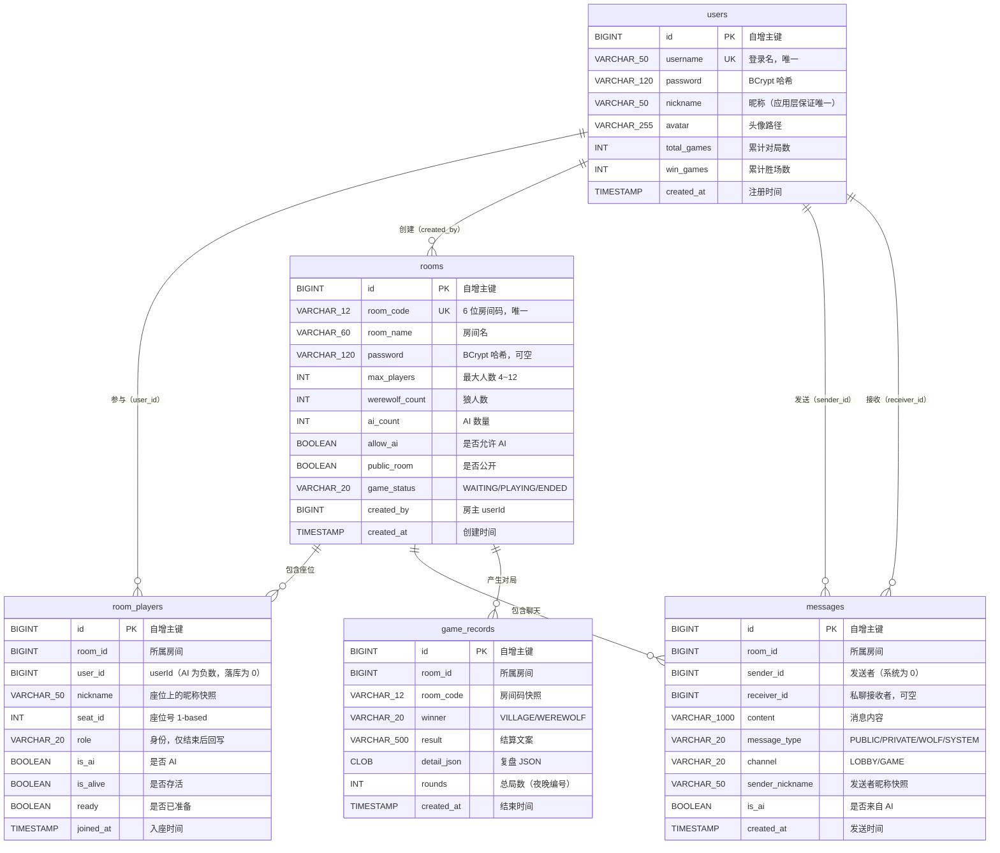

> 2026-10-29 版本提示：本文含早期狼人杀设计与操作示例。当前交付范围、规则和生产运行方式以 [当前状态](JIUJIU_CURRENT_STATUS.md)、[运行与部署](RELEASE_AND_OPERATIONS.md) 及对应阶段报告为准；旧的角色/人数/多数决、禁止 WebRTC 或删除卷升级等说法已被新需求覆盖。

# 数据库设计（DATABASE）

> 阶段 2 新增friendships规范化双用户关系唯一约束与media_assets图片元数据表。新库schema.sql已包含，旧库按V003增量升级，见database/migrations/README.md。

> 阶段 1 增量：users 新增 signature VARCHAR(240)、updated_at。现有库升级见 [迁移说明](../database/migrations/README.md)，H2 新旧库重复升级已测，MySQL 尚待实际演练。

> 本文档面向**成员 B、后端开发者与运维人员**，解决一个问题：**说清五张表每个字段的含义与约束、为什么对局中的状态不落库、以及日常运维该跑哪些 SQL**。

---

## 一、设计原则

| 原则 | 说明 |
| --- | --- |
| **对局状态在内存** | 进行中的身份、票型、查验记录、药水状态全部在 `GameState` 里（JVM 内存），**绝不落库** |
| **只落「跨会话/跨重启」需要的数据** | 账号、房间配置、聊天记录、对局结果 |
| **身份延后回写** | `room_players.role` 只在一局结束后（`phase == END`）才写入，对局中恒为 `NULL` |
| **无外键约束** | 所有表之间**没有** `FOREIGN KEY`，只有索引。理由：① 应用层已保证一致性；② 删房间时要清 `room_players`，有外键反而碍事；③ 换库/分库更容易 |
| **单表 CRUD，无手写 SQL** | 全部通过 MyBatis-Plus 的 `BaseMapper` 完成；`ChatService.history` 用了 `.last("LIMIT " + size)` 拼接（`size` 已被 `Math.min(Math.max(limit,1),200)` 夹紧，无注入风险） |
| **H2 与 MySQL 同一套结构** | `backend/src/main/resources/db/h2/schema.sql` 用 MySQL 兼容模式（`MODE=MySQL`），与生产脚本结构一致 |

---

## 二、ER 图



> **图例说明**：`||--o{` 表示一对多。**注意这些关系是逻辑关系，数据库层面没有外键**。

### 2.1 实体类对应关系

| 表 | 实体类 | Mapper |
| --- | --- | --- |
| `users` | `user/entity/User.java` | `user/mapper/UserMapper.java` |
| `rooms` | `room/entity/Room.java` | `room/mapper/RoomMapper.java` |
| `room_players` | `room/entity/RoomPlayer.java` | `room/mapper/RoomPlayerMapper.java` |
| `messages` | `websocket/entity/Message.java` | `websocket/mapper/MessageMapper.java` |
| `game_records` | `game/entity/GameRecord.java` | `game/mapper/GameRecordMapper.java` |

全部继承 MyBatis-Plus 的 `BaseMapper<T>`，**没有任何自定义 SQL**。

---

## 三、五张表的完整字段说明

以下 DDL 与 `backend/src/main/resources/db/h2/schema.sql` **完全一致**。

### 3.1 `users` — 用户表

```sql
CREATE TABLE IF NOT EXISTS users (
    id          BIGINT AUTO_INCREMENT PRIMARY KEY,
    username    VARCHAR(50)  NOT NULL,
    password    VARCHAR(120) NOT NULL,
    nickname    VARCHAR(50)  NOT NULL,
    avatar      VARCHAR(255),
    total_games INT DEFAULT 0,
    win_games   INT DEFAULT 0,
    created_at  TIMESTAMP DEFAULT CURRENT_TIMESTAMP,
    CONSTRAINT uk_users_username UNIQUE (username)
);
```

| 字段 | 类型 | 约束 | 默认值 | 说明 |
| --- | --- | --- | --- | --- |
| `id` | BIGINT | PK, AUTO_INCREMENT | — | 主键。**不接受外部输入**，由数据库生成 |
| `username` | VARCHAR(50) | NOT NULL, **UNIQUE** | — | 登录名。应用层 `RegisterRequest` 还限制为 3~20 字符、`^[A-Za-z0-9_]+$` |
| `password` | VARCHAR(120) | NOT NULL | — | **BCrypt 哈希**（`BCryptPasswordEncoder`，60 字符）。`VARCHAR(120)` 留了余量以支持未来换算法 |
| `nickname` | VARCHAR(50) | NOT NULL | — | 展示名。应用层限制 ≤ 16 字符，**唯一性由 `AuthService` 用 `selectCount` 保证**（表上没有唯一约束） |
| `avatar` | VARCHAR(255) | 可空 | `NULL` | 头像路径。注册时为空则填 `/assets/avatars/bot-01.svg` |
| `total_games` | INT | 可空 | `0` | 累计对局数。每局结束 +1（`RoomService.saveGameRecord`） |
| `win_games` | INT | 可空 | `0` | 累计胜场数。按阵营判断：`p.getRole().getCamp().name().equals(state.getWinner())` |
| `created_at` | TIMESTAMP | 可空 | `CURRENT_TIMESTAMP` | 注册时间。应用层显式传 `LocalDateTime.now()` |

**索引：**

| 索引 | 类型 | 字段 |
| --- | --- | --- |
| `PRIMARY` | 主键 | `id` |
| `uk_users_username` | 唯一 | `username` |

**为什么 `nickname` 没有唯一索引**：昵称的唯一性是**应用层业务规则**（可以在「修改资料」时改），而不是强约束。如果用唯一索引，删除/改名时容易因为冲突而报数据库异常，前端拿到的就是 `1004` 而不是可读的 `2001`。

---

### 3.2 `rooms` — 房间表

```sql
CREATE TABLE IF NOT EXISTS rooms (
    id             BIGINT AUTO_INCREMENT PRIMARY KEY,
    room_code      VARCHAR(12)  NOT NULL,
    room_name      VARCHAR(60)  NOT NULL,
    password       VARCHAR(120),
    max_players    INT NOT NULL DEFAULT 8,
    werewolf_count INT NOT NULL DEFAULT 2,
    ai_count       INT NOT NULL DEFAULT 0,
    allow_ai       BOOLEAN NOT NULL DEFAULT TRUE,
    public_room    BOOLEAN NOT NULL DEFAULT TRUE,
    game_status    VARCHAR(20) NOT NULL DEFAULT 'WAITING',
    created_by     BIGINT,
    created_at     TIMESTAMP DEFAULT CURRENT_TIMESTAMP,
    CONSTRAINT uk_rooms_code UNIQUE (room_code)
);
```

| 字段 | 类型 | 约束 | 默认值 | 说明 |
| --- | --- | --- | --- | --- |
| `id` | BIGINT | PK, AUTO_INCREMENT | — | 主键。内存态 `RoomRuntime` 通过它索引（`RoomManager.byId`） |
| `room_code` | VARCHAR(12) | NOT NULL, **UNIQUE** | — | **6 位**房间码，字符集 `ABCDEFGHJKLMNPQRSTUVWXYZ23456789`（去掉了易混的 `I`/`O`/`0`/`1`）。`VARCHAR(12)` 留了余量 |
| `room_name` | VARCHAR(60) | NOT NULL | — | 房间名。应用层限制 ≤ 30 字符 |
| `password` | VARCHAR(120) | 可空 | `NULL` | **BCrypt 哈希**；`NULL` 或空串表示无密码。`RoomView.hasPassword` 由此判断 |
| `max_players` | INT | NOT NULL | `8` | 最大人数。应用层限制 4~12 |
| `werewolf_count` | INT | NOT NULL | `2` | 狼人数。应用层限制 `1 ≤ w ≤ min(⌊(n-1)/2⌋, n-2)`（同时满足：少于总人数一半、为预言家与女巫各留 1 个座位） |
| `ai_count` | INT | NOT NULL | `0` | AI 数量。**默认 0**（本轮交付默认不含 AI） |
| `allow_ai` | BOOLEAN | NOT NULL | `FALSE` | 是否允许 AI 入座。**DDL 与应用层默认值已统一为 `FALSE`**（`CreateRoomRequest.allowAi` 默认 `Boolean.FALSE`，`RoomService.createRoom` 显式写入），因此"不改任何配置"时房间一定是纯真人房 |
| `public_room` | BOOLEAN | NOT NULL | `TRUE` | 是否出现在大厅列表。`RoomManager.publicWaitingRooms()` 用它筛选 |
| `game_status` | VARCHAR(20) | NOT NULL | `'WAITING'` | 房间生命周期状态，取值 `WAITING` / `PLAYING` / `ENDED`。**与 `GamePhase` 解耦**——房间可以等待多局游戏 |
| `created_by` | BIGINT | 可空 | `NULL` | 房主 userId。**解散房间、踢人、改配置、开局的权限判据** |
| `created_at` | TIMESTAMP | 可空 | `CURRENT_TIMESTAMP` | 创建时间。大厅列表按它**倒序**排序 |

**索引：**

| 索引 | 类型 | 字段 |
| --- | --- | --- |
| `PRIMARY` | 主键 | `id` |
| `uk_rooms_code` | 唯一 | `room_code` |

#### 3.2.1 ⚠️ `allow_ai` 默认值的不一致（需要注意，但不是 bug）

| 位置 | 默认值 |
| --- | --- |
| `db/h2/schema.sql` 的 DDL | `DEFAULT TRUE` |
| `room/entity/Room.java` 的 Java 字段 | `Boolean allowAi;`（无初始值 → `null`） |
| `room/dto/CreateRoomRequest.java` | `Boolean allowAi = Boolean.FALSE;` |
| `RoomService.createRoom` 实际写入 | `room.setAllowAi(request.getAllowAi() == null ? Boolean.TRUE : request.getAllowAi());` |
| `RoomService.addBots` 的判断 | `if (!Boolean.TRUE.equals(room.getAllowAi())) return;` |

**实际效果**：因为 `CreateRoomRequest.allowAi` 的默认值是 `Boolean.FALSE`，**请求体里不传 `allowAi` 时写入的就是 `FALSE`**，DDL 的 `DEFAULT TRUE` 永远不会被用到（MyBatis-Plus 总是显式提供该列的值）。所以：

- ✅ **默认行为 = 不允许 AI**，与 README 的说明一致；
- ⚠️ 但 `RoomService.createRoom` 里那个 `== null ? Boolean.TRUE : ...` 的兜底分支**永远不会命中**（因为 DTO 默认值保证了非 null），是一段死代码；
- ⚠️ 如果有人直接往数据库插一行不带 `allow_ai` 的记录，会得到 `TRUE`，与「默认不含 AI」的定位不符。

**建议**：把 DDL 里的 `DEFAULT TRUE` 改成 `DEFAULT FALSE`，并把 `RoomService.createRoom` 的兜底改成 `Boolean.FALSE`，让三层默认值一致。这是文档层面记录的不一致点，**未修改代码**。

---

### 3.3 `room_players` — 座位表

```sql
CREATE TABLE IF NOT EXISTS room_players (
    id       BIGINT AUTO_INCREMENT PRIMARY KEY,
    room_id  BIGINT NOT NULL,
    user_id  BIGINT NOT NULL,
    nickname VARCHAR(50),
    seat_id  INT NOT NULL,
    role     VARCHAR(20),
    is_ai    BOOLEAN NOT NULL DEFAULT FALSE,
    is_alive BOOLEAN NOT NULL DEFAULT TRUE,
    ready    BOOLEAN NOT NULL DEFAULT FALSE,
    joined_at TIMESTAMP DEFAULT CURRENT_TIMESTAMP
);
```

| 字段 | 类型 | 约束 | 默认值 | 说明 |
| --- | --- | --- | --- | --- |
| `id` | BIGINT | PK, AUTO_INCREMENT | — | 主键 |
| `room_id` | BIGINT | NOT NULL | — | 所属房间 `rooms.id`。**每次座位变化都会「先删后插」全量重建** |
| `user_id` | BIGINT | NOT NULL | — | 玩家 userId。⚠️ **AI 座位写入的是 `0`**：`rp.setUserId(p.getUserId() == null ? 0L : p.getUserId())`。内存里 AI 的 userId 是负数（`-seatId`），落库时负数会被直接写入（`0L` 只在 null 时生效）；见 3.3.1 |
| `nickname` | VARCHAR(50) | 可空 | `NULL` | 座位上的昵称**快照**（不跟随用户改名） |
| `seat_id` | INT | NOT NULL | — | **1-based** 座位号，与前端展示一致 |
| `role` | VARCHAR(20) | 可空 | `NULL` | 身份。**对局中恒为 `NULL`，只有 `phase == END` 时才回写**（`revealRoles` 判断） |
| `is_ai` | BOOLEAN | NOT NULL | `FALSE` | 是否 AI NPC |
| `is_alive` | BOOLEAN | NOT NULL | `TRUE` | 是否存活 |
| `ready` | BOOLEAN | NOT NULL | `FALSE` | 是否已准备。AI 创建时即 `ready=true` |
| `joined_at` | TIMESTAMP | 可空 | `CURRENT_TIMESTAMP` | 入座时间。**每次 `persistSeats` 都会刷新为当前时间**（不是真正的「首次入座时间」） |

**索引：**

| 索引 | 类型 | 字段 |
| --- | --- | --- |
| `PRIMARY` | 主键 | `id` |
| `idx_room_players_room` | 普通 | `room_id` |

**为什么索引只有 `room_id`**：所有查询都是「按房间查全部座位」（`ChatService` 不需要它，`RoomService.persistSeats` 的删除也是按 `room_id`）。没有「按用户查座位」的需求——那是内存里 `RoomManager.findByUserId()` 的活。

#### 3.3.1 ⚠️ AI 座位的 `user_id` 实际写入负数

`RoomRuntime.addBot` 里 AI 的 userId 是 `(long) -seatId`（例如座位 5 的 AI 是 `-5`）：

```java
public PlayerState addBot(int seatId, String nickname, String avatar) {
    PlayerState p = new PlayerState(seatId, (long) -seatId, nickname, avatar, true);
    // ...
}
```

而 `RoomService.persistSeats` 的写法是：

```java
rp.setUserId(p.getUserId() == null ? 0L : p.getUserId());
```

`p.getUserId()` 对 AI 来说是 `-5`（**不是 null**），所以 `0L` 那个分支不会命中，**落库的是负数 `-5`**。

| 影响 | 说明 |
| --- | --- |
| 不影响功能 | 因为 `room_players` 表上没有外键约束，负数不会违反约束 |
| 语义混乱 | 原本的设计意图（从注释「AI 玩家使用负数 id」和 `0L` 兜底看）是「AI 落库为 0」，实际落成了负数 |
| 运维注意 | 写运维 SQL 时如果需要过滤真人，用 `user_id > 0` 或 `is_ai = FALSE`，**不要用 `user_id != 0`** |
| `RoomPlayer` 实体注释 | 注释说「AI 玩家使用负数 id」，与实际行为一致 ✅；但 `persistSeats` 里的 `0L` 兜底是死代码 |

**建议**：把 `persistSeats` 改成 `rp.setUserId(p.isAi() ? 0L : p.getUserId())`，让语义与注释一致。**未修改代码**。

---

### 3.4 `messages` — 聊天记录表

```sql
CREATE TABLE IF NOT EXISTS messages (
    id              BIGINT AUTO_INCREMENT PRIMARY KEY,
    room_id         BIGINT NOT NULL,
    sender_id       BIGINT,
    receiver_id     BIGINT,
    content         VARCHAR(1000) NOT NULL,
    message_type    VARCHAR(20) NOT NULL DEFAULT 'PUBLIC',
    channel         VARCHAR(20) NOT NULL DEFAULT 'LOBBY',
    sender_nickname VARCHAR(50),
    is_ai           BOOLEAN NOT NULL DEFAULT FALSE,
    created_at      TIMESTAMP DEFAULT CURRENT_TIMESTAMP
);
```

| 字段 | 类型 | 约束 | 默认值 | 说明 |
| --- | --- | --- | --- | --- |
| `id` | BIGINT | PK, AUTO_INCREMENT | — | 主键。**也是排序键**（历史记录按 id 升序） |
| `room_id` | BIGINT | NOT NULL | — | 所属房间 `rooms.id`。⚠️ **不是房间码** |
| `sender_id` | BIGINT | 可空 | `NULL` | 发送者 userId。**系统消息固定为 `0`** |
| `receiver_id` | BIGINT | 可空 | `NULL` | 私聊接收者 userId；**非私聊时为 `NULL`** |
| `content` | VARCHAR(1000) | NOT NULL | — | 内容。应用层截断到 **500 字符**（`MAX_CONTENT_LENGTH = 500`），字段留了 2 倍余量 |
| `message_type` | VARCHAR(20) | NOT NULL | `'PUBLIC'` | `PUBLIC` / `PRIVATE` / `WOLF` / `SYSTEM`。**可见性过滤的依据** |
| `channel` | VARCHAR(20) | NOT NULL | `'LOBBY'` | `LOBBY`（房间阶段为 `WAITING` 时）/ `GAME`（对局中）。由 `state.getPhase() == GamePhase.WAITING` 决定 |
| `sender_nickname` | VARCHAR(50) | 可空 | `NULL` | 发送者昵称快照。系统消息为 `"系统"` |
| `is_ai` | BOOLEAN | NOT NULL | `FALSE` | 是否来自 AI NPC（前端加机器人标识） |
| `created_at` | TIMESTAMP | 可空 | `CURRENT_TIMESTAMP` | 发送时间（`LocalDateTime.now()`） |

**索引：**

| 索引 | 类型 | 字段 | 顺序 |
| --- | --- | --- | --- |
| `PRIMARY` | 主键 | `id` | — |
| `idx_messages_room` | 复合 | `(room_id, id)` | `room_id` 升序，`id` 升序 |

**为什么是 `(room_id, id)` 复合索引**：唯一的查询模式就是「按房间取最近 N 条」：

```java
messageMapper.selectList(Wrappers.<Message>lambdaQuery()
        .eq(Message::getRoomId, runtime.getRoom().getId())
        .orderByDesc(Message::getId)
        .last("LIMIT " + size));
```

这个复合索引可以让「定位房间 → 按 id 倒序取 N 条」**一次索引扫描完成**，不需要回表排序。

---

### 3.5 `game_records` — 对局记录表

```sql
CREATE TABLE IF NOT EXISTS game_records (
    id          BIGINT AUTO_INCREMENT PRIMARY KEY,
    room_id     BIGINT,
    room_code   VARCHAR(12),
    winner      VARCHAR(20),
    result      VARCHAR(500),
    detail_json CLOB,
    rounds      INT,
    created_at  TIMESTAMP DEFAULT CURRENT_TIMESTAMP
);
```

| 字段 | 类型 | 约束 | 默认值 | 说明 |
| --- | --- | --- | --- | --- |
| `id` | BIGINT | PK, AUTO_INCREMENT | — | 主键 |
| `room_id` | BIGINT | 可空 | `NULL` | 所属房间 id（房间被删了也不影响历史记录） |
| `room_code` | VARCHAR(12) | 可空 | `NULL` | 房间码**快照**（房间解散后仍能追溯） |
| `winner` | VARCHAR(20) | 可空 | `NULL` | `VILLAGE` / `WEREWOLF` |
| `result` | VARCHAR(500) | 可空 | `NULL` | 结算文案。**⚠️ 已知缺陷 D-10**：`RoomService.saveGameRecord` 里写的是 `"狼人阵营".equals(label(state.getWinner())) ? "狼人阵营胜利" : "好人阵营胜利"`，而 `label()` 只是原样返回 `"WEREWOLF"`/`"VILLAGE"`，**永远不等于中文串 `"狼人阵营"`**，因此该列**无论谁赢都会被写成「好人阵营胜利」**。请以 `winner` 列为准（`VILLAGE` / `WEREWOLF`）。详见 [docs/TEST_PLAN.md](TEST_PLAN.md) 缺陷清单 D-10 |
| `detail_json` | **CLOB** | 可空 | `NULL` | 复盘 JSON，含全部玩家身份与全部发言。结构见第五节 |
| `rounds` | INT | 可空 | `NULL` | 总局数（= 最后的夜晚编号 `state.getRound()`）。**1 轮就结束的局记为 1** |
| `created_at` | TIMESTAMP | 可空 | `CURRENT_TIMESTAMP` | 结束时间 |

**索引：**

| 索引 | 类型 | 字段 |
| --- | --- | --- |
| `PRIMARY` | 主键 | `id` |
| `idx_game_records_room` | 普通 | `room_id` |

> **`CLOB` 与 MySQL 的兼容性**：`CLOB` 是 H2 的类型。在 MySQL 8 里对应的类型是 `LONGTEXT`（或 `TEXT`）。**`database/schema.sql`（成员 B 负责）里应写成 `LONGTEXT`**，其余字段类型两者通用。见第七节。

---

## 四、索引设计汇总与理由

| 索引名 | 表 | 字段 | 唯一 | 支撑的查询 | 为什么需要 |
| --- | --- | --- | --- | --- | --- |
| `PRIMARY` | 全部 | `id` | ✅ | 按主键查 | 主键自带 |
| `uk_users_username` | `users` | `username` | ✅ | 登录、注册查重 | **登录是最热的查询**（每次登录一次）；同时**防止并发注册出重复用户名** |
| `uk_rooms_code` | `rooms` | `room_code` | ✅ | 按房间码加入 | **加入房间是最热的查询**；同时防止房间码碰撞（`RoomService.createRoom` 捕获 `DuplicateKeyException` 后重试一次） |
| `idx_room_players_room` | `room_players` | `room_id` | ❌ | `persistSeats` 的按房间删除、按房间查询 | 每次座位变化都会 `DELETE ... WHERE room_id = ?`，没有索引会全表扫 |
| `idx_messages_room` | `messages` | `(room_id, id)` | ❌ | 聊天历史：按房间 + id 倒序 + LIMIT | **复合索引避免排序**：`ORDER BY id DESC LIMIT 100` 可以直接走索引倒序扫描 |
| `idx_game_records_room` | `game_records` | `room_id` | ❌ | 「这个房间的历史对局」 | 复盘与统计查询 |

### 4.1 刻意**没有**建的索引

| 候选索引 | 为什么不建 |
| --- | --- |
| `users(nickname)` 唯一 | 昵称唯一性是**可变的业务规则**（改资料时要判重），用唯一索引会导致数据库异常而不是可读的业务错误码 `2001` |
| `room_players(user_id)` | 「查用户在哪个房间」走的是**内存** `RoomManager.findByUserId()`，不查库 |
| `rooms(game_status)` | 大厅列表也是**内存**查询（`RoomManager.publicWaitingRooms()`）。`rooms.game_status` 只用于持久化与排查 |
| `rooms(public_room)` | 同上 |
| `messages(sender_id)` / `messages(receiver_id)` | 没有「查某人发的所有消息」的需求；可见性过滤是在**内存里**对已取出的 N 条做的 |
| `game_records(winner)` | 没有全局统计需求；用户战绩存在 `users.total_games` / `win_games` 上 |

> **一条重要的设计选择**：**大厅列表与房间查找都走内存，不走数据库。** 数据库里的 `rooms` 行只是「配置的持久化副本」，实时状态在 `RoomManager` 的 `ConcurrentHashMap` 里。这避免了每秒都在查数据库。

---

## 五、为什么对局中的状态不落库

### 5.1 内存态 vs 持久态的边界

| 数据 | 位置 | 生命周期 | 为什么 |
| --- | --- | --- | --- |
| **真实身份** `PlayerState.role` | **内存** | 一局 | ⚠️ **最关键的一条**：对局中落库意味着任何能读数据库的人（包括做演示时打开的 H2 控制台、DBA、备份文件）都能看到全部身份 |
| 狼刀目标 `wolfTargetSeatId` | **内存** | 一晚 | 每夜重置，落库毫无意义 |
| 狼人内部票型 `wolfVotes` | **内存** | 一晚 | 同上 |
| 预言家查验记录 `checkRecords` | **内存** | 一局 | 仅本人可见的私有信息 |
| 女巫药水 `healPotionAvailable` / `poisonPotionAvailable` | **内存** | 一局（`assign()` 时重置） | 高频读写 |
| 当前阶段 / 倒计时 / 轮次 | **内存** | 瞬时 | 每秒都在变 |
| 发言记录 `speeches` | **内存** → 结束时随 `detail_json` 落库 | 一局 | 需要在结束后可复盘 |
| 事件流 `events` | **内存** | 一局 | 前端实时消费，不需要持久化 |
| 房间座位 / 谁在线 / 谁准备 | **内存**（`RoomRuntime`） | 房间存活期 | 每秒可能变化 |
| 账号 `users` | **落库** | 永久 | 跨会话、跨重启 |
| 房间配置 `rooms` | **落库** | 房间存活期 + 历史 | 需要能按房间码找回 |
| 座位快照 `room_players` | **落库**（全量重建） | 房间存活期 | 服务重启后能恢复房间 |
| 聊天记录 `messages` | **落库** | 永久 | 需要历史记录，且要按频道做可见性过滤 |
| 对局结果 `game_records` | **落库**（结束时一次性写入） | 永久 | 复盘与战绩 |

### 5.2 四条理由

| # | 理由 | 展开 |
| --- | --- | --- |
| 1 | **性能** | 夜晚阶段可能每秒有多次行动与广播。写库会引入毫秒级延迟，而内存操作是纳秒级。4~12 人的房间，一个阶段（30~45 秒）内可能产生几十次状态变化 |
| 2 | **一致性** | 内存态是**唯一真相**。如果内存和数据库都有身份信息，就必须处理「写库成功但广播失败」「两个玩家同时改同一状态」这类问题。现在是「单线程 tick + 乐观校验」，没有双写问题 |
| 3 | **安全** | 见 5.1 的第一行。这是**隐私裁剪链路**（见 [ARCHITECTURE.md](ARCHITECTURE.md) 第七节）能够成立的前提——如果身份落库了，`GameViewProjector` 再怎么裁剪也没用 |
| 4 | **规模匹配** | 单机单进程，没有多实例共享状态的需求。若将来要多实例，正确做法是把 `RoomManager` 换成 Redis 实现（`GameBroadcaster` 接口已经抽好了），而**不是**把对局状态落 MySQL |

### 5.3 落库时机完整表

| 时机 | 触发链 | 写入内容 |
| --- | --- | --- |
| 注册 | `AuthService.register` → `userMapper.insert` | `users` 1 行 |
| 创建房间 | `RoomController.create` → `RoomService.createRoom` → `roomMapper.insert` + `persistSeats` + `addBots` | `rooms` 1 行；`room_players` N 行 |
| 加入房间 | `RoomService.joinRoom` → `persistSeats` | `room_players` 全量重建 |
| 准备 / 取消准备 | `RoomService.setReady` → `persistSeats` | `room_players` 全量重建 |
| 修改房间配置 | `RoomService.updateRoom` → `roomMapper.updateById` + `persistSeats` | `rooms` 更新；`room_players` 全量重建 |
| 踢人 | `RoomService.kick` → `persistSeats` | `room_players` 全量重建 |
| 离开房间 | `RoomService.leaveRoom` → `persistSeats`（房主则 `dissolve`） | 同上 |
| 解散房间 | `RoomService.dissolve` → `roomMapper.updateById`（`game_status = ENDED`）+ `roomPlayerMapper.delete` | `rooms` 更新；`room_players` 清空 |
| 开局 | `RoomService.startGame` → `persistSeats` | `room_players` 全量重建（**`role` 仍为 `NULL`**） |
| 发聊天 | `ChatService.send` → `messageMapper.insert` | `messages` 1 行 |
| **对局结束** | `RoomRuntime.onGameEnd` → `GameEndHandler.onGameEnd` → `RoomService.onGameEnd` | ① `persistSeats`（**此时 `phase == END`，`role` 被回写**）② `game_records` 1 行 ③ 每个真人的 `users.total_games` / `win_games` 更新 |

**`persistSeats` 的实现（先删后插全量重建）：**

```java
private void persistSeats(RoomRuntime runtime) {
    Room room = runtime.getRoom();
    roomPlayerMapper.delete(Wrappers.<RoomPlayer>lambdaQuery()
            .eq(RoomPlayer::getRoomId, room.getId()));
    boolean revealRoles = runtime.getState().getPhase() == GamePhase.END;   // ★ 身份回写的唯一开关
    for (PlayerState p : runtime.getState().getPlayers()) {
        RoomPlayer rp = new RoomPlayer();
        rp.setRoomId(room.getId());
        rp.setUserId(p.getUserId() == null ? 0L : p.getUserId());
        rp.setNickname(p.getNickname());
        rp.setSeatId(p.getSeatId());
        rp.setIsAi(p.isAi());
        rp.setIsAlive(p.isAlive());
        rp.setReady(p.isReady());
        rp.setRole(revealRoles && p.getRole() != null ? p.getRole().name() : null);
        rp.setJoinedAt(LocalDateTime.now());
        roomPlayerMapper.insert(rp);
    }
}
```

> **「先删后插」的取舍**：座位数最多 12，全量重建的代价可忽略，胜在逻辑简单、不会出现脏数据（不需要 diff、不需要处理座位号重排）。代价是 `id` 每次都变，且 `joined_at` 语义不准确（见 3.3 表）。

---

## 六、`game_records.detail_json` 的结构

由 `RoomService.saveGameRecord` 构造：

```java
Map<String, Object> detail = new LinkedHashMap<>();
List<Map<String, Object>> players = new ArrayList<>();
for (PlayerState p : state.getPlayers()) {
    Map<String, Object> m = new LinkedHashMap<>();
    m.put("seatId",   p.getSeatId());
    m.put("nickname", p.getNickname());
    m.put("role",     p.getRole() == null ? null : p.getRole().name());
    m.put("alive",    p.isAlive());
    m.put("ai",       p.isAi());
    players.add(m);
}
detail.put("players", players);
detail.put("speeches", state.getSpeeches());      // JSON 序列化时展开为数组
record.setDetailJson(objectMapper.writeValueAsString(detail));
```

### 6.1 完整结构示例（4 真人局）

```json
{
  "players": [
    { "seatId": 1, "nickname": "演示玩家", "role": "WEREWOLF", "alive": false, "ai": false },
    { "seatId": 2, "nickname": "1号玩家",  "role": "SEER",     "alive": true,  "ai": false },
    { "seatId": 3, "nickname": "2号玩家",  "role": "VILLAGER", "alive": false, "ai": false },
    { "seatId": 4, "nickname": "3号玩家",  "role": "VILLAGER", "alive": true,  "ai": false }
  ],
  "speeches": [
    {
      "round": 1,
      "seatId": 4,
      "nickname": "3号玩家",
      "content": "我是 4 号。3 号昨晚倒了，场上还有 3 个人，我怀疑 1 号。",
      "ai": false,
      "phase": "DISCUSSION"
    },
    {
      "round": 1,
      "seatId": 1,
      "nickname": "演示玩家",
      "content": "我是 1 号，我是好人。4 号一上来就怀疑我，我觉得他更像狼。",
      "ai": false,
      "phase": "DISCUSSION"
    },
    {
      "round": 1,
      "seatId": 2,
      "nickname": "1号玩家",
      "content": "我是预言家，昨晚验了 1 号，1 号是狼。请大家投票放逐 1 号。",
      "ai": false,
      "phase": "DISCUSSION"
    }
  ]
}
```

### 6.2 字段说明

| 路径 | 类型 | 来源 | 说明 |
| --- | --- | --- | --- |
| `players` | array | `state.getPlayers()` | 全部座位（含已出局） |
| `players[].seatId` | number | `PlayerState.getSeatId()` | 座位号 |
| `players[].nickname` | string | `PlayerState.getNickname()` | 昵称快照 |
| `players[].role` | string \| null | `PlayerState.getRole().name()` | **结束后全部公开**；若为 null（异常情况）则序列化为 `null` |
| `players[].alive` | boolean | `PlayerState.isAlive()` | 结束时的存活状态 |
| `players[].ai` | boolean | `PlayerState.isAi()` | 是否 AI（本轮交付默认全为 `false`） |
| `speeches` | array | `state.getSpeeches()` | **全部发言**（不截断），按发言时间顺序 |
| `speeches[].round` | number | `SpeechRecord.round()` | 第几轮 |
| `speeches[].seatId` | number | `SpeechRecord.seatId()` | 发言人座位号 |
| `speeches[].nickname` | string | `SpeechRecord.nickname()` | 发言人昵称 |
| `speeches[].content` | string | `SpeechRecord.content()` | 发言内容（引擎侧截断到 500 字符） |
| `speeches[].ai` | boolean | `SpeechRecord.ai()` | 是否 AI 发言 |
| `speeches[].phase` | string | `SpeechRecord.phase()` | 发言时的阶段（正常都是 `DISCUSSION`） |

> **注意**：`SpeechRecord` 是 Java 的 `record`，Jackson 序列化时**使用组件名作为键**（`round` / `seatId` / `nickname` / `content` / `ai` / `phase`），与上表一致。
>
> **`detail_json` 里没有的东西**：狼刀目标、狼人内部票型、每轮投票明细、女巫用药记录、预言家查验记录。这些**从未进入任何持久化结构**——复盘页只能看到「谁说了什么、谁是什么身份、谁活到最后」。

### 6.3 查询示例

**H2（开发）：**

```sql
SELECT id, room_code, winner, rounds, created_at,
       LEFT(detail_json, 200) AS preview
FROM game_records
ORDER BY id DESC
LIMIT 10;
```

**MySQL 8（生产）：**

```sql
SELECT id, room_code, winner, rounds, created_at,
       LEFT(detail_json, 200) AS preview
FROM game_records
ORDER BY id DESC
LIMIT 10;
```

**用 JSON 函数直接查（MySQL 8 支持）：**

```sql
-- 找出所有"狼人获胜且预言家活到最后"的对局
SELECT id, room_code, winner, rounds
FROM game_records
WHERE winner = 'WEREWOLF'
  AND JSON_SEARCH(detail_json, 'one', 'SEER', NULL, '$.players[*].role') IS NOT NULL;
```

---

## 七、常用运维 SQL

### 7.1 查询活跃房间（内存在跑的房间，需要看内存；数据库只能看持久化的）

> ⚠️ **重要认知**：真正「活跃的房间」在内存里（`RoomManager`）。数据库里的 `rooms` 行只反映**最近一次落库的状态**。要看内存态请用 HTTP 接口。

**用接口查（推荐）：**

```bash
curl -s http://localhost:8080/api/health
# data.activeRooms 就是内存里的房间数

curl -s http://localhost:8080/api/rooms/public -H "Authorization: Bearer $TOKEN"
# 公开等待中的房间列表
```

**用数据库查（近似）：**

```sql
-- 数据库里标记为「游戏中或等待中」的房间（可能包含已被回收但未落库的）
SELECT r.id, r.room_code, r.room_name, r.game_status, r.max_players,
       r.werewolf_count, r.ai_count, r.created_at,
       (SELECT COUNT(*) FROM room_players rp WHERE rp.room_id = r.id) AS seats
FROM rooms r
WHERE r.game_status IN ('WAITING', 'PLAYING')
ORDER BY r.created_at DESC;
```

**查「已解散但记录还在」的房间：**

```sql
SELECT id, room_code, room_name, game_status, created_at
FROM rooms
WHERE game_status = 'ENDED'
ORDER BY created_at DESC
LIMIT 20;
```

### 7.2 最近 10 局

```sql
SELECT id, room_code, winner, result, rounds, created_at
FROM game_records
ORDER BY id DESC
LIMIT 10;
```

**加上阵营中文名：**

```sql
SELECT id,
       room_code,
       CASE winner WHEN 'WEREWOLF' THEN '狼人阵营' WHEN 'VILLAGE' THEN '好人阵营' ELSE winner END AS winner_cn,
       rounds,
       created_at
FROM game_records
ORDER BY id DESC
LIMIT 10;
```

### 7.3 某用户胜率

> ⚠️ **注意**：`game_records` 里**没有** `user_id` 关联（`detail_json` 里只有 `seatId` 和 `nickname`）。所以「某用户的胜率」有两种查法：

**查法 1：直接读预计算的战绩字段（推荐，最简单）**

```sql
SELECT id, username, nickname,
       total_games,
       win_games,
       CASE WHEN total_games = 0 THEN 0
            ELSE ROUND(win_games * 100.0 / total_games, 1)
       END AS win_rate_pct
FROM users
WHERE username = 'demo';
```

这两个字段由 `RoomService.saveGameRecord` 在每局结束时累加：

```java
user.setTotalGames((user.getTotalGames() == null ? 0 : user.getTotalGames()) + 1);
boolean win = p.getRole() != null && p.getRole().getCamp().name().equals(state.getWinner());
if (win) user.setWinGames((user.getWinGames() == null ? 0 : user.getWinGames()) + 1);
```

**查法 2：从 `room_players` 反推（能查到具体哪些局）**

```sql
-- 某用户参与过的对局（需要 join rooms + game_records）
SELECT u.username,
       g.id          AS game_id,
       g.room_code,
       g.winner,
       rp.role,
       rp.is_alive,
       CASE WHEN rp.role IS NULL THEN '未知'
            WHEN g.winner = 'WEREWOLF' AND rp.role = 'WEREWOLF' THEN '胜'
            WHEN g.winner = 'VILLAGE'  AND rp.role <> 'WEREWOLF' THEN '胜'
            ELSE '负'
       END AS my_result,
       g.created_at
FROM users u
JOIN room_players rp ON rp.user_id = u.id AND rp.is_ai = FALSE
JOIN rooms r         ON r.id = rp.room_id
JOIN game_records g  ON g.room_id = r.id
WHERE u.username = 'demo'
ORDER BY g.id DESC;
```

> **这个查法的局限**：`room_players` 是「先删后插」，**只保留最新一次快照**，而且对局结束后的 `persistSeats` 会写入结束时的状态——但如果之后房间又开了新一局，旧快照就被覆盖了。所以**只有「最近一局」是可靠的**。真要长期统计，应该由 `users` 的计数字段承担，或在 `game_records` 里补一个 `user_ids` 字段。

**排行榜（按胜率，至少有 5 局）：**

```sql
SELECT username, nickname, total_games, win_games,
       ROUND(win_games * 100.0 / total_games, 1) AS win_rate_pct
FROM users
WHERE total_games >= 5
ORDER BY win_rate_pct DESC, total_games DESC
LIMIT 20;
```

### 7.4 清理与维护

**清空某个房间的聊天记录（保留房间）：**

```sql
DELETE FROM messages WHERE room_id = (SELECT id FROM rooms WHERE room_code = 'K7M2QP');
```

**删除 7 天前的已结束房间及其座位数据：**

```sql
-- MySQL 8：先删座位，再删房间
DELETE rp FROM room_players rp
JOIN rooms r ON r.id = rp.room_id
WHERE r.game_status = 'ENDED' AND r.created_at < NOW() - INTERVAL 7 DAY;

DELETE FROM rooms
WHERE game_status = 'ENDED' AND created_at < NOW() - INTERVAL 7 DAY;
```

**H2 版本：**

```sql
DELETE FROM room_players
WHERE room_id IN (SELECT id FROM rooms
                  WHERE game_status = 'ENDED'
                    AND created_at < DATEADD('DAY', -7, CURRENT_TIMESTAMP));

DELETE FROM rooms
WHERE game_status = 'ENDED'
  AND created_at < DATEADD('DAY', -7, CURRENT_TIMESTAMP);
```

**统计各表行数：**

```sql
SELECT 'users'         AS table_name, COUNT(*) AS rows FROM users
UNION ALL SELECT 'rooms',         COUNT(*) FROM rooms
UNION ALL SELECT 'room_players',  COUNT(*) FROM room_players
UNION ALL SELECT 'messages',      COUNT(*) FROM messages
UNION ALL SELECT 'game_records',  COUNT(*) FROM game_records;
```

**检查是否有「一直卡在 PLAYING」的僵尸房间**（应用崩溃导致没落库）：

```sql
-- 找出 game_status = PLAYING 但最近 1 小时没有任何新消息的房间
SELECT r.id, r.room_code, r.created_at
FROM rooms r
LEFT JOIN messages m ON m.room_id = r.id
WHERE r.game_status = 'PLAYING'
GROUP BY r.id, r.room_code, r.created_at
HAVING MAX(m.created_at) IS NULL
    OR MAX(m.created_at) < NOW() - INTERVAL 1 HOUR;
```

### 7.5 排查类 SQL

**查某个用户的房间历史：**

```sql
SELECT r.room_code, r.room_name, r.game_status, rp.seat_id, rp.role, rp.is_alive, rp.ready
FROM room_players rp
JOIN rooms r ON r.id = rp.room_id
WHERE rp.user_id = (SELECT id FROM users WHERE username = 'demo');
```

**查某房间的全部聊天（按频道分类）：**

```sql
SELECT message_type, channel, sender_nickname, content, created_at
FROM messages
WHERE room_id = (SELECT id FROM rooms WHERE room_code = 'K7M2QP')
ORDER BY id;
```

**各阵营胜率：**

```sql
SELECT winner,
       COUNT(*) AS games,
       ROUND(COUNT(*) * 100.0 / (SELECT COUNT(*) FROM game_records), 1) AS pct
FROM game_records
GROUP BY winner;
```

**平均一局多少轮：**

```sql
SELECT ROUND(AVG(rounds), 2) AS avg_rounds,
       MIN(rounds) AS min_rounds,
       MAX(rounds) AS max_rounds,
       COUNT(*) AS total_games
FROM game_records;
```

---

## 八、H2 演示模式与 MySQL 生产模式的差异

### 8.1 配置对照

| 项 | H2 演示（`h2` profile） | MySQL 生产（`mysql` profile） |
| --- | --- | --- |
| 配置文件 | `application-h2.yml` | `application-mysql.yml` |
| 激活方式 | 默认（`spring.profiles.active` 默认 `h2`） | `SPRING_PROFILES_ACTIVE=mysql` |
| JDBC URL | `jdbc:h2:mem:werewolf;MODE=MySQL;DB_CLOSE_DELAY=-1;DATABASE_TO_LOWER=TRUE` | `jdbc:mysql://${MYSQL_HOST}:${MYSQL_PORT}/${MYSQL_DATABASE}?useUnicode=true&characterEncoding=utf8&serverTimezone=Asia/Shanghai&useSSL=false&allowPublicKeyRetrieval=true` |
| 驱动 | `org.h2.Driver` | `com.mysql.cj.jdbc.Driver` |
| 账号 | `sa` / 空密码 | `${MYSQL_USER:werewolf}` / `${MYSQL_PASSWORD:werewolf123}` |
| 连接池 | 默认（HikariCP，未配置） | `maximum-pool-size: 20`、`minimum-idle: 5`、`connection-timeout: 10000` |
| 建表 | **应用自动执行**（`spring.sql.init.mode: always` + `schema-locations: classpath:db/h2/schema.sql`） | **应用不建表**（`mode: never`），由 `database/schema.sql` 手工初始化 |
| 数据 | **内存，重启即清空** | 持久化 |
| SQL 日志 | 默认（`NoLoggingImpl`） | `StdOutImpl`（打印到控制台，便于排查） |
| 演示账号 | **自动创建** 5 个（`DemoDataInitializer`，`@Profile("h2")`） | **不创建**，需自行注册 |
| `data-locations` | 已移除（`db/h2/data.sql` 已删除） | — |

### 8.2 关键差异详解

#### ① H2 的 `MODE=MySQL` 是什么

```java
url: jdbc:h2:mem:werewolf;MODE=MySQL;DB_CLOSE_DELAY=-1;DATABASE_TO_LOWER=TRUE
```

| 参数 | 作用 |
| --- | --- |
| `MODE=MySQL` | 让 H2 使用 MySQL 的语法与类型兼容模式。**这样同一份 DDL 语义在两边一致** |
| `DB_CLOSE_DELAY=-1` | 最后一个连接关闭时**不销毁**数据库（保持在内存里）。没有这个参数，HikariCP 空闲时可能关掉连接，导致内存库被清空 |
| `DATABASE_TO_LOWER=TRUE` | 标识符统一小写，避免 H2 默认的「大写表名」导致 `SELECT * FROM users` 失败 |

**由于是内存库，`schema-locations` 里的 `CREATE TABLE IF NOT EXISTS` 每次启动都会跑一遍**——`IF NOT EXISTS` 保证了幂等（虽然每次都是干净的库）。

#### ② `data.sql` 为什么被删除

`backend/src/main/resources/db/h2/data.sql` **曾经存在**（用于插入演示账号），现在**已删除**，`application-h2.yml` 也不再配置 `data-locations`。

**原因**（`DemoDataInitializer` 的类注释原文）：

> 为什么用代码而不是 data.sql：BCrypt 哈希必须由 `PasswordEncoder` 现场生成，写死在 SQL 里既不可读也容易与编码器版本不一致。

`BCryptPasswordEncoder` 每次生成的哈希都不同（内含随机 salt），所以**没法预先算好写进 SQL**。用 `ApplicationRunner` 在启动时用真实编码器生成才是正确做法。

**`DemoDataInitializer` 的逻辑：**

```java
@Component
@Profile("h2")                    // ★ 只在 h2 profile 生效
public class DemoDataInitializer implements ApplicationRunner {

    private static final List<String[]> DEMO_USERS = List.of(
            new String[]{"demo",    "demo1234", "演示玩家"},
            new String[]{"player1", "demo1234", "1号玩家"},
            new String[]{"player2", "demo1234", "2号玩家"},
            new String[]{"player3", "demo1234", "3号玩家"},
            new String[]{"player4", "demo1234", "4号玩家"});

    @Override
    public void run(ApplicationArguments args) {
        for (String[] row : DEMO_USERS) {
            // 已存在则跳过（幂等）
            Long exists = userMapper.selectCount(...eq(User::getUsername, row[0]));
            if (exists != null && exists > 0) continue;
            // 用真实的 PasswordEncoder 生成 BCrypt 哈希
            user.setPassword(passwordEncoder.encode(row[1]));
            user.setAvatar("/assets/avatars/bot-%02d.svg".formatted(index));
            userMapper.insert(user);
        }
    }
}
```

#### ③ 类型差异表

| H2 类型 | MySQL 8 类型 | 用在哪个字段 | 说明 |
| --- | --- | --- | --- |
| `BIGINT AUTO_INCREMENT` | `BIGINT AUTO_INCREMENT` | 全部主键 | ✅ 通用 |
| `VARCHAR(n)` | `VARCHAR(n)` | 全部字符串 | ✅ 通用 |
| `INT` | `INT` | 计数与座位号 | ✅ 通用 |
| `BOOLEAN` | `BOOLEAN`（`TINYINT(1)` 的别名） | `is_ai` / `is_alive` / `ready` / `allow_ai` / `public_room` | ✅ 通用。MyBatis-Plus 会把 Java 的 `Boolean` 映射成 `tinyint(1)` |
| `TIMESTAMP DEFAULT CURRENT_TIMESTAMP` | `TIMESTAMP DEFAULT CURRENT_TIMESTAMP` | 全部时间字段 | ⚠️ **MySQL 的 `TIMESTAMP` 有 2038 年上限**，且默认会做时区转换。应用层用的是 `LocalDateTime`，配置了 `serverTimezone=Asia/Shanghai` |
| **`CLOB`** | **`LONGTEXT`** | `game_records.detail_json` | ❌ **不通用**，`database/schema.sql` 里必须写成 `LONGTEXT` |

#### ④ `CREATE INDEX IF NOT EXISTS` 的差异

`schema.sql` 里用的是：

```sql
CREATE INDEX IF NOT EXISTS idx_messages_room ON messages (room_id, id);
```

| 数据库 | 支持 `CREATE INDEX IF NOT EXISTS` |
| --- | --- |
| H2 | ✅ 支持 |
| **MySQL 8** | ❌ **不支持**（MySQL 直到 8.0 都没有 `CREATE INDEX IF NOT EXISTS`） |

**`database/schema.sql`（成员 B 负责）的处理方式**，二选一：

**方式 A：把索引写进 `CREATE TABLE`**

```sql
CREATE TABLE IF NOT EXISTS messages (
    ...
    INDEX idx_messages_room (room_id, id)
) ENGINE=InnoDB DEFAULT CHARSET=utf8mb4 COLLATE=utf8mb4_unicode_ci;
```

**方式 B：用建表脚本的幂等包裹（推荐用于「可重复执行」的脚本）**

```sql
DROP PROCEDURE IF EXISTS add_index_if_missing;
DELIMITER //
CREATE PROCEDURE add_index_if_missing()
BEGIN
    IF NOT EXISTS (SELECT 1 FROM information_schema.statistics
                   WHERE table_schema = DATABASE() AND table_name = 'messages'
                     AND index_name = 'idx_messages_room') THEN
        CREATE INDEX idx_messages_room ON messages (room_id, id);
    END IF;
    -- ... 其它索引 ...
END //
DELIMITER ;
CALL add_index_if_missing();
DROP PROCEDURE add_index_if_missing;
```

#### ⑤ 字符集与排序规则（MySQL 必须显式指定）

H2 的 `MODE=MySQL` 默认用 Unicode，**MySQL 必须显式指定 `utf8mb4`**，否则中文会乱码（`utf8` 在 MySQL 里是 3 字节的残缺实现，存不了 emoji 和部分生僻字）：

```sql
CREATE TABLE IF NOT EXISTS users (
    ...
) ENGINE=InnoDB DEFAULT CHARSET=utf8mb4 COLLATE=utf8mb4_unicode_ci;
```

#### ⑥ 演示账号的差异处理

| 场景 | 做法 |
| --- | --- |
| H2 演示 | 自动创建（`DemoDataInitializer`），直接用 `demo/demo1234` 登录 |
| MySQL | 手动注册 4 个账号，见 [README 第六节](../README.md) 的 bash / PowerShell 脚本 |

### 8.3 从 H2 切到 MySQL 的检查清单

| # | 检查项 | 命令 / 操作 |
| --- | --- | --- |
| 1 | 建库建表 | `mysql -u root -p < database/schema.sql` |
| 2 | 确认字符集 | `SHOW CREATE TABLE users\G` → 应看到 `CHARSET=utf8mb4` |
| 3 | 确认 `detail_json` 类型 | `SHOW CREATE TABLE game_records\G` → 应为 `longtext` |
| 4 | 确认索引建好 | `SHOW INDEX FROM messages;` → 应有 `idx_messages_room` |
| 5 | 创建应用账号并授权 | `CREATE USER 'werewolf'@'%' ...; GRANT ALL ON werewolf.* ...` |
| 6 | 设 `SPRING_PROFILES_ACTIVE=mysql` 启动 | 启动日志里**不应**出现 `schema.sql` 的执行 |
| 7 | 注册 4 个账号 | 用 README 里的脚本 |
| 8 | 检查应用不自动建表 | `application-mysql.yml` 里 `spring.sql.init.mode: never` |
| 9 | 跑一局验证全链路 | 4 个浏览器窗口完整对局后，查 `game_records` 与 `users` |
| 10 | 检查 HikariCP 连接池 | 看启动日志或 `SHOW PROCESSLIST;`，连接数应在 5~20 之间 |

---

## 九、`database/schema.sql` 的规格（成员 B 交付）

> 当前仓库**尚无** `database/schema.sql`。以下是它应包含的内容规格，与 `backend/src/main/resources/db/h2/schema.sql` **结构完全对齐**，仅做 MySQL 8 适配。

**必须包含：**

| # | 内容 | 说明 |
| --- | --- | --- |
| 1 | `CREATE DATABASE IF NOT EXISTS werewolf DEFAULT CHARSET utf8mb4 COLLATE utf8mb4_unicode_ci;` + `USE werewolf;` | 建库 |
| 2 | `users` 表 | 与 H2 版字段一致，`ENGINE=InnoDB DEFAULT CHARSET=utf8mb4` |
| 3 | `rooms` 表 | 同上。**建议把 `allow_ai` 的 `DEFAULT TRUE` 改为 `DEFAULT FALSE`**（与代码默认值一致，见 3.2.1） |
| 4 | `room_players` 表 | 同上 |
| 5 | `messages` 表 | 同上 |
| 6 | `game_records` 表 | 同上，**`detail_json` 用 `LONGTEXT`** |
| 7 | 三个索引 | `idx_messages_room(room_id, id)`、`idx_room_players_room(room_id)`、`idx_game_records_room(room_id)` |
| 8 | 两个唯一键 | `uk_users_username(username)`、`uk_rooms_code(room_code)` |
| 9 | 可选：注释 | 用 `COMMENT '...'` 给表和关键字段加中文注释，便于 DBA 理解 |
| 10 | 可选：初始管理员/演示账号 | **不要用 SQL 插入**（BCrypt 哈希问题），改为文档说明「注册即可」 |

**参考模板（MySQL 8）：**

```sql
-- =====================================================================
-- 基于 AI 增强的多人在线狼人杀系统 —— MySQL 8 建库建表脚本
-- 与 backend/src/main/resources/db/h2/schema.sql 结构对齐
-- 执行：mysql -u root -p < database/schema.sql
-- =====================================================================

CREATE DATABASE IF NOT EXISTS werewolf
    DEFAULT CHARACTER SET utf8mb4
    DEFAULT COLLATE utf8mb4_unicode_ci;
USE werewolf;

-- ---------------------------------------------------------------------
-- 1. 用户表
-- ---------------------------------------------------------------------
CREATE TABLE IF NOT EXISTS users (
    id          BIGINT       NOT NULL AUTO_INCREMENT COMMENT '主键',
    username    VARCHAR(50)  NOT NULL COMMENT '登录名，3~20 位字母数字下划线',
    password    VARCHAR(120) NOT NULL COMMENT 'BCrypt 哈希，绝不返回前端',
    nickname    VARCHAR(50)  NOT NULL COMMENT '昵称，最长 16 字符',
    avatar      VARCHAR(255)          DEFAULT NULL COMMENT '头像路径',
    total_games INT                   DEFAULT 0 COMMENT '累计对局数',
    win_games   INT                   DEFAULT 0 COMMENT '累计胜场数',
    created_at  TIMESTAMP             DEFAULT CURRENT_TIMESTAMP COMMENT '注册时间',
    PRIMARY KEY (id),
    UNIQUE KEY uk_users_username (username)
) ENGINE = InnoDB DEFAULT CHARSET = utf8mb4 COLLATE = utf8mb4_unicode_ci COMMENT '用户表';

-- ---------------------------------------------------------------------
-- 2. 房间表（只存配置与状态标记，实时座位在内存）
-- ---------------------------------------------------------------------
CREATE TABLE IF NOT EXISTS rooms (
    id             BIGINT      NOT NULL AUTO_INCREMENT COMMENT '主键',
    room_code      VARCHAR(12) NOT NULL COMMENT '6 位房间码',
    room_name      VARCHAR(60) NOT NULL COMMENT '房间名',
    password       VARCHAR(120)         DEFAULT NULL COMMENT 'BCrypt 哈希，NULL=无密码',
    max_players    INT         NOT NULL DEFAULT 8 COMMENT '最大人数 4~12',
    werewolf_count INT         NOT NULL DEFAULT 2 COMMENT '狼人数',
    ai_count       INT         NOT NULL DEFAULT 0 COMMENT 'AI 数量，默认 0',
    allow_ai       BOOLEAN     NOT NULL DEFAULT FALSE COMMENT '是否允许 AI，默认否',
    public_room    BOOLEAN     NOT NULL DEFAULT TRUE COMMENT '是否公开',
    game_status    VARCHAR(20) NOT NULL DEFAULT 'WAITING' COMMENT 'WAITING/PLAYING/ENDED',
    created_by     BIGINT               DEFAULT NULL COMMENT '房主 userId',
    created_at     TIMESTAMP            DEFAULT CURRENT_TIMESTAMP COMMENT '创建时间',
    PRIMARY KEY (id),
    UNIQUE KEY uk_rooms_code (room_code)
) ENGINE = InnoDB DEFAULT CHARSET = utf8mb4 COLLATE = utf8mb4_unicode_ci COMMENT '房间表';

-- ---------------------------------------------------------------------
-- 3. 座位表（每次座位变化全量重建；role 仅对局结束后回写）
-- ---------------------------------------------------------------------
CREATE TABLE IF NOT EXISTS room_players (
    id       BIGINT      NOT NULL AUTO_INCREMENT COMMENT '主键',
    room_id  BIGINT      NOT NULL COMMENT '房间 id',
    user_id  BIGINT      NOT NULL COMMENT '用户 id',
    nickname VARCHAR(50)          DEFAULT NULL COMMENT '昵称快照',
    seat_id  INT         NOT NULL COMMENT '座位号 1-based',
    role     VARCHAR(20)          DEFAULT NULL COMMENT '身份，仅结束后回写',
    is_ai    BOOLEAN     NOT NULL DEFAULT FALSE COMMENT '是否 AI',
    is_alive BOOLEAN     NOT NULL DEFAULT TRUE COMMENT '是否存活',
    ready    BOOLEAN     NOT NULL DEFAULT FALSE COMMENT '是否已准备',
    joined_at TIMESTAMP           DEFAULT CURRENT_TIMESTAMP COMMENT '入座时间',
    PRIMARY KEY (id),
    KEY idx_room_players_room (room_id)
) ENGINE = InnoDB DEFAULT CHARSET = utf8mb4 COLLATE = utf8mb4_unicode_ci COMMENT '房间座位表';

-- ---------------------------------------------------------------------
-- 4. 聊天表
-- ---------------------------------------------------------------------
CREATE TABLE IF NOT EXISTS messages (
    id              BIGINT        NOT NULL AUTO_INCREMENT COMMENT '主键',
    room_id         BIGINT        NOT NULL COMMENT '房间 id',
    sender_id       BIGINT                 DEFAULT NULL COMMENT '发送者，系统为 0',
    receiver_id     BIGINT                 DEFAULT NULL COMMENT '私聊接收者',
    content         VARCHAR(1000) NOT NULL COMMENT '内容，应用层截断到 500',
    message_type    VARCHAR(20)   NOT NULL DEFAULT 'PUBLIC' COMMENT 'PUBLIC/PRIVATE/WOLF/SYSTEM',
    channel         VARCHAR(20)   NOT NULL DEFAULT 'LOBBY' COMMENT 'LOBBY/GAME',
    sender_nickname VARCHAR(50)            DEFAULT NULL COMMENT '发送者昵称快照',
    is_ai           BOOLEAN       NOT NULL DEFAULT FALSE COMMENT '是否来自 AI',
    created_at      TIMESTAMP              DEFAULT CURRENT_TIMESTAMP COMMENT '发送时间',
    PRIMARY KEY (id),
    KEY idx_messages_room (room_id, id)
) ENGINE = InnoDB DEFAULT CHARSET = utf8mb4 COLLATE = utf8mb4_unicode_ci COMMENT '聊天记录表';

-- ---------------------------------------------------------------------
-- 5. 对局记录表
-- ---------------------------------------------------------------------
CREATE TABLE IF NOT EXISTS game_records (
    id          BIGINT      NOT NULL AUTO_INCREMENT COMMENT '主键',
    room_id     BIGINT               DEFAULT NULL COMMENT '房间 id',
    room_code   VARCHAR(12)          DEFAULT NULL COMMENT '房间码快照',
    winner      VARCHAR(20)          DEFAULT NULL COMMENT 'VILLAGE/WEREWOLF',
    result      VARCHAR(500)         DEFAULT NULL COMMENT '结算文案',
    detail_json LONGTEXT             DEFAULT NULL COMMENT '复盘 JSON',
    rounds      INT                  DEFAULT NULL COMMENT '总轮数',
    created_at  TIMESTAMP            DEFAULT CURRENT_TIMESTAMP COMMENT '结束时间',
    PRIMARY KEY (id),
    KEY idx_game_records_room (room_id)
) ENGINE = InnoDB DEFAULT CHARSET = utf8mb4 COLLATE = utf8mb4_unicode_ci COMMENT '对局记录表';
```

> **说明**：以上模板是**规格参考**，实际交付由**成员 B** 按 [docs/TEAM_PLAN.md](TEAM_PLAN.md) 的分工完成。注意其中已经采纳了本文件发现的两处改进建议（`allow_ai DEFAULT FALSE`、`detail_json LONGTEXT`）。
