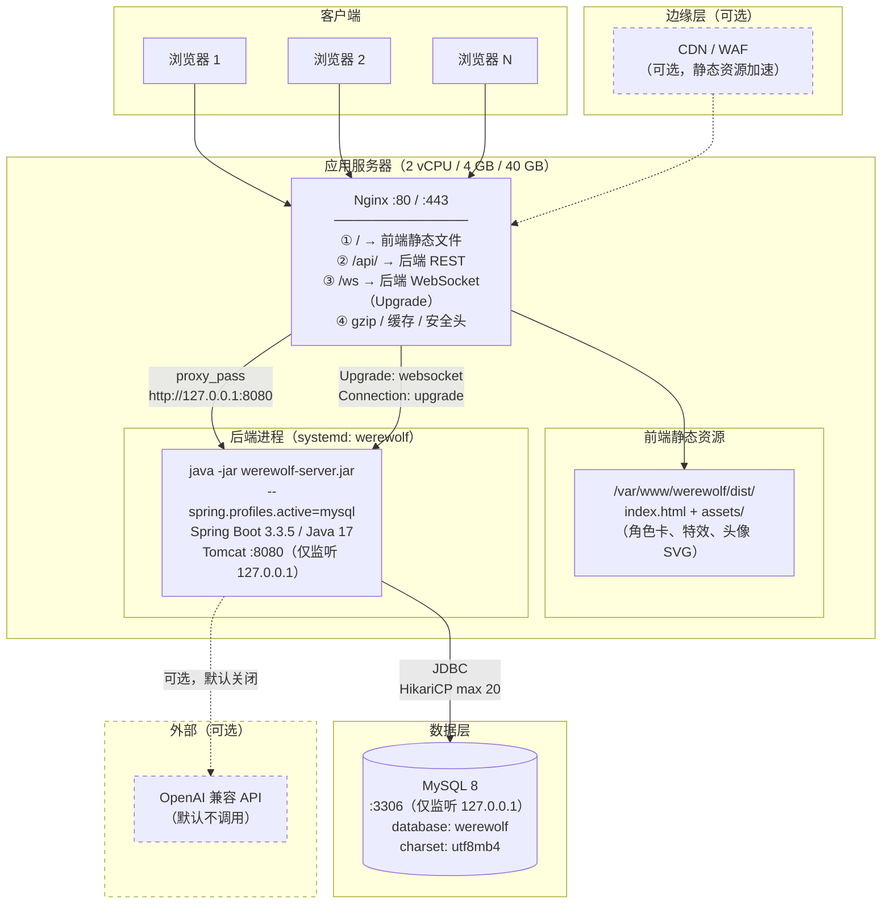

> 2026-10-29 版本提示：本文含早期狼人杀设计与操作示例。当前交付范围、规则和生产运行方式以 [当前状态](JIUJIU_CURRENT_STATUS.md)、[运行与部署](RELEASE_AND_OPERATIONS.md) 及对应阶段报告为准；旧的角色/人数/多数决、禁止 WebRTC 或删除卷升级等说法已被新需求覆盖。

# 部署与运维手册（DEPLOY）

> 本文档面向**成员 F、运维人员与答辩现场操作者**，解决一个问题：**从零把系统跑起来（开发 / Docker / 裸机三种方式），并且出问题时能按手册快速定位**。

---

## 一、部署方式总览

| 方式 | 适用场景 | 需要什么 | 数据持久化 | 启动时间 |
| --- | --- | --- | --- | --- |
| **① 本地开发（H2 内存库）** | 日常开发、**答辩现场演示** | JDK 17 + Node 18 + pnpm | ❌ 重启即清空 | ~10 秒（依赖已下载） |
| **② 本地开发（MySQL）** | 需要数据持久化的开发 | 上面 + MySQL 8 | ✅ | ~15 秒 |
| **③ Docker Compose** | 一台服务器起全栈 | Docker + Compose v2 | ✅（数据卷） | ~2 分钟（首次构建） |
| **④ 裸机部署** | 生产环境 / 无 Docker 的服务器 | JDK 17 + Nginx + MySQL 8 + systemd | ✅ | ~20 秒 |

**本轮交付的推荐组合**：开发与答辩用 **①**，交付部署用 **③** 或 **④**。

---

## 二、开发环境一键启动

### 2.1 前置检查

**Windows PowerShell：**

```powershell
java -version      # 需要 17 或更高
node -v            # 需要 18 或更高
pnpm -v            # 没有的话：npm i -g pnpm
```

**Linux / macOS bash：**

```bash
java -version
node -v
pnpm -v            # 没有的话：npm i -g pnpm
```

### 2.2 Windows PowerShell（完整步骤）

**终端 1 — 后端：**

```powershell
# 1) 进入后端目录
cd werewolf-game\backend

# 2) 启动（H2 内存库，默认 profile 就是 h2）
mvn spring-boot:run "-Dspring-boot.run.profiles=h2"

# 若没有系统 Maven，用 wrapper：
# .\mvnw.cmd spring-boot:run "-Dspring-boot.run.profiles=h2"
```

**终端 2 — 前端：**

```powershell
# 1) 进入前端目录
cd werewolf-game\frontend

# 2) 首次安装依赖
pnpm install

# 3) 启动开发服务器
pnpm dev
```

**终端 3 — 验证：**

```powershell
# 后端健康检查
Invoke-RestMethod -Uri "http://localhost:8080/api/health" | ConvertTo-Json -Depth 4

# 登录拿 Token
$TOKEN = (Invoke-RestMethod -Uri "http://localhost:8080/api/auth/login" -Method Post `
  -ContentType "application/json" `
  -Body '{"username":"demo","password":"demo1234"}').data.token
Write-Host "TOKEN = $($TOKEN.Substring(0,30))..."

# 看游戏元数据
(Invoke-RestMethod -Uri "http://localhost:8080/api/game/meta" `
  -Headers @{ Authorization = "Bearer $TOKEN" }).data.roles |
  Select-Object name, label, campLabel | Format-Table -AutoSize
```

**预期结果：**

| 命令 | 预期 |
| --- | --- |
| 健康检查 | `data.status = "UP"`、`data.aiProvider = "规则 AI（AI 总开关关闭）"`、`data.llmEnabled = false` |
| 登录 | 返回 `code=0` 与 `token` |
| 元数据 | 4 个角色：狼人 / 预言家 / 女巫 / 平民 |

浏览器打开 **http://localhost:5173** → 用 `demo / demo1234` 登录。

### 2.3 Linux / macOS bash（完整步骤）

**终端 1 — 后端：**

```bash
cd werewolf-game/backend

# 加执行权限（首次）
chmod +x mvnw 2>/dev/null || true

# 启动（H2）
./mvnw spring-boot:run -Dspring-boot.run.profiles=h2
# 没有 mvnw 时：
# mvn spring-boot:run -Dspring-boot.run.profiles=h2
```

**终端 2 — 前端：**

```bash
cd werewolf-game/frontend
pnpm install
pnpm dev
```

**终端 3 — 验证：**

```bash
# 后端健康检查
curl -s http://localhost:8080/api/health | python3 -m json.tool 2>/dev/null || curl -s http://localhost:8080/api/health

# 登录拿 Token 并存入变量
TOKEN=$(curl -s -X POST http://localhost:8080/api/auth/login \
  -H "Content-Type: application/json" \
  -d '{"username":"demo","password":"demo1234"}' \
  | sed -n 's/.*"token":"\([^"]*\)".*/\1/p')
echo "TOKEN = ${TOKEN:0:30}..."

# 看游戏元数据
curl -s http://localhost:8080/api/game/meta -H "Authorization: Bearer $TOKEN"
```

### 2.4 一键启动脚本

**`start-dev.ps1`（Windows PowerShell，放在 `werewolf-game/` 下）：**

```powershell
#!/usr/bin/env pwsh
# 一键启动开发环境：新开两个窗口分别跑后端和前端
$root = Split-Path -Parent $MyInvocation.MyCommand.Path
Write-Host "启动后端（H2 模式）..." -ForegroundColor Cyan
Start-Process pwsh -ArgumentList "-NoExit", "-Command", "cd '$root\backend'; mvn spring-boot:run '-Dspring-boot.run.profiles=h2'"

Start-Sleep -Seconds 3
Write-Host "启动前端..." -ForegroundColor Cyan
Start-Process pwsh -ArgumentList "-NoExit", "-Command", "cd '$root\frontend'; pnpm dev"

Write-Host "`n等待约 15 秒后访问 http://localhost:5173" -ForegroundColor Green
Write-Host "演示账号：demo / demo1234（或 player1~player4）" -ForegroundColor Green
Write-Host "健康检查：http://localhost:8080/api/health" -ForegroundColor Green
```

用法：

```powershell
cd werewolf-game
pwsh -File .\start-dev.ps1
```

**`start-dev.sh`（Linux / macOS，放在 `werewolf-game/` 下）：**

```bash
#!/usr/bin/env bash
# 一键启动开发环境
set -e
ROOT="$(cd "$(dirname "${BASH_SOURCE[0]}")" && pwd)"

echo "启动后端（H2 模式）..."
(cd "$ROOT/backend" && mvn spring-boot:run -Dspring-boot.run.profiles=h2) &
BACKEND_PID=$!

sleep 3
echo "启动前端..."
(cd "$ROOT/frontend" && pnpm dev) &
FRONTEND_PID=$!

echo ""
echo "后端 PID=$BACKEND_PID  前端 PID=$FRONTEND_PID"
echo "等待约 15 秒后访问 http://localhost:5173"
echo "演示账号：demo / demo1234（或 player1~player4）"
echo "按 Ctrl+C 停止全部服务"

trap "kill $BACKEND_PID $FRONTEND_PID 2>/dev/null || true; exit 0" INT TERM
wait
```

用法：

```bash
chmod +x werewolf-game/start-dev.sh
./werewolf-game/start-dev.sh
```

### 2.5 开发环境环境变量（可选覆盖）

创建 `werewolf-game/backend/.env`（仅供参考，Spring Boot 不读 `.env`，请用系统环境变量或 IDE 运行配置）：

| 变量 | 开发建议值 | 说明 |
| --- | --- | --- |
| `SERVER_PORT` | `8080` | 换端口时记得同步改前端代理 |
| `WEREWOLF_JWT_SECRET` | 任意 ≥ 32 字节 | 开发可用默认值 |
| `WEREWOLF_CORS_ORIGINS` | `http://localhost:5173` | 多人联调时必须加别人的 IP |
| `WEREWOLF_AI_ENABLED` | `false`（默认） | **本轮交付保持 false** |

---

## 三、生产部署拓扑



### 3.1 关键设计点

| 点 | 说明 |
| --- | --- |
| **Nginx 是唯一入口** | 后端只监听 `127.0.0.1:8080`，MySQL 只监听 `127.0.0.1:3306`，**不对外暴露端口** |
| **同源部署** | 前端与 API 走同一个域名 → **不需要跨域配置**（生产可以把 `WEREWOLF_CORS_ORIGINS` 留空或设为域名） |
| **WebSocket 必须显式配置 Upgrade 头** | 这是最容易出错的一步，见第七节 |
| **静态资源由 Nginx 直接返回** | 角色卡 / 特效 / 头像都是 SVG，Nginx 直接服务比走后端快得多 |
| **AI 外部调用是虚线** | 默认 `werewolf.ai.enabled=false`，**生产环境默认不产生任何外部请求** |

---

## 四、服务器规格建议与成本估算

### 4.1 规格建议

| 项 | 推荐配置 | 最低配置 | 说明 |
| --- | --- | --- | --- |
| **CPU** | 2 vCPU | 1 vCPU | 后端单线程 tick 是主要开销；1 核在房间数多时会吃紧 |
| **内存** | **4 GB** | 2 GB | JVM 堆 1 GB + MySQL 缓冲池 512 MB + 系统余量 |
| **磁盘** | **40 GB SSD** | 20 GB | 系统 10 GB + JDK/Maven 2 GB + MySQL 数据 + 日志 |
| **带宽** | 3 Mbps | 1 Mbps | 单个 WebSocket 连接约 2~10 KB/s，4~8 人一局不到 100 KB/s |
| **操作系统** | Ubuntu 22.04 LTS / Rocky Linux 9 | — | 本文档以 Ubuntu 为例 |

### 4.2 各组件资源占用实测（参考值）

| 组件 | 内存 | CPU（空闲 / 一局进行中） |
| --- | --- | --- |
| JVM（Spring Boot + 1 个房间） | ~350 MB | < 1% / 3~8% |
| JVM（10 个并发房间） | ~450 MB | 1% / 15~25% |
| MySQL 8（空库） | ~200 MB | < 1% |
| Nginx | ~10 MB | < 1% |
| **合计** | **~600 MB ~ 1 GB** | — |

> **只有开启 AI（`WEREWOLF_AI_ENABLED=true`）时 CPU 才可能成为瓶颈**——`AiService.decide()` 在 LLM 模式下会**同步阻塞**等待 HTTP 响应（默认超时 12 秒），而 `RoomRuntimeScheduler` 是**单线程** tick。所以：**AI 关闭时 1 vCPU 够用；开启 AI 时建议 2 vCPU 且 AI 数量 ≤ 3**。

### 4.3 JVM 参数建议

```bash
java -Xms512m -Xmx1024m \
     -XX:+UseG1GC \
     -XX:MaxGCPauseMillis=200 \
     -Duser.timezone=Asia/Shanghai \
     -jar /opt/werewolf/werewolf-server.jar \
     --spring.profiles.active=mysql
```

| 参数 | 说明 |
| --- | --- |
| `-Xms512m -Xmx1024m` | 固定堆大小，避免动态扩缩带来的抖动。4 GB 内存的机器给 JVM 1 GB 足够 |
| `-XX:+UseG1GC` | Java 17 默认就是 G1，显式写出来便于交接 |
| `-Duser.timezone=Asia/Shanghai` | `application.yml` 已配 Jackson 时区，这里再固定 JVM 时区，保证 `LocalDateTime.now()` 正确 |

### 4.4 成本估算（参考价，以实际报价为准）

**方案 A：国内云厂商轻量应用服务器**

| 项 | 规格 | 月成本（参考） |
| --- | --- | --- |
| 轻量应用服务器 | 2 核 4 GB 40 GB SSD，3 Mbps | ¥60 ~ ¥100 / 月 |
| 域名（可选） | `.top` / `.xyz` 首年 | ¥10 ~ ¥30 / 年 |
| SSL 证书（可选） | Let's Encrypt | **免费** |
| **合计** | | **约 ¥60 ~ ¥100 / 月** |

**方案 B：学生优惠 / 免费额度**

| 项 | 说明 | 成本 |
| --- | --- | --- |
| 云厂商学生机 | 2 核 2 GB（部分厂商有学生优惠） | ¥10 ~ ¥20 / 月 或免费 |
| GitHub Student Pack | 部分云厂商提供额度 | 免费 |
| **合计** | 课程项目足够 | **¥0 ~ ¥20 / 月** |

**方案 C：本地 / 内网部署（课程项目最省）**

| 项 | 说明 | 成本 |
| --- | --- | --- |
| 任意一台能跑 Docker 的机器 | 组员的笔记本 / 实验室机器 | ¥0 |
| 内网访问 | 通过局域网 IP 或内网穿透工具 | ¥0 |
| **合计** | | **¥0** |

> **答辩建议**：用**方案 C + H2 内存库**——零成本、零网络依赖、启动 10 秒。只有需要「长期在线」时才考虑方案 A。

### 4.5 LLM 调用成本（可选增强，默认关闭）

| 供应商 | 模型 | 参考价（每百万 token） | 一局（6 人 2 AI，约 20 次调用）估算 |
| --- | --- | --- | --- |
| DeepSeek | `deepseek-chat` | 输入 ¥1 / 输出 ¥2 | **< ¥0.1** |
| OpenAI | `gpt-4o-mini` | 输入 $0.15 / 输出 $0.60 | **< ¥0.2** |
| 本地 Ollama | `qwen2.5:7b` | 电费 | **¥0** |

**控制成本的三个开关**（详见 [docs/AI_DESIGN.md](AI_DESIGN.md) 第六节）：

| 开关 | 默认值 | 建议 |
| --- | --- | --- |
| `werewolf.ai.enabled` | **`false`** | **保持 false，零成本** |
| `werewolf.ai.max-calls-per-game` | `120` | 降到 `40` |
| 房间 `aiCount` | **`0`** | 演示用 `2~3` |

---

## 五、Docker Compose 部署

> **文件状态**：`deploy/docker-compose.yml`、`deploy/.env.example`、`deploy/README.md`、`deploy/nginx-standalone.conf`、`backend/Dockerfile`、`frontend/Dockerfile`、`frontend/nginx.conf` **均已交付并可直接使用**（负责人：成员 F，见 [docs/TEAM_PLAN.md](TEAM_PLAN.md) 第 3.3 节）。本节同时给出**规格说明**（便于核对实现）与**完整的可复制命令**。

### 5.1 目录结构

```
werewolf-game/
├── backend/
│   ├── Dockerfile
│   └── .dockerignore
├── frontend/
│   ├── Dockerfile
│   ├── nginx.conf
│   └── .dockerignore
└── deploy/
    ├── docker-compose.yml
    └── .env.example
```

### 5.2 `.env.example` 规格

```bash
# =====================================================================
# Docker Compose 部署环境变量
# 用法：cp .env.example .env 然后按需修改
# =====================================================================

# ---------- MySQL ----------
MYSQL_ROOT_PASSWORD=change-this-root-password
MYSQL_DATABASE=werewolf
MYSQL_USER=werewolf
MYSQL_PASSWORD=change-this-app-password

# ---------- 后端 ----------
SERVER_PORT=8080
SPRING_PROFILES_ACTIVE=mysql
# 必须是 32 字节以上的随机字符串；生成方法：openssl rand -base64 48
WEREWOLF_JWT_SECRET=please-change-this-to-a-random-string-at-least-32-bytes
# 生产域名（同源部署时留空即可，因为不需要跨域）
WEREWOLF_CORS_ORIGINS=

# ---------- AI（可选增强，默认关闭）----------
# 保持 false：不向任何外部 LLM 发起请求
WEREWOLF_AI_ENABLED=false
WEREWOLF_AI_BASE_URL=https://api.deepseek.com
WEREWOLF_AI_API_KEY=
WEREWOLF_AI_MODEL=deepseek-chat
WEREWOLF_AI_MAX_CALLS_PER_GAME=40

# ---------- 前端 ----------
# 前端对外端口
WEB_PORT=80
# WebSocket 地址；同源部署时留空，前端会自动用 window.location.host + /ws
VITE_WS_URL=
VITE_USE_SOCKJS=false
```

### 5.3 `docker-compose.yml` 规格

```yaml
# =====================================================================
# 基于 AI 增强的多人在线狼人杀系统 —— 一键编排
# 用法：docker compose -f deploy/docker-compose.yml --env-file deploy/.env up -d --build
# =====================================================================

services:
  mysql:
    image: mysql:8.0
    container_name: werewolf-mysql
    restart: unless-stopped
    environment:
      MYSQL_ROOT_PASSWORD: ${MYSQL_ROOT_PASSWORD}
      MYSQL_DATABASE: ${MYSQL_DATABASE:-werewolf}
      MYSQL_USER: ${MYSQL_USER:-werewolf}
      MYSQL_PASSWORD: ${MYSQL_PASSWORD}
      TZ: Asia/Shanghai
    command:
      - --character-set-server=utf8mb4
      - --collation-server=utf8mb4_unicode_ci
      - --default-time-zone=+08:00
    volumes:
      - mysql-data:/var/lib/mysql
      # 首次启动自动执行建表脚本
      - ../database/schema.sql:/docker-entrypoint-initdb.d/01-schema.sql:ro
    healthcheck:
      test: ["CMD", "mysqladmin", "ping", "-h", "127.0.0.1", "-u", "root", "-p${MYSQL_ROOT_PASSWORD}"]
      interval: 10s
      timeout: 5s
      retries: 10
      start_period: 30s
    networks:
      - werewolf-net

  backend:
    build:
      context: ../backend
      dockerfile: Dockerfile
    container_name: werewolf-backend
    restart: unless-stopped
    depends_on:
      mysql:
        condition: service_healthy
    environment:
      SPRING_PROFILES_ACTIVE: ${SPRING_PROFILES_ACTIVE:-mysql}
      SERVER_PORT: 8080
      MYSQL_HOST: mysql
      MYSQL_PORT: 3306
      MYSQL_DATABASE: ${MYSQL_DATABASE:-werewolf}
      MYSQL_USER: ${MYSQL_USER:-werewolf}
      MYSQL_PASSWORD: ${MYSQL_PASSWORD}
      WEREWOLF_JWT_SECRET: ${WEREWOLF_JWT_SECRET}
      WEREWOLF_CORS_ORIGINS: ${WEREWOLF_CORS_ORIGINS}
      WEREWOLF_AI_ENABLED: ${WEREWOLF_AI_ENABLED:-false}
      WEREWOLF_AI_BASE_URL: ${WEREWOLF_AI_BASE_URL}
      WEREWOLF_AI_API_KEY: ${WEREWOLF_AI_API_KEY}
      WEREWOLF_AI_MODEL: ${WEREWOLF_AI_MODEL}
      TZ: Asia/Shanghai
    expose:
      - "8080"
    networks:
      - werewolf-net

  frontend:
    build:
      context: ../frontend
      dockerfile: Dockerfile
      args:
        VITE_API_BASE: /api
        VITE_WS_URL: ${VITE_WS_URL}
        VITE_USE_SOCKJS: ${VITE_USE_SOCKJS:-false}
    container_name: werewolf-frontend
    restart: unless-stopped
    depends_on:
      - backend
    ports:
      - "${WEB_PORT:-80}:80"
    networks:
      - werewolf-net

volumes:
  mysql-data:
    driver: local

networks:
  werewolf-net:
    driver: bridge
```

### 5.4 `backend/Dockerfile` 规格

```dockerfile
# =====================================================================
# 后端镜像：多阶段构建（Maven 构建 → JRE 运行）
# =====================================================================

# ---------- 阶段 1：构建 ----------
FROM maven:3.9-eclipse-temurin-17 AS builder
WORKDIR /build

# 先只复制 pom.xml，利用 Docker 层缓存加速依赖下载
COPY pom.xml .
RUN mvn -B -q dependency:go-offline

# 再复制源码并打包
COPY src ./src
RUN mvn -B -q clean package -DskipTests

# ---------- 阶段 2：运行 ----------
FROM eclipse-temurin:17-jre-jammy
WORKDIR /app

# 时区与中文环境
ENV TZ=Asia/Shanghai
RUN ln -snf /usr/share/zoneinfo/$TZ /etc/localtime && echo $TZ > /etc/timezone

# 非 root 用户运行
RUN groupadd -r werewolf && useradd -r -g werewolf werewolf

# 复制产物（pom.xml 里 finalName 是 werewolf-server）
COPY --from=builder /build/target/werewolf-server.jar /app/app.jar
RUN chown -R werewolf:werewolf /app
USER werewolf

EXPOSE 8080

# 健康检查（Spring Boot Actuator 未引入，用 wget 打 /api/health）
HEALTHCHECK --interval=30s --timeout=5s --start-period=40s --retries=3 \
  CMD wget -qO- http://127.0.0.1:8080/api/health || exit 1

ENTRYPOINT ["java", "-Xms512m", "-Xmx1024m", "-XX:+UseG1GC", \
            "-Duser.timezone=Asia/Shanghai", "-jar", "/app/app.jar"]
```

**`backend/.dockerignore`：**

```
target/
*.log
.idea/
.vscode/
*.iml
```

### 5.5 `frontend/Dockerfile` 规格

```dockerfile
# =====================================================================
# 前端镜像：多阶段构建（Node 构建 → Nginx 托管静态文件）
# =====================================================================

# ---------- 阶段 1：构建 ----------
FROM node:20-alpine AS builder
WORKDIR /build

# 启用 pnpm（仓库里有 pnpm-workspace.yaml，pnpm v10 需要它允许 esbuild 运行安装脚本）
RUN corepack enable && corepack prepare pnpm@latest --activate

# 先装依赖（利用层缓存）
COPY package.json pnpm-lock.yaml pnpm-workspace.yaml ./
RUN pnpm install --frozen-lockfile

# 构建时注入环境变量
ARG VITE_API_BASE=/api
ARG VITE_WS_URL=
ARG VITE_USE_SOCKJS=false
ENV VITE_API_BASE=$VITE_API_BASE \
    VITE_WS_URL=$VITE_WS_URL \
    VITE_USE_SOCKJS=$VITE_USE_SOCKJS

# 复制源码与静态资源并构建
COPY . .
# 用 build:only 跳过 vue-tsc（镜像里不做类型检查，类型检查放在 CI/本地）
RUN pnpm build:only

# ---------- 阶段 2：运行 ----------
FROM nginx:1.27-alpine

ENV TZ=Asia/Shanghai
RUN ln -snf /usr/share/zoneinfo/$TZ /etc/localtime && echo $TZ > /etc/timezone

# 自定义 Nginx 配置
COPY nginx.conf /etc/nginx/conf.d/default.conf

# 静态产物
COPY --from=builder /build/dist /usr/share/nginx/html

EXPOSE 80

HEALTHCHECK --interval=30s --timeout=5s --start-period=10s --retries=3 \
  CMD wget -qO- http://127.0.0.1/ >/dev/null || exit 1

CMD ["nginx", "-g", "daemon off;"]
```

**`frontend/.dockerignore`：**

```
node_modules/
dist/
.env.local
*.log
```

### 5.6 `frontend/nginx.conf` 规格

```nginx
# =====================================================================
# 生产 Nginx 配置：静态站点 + API 反向代理 + WebSocket 升级
# 放在容器内 /etc/nginx/conf.d/default.conf
# =====================================================================

server {
    listen 80;
    server_name _;

    root /usr/share/nginx/html;
    index index.html;

    charset utf-8;
    client_max_body_size 2m;

    # ---------- 压缩 ----------
    gzip on;
    gzip_vary on;
    gzip_min_length 1024;
    gzip_comp_level 5;
    gzip_types
        text/plain text/css text/xml
        application/json application/javascript application/xml+rss
        application/vnd.ms-fontobject application/x-font-ttf
        font/opentype image/svg+xml;

    # ---------- 安全响应头 ----------
    add_header X-Content-Type-Options "nosniff" always;
    add_header X-Frame-Options "SAMEORIGIN" always;
    add_header Referrer-Policy "strict-origin-when-cross-origin" always;

    # ---------- 静态资源缓存 ----------
    # 带 hash 的构建产物：长期缓存
    location /assets/ {
        expires 30d;
        add_header Cache-Control "public, immutable";
        try_files $uri =404;
    }

    location ~* \.(?:js|css|woff2?|ttf|eot)$ {
        expires 30d;
        add_header Cache-Control "public, immutable";
        try_files $uri =404;
    }

    # index.html 不缓存（保证发版后能拿到新版本）
    location = /index.html {
        add_header Cache-Control "no-cache, no-store, must-revalidate";
        expires -1;
    }

    # ---------- REST API 反向代理 ----------
    location /api/ {
        proxy_pass http://backend:8080;
        proxy_http_version 1.1;

        proxy_set_header Host              $host;
        proxy_set_header X-Real-IP         $remote_addr;
        proxy_set_header X-Forwarded-For   $proxy_add_x_forwarded_for;
        proxy_set_header X-Forwarded-Proto $scheme;

        proxy_connect_timeout 10s;
        proxy_send_timeout    60s;
        proxy_read_timeout    60s;
    }

    # ---------- WebSocket 反向代理（关键！）----------
    location /ws {
        proxy_pass http://backend:8080;

        # ★★★ 这三行是 WebSocket 能连上的关键 ★★★
        proxy_http_version 1.1;
        proxy_set_header Upgrade    $http_upgrade;
        proxy_set_header Connection "upgrade";

        proxy_set_header Host              $host;
        proxy_set_header X-Real-IP         $remote_addr;
        proxy_set_header X-Forwarded-For   $proxy_add_x_forwarded_for;
        proxy_set_header X-Forwarded-Proto $scheme;

        # 长连接：不能因为空闲就断开
        proxy_read_timeout  3600s;
        proxy_send_timeout  3600s;
        proxy_buffering     off;
    }

    # ---------- SockJS 兜底端点（同 /ws，但走 HTTP 轮询）----------
    location /ws/ {
        proxy_pass http://backend:8080;
        proxy_http_version 1.1;
        proxy_set_header Host              $host;
        proxy_set_header X-Real-IP         $remote_addr;
        proxy_set_header X-Forwarded-For   $proxy_add_x_forwarded_for;
        proxy_read_timeout 3600s;
        proxy_buffering off;
    }

    # ---------- SPA history 路由回退 ----------
    location / {
        try_files $uri $uri/ /index.html;
    }
}
```

### 5.7 部署命令（完整流程）

**第 1 步：准备环境变量**

```bash
cd werewolf-game/deploy
cp .env.example .env

# 生成一个安全的 JWT 密钥并写入 .env
JWT_SECRET=$(openssl rand -base64 48 | tr -d '\n')
sed -i "s|^WEREWOLF_JWT_SECRET=.*|WEREWOLF_JWT_SECRET=${JWT_SECRET}|" .env

# 同样方式设置 MySQL 密码
sed -i "s|^MYSQL_ROOT_PASSWORD=.*|MYSQL_ROOT_PASSWORD=$(openssl rand -hex 16)|" .env
sed -i "s|^MYSQL_PASSWORD=.*|MYSQL_PASSWORD=$(openssl rand -hex 16)|" .env

# 检查
grep -E "JWT_SECRET|MYSQL_ROOT_PASSWORD|MYSQL_PASSWORD|AI_ENABLED" .env
```

> **Windows PowerShell 等价操作：**
> ```powershell
> cd werewolf-game\deploy
> Copy-Item .env.example .env
> # 生成随机密钥（PowerShell 5+）
> $jwt = [Convert]::ToBase64String((1..48 | ForEach-Object { Get-Random -Max 256 }))
> (Get-Content .env) -replace '^WEREWOLF_JWT_SECRET=.*', "WEREWOLF_JWT_SECRET=$jwt" | Set-Content .env
> Get-Content .env | Select-String "JWT_SECRET|AI_ENABLED"
> ```

**第 2 步：构建并启动**

```bash
cd werewolf-game
docker compose -f deploy/docker-compose.yml --env-file deploy/.env up -d --build
```

**第 3 步：检查状态**

```bash
# 容器状态（3 个都应是 healthy / running）
docker compose -f deploy/docker-compose.yml ps

# 等待后端就绪（约 30~60 秒）
docker compose -f deploy/docker-compose.yml logs -f backend
# 看到 "Started WerewolfApplication in X seconds" 就 OK，按 Ctrl+C 退出日志

# 查看所有日志
docker compose -f deploy/docker-compose.yml logs --tail=100
```

**第 4 步：验证**

```bash
# 1) 前端能访问
curl -s -o /dev/null -w "frontend HTTP %{http_code}\n" http://localhost/

# 2) 后端健康检查
curl -s http://localhost/api/health
# 期望：{"code":0,...,"data":{"status":"UP",...,"aiProvider":"规则 AI（AI 总开关关闭）",...}}

# 3) 注册一个账号（MySQL 模式没有演示账号）
curl -s -X POST http://localhost/api/auth/register \
  -H "Content-Type: application/json" \
  -d '{"username":"smoke","password":"demo1234","nickname":"冒烟测试"}'

# 4) 登录拿 Token
curl -s -X POST http://localhost/api/auth/login \
  -H "Content-Type: application/json" \
  -d '{"username":"smoke","password":"demo1234"}'

# 5) 验证 WebSocket 升级（应返回 101 Switching Protocols）
curl -s -i -N \
  -H "Connection: Upgrade" \
  -H "Upgrade: websocket" \
  -H "Sec-WebSocket-Version: 13" \
  -H "Sec-WebSocket-Key: dGhlIHNhbXBsZSBub25jZQ==" \
  http://localhost/ws 2>&1 | head -20
# 期望看到 "HTTP/1.1 101 Switching Protocols"

# 6) 数据库里五张表都建好了
docker compose -f deploy/docker-compose.yml exec mysql \
  mysql -u werewolf -p"$(grep '^MYSQL_PASSWORD=' deploy/.env | cut -d= -f2)" \
  -e "USE werewolf; SHOW TABLES;" 2>/dev/null
# 期望：game_records, messages, room_players, rooms, users
```

**第 5 步：浏览器端到端验证**

打开 http://localhost ，用第 4 步注册的账号登录，然后用**4 个浏览器窗口**（2 个无痕）完整跑一局（步骤见 [README 第七节](../README.md)）。

### 5.8 日常运维命令

```bash
cd werewolf-game
COMPOSE="docker compose -f deploy/docker-compose.yml --env-file deploy/.env"

# 查看状态
$COMPOSE ps

# 查看日志（实时）
$COMPOSE logs -f backend
$COMPOSE logs -f frontend
$COMPOSE logs -f mysql

# 重启某个服务
$COMPOSE restart backend

# 停止（保留数据）
$COMPOSE stop

# 启动
$COMPOSE start

# 完全停止并删除容器（保留数据卷）
$COMPOSE down

# 完全停止并删除数据（⚠️ 数据会丢）
$COMPOSE down -v

# 更新代码后重新构建（只重建改动的服务）
$COMPOSE up -d --build backend
$COMPOSE up -d --build frontend

# 进入容器排查
$COMPOSE exec backend sh
$COMPOSE exec mysql mysql -u werewolf -p werewolf

# 备份数据库
docker compose -f deploy/docker-compose.yml exec -T mysql \
  mysqldump -u root -p"$(grep '^MYSQL_ROOT_PASSWORD=' deploy/.env | cut -d= -f2)" \
  --single-transaction --routines werewolf > backup-$(date +%Y%m%d-%H%M).sql

# 恢复数据库
docker compose -f deploy/docker-compose.yml exec -T mysql \
  mysql -u root -p"$(grep '^MYSQL_ROOT_PASSWORD=' deploy/.env | cut -d= -f2)" werewolf < backup-20241207-1200.sql

# 查看资源占用
docker stats --no-stream
```

---

## 六、裸机部署（无 Docker）

### 6.1 环境准备（以 Ubuntu 22.04 为例）

```bash
# 1) 安装 JDK 17
sudo apt update
sudo apt install -y openjdk-17-jdk-headless
java -version        # 应显示 17.x

# 2) 安装 Nginx
sudo apt install -y nginx
nginx -v

# 3) 安装 MySQL 8
sudo apt install -y mysql-server
sudo systemctl enable --now mysql
mysql --version

# 4) 配置 MySQL
sudo mysql -u root <<'SQL'
CREATE DATABASE IF NOT EXISTS werewolf
    DEFAULT CHARACTER SET utf8mb4 COLLATE utf8mb4_unicode_ci;
CREATE USER IF NOT EXISTS 'werewolf'@'127.0.0.1' IDENTIFIED BY 'CHANGE_THIS_PASSWORD';
GRANT ALL PRIVILEGES ON werewolf.* TO 'werewolf'@'127.0.0.1';
FLUSH PRIVILEGES;
SQL

# 5) 导入建表脚本
mysql -u root werewolf < /opt/werewolf/database/schema.sql

# 6) 验证表已创建
mysql -u werewolf -p'CHANGE_THIS_PASSWORD' werewolf -e "SHOW TABLES;"
# 期望：game_records  messages  room_players  rooms  users
```

### 6.2 部署后端

```bash
# 1) 创建部署目录
sudo mkdir -p /opt/werewolf/{bin,config,logs}
sudo useradd -r -s /sbin/nologin werewolf 2>/dev/null || true

# 2) 在本地（或 CI）打包
cd werewolf-game/backend
mvn -q clean package -DskipTests
# 产物：target/werewolf-server.jar

# 3) 上传到服务器
scp target/werewolf-server.jar user@server:/tmp/
ssh user@server
sudo mv /tmp/werewolf-server.jar /opt/werewolf/bin/
sudo chown -R werewolf:werewolf /opt/werewolf
sudo chmod 750 /opt/werewolf/bin/werewolf-server.jar
```

**环境变量文件 `/opt/werewolf/config/werewolf.env`：**

```bash
# 权限必须是 600（含密钥）
SPRING_PROFILES_ACTIVE=mysql
SERVER_PORT=8080

MYSQL_HOST=127.0.0.1
MYSQL_PORT=3306
MYSQL_DATABASE=werewolf
MYSQL_USER=werewolf
MYSQL_PASSWORD=CHANGE_THIS_PASSWORD

# 生成方法：openssl rand -base64 48
WEREWOLF_JWT_SECRET=CHANGE_THIS_TO_A_RANDOM_48_BYTE_STRING_XXXXXXXXXXXX

# 同源部署时不需要跨域；如需跨域，逗号分隔
WEREWOLF_CORS_ORIGINS=

# AI 可选增强，默认关闭
WEREWOLF_AI_ENABLED=false
```

```bash
sudo chmod 600 /opt/werewolf/config/werewolf.env
sudo chown werewolf:werewolf /opt/werewolf/config/werewolf.env
```

### 6.3 systemd 服务单元

**`/etc/systemd/system/werewolf.service`：**

```ini
[Unit]
Description=Werewolf Game Server (基于 AI 增强的多人在线狼人杀系统)
Documentation=file:/opt/werewolf/README.md
After=network-online.target mysql.service
Wants=network-online.target
Requires=mysql.service

[Service]
Type=simple
User=werewolf
Group=werewolf
WorkingDirectory=/opt/werewolf

# 环境变量文件（含数据库密码与 JWT 密钥，权限 600）
EnvironmentFile=/opt/werewolf/config/werewolf.env

# 启动命令
ExecStart=/usr/bin/java \
    -Xms512m -Xmx1024m \
    -XX:+UseG1GC \
    -XX:MaxGCPauseMillis=200 \
    -Duser.timezone=Asia/Shanghai \
    -Djava.security.egd=file:/dev/./urandom \
    -jar /opt/werewolf/bin/werewolf-server.jar

# 优雅停止：先发 SIGTERM，等 30 秒再强杀
KillSignal=SIGTERM
TimeoutStopSec=30

# 自动重启（服务崩溃 / JVM OOM 时）
Restart=on-failure
RestartSec=10

# 日志
StandardOutput=append:/opt/werewolf/logs/stdout.log
StandardError=append:/opt/werewolf/logs/stderr.log

# 安全加固
NoNewPrivileges=true
PrivateTmp=true
ProtectSystem=strict
ProtectHome=true
ReadWritePaths=/opt/werewolf/logs
ProtectKernelTunables=true
ProtectControlGroups=true
RestrictSUIDSGID=true

# 资源限制
LimitNOFILE=65535

[Install]
WantedBy=multi-user.target
```

**生效与启动：**

```bash
sudo systemctl daemon-reload
sudo systemctl enable werewolf
sudo systemctl start werewolf

# 查看状态
sudo systemctl status werewolf

# 看日志
sudo journalctl -u werewolf -f
# 或看文件日志
sudo tail -f /opt/werewolf/logs/stdout.log

# 重启 / 停止
sudo systemctl restart werewolf
sudo systemctl stop werewolf
```

### 6.4 部署前端静态资源

```bash
# 1) 在本地构建
cd werewolf-game/frontend
pnpm install
pnpm build        # 会先跑 vue-tsc 类型检查，再 vite build
# 产物：dist/

# 2) 上传到服务器
sudo mkdir -p /var/www/werewolf
rsync -avz --delete dist/ user@server:/tmp/werewolf-dist/
ssh user@server
sudo rm -rf /var/www/werewolf/*
sudo mv /tmp/werewolf-dist/* /var/www/werewolf/
sudo chown -R www-data:www-data /var/www/werewolf
sudo chmod -R 755 /var/www/werewolf
```

### 6.5 Nginx 站点配置（裸机版）

**`/etc/nginx/sites-available/werewolf`：**

```nginx
# ---------- HTTP（先跑通，再考虑上 HTTPS）----------
server {
    listen 80;
    server_name your-domain.com;   # 没有域名就写服务器 IP 或 _

    root /var/www/werewolf;
    index index.html;

    charset utf-8;
    client_max_body_size 2m;

    gzip on;
    gzip_vary on;
    gzip_min_length 1024;
    gzip_comp_level 5;
    gzip_types text/plain text/css application/json application/javascript
               application/xml image/svg+xml;

    add_header X-Content-Type-Options "nosniff" always;
    add_header X-Frame-Options "SAMEORIGIN" always;
    add_header Referrer-Policy "strict-origin-when-cross-origin" always;

    # 静态资源缓存（角色卡、特效、头像 SVG 都在这里）
    location /assets/ {
        expires 30d;
        add_header Cache-Control "public, immutable";
        try_files $uri =404;
    }

    location ~* \.(?:js|css|woff2?|ttf|eot)$ {
        expires 30d;
        add_header Cache-Control "public, immutable";
        try_files $uri =404;
    }

    location = /index.html {
        add_header Cache-Control "no-cache, no-store, must-revalidate";
        expires -1;
    }

    # REST API
    location /api/ {
        proxy_pass http://127.0.0.1:8080;
        proxy_http_version 1.1;
        proxy_set_header Host              $host;
        proxy_set_header X-Real-IP         $remote_addr;
        proxy_set_header X-Forwarded-For   $proxy_add_x_forwarded_for;
        proxy_set_header X-Forwarded-Proto $scheme;
        proxy_connect_timeout 10s;
        proxy_read_timeout    60s;
    }

    # WebSocket（★ Upgrade / Connection 两行必须有）
    location /ws {
        proxy_pass http://127.0.0.1:8080;
        proxy_http_version 1.1;
        proxy_set_header Upgrade    $http_upgrade;
        proxy_set_header Connection "upgrade";
        proxy_set_header Host              $host;
        proxy_set_header X-Real-IP         $remote_addr;
        proxy_set_header X-Forwarded-For   $proxy_add_x_forwarded_for;
        proxy_set_header X-Forwarded-Proto $scheme;
        proxy_read_timeout 3600s;
        proxy_send_timeout 3600s;
        proxy_buffering    off;
    }

    # SPA 路由回退
    location / {
        try_files $uri $uri/ /index.html;
    }
}
```

**启用：**

```bash
sudo ln -sf /etc/nginx/sites-available/werewolf /etc/nginx/sites-enabled/werewolf
sudo rm -f /etc/nginx/sites-enabled/default      # 移除默认站点

# 语法检查（每次改完配置必做）
sudo nginx -t

# 重载
sudo systemctl reload nginx
```

### 6.6 HTTPS（可选，推荐）

```bash
# 1) 安装 certbot
sudo apt install -y certbot python3-certbot-nginx

# 2) 自动申请并配置（会把 HTTP 重定向到 HTTPS）
sudo certbot --nginx -d your-domain.com

# 3) 验证自动续期
sudo certbot renew --dry-run
```

> **注意**：上 HTTPS 后前端必须用 `wss://` 连接 WebSocket。前端的 `resolveWsUrl()` 会**自动根据 `window.location.protocol` 选择 `ws:` 或 `wss:`**，所以同源部署**无需改任何代码**。只有跨域部署时才需要在 `VITE_WS_URL` 里显式写 `wss://.../ws`。

### 6.7 防火墙

```bash
# UFW（Ubuntu）
sudo ufw allow 22/tcp       # SSH
sudo ufw allow 80/tcp       # HTTP
sudo ufw allow 443/tcp      # HTTPS
sudo ufw enable
sudo ufw status

# ⚠️ 绝对不要对外开放 8080（后端）与 3306（MySQL）
# 验证：从外部 telnet 8080 应该连不上
```

> **强制确认**：后端的 `server.port=8080` 只应由 Nginx 从 `127.0.0.1` 访问。如果后端监听在 `0.0.0.0`，请在 `application.yml` 里加 `server.address: 127.0.0.1`。

### 6.8 日志轮转

**`/etc/logrotate.d/werewolf`：**

```
/opt/werewolf/logs/*.log {
    daily
    rotate 14
    compress
    delaycompress
    missingok
    notifempty
    create 0640 werewolf werewolf
    sharedscripts
    postrotate
        systemctl reload werewolf >/dev/null 2>&1 || true
    endscript
}
```

---

## 七、环境变量清单

> 从 `application.yml` / `application-h2.yml` / `application-mysql.yml` / `AppProperties.java` / `AiProperties.java` 提取。**所有变量都是可选的**（都有默认值），但生产环境必须覆盖标记为「🔴 必填」的项。

### 7.1 服务与 Spring

| 变量名 | 默认值 | 必填 | 说明 |
| --- | --- | --- | --- |
| `SERVER_PORT` | `8080` | ❌ | 后端 HTTP 端口 |
| `SPRING_PROFILES_ACTIVE` | `h2` | ❌ | 激活的 profile：`h2`（演示）/ `mysql`（生产） |
| `TZ` / `-Duser.timezone` | 系统时区 | ❌ | 建议 `Asia/Shanghai` |

根配置项（无环境变量覆盖时使用 `application.yml` 里的固定值）：

| 配置项 | 默认值 | 说明 |
| --- | --- | --- |
| `server.servlet.context-path` | `/` | 上下文路径 |
| `server.compression.enabled` | `true` | 响应压缩 |
| `server.tomcat.threads.max` | `200` | Tomcat 最大线程数 |
| `spring.jackson.default-property-inclusion` | `non_null` | **隐私相关**：为 null 的字段不序列化 |
| `spring.jackson.time-zone` | `Asia/Shanghai` | JSON 时间时区 |
| `spring.jackson.serialization.write-dates-as-timestamps` | `false` | 时间序列化为 ISO 字符串 |
| `mybatis-plus.configuration.map-underscore-to-camel-case` | `true` | 下划线转驼峰 |
| `mybatis-plus.global-config.db-config.id-type` | `auto` | 主键自增 |

### 7.2 数据库

**H2（`h2` profile）：**

| 配置项 | 默认值 | 说明 |
| --- | --- | --- |
| `spring.datasource.url` | `jdbc:h2:mem:werewolf;MODE=MySQL;DB_CLOSE_DELAY=-1;DATABASE_TO_LOWER=TRUE` | 内存库 |
| `spring.datasource.driver-class-name` | `org.h2.Driver` | 驱动 |
| `spring.datasource.username` | `sa` | 账号 |
| `spring.datasource.password` | 空 | 密码 |
| `spring.sql.init.mode` | `always` | **自动建表** |
| `spring.sql.init.schema-locations` | `classpath:db/h2/schema.sql` | 建表脚本 |

**MySQL（`mysql` profile）：**

| 变量名 | 默认值 | 必填 | 说明 |
| --- | --- | --- | --- |
| `MYSQL_HOST` | `127.0.0.1` | ❌ | 数据库主机（Docker 里是服务名 `mysql`） |
| `MYSQL_PORT` | `3306` | ❌ | 数据库端口 |
| `MYSQL_DATABASE` | `werewolf` | ❌ | 数据库名 |
| `MYSQL_USER` | `werewolf` | 🔴 **必填**（生产） | 应用账号 |
| `MYSQL_PASSWORD` | `werewolf123` | 🔴 **必填**（生产） | 应用密码。**默认值仅供本地开发，生产必须改** |
| `spring.sql.init.mode`（mysql profile） | `never` | — | **应用不自动建表**，由 `database/schema.sql` 手工初始化 |
| `spring.datasource.hikari.maximum-pool-size` | `20` | ❌ | 连接池上限 |
| `spring.datasource.hikari.minimum-idle` | `5` | ❌ | 最小空闲连接 |
| `spring.datasource.hikari.connection-timeout` | `10000` | ❌ | 获取连接超时（ms） |

### 7.3 JWT 与 CORS（`werewolf.jwt.*` / `werewolf.cors.*`）

| 变量名 | 默认值 | 必填 | 说明 |
| --- | --- | --- | --- |
| `WEREWOLF_JWT_SECRET` | `werewolf-dev-secret-key-please-change-in-production-2024` | 🔴 **必填**（生产） | HS256 密钥，**至少 32 字节**，否则启动直接失败 |
| `WEREWOLF_CORS_ORIGINS` | `http://localhost:5173,http://127.0.0.1:5173,http://localhost:4173,http://127.0.0.1:4173` | ❌ | 允许的源，**逗号分隔**。**同时控制 HTTP 与 WebSocket 握手**。同源生产部署可留空 |

固定配置项：

| 配置项 | 默认值 | 说明 |
| --- | --- | --- |
| `werewolf.jwt.expire-minutes` | `1440` | Token 有效期（分钟）= 24 小时 |
| `werewolf.jwt.issuer` | `werewolf-game` | JWT 签发者，验签时会校验 |

### 7.4 房间与阶段时长（`werewolf.room.*` / `werewolf.phase.*`）

| 配置项 | 默认值 | 说明 |
| --- | --- | --- |
| `werewolf.room.idle-timeout-minutes` | `120` | 空闲房间回收时间（分钟）。`RoomRuntimeScheduler` 每 5 分钟检查一次 |
| `werewolf.phase.starting-seconds` | `6` | 发牌阶段时长 |
| `werewolf.phase.night-seconds` | `30` | 夜晚阶段时长 |
| `werewolf.phase.day-seconds` | `10` | 白天公布死讯时长 |
| `werewolf.phase.discussion-seconds` | `40` | 讨论阶段时长（**也是讨论超时后重置的时长**） |
| `werewolf.phase.voting-seconds` | `25` | 投票阶段时长 |
| `werewolf.phase.check-winner-seconds` | `4` | 结算阶段时长 |

> **答辩提速配置**：把这些值调小（夜 15 / 天 5 / 讨论 20 / 投票 15），一局能在 2 分钟内打完。**注意 `GamePhase` 枚举里的默认值会被这些配置覆盖。**

### 7.5 AI（`werewolf.ai.*`，可选增强，**默认关闭**）

| 变量名 | 配置项 | 默认值 | 必填 | 说明 |
| --- | --- | --- | --- | --- |
| `WEREWOLF_AI_ENABLED` | `werewolf.ai.enabled` | **`false`** | ❌ | **AI 总开关。默认关闭：不向任何外部 LLM 发起请求** |
| `WEREWOLF_AI_BASE_URL` | `werewolf.ai.base-url` | `https://api.deepseek.com` | ❌ | OpenAI 兼容 API 基址 |
| `WEREWOLF_AI_API_KEY` | `werewolf.ai.api-key` | 空 | ❌ | **留空则走规则 AI**（零外部依赖） |
| `WEREWOLF_AI_MODEL` | `werewolf.ai.model` | `deepseek-chat` | ❌ | 模型名 |
| — | `werewolf.ai.path` | `/chat/completions` | ❌ | 接口路径 |
| — | `werewolf.ai.temperature` | `0.9` | ❌ | 采样温度 |
| — | `werewolf.ai.max-tokens` | `400` | ❌ | 单次回复上限 |
| — | `werewolf.ai.timeout-seconds` | `12` | ❌ | 单次请求超时 |
| — | `werewolf.ai.max-calls-per-game` | `120` | ❌ | 单局调用上限，超出后整局走规则 AI |
| — | `werewolf.ai.min-think-millis` | `900` | ❌ | 拟人化思考延迟下限 |
| — | `werewolf.ai.max-think-millis` | `2600` | ❌ | 拟人化思考延迟上限 |

**开启 AI 的最小配置（可选）：**

```bash
WEREWOLF_AI_ENABLED=true
WEREWOLF_AI_API_KEY=sk-你的密钥        # 不配则用规则 AI
WEREWOLF_AI_BASE_URL=https://api.deepseek.com
WEREWOLF_AI_MODEL=deepseek-chat
```

### 7.6 前端（Vite 构建时注入）

| 变量名 | 默认值 | 说明 |
| --- | --- | --- |
| `VITE_API_BASE` | `/api` | REST 基础路径。开发期留空走 Vite 代理；生产用 `/api`（Nginx 同源转发） |
| `VITE_WS_URL` | 空 | WebSocket 地址。**留空时前端自动使用 `window.location.host + /ws`**，同源部署无需配置 |
| `VITE_USE_SOCKJS` | `false` | 是否用 SockJS 兜底传输（代理环境原生 WS 不可用时设 `true`） |

> ⚠️ **Vite 环境变量是构建时注入的**，改了要重新 `pnpm build`。运行时的 `.env` 改了没用。

### 7.7 日志级别

| 配置项 | 默认值 | 说明 |
| --- | --- | --- |
| `logging.level.root` | `INFO` | 根日志级别 |
| `logging.level.com.werewolf` | `INFO`（h2 profile 也是 `INFO`） | 业务日志。排查时改成 `DEBUG` |
| `logging.level.org.springframework.web.socket` | `WARN` | **WebSocket 框架日志。排查 WS 问题时改成 `DEBUG`** |
| `mybatis-plus.configuration.log-impl`（mysql profile） | `StdOutImpl` | 打印 SQL（生产建议关掉，改成 `NoLoggingImpl`） |

---

## 八、反向代理与 WebSocket 关键配置

### 8.1 为什么 WebSocket 需要特殊配置

普通 HTTP 是「请求-响应」模型，代理收到响应就可以关闭连接。WebSocket 需要**协议升级**（HTTP → WS），代理必须：

1. 把 `Upgrade: websocket` 与 `Connection: Upgrade` 请求头**透传给后端**；
2. 升级成功后**保持 TCP 长连接**，不能因为「空闲」就断开。

**Nginx 默认不转发 `Upgrade` / `Connection` 头**（因为它们是 hop-by-hop 头），所以必须显式设置：

```nginx
location /ws {
    proxy_pass http://backend:8080;
    proxy_http_version 1.1;                          # ★ 必须：1.0 不支持 Upgrade
    proxy_set_header Upgrade    $http_upgrade;       # ★ 必须
    proxy_set_header Connection "upgrade";           # ★ 必须
    proxy_read_timeout 3600s;                        # ★ 必须：默认 60s 会掐断空闲连接
    proxy_send_timeout 3600s;
    proxy_buffering    off;                          # 建议：实时消息不要缓冲
}
```

### 8.2 各反代软件的配置对照

**Nginx：**

```nginx
location /ws {
    proxy_pass http://127.0.0.1:8080;
    proxy_http_version 1.1;
    proxy_set_header Upgrade $http_upgrade;
    proxy_set_header Connection "upgrade";
    proxy_read_timeout 3600s;
}
```

**Caddy（自动 HTTPS，最简单的方案）：**

```caddyfile
your-domain.com {
    root * /var/www/werewolf
    encode gzip

    handle /api/* {
        reverse_proxy 127.0.0.1:8080
    }

    handle /ws* {
        reverse_proxy 127.0.0.1:8080
    }

    handle {
        try_files {path} /index.html
        file_server
    }
}
```

> **Caddy 会自动处理 WebSocket 升级**，不需要特殊配置——这是它相比 Nginx 的最大优势。

**Apache：**

```apache
<VirtualHost *:80>
    ServerName your-domain.com
    DocumentRoot /var/www/werewolf

    ProxyPreserveHost On
    ProxyRequests Off

    # REST
    ProxyPass        /api/ http://127.0.0.1:8080/api/
    ProxyPassReverse /api/ http://127.0.0.1:8080/api/

    # WebSocket（需要 mod_proxy_wstunnel）
    ProxyPass        /ws  ws://127.0.0.1:8080/ws
    ProxyPassReverse /ws  ws://127.0.0.1:8080/ws

    # SPA 回退
    <Directory /var/www/werewolf>
        Require all granted
        FallbackResource /index.html
    </Directory>
</VirtualHost>
```

启用模块：

```bash
sudo a2enmod proxy proxy_http proxy_wstunnel rewrite headers
sudo systemctl restart apache2
```

**阿里云 SLB / 腾讯云 CLB：**

| 设置项 | 值 |
| --- | --- |
| 监听协议 | HTTP/HTTPS（**不要用 TCP 直通**，否则拿不到真实 IP） |
| 后端协议 | HTTP |
| 会话保持 | **建议开启**（同一用户尽量落到同一后端；单实例部署无所谓） |
| 健康检查路径 | `/api/health`，期望返回 200 |
| 连接空闲超时 | **≥ 300 秒**（默认 60 秒会掐断 WebSocket） |
| 是否支持 WebSocket | 需要显式开启（阿里云 CLB 的 HTTP 监听默认支持） |

### 8.3 排查 WebSocket 不通的五个检查点

| # | 检查 | 命令 / 方法 | 期望 |
| --- | --- | --- | --- |
| 1 | **后端直接连是否通** | 浏览器控制台：`new WebSocket('ws://127.0.0.1:8080/ws?token=xxx')` | `onopen` 触发 |
| 2 | **经过 Nginx 是否通** | 浏览器控制台：`new WebSocket('ws://your-domain/ws?token=xxx')` | `onopen` 触发 |
| 3 | **Nginx 配置是否正确** | `sudo nginx -T \| grep -A 10 "location /ws"` | 看到 `Upgrade` 与 `Connection` |
| 4 | **curl 能否拿到 101** | `curl -i -N -H "Connection: Upgrade" -H "Upgrade: websocket" -H "Sec-WebSocket-Version: 13" -H "Sec-WebSocket-Key: dGhlIHNhbXBsZSBub25jZQ==" http://your-domain/ws` | `HTTP/1.1 101 Switching Protocols` |
| 5 | **Nginx 错误日志** | `sudo tail -f /var/log/nginx/error.log` | 无 `upstream prematurely closed` / `400 Bad Request` |

---

## 九、上线检查清单（≥ 12 项）

### 9.1 安全（🔴 必须全部通过）

| # | 检查项 | 命令 / 操作 | 通过标准 |
| --- | --- | --- | --- |
| 1 | **JWT 密钥已改** | `grep WEREWOLF_JWT_SECRET .env` | 不是默认值，长度 ≥ 32 字节，随机生成 |
| 2 | **数据库密码已改** | `grep MYSQL_PASSWORD .env` | 不是 `werewolf123`，随机生成 |
| 3 | **后端不对外暴露 8080** | 从外网 `telnet <IP> 8080` | 连不上 |
| 4 | **MySQL 不对外暴露 3306** | 从外网 `telnet <IP> 3306` | 连不上 |
| 5 | **敏感配置未提交 Git** | `git log --all --full-history -- .env` | 无记录；`.gitignore` 已包含 `.env` |
| 6 | **`.env` 文件权限** | `stat -c "%a %n" .env` | `600`（仅属主可读） |
| 7 | **密码哈希生效** | 查数据库 `SELECT password FROM users LIMIT 1;` | 是 `$2a$10$...` 形式的 BCrypt 哈希，不是明文 |
| 8 | **接口鉴权生效** | `curl http://your-domain/api/rooms/public`（不带 Token） | 返回 `{"code":1001,...}` |
| 9 | **隐私裁剪生效** | 登录后开 F12 → Network → WS，检索 `"role"` | 只出现在自己的 `me.role` 中 |
| 10 | **AI 默认关闭** | `curl http://your-domain/api/health` | `aiProvider = "规则 AI（AI 总开关关闭）"`、`llmEnabled = false` |
| 11 | **HTTPS 已启用**（如有域名） | 浏览器访问 `https://your-domain` | 显示锁图标；HTTP 自动跳转 HTTPS |
| 12 | **安全响应头存在** | `curl -I https://your-domain` | 有 `X-Content-Type-Options`、`X-Frame-Options` |

### 9.2 功能（🔴 必须全部通过）

| # | 检查项 | 命令 / 操作 | 通过标准 |
| --- | --- | --- | --- |
| 13 | **前端可访问** | `curl -o /dev/null -w "%{http_code}" http://your-domain/` | `200` |
| 14 | **健康检查** | `curl http://your-domain/api/health` | `code=0`、`status="UP"` |
| 15 | **五张表齐全** | `SHOW TABLES;` | `game_records` / `messages` / `room_players` / `rooms` / `users` |
| 16 | **索引已建** | `SHOW INDEX FROM messages;` | 有 `idx_messages_room` |
| 17 | **字符集正确** | `SHOW CREATE TABLE users\G` | `CHARSET=utf8mb4` |
| 18 | **WebSocket 升级成功** | 见 8.3 第 4 条的 curl | `101 Switching Protocols` |
| 19 | **注册登录可用** | 前端注册一个新账号 | 登录成功，跳转大厅 |
| 20 | **4 人完整对局** | **4 个浏览器窗口（2 个无痕）跑完一局** | 夜晚 → 白天 → 讨论 → 投票 → 胜负，4 窗口结果一致 |
| 21 | **聊天三频道** | 公共 / 私聊 / 狼人频道各测一次 | 可见性正确；好人发狼人频道返回 4004 |
| 22 | **断线重连** | 任一窗口 F5 | 自动回到对局页，状态恢复 |
| 23 | **数据落库** | 一局结束后 `SELECT * FROM game_records ORDER BY id DESC LIMIT 1;` | 有记录，`detail_json` 含 players 与 speeches |
| 24 | **战绩累加** | `SELECT username, total_games, win_games FROM users;` | 参与过对局的账号计数已增加 |
| 25 | **静态素材可加载** | 打开 http://your-domain/assets/roles/werewolf-card.svg | 显示狼人角色卡（不是 404） |
| 26 | **特效可播放** | 对局中观察发牌 / 天亮 / 结算 | 出现全屏 SVG 特效 |

### 9.3 运维（🟡 强烈建议）

| # | 检查项 | 命令 / 操作 | 通过标准 |
| --- | --- | --- | --- |
| 27 | **服务开机自启** | `sudo systemctl is-enabled werewolf` | `enabled` |
| 28 | **崩溃自动重启** | `sudo systemctl show werewolf -p Restart` | `Restart=on-failure` |
| 29 | **日志轮转已配置** | `ls /etc/logrotate.d/werewolf` | 文件存在 |
| 30 | **防火墙规则** | `sudo ufw status` | 只开 22 / 80 / 443 |
| 31 | **磁盘空间充足** | `df -h` | 根分区使用率 < 80%，剩余 > 5 GB |
| 32 | **内存充足** | `free -h` | 可用内存 > 500 MB |
| 33 | **数据库备份可用** | 跑一次 `mysqldump`，检查文件非空 | 有备份文件且能成功恢复 |
| 34 | **JVM 参数已设置** | `ps aux \| grep java` | 看到 `-Xmx1024m` |
| 35 | **时区正确** | `date` 与后端日志时间对比 | 都是 `Asia/Shanghai` |

### 9.4 上线后 24 小时观察

| 项 | 观察方法 | 异常阈值 |
| --- | --- | --- |
| 错误日志 | `grep -c "ERROR" /opt/werewolf/logs/stderr.log` | > 10 条/小时 |
| 内存增长 | `ps -o rss= -p $(pgrep -f werewolf-server.jar)`（KB） | 持续增长不回落（疑似内存泄漏） |
| CPU 使用 | `top -p $(pgrep -f werewolf-server.jar)` | 空闲时 > 20% |
| MySQL 连接数 | `SHOW STATUS LIKE 'Threads_connected';` | 持续接近 20（连接池上限） |
| 活跃房间泄漏 | `curl -s http://127.0.0.1:8080/api/health \| grep activeRooms` | 持续增长不下降 |
| 磁盘增长 | `du -sh /var/lib/mysql /opt/werewolf/logs` | 日志目录 > 1 GB |

---

## 十、故障排查手册

> 格式：**症状 → 可能原因 → 排查命令 → 解决方案**

### F1 后端启动失败：`Port 8080 was already in use`

**可能原因**：端口被其它进程占用。

**排查：**

```bash
# Linux / macOS
sudo lsof -i :8080
sudo ss -lntp | grep 8080

# Windows PowerShell
netstat -ano | Select-String ":8080"
Get-Process -Id <上面查到的PID>
```

**解决：**

```bash
# 方案 1：杀掉占用进程
kill -9 <PID>                      # Linux
Stop-Process -Id <PID> -Force      # Windows

# 方案 2：换端口
SERVER_PORT=8081 java -jar werewolf-server.jar
```

> ⚠️ 换端口后必须同步改 Nginx 的 `proxy_pass` 与前端 `vite.config.ts` 的代理目标。

---

### F2 后端启动失败：`werewolf.jwt.secret 至少需要 32 字节`

**可能原因**：`WEREWOLF_JWT_SECRET` 太短或未设置。

**排查：**

```bash
echo -n "$WEREWOLF_JWT_SECRET" | wc -c
grep WEREWOLF_JWT_SECRET /opt/werewolf/config/werewolf.env
```

**解决：**

```bash
# 生成并写入（≥ 32 字节）
NEW_SECRET=$(openssl rand -base64 48 | tr -d '\n')
sudo sed -i "s|^WEREWOLF_JWT_SECRET=.*|WEREWOLF_JWT_SECRET=${NEW_SECRET}|" \
  /opt/werewolf/config/werewolf.env
sudo systemctl restart werewolf
```

> ⚠️ **改密钥会让所有已签发的 Token 立即失效**，用户需要重新登录。

---

### F3 后端启动失败：`Communications link failure` / `Access denied for user`

**可能原因**：数据库连不上、账号密码错、账号没有远程权限。

**排查：**

```bash
# 1) MySQL 是否在跑
sudo systemctl status mysql
sudo ss -lntp | grep 3306

# 2) 用应用账号能不能连上
mysql -h 127.0.0.1 -P 3306 -u werewolf -p'你的密码' werewolf -e "SELECT 1;"

# 3) 账号是否存在、权限是否正确
sudo mysql -u root -e "SELECT user, host FROM mysql.user WHERE user='werewolf';"
sudo mysql -u root -e "SHOW GRANTS FOR 'werewolf'@'127.0.0.1';"

# 4) 数据库是否存在
sudo mysql -u root -e "SHOW DATABASES LIKE 'werewolf';"

# 5) Docker 环境：容器网络是否互通
docker compose -f deploy/docker-compose.yml exec backend ping -c 2 mysql
```

**解决：**

```sql
-- 重建账号与权限（host 要与连接来源匹配）
CREATE USER 'werewolf'@'127.0.0.1' IDENTIFIED BY '新密码';
GRANT ALL PRIVILEGES ON werewolf.* TO 'werewolf'@'127.0.0.1';
FLUSH PRIVILEGES;

-- Docker 环境用 '%'（容器 IP 不固定）
CREATE USER 'werewolf'@'%' IDENTIFIED BY '新密码';
GRANT ALL PRIVILEGES ON werewolf.* TO 'werewolf'@'%';
FLUSH PRIVILEGES;
```

> **注意 MySQL 8 的 `caching_sha2_password`**：老版本 JDBC 驱动可能不支持。`application-mysql.yml` 的 URL 里已经带了 `allowPublicKeyRetrieval=true&useSSL=false`，通常没问题。若仍失败，可以把账号改成 `mysql_native_password`：
> ```sql
> ALTER USER 'werewolf'@'%' IDENTIFIED WITH mysql_native_password BY '新密码';
> ```

---

### F4 前端打开是白屏 / 404

**可能原因**：`index.html` 缺失、构建产物没上传、Nginx root 路径错、SPA 回退没配。

**排查：**

```bash
# 1) 文件是否存在
ls -la /var/www/werewolf/
# 应该有 index.html 和 assets/

# 2) Nginx root 是否指向正确目录
sudo nginx -T | grep -E "root|server_name" | head -20

# 3) 直接请求看返回什么
curl -I http://your-domain/
curl -s http://your-domain/ | head -20

# 4) 浏览器 F12 → Console 看具体报错
```

**解决：**

| 现象 | 原因 | 解决 |
| --- | --- | --- |
| `403 Forbidden` | 文件权限不对 | `sudo chown -R www-data:www-data /var/www/werewolf && sudo chmod -R 755 /var/www/werewolf` |
| `404 Not Found` | root 路径错，或文件没上传 | 修正 `root`；重新上传 `dist/` |
| 首页正常但刷新子路由 404 | 缺 SPA 回退 | 加 `location / { try_files $uri $uri/ /index.html; }` |
| 页面空白，Console 报 `Failed to fetch dynamically imported module` | 构建产物不全或缓存了旧 index.html | 重新 `pnpm build` + 上传；清浏览器缓存 |
| Console 报 `Failed to resolve import "@/views/GameView.vue"` | 本地依赖未装全 / 构建机漏拉了 `frontend/src/views/`（页面已交付，见 [README FAQ Q5](../README.md)） | 重新 `pnpm install`；确认构建上下文包含 `src/` 与 `index.html` |

---

### F5 WebSocket 连不上（右上角一直「连接中…」/ Console 报 `WebSocket connection failed`）

**可能原因**（按概率排序）：

1. Nginx 缺少 `Upgrade` / `Connection` 头；
2. `proxy_read_timeout` 太短（默认 60s）导致空闲后被掐断；
3. 云负载均衡的空闲超时太短；
4. Token 无效（过期或被换过密钥）；
5. 企业代理 / VPN 拦截了 WebSocket 升级；
6. 前端连的是 `ws://` 但页面是 `https://`（混合内容被浏览器拦截）。

**排查：**

```bash
# 1) 后端直连测试（在服务器上）
curl -i -N \
  -H "Connection: Upgrade" -H "Upgrade: websocket" \
  -H "Sec-WebSocket-Version: 13" \
  -H "Sec-WebSocket-Key: dGhlIHNhbXBsZSBub25jZQ==" \
  http://127.0.0.1:8080/ws
# 期望：HTTP/1.1 101 Switching Protocols

# 2) 经过 Nginx 测试
curl -i -N \
  -H "Connection: Upgrade" -H "Upgrade: websocket" \
  -H "Sec-WebSocket-Version: 13" \
  -H "Sec-WebSocket-Key: dGhlIHNhbXBsZSBub25jZQ==" \
  http://your-domain/ws

# 3) Nginx 配置检查
sudo nginx -T | grep -A 12 "location /ws"

# 4) Nginx 错误日志
sudo tail -50 /var/log/nginx/error.log | grep -i "upgrade\|websocket\|400\|502"

# 5) 后端日志（打开 DEBUG）
# application.yml 里把 logging.level.org.springframework.web.socket 改成 DEBUG
sudo journalctl -u werewolf -f | grep -i websocket
```

**解决：**

```nginx
location /ws {
    proxy_pass http://127.0.0.1:8080;
    proxy_http_version 1.1;                        # ① 必须有
    proxy_set_header Upgrade    $http_upgrade;     # ② 必须有
    proxy_set_header Connection "upgrade";         # ③ 必须有
    proxy_read_timeout  3600s;                     # ④ 拉长
    proxy_send_timeout  3600s;
    proxy_buffering     off;
}
```

```bash
sudo nginx -t && sudo systemctl reload nginx
```

**如果是混合内容问题**：确认前端用的是相对地址（`VITE_WS_URL` 留空），前端的 `resolveWsUrl()` 会**自动根据页面协议选 `ws:` 或 `wss:`**。若显式配了 `VITE_WS_URL=ws://...` 而页面是 HTTPS，浏览器会直接拦掉。

**如果代理环境不支持 WebSocket**：改用 SockJS 兜底（注意 Vite 变量是**构建时注入**的）：

```bash
# frontend/.env.local（开发）
VITE_USE_SOCKJS=true

# 生产重新构建
VITE_USE_SOCKJS=true pnpm build
```

---

### F6 浏览器报 CORS 错误

**可能原因**：前端源不在 `werewolf.cors.allowed-origins` 白名单里。

**排查：**

```bash
# 1) 看当前白名单
curl -s http://your-domain/api/health      # 能通说明后端正常
# 白名单是后端配置，需要看配置文件
grep -A 2 "allowed-origins" /opt/werewolf/config/*.yml 2>/dev/null
echo "$WEREWOLF_CORS_ORIGINS"

# 2) 模拟跨域请求看响应头
curl -i -X OPTIONS http://your-domain/api/auth/login \
  -H "Origin: http://192.168.1.100:5173" \
  -H "Access-Control-Request-Method: POST" \
  -H "Access-Control-Request-Headers: content-type"
# 期望看到 Access-Control-Allow-Origin: http://192.168.1.100:5173
```

**解决：**

```bash
# 把实际地址加进白名单（逗号分隔，不要有空格）
WEREWOLF_CORS_ORIGINS="http://localhost:5173,http://192.168.1.100:5173"
sudo systemctl restart werewolf
```

> **生产环境同源部署时不该有 CORS 问题**——前端和 API 都是同一个域名。如果出现了，说明前端请求的绝对地址写错了（检查 `VITE_API_BASE` 是否为 `/api`）。

---

### F7 数据库表不存在 / `Table 'werewolf.users' doesn't exist`

**可能原因**：MySQL 模式不自动建表（`spring.sql.init.mode: never`），但没手工执行建表脚本。

**排查：**

```bash
# 1) 表是否存在
mysql -u werewolf -p werewolf -e "SHOW TABLES;"

# 2) 建表脚本是否存在
ls -la werewolf-game/database/schema.sql

# 3) 应用日志里有没有 SQL 初始化
sudo journalctl -u werewolf | grep -i "schema\|sql.init"
```

**解决：**

```bash
# 手工执行建表脚本
mysql -u root -p werewolf < werewolf-game/database/schema.sql

# 验证
mysql -u werewolf -p werewolf -e "SHOW TABLES; SHOW INDEX FROM messages;"

# Docker 环境：脚本在首次启动时才自动执行，已初始化过的库需要手工执行
docker compose -f deploy/docker-compose.yml exec -T mysql \
  mysql -u root -p"$MYSQL_ROOT_PASSWORD" werewolf < database/schema.sql
```

> ⚠️ **Docker 的 `/docker-entrypoint-initdb.d/` 只在数据卷为空时执行一次**。如果之前已经启动过（数据卷已有数据），改脚本不会重新执行。需要 `docker compose down -v` 清空数据卷，或手工执行。

---

### F8 中文乱码 / emoji 存不进去

**可能原因**：MySQL 用了 `utf8`（3 字节）而不是 `utf8mb4`（4 字节）。

**排查：**

```bash
# 1) 库的字符集
mysql -u root -e "SELECT SCHEMA_NAME, DEFAULT_CHARACTER_SET_NAME, DEFAULT_COLLATION_NAME
                  FROM information_schema.SCHEMATA WHERE SCHEMA_NAME='werewolf';"

# 2) 表的字符集
mysql -u root -e "SHOW CREATE TABLE werewolf.messages\G" | grep -i charset

# 3) 列的字符集
mysql -u root -e "SELECT TABLE_NAME, COLUMN_NAME, CHARACTER_SET_NAME
                  FROM information_schema.COLUMNS
                  WHERE TABLE_SCHEMA='werewolf' AND CHARACTER_SET_NAME IS NOT NULL;"

# 4) 服务端默认字符集
mysql -u root -e "SHOW VARIABLES LIKE 'character_set%';"
```

**解决：**

```sql
-- 改库
ALTER DATABASE werewolf CHARACTER SET utf8mb4 COLLATE utf8mb4_unicode_ci;

-- 改表（逐个）
ALTER TABLE users         CONVERT TO CHARACTER SET utf8mb4 COLLATE utf8mb4_unicode_ci;
ALTER TABLE rooms         CONVERT TO CHARACTER SET utf8mb4 COLLATE utf8mb4_unicode_ci;
ALTER TABLE room_players  CONVERT TO CHARACTER SET utf8mb4 COLLATE utf8mb4_unicode_ci;
ALTER TABLE messages      CONVERT TO CHARACTER SET utf8mb4 COLLATE utf8mb4_unicode_ci;
ALTER TABLE game_records  CONVERT TO CHARACTER SET utf8mb4 COLLATE utf8mb4_unicode_ci;
```

```bash
# 服务端默认（写进 /etc/mysql/mysql.conf.d/mysqld.cnf 的 [mysqld] 段）
character-set-server=utf8mb4
collation-server=utf8mb4_unicode_ci
sudo systemctl restart mysql
```

---

### F9 对局卡住不动 / 倒计时不走

**可能原因**：`RoomRuntimeScheduler` 的定时任务没在跑、房间 tick 抛异常、阶段倒计时被设成 0。

**排查：**

```bash
# 1) 后端日志里有没有 tick 异常
sudo journalctl -u werewolf -f | grep -i "tick\|房间"
# 或
sudo grep -i "房间 tick 异常" /opt/werewolf/logs/stdout.log

# 2) 当前游戏状态（看 phase 与 phaseSecondsLeft）
TOKEN=...   # 先登录拿 Token
curl -s http://127.0.0.1:8080/api/game/state -H "Authorization: Bearer $TOKEN"

# 3) 活跃房间数是否正常
curl -s http://127.0.0.1:8080/api/health | grep activeRooms

# 4) 确认 @EnableScheduling 生效（启动日志里应有 scheduling 相关初始化）
sudo journalctl -u werewolf | grep -i scheduling
```

**解决：**

| 现象 | 原因 | 解决 |
| --- | --- | --- |
| `phase` 一直是 `NIGHT` 且 `phaseSecondsLeft` 不变 | `@EnableScheduling` 未生效或调度器线程池被占满 | 检查 `WerewolfApplication` 上的 `@EnableScheduling`；重启服务 |
| `phaseSecondsLeft` 是 0 | 房间刚创建但没开局 | 这是正常的（`WAITING` 阶段为 0） |
| 日志有 `房间 tick 异常` | 某个房间的状态异常 | 看异常的堆栈；房主用 `POST /api/game/reset` 重置 |
| 讨论阶段卡住 | 当前发言人一直不发言，且超时处理异常 | 这是设计上会「只跳过当前发言人」的行为；等 `discussion-seconds` 秒后会自动跳过 |
| 房间在内存里但接口 404 | 房间被回收了（`cleanupIdleRooms`） | 重新创建房间 |

**立即恢复手段**（房主操作）：

```bash
# 重置到等待状态
curl -s -X POST http://127.0.0.1:8080/api/game/reset -H "Authorization: Bearer $房主TOKEN"

# 或者重新开局（若当前 phase == END，startGame 会自动先重置）
curl -s -X POST http://127.0.0.1:8080/api/game/start -H "Authorization: Bearer $房主TOKEN"
```

---

### F10 内存持续增长 / 服务被 OOM Killer 杀掉

**可能原因**：房间运行时没有回收、聊天记录无限增长、JVM 堆太小。

**排查：**

```bash
# 1) 看看是不是被 OOM 杀了
sudo dmesg | grep -i "killed process"
sudo journalctl -u werewolf | grep -i "outofmemory\|heap space"

# 2) 当前内存占用
ps -o pid,rss,vsz,cmd -p $(pgrep -f werewolf-server.jar)
# RSS 单位是 KB

# 3) 活跃房间数（正常应该稳定，不会一直涨）
curl -s http://127.0.0.1:8080/api/health | grep activeRooms

# 4) 数据库里的消息量
mysql -u werewolf -p werewolf -e "SELECT COUNT(*) FROM messages;"

# 5) JVM 堆使用（需要 jstat，JDK 自带）
jstat -gc $(pgrep -f werewolf-server.jar) 5000 5
```

**解决：**

```bash
# 1) 加大堆（4 GB 内存的机器最多给 1.5 GB）
sudo sed -i 's/-Xmx1024m/-Xmx1536m/' /etc/systemd/system/werewolf.service
sudo systemctl daemon-reload && sudo systemctl restart werewolf

# 2) 缩短空闲房间回收时间（默认 120 分钟）
# application.yml: werewolf.room.idle-timeout-minutes: 30

# 3) 清理历史聊天记录
mysql -u werewolf -p werewolf -e "
DELETE FROM messages WHERE created_at < DATE_SUB(NOW(), INTERVAL 30 DAY);"

# 4) 清理已结束的房间
mysql -u werewolf -p werewolf -e "
DELETE FROM room_players WHERE room_id IN
  (SELECT id FROM rooms WHERE game_status='ENDED' AND created_at < DATE_SUB(NOW(), INTERVAL 7 DAY));
DELETE FROM rooms WHERE game_status='ENDED' AND created_at < DATE_SUB(NOW(), INTERVAL 7 DAY);"
```

> **根本原因**：`RoomRuntimeScheduler.cleanupIdleRooms()` 每 5 分钟回收「没有在线真人」或「空闲超过 `idle-timeout-minutes`」的房间。**正在进行中的对局不会被回收**（`playing` 判断）。如果你的服务器上房间数一直涨，说明有人一直保持连接。

---

### F11 静态素材 404（角色卡 / 特效 / 头像加载失败）

**可能原因**：`public/assets/` 没被打包进 `dist/`、Nginx 的 `/assets/` location 配置错、文件名大小写不符。

**排查：**

```bash
# 1) 构建产物里有没有
ls -la /var/www/werewolf/assets/
ls -la /var/www/werewolf/assets/roles/ | head

# 2) 直接请求
curl -I http://your-domain/assets/roles/werewolf-card.svg
curl -I http://your-domain/assets/effects/wolf-kill.svg
curl -I http://your-domain/assets/brand/logo.svg

# 3) Nginx 的 /assets/ location
sudo nginx -T | grep -A 5 "location /assets/"

# 4) meta 接口给的路径是什么
curl -s http://127.0.0.1:8080/api/game/meta -H "Authorization: Bearer $TOKEN" | grep -o "/assets/[^\"]*"
```

**解决：**

| 现象 | 原因 | 解决 |
| --- | --- | --- |
| 全部 404 | `dist/assets/` 为空 | 确认 `frontend/public/assets/` 下有文件；重新 `pnpm build` |
| 只有一个 404 | 文件名与 `RoleType.getAssetName()` 拼出的不一致 | 文件名必须是 `角色枚举名小写-card.svg`（例如 `werewolf-card.svg`） |
| Linux 上 404，Windows 上正常 | **文件名大小写不符**（Linux 区分大小写） | 用 `ls` 核对实际文件名，改成全小写 |
| 403 Forbidden | Nginx 没有读权限 | `sudo chmod -R 755 /var/www/werewolf` |

---

### F12 4 个浏览器窗口互相顶掉登录态

**可能原因**：Token 存在 `localStorage`，**同源窗口共享**。

**排查：**

```javascript
// 在任一窗口的 Console 里执行
localStorage.getItem('werewolf_token')?.slice(0, 30)
localStorage.getItem('werewolf_user')
```

**解决：**

| 方案 | 说明 |
| --- | --- |
| **用无痕/隐私窗口**（推荐） | Chrome / Edge 的 `Ctrl+Shift+N`（或 `Ctrl+Shift+P`），每个无痕窗口有独立的 `localStorage` |
| **用不同浏览器** | Chrome + Edge + Firefox + Safari 各自独立 |
| **用不同的浏览器 Profile** | Chrome 的「添加用户」功能，每个 Profile 独立存储 |
| **同浏览器不同端口** | 用 `http://localhost:5173` 与 `http://127.0.0.1:5173`（两者是不同源，存储独立） |

> 这也是 [README 第七节](../README.md) 强调「4 个窗口中至少 2 个必须用无痕模式」的原因。

---

### F13 Docker 构建失败：`esbuild binary not found` / `ERR_PNPM_...`

**可能原因**：pnpm v10 默认不执行依赖的安装脚本，esbuild 的原生可执行文件没落地。

**排查：**

```bash
# 构建日志中的具体错误
docker compose -f deploy/docker-compose.yml build frontend 2>&1 | tail -40

# 确认 pnpm-workspace.yaml 存在且会被复制进镜像
ls -la werewolf-game/frontend/pnpm-workspace.yaml
grep -A 3 "COPY" werewolf-game/frontend/Dockerfile
```

**解决：**

**① 确保 `frontend/pnpm-workspace.yaml` 存在并被复制：**

```yaml
# frontend/pnpm-workspace.yaml
allowBuilds:
  esbuild: true
  vue-demi: true
```

```dockerfile
# Dockerfile 里必须在 pnpm install 之前复制它
COPY package.json pnpm-lock.yaml pnpm-workspace.yaml ./
RUN pnpm install --frozen-lockfile
```

**② 或者在 Dockerfile 里显式 rebuild：**

```dockerfile
RUN pnpm install --frozen-lockfile && pnpm rebuild esbuild
```

**③ 如果是 `--frozen-lockfile` 报锁文件不一致：**

```bash
# 本地重新生成锁文件并提交
cd werewolf-game/frontend
pnpm install
git add pnpm-lock.yaml
git commit -m "chore(ui): 更新 pnpm 锁文件"
```

---

### F14 排查工具速查

```bash
# ---------- 服务状态 ----------
sudo systemctl status werewolf              # 后端服务
sudo systemctl status nginx                 # Nginx
sudo systemctl status mysql                 # MySQL
docker compose -f deploy/docker-compose.yml ps   # Docker 全栈

# ---------- 日志 ----------
sudo journalctl -u werewolf -f              # 后端（systemd）
sudo tail -f /opt/werewolf/logs/stdout.log  # 后端（文件）
sudo tail -f /var/log/nginx/error.log       # Nginx 错误
sudo tail -f /var/log/nginx/access.log      # Nginx 访问
docker compose -f deploy/docker-compose.yml logs -f backend   # Docker

# ---------- 端口 ----------
sudo ss -lntp                               # 所有监听端口
sudo ss -lntp | grep -E "80|443|8080|3306"
netstat -ano | Select-String ":8080"        # Windows

# ---------- 进程与资源 ----------
top -p $(pgrep -f werewolf-server.jar)
ps -o pid,rss,vsz,etime,cmd -p $(pgrep -f werewolf-server.jar)
free -h
df -h
docker stats --no-stream

# ---------- 网络 ----------
curl -v http://your-domain/api/health
curl -i -N -H "Connection: Upgrade" -H "Upgrade: websocket" \
  -H "Sec-WebSocket-Version: 13" -H "Sec-WebSocket-Key: dGhlIHNhbXBsZSBub25jZQ==" \
  http://your-domain/ws
ping your-domain

# ---------- 数据库 ----------
mysql -u werewolf -p werewolf -e "SHOW TABLES;"
mysql -u werewolf -p werewolf -e "SELECT COUNT(*) FROM users;"
mysql -u werewolf -p werewolf -e "SHOW PROCESSLIST;"
mysql -u root -e "SHOW STATUS LIKE 'Threads_connected';"

# ---------- Nginx 配置 ----------
sudo nginx -t                               # 语法检查
sudo nginx -T                               # 打印完整生效配置

# ---------- JVM ----------
jps -l                                      # 列出 Java 进程
jstat -gc $(pgrep -f werewolf-server.jar) 5000 5   # GC 情况
jstack $(pgrep -f werewolf-server.jar) > /tmp/threads.txt   # 线程快照
jmap -histo:live $(pgrep -f werewolf-server.jar) | head -30 # 对象直方图
```

---

## 十一、回滚与升级

### 11.1 升级流程

```bash
# 1) 备份当前版本
cd /opt/werewolf
sudo cp bin/werewolf-server.jar bin/werewolf-server.jar.bak-$(date +%Y%m%d-%H%M)
sudo tar czf /tmp/frontend-bak-$(date +%Y%m%d-%H%M).tar.gz -C /var/www werewolf

# 2) 备份数据库
mysqldump -u root -p --single-transaction werewolf > /tmp/db-bak-$(date +%Y%m%d-%H%M).sql

# 3) 上传新版本
scp werewolf-server.jar user@server:/tmp/
cd werewolf-game/frontend && pnpm build
rsync -avz dist/ user@server:/tmp/werewolf-dist/

# 4) 替换并重启
ssh user@server
sudo systemctl stop werewolf
sudo mv /tmp/werewolf-server.jar /opt/werewolf/bin/werewolf-server.jar
sudo chown werewolf:werewolf /opt/werewolf/bin/werewolf-server.jar
sudo systemctl start werewolf

sudo rm -rf /var/www/werewolf/*
sudo mv /tmp/werewolf-dist/* /var/www/werewolf/
sudo chown -R www-data:www-data /var/www/werewolf

# 5) 验证
curl -s http://127.0.0.1:8080/api/health
sudo systemctl status werewolf
```

### 11.2 回滚

```bash
# 后端回滚
sudo systemctl stop werewolf
sudo cp /opt/werewolf/bin/werewolf-server.jar.bak-20241207-1200 \
        /opt/werewolf/bin/werewolf-server.jar
sudo systemctl start werewolf

# 前端回滚
sudo rm -rf /var/www/werewolf/*
sudo tar xzf /tmp/frontend-bak-20241207-1200.tar.gz -C /var/www
sudo chown -R www-data:www-data /var/www/werewolf

# 数据库回滚（谨慎！会覆盖当前数据）
mysql -u root -p werewolf < /tmp/db-bak-20241207-1200.sql

# 验证
curl -s http://127.0.0.1:8080/api/health
```

> **注意**：如果新版本改了表结构，数据库回滚可能失败。**升级前必须备份数据库**，且表结构变更要向前兼容（只加字段，不删字段）。

### 11.3 零停机升级（可选，进阶）

单实例部署无法做到真正的零停机，但可以把停机时间压到几秒：

```bash
# 1) 提前构建好新版本并放到 /opt/werewolf/bin/werewolf-server-new.jar
# 2) 切换 + 重启（约 5~10 秒）
sudo systemctl stop werewolf
sudo mv /opt/werewolf/bin/werewolf-server-new.jar /opt/werewolf/bin/werewolf-server.jar
sudo systemctl start werewolf

# 3) 前端静态资源可先上传到临时目录，最后一次性 mv（原子操作）
sudo mv /tmp/werewolf-dist-new /var/www/werewolf-new
sudo mv /var/www/werewolf /var/www/werewolf-old
sudo mv /var/www/werewolf-new /var/www/werewolf
```

> **真正的零停机需要多实例 + 负载均衡**。但要注意：`RoomManager` 是**内存**的，多实例会导致「同一个房间的玩家分散在不同实例上」，必须先把 `RoomManager` 改成 Redis 实现、把 `SimpGameBroadcaster` 换成 STOMP Relay。**这超出了本轮交付范围**，见 [docs/ARCHITECTURE.md](ARCHITECTURE.md) 第九节。
