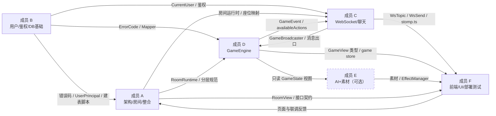
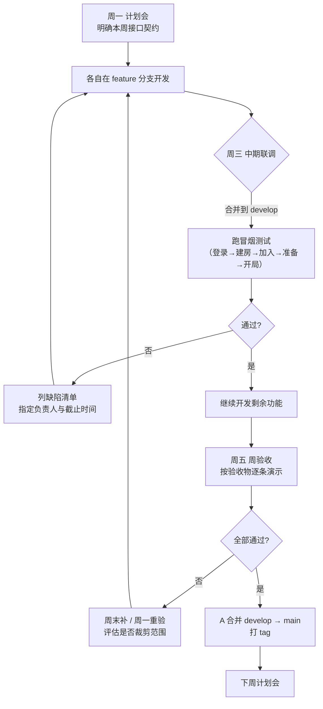
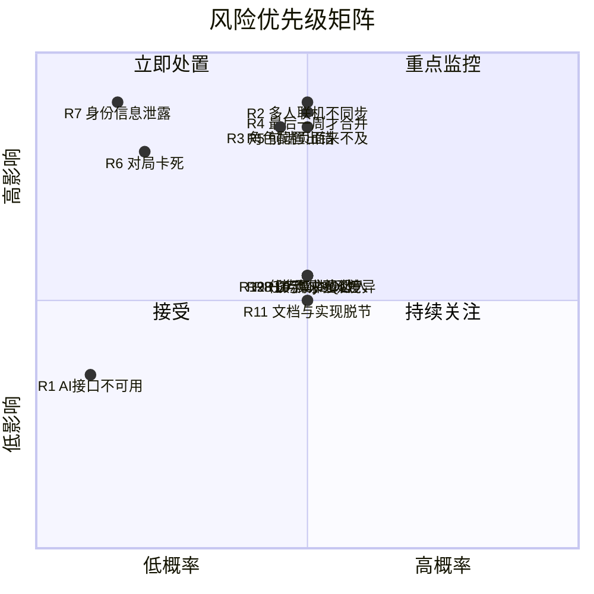

> 2026-10-29 版本提示：本文含早期狼人杀设计与操作示例。当前交付范围、规则和生产运行方式以 [当前状态](JIUJIU_CURRENT_STATUS.md)、[运行与部署](RELEASE_AND_OPERATIONS.md) 及对应阶段报告为准；旧的角色/人数/多数决、禁止 WebRTC 或删除卷升级等说法已被新需求覆盖。

# 团队协作计划（TEAM_PLAN）

> 本文档面向**六人开发小组**，解决一个问题：**每个人清楚自己负责哪些文件、每周要交付什么、代码怎么合并、风险怎么应对**。

---

## 一、项目概况与交付范围

| 项 | 内容 |
| --- | --- |
| 项目名称 | 基于 AI 增强的多人在线狼人杀系统 |
| 团队规模 | 6 人（成员 A ~ F） |
| 周期 | 约 6 周 |
| 技术栈 | Java 17 + Spring Boot 3.3.5 + MyBatis-Plus + MySQL 8/H2 + WebSocket(STOMP)；Vue3 + TypeScript + Vite + Element Plus + Pinia |
| 架构 | 单体应用（**禁止**微服务、Kafka、RabbitMQ、WebRTC） |
| **本轮交付范围** | **基础功能（P0 核心闭环）**：注册登录 → 创建房间 → 多人加入 → 准备 → 开始 → 夜晚/白天/讨论/投票 → 胜负 → 聊天。**AI 元素默认全部关闭，作为可选增强** |

### 1.1 本轮交付完成的基础功能清单

以下功能**已全部完成并可用**，是本轮的验收内容：

| # | 功能模块 | 具体能力 | 主要位置 |
| --- | --- | --- | --- |
| 1 | **账号** | 注册、登录、退出、JWT 无状态鉴权、刷新保持登录 | `auth/`、`user/`、`config/SecurityConfig.java` |
| 2 | **房间生命周期** | 创建（自定义人数/狼数/密码/公开性）、按房间码加入、退出、房主解散 | `room/RoomController.java`、`RoomService.java` |
| 3 | **座位管理** | 最小空位分配、准备/取消准备、房主踢人、房主退出即解散、座位号重排 | `room/runtime/RoomRuntime.java`、`RoomService.kick/removeBots/renumberSeats` |
| 4 | **开局校验** | 人数 ≥ 4、除房主外的真人已准备、角色配置合法 | `RoomService.startGame`、`RoleAssigner.validateConfig` |
| 5 | **角色系统** | 狼人 / 预言家 / 女巫 / 平民；预言家与女巫**恒定各 1 名**（4 人局也保留，`REQUIRED_SPECIAL_ROLES = 2`），发牌打乱 | `game/domain/RoleType.java`、`RoleAssigner.java` |
| 6 | **夜晚** | 狼人刀人（多数决）、预言家查验（不可重复/不可查自己）、女巫解药/毒药/空过 | `game/engine/WerewolfGameEngine.java` |
| 7 | **夜晚结算** | 解药优先于狼刀、毒药独立生效、死讯排序、平安夜判定 | `WerewolfGameEngine.resolveNight` |
| 8 | **白天与讨论** | 公布死讯、从死者下一位开始的环形发言顺序、仅当前发言人可发言 | `WerewolfGameEngine.buildSpeakOrder/speak` |
| 9 | **投票** | 最高票放逐、平票无人出局、弃票、不能投自己、不能重复投票 | `WerewolfGameEngine.vote/abstain/resolveVoting` |
| 10 | **胜负与复盘** | 狼人全灭 → 好人胜；狼数 ≥ 好人数 → 狼人胜；结束后公开全部身份 | `WerewolfGameEngine.checkWinnerInternal`、`GameViewProjector` |
| 11 | **实时同步** | STOMP 广播房间/状态/事件，私有状态按座位投递 | `config/WebSocketConfig.java`、`websocket/` |
| 12 | **局内聊天** | 公共 / 私聊 / 狼人 三频道，可见性由服务端裁剪，历史记录过滤 | `websocket/ChatService.java`、`ChatController.java` |
| 13 | **断线重连** | 刷新页面自动恢复、WebSocket 自动重连 + 状态补齐、离线消息队列 | `RoomWsController.sync/me`、`frontend/src/websocket/stomp.ts` |
| 14 | **超时兜底** | 任何阶段超时都自动推进，对局永不卡死 | `WerewolfGameEngine.autoCompleteCurrentPhase`、`RoomRuntime.onPhaseTimeout` |
| 15 | **数据持久化** | 五张表（users/rooms/room_players/messages/game_records）、房间回收、战绩统计 | `db/h2/schema.sql`、`RoomService.saveGameRecord` |
| 16 | **UI 与素材** | 登录/大厅/房间/对局/战绩页面、原创 SVG 角色卡与 8 个特效、牌桌与品牌素材 | `frontend/src/`、`frontend/public/assets/` |

### 1.2 可选增强（默认关闭，不计入本轮验收）

| 能力 | 代码位置 | 默认状态 | 开启方式 |
| --- | --- | --- | --- |
| AI NPC（规则 AI） | `backend/.../ai/RuleAgent.java`、`AiService.java` | ⏸ 关闭 | `WEREWOLF_AI_ENABLED=true` + 建房时 `"allowAi":true,"aiCount":N` |
| AI NPC（LLM 驱动） | `backend/.../ai/LlmAgent.java`、`ChatCompletionClient.java` | ⏸ 关闭 | 同上 + `WEREWOLF_AI_API_KEY` |

> **重要**：`werewolf.ai.enabled` 默认为 `false`，`CreateRoomRequest.allowAi` 默认为 `false`、`aiCount` 默认为 `0`。**系统默认不会向任何外部 LLM 发起请求，也不需要 API Key。**

---

## 二、六人分工表

| 成员 | 角色定位 | 职责范围 | 主要交付物 | 依赖关系 |
| --- | --- | --- | --- | --- |
| **成员 A** | 项目架构 / 房间系统 / 最终整合 | ① 搭建后端骨架与分层规范；② 房间全生命周期（创建/加入/退出/踢人/改配置/解散）；③ 运行时容器（`RoomRuntime` / `RoomManager` / 每秒 tick 调度器）；④ 统一 API / WebSocket / DB 规范；⑤ **最终合并与集成验证**；⑥ 环境配置与 Maven 依赖管理 | `room/**`、`config/**`（除 AI 配置）、`backend/pom.xml`、`docs/API.md`、`docs/WEBSOCKET.md`、根 `README.md` | **被所有人依赖**（接口规范先行）。依赖 B 的用户体系、C 的消息出口、D 的引擎 |
| **成员 B** | 用户 / 登录 / JWT / 数据库基础 | ① 用户实体与 Mapper；② 注册/登录/退出/资料修改；③ JWT 签发验签 + `JwtAuthenticationFilter`；④ Spring Security 配置（白名单、CORS、BCrypt）；⑤ **五张表的建表脚本与索引**；⑥ 统一响应体、错误码、全局异常处理；⑦ 演示账号初始化 | `auth/**`、`user/**`、`common/**`、`database/schema.sql`、`docs/DATABASE.md` | **被所有人依赖**（鉴权与错误码先行）。为 A 的房间表、C 的消息表、D 的对局记录表提供基础 |
| **成员 C** | WebSocket + 局内聊天 | ① STOMP 配置（端点、Broker、拦截器）；② 目的地常量与握手/CONNECT 鉴权；③ 出站消息出口 `GameEventMessenger`；④ 三频道聊天服务与可见性裁剪；⑤ 聊天历史接口；⑥ 断线重连协议；⑦ 前端 STOMP 客户端封装与 chat store | `websocket/**`、`config/WebSocketConfig.java`、`config/TokenHandshakeInterceptor.java`、`frontend/src/websocket/stomp.ts`、`frontend/src/stores/chat.ts`、`frontend/src/components/ChatPanel.vue` | 依赖 B 的 `UserPrincipal` / `CurrentUser`；**为 D 提供事件广播通道**；依赖 A 的房间运行时取座位映射 |
| **成员 D** | 狼人杀 GameEngine | ① 领域模型（`GamePhase` / `RoleType` / `ActionType` / `GameState` / `PlayerState` / `GameAction` / `GameEvent`）；② **状态机与全部游戏规则**（发牌、夜晚结算、发言顺序、投票、胜负）；③ 视图投影与隐私裁剪（`GameViewProjector` / `GameView`）；④ 游戏接口（start/action/state/speeches/reset/meta）；⑤ 对局结束落库回调；⑥ 前端 game store | `game/**`、`room/runtime/RoomRuntime.java`（与 A 共同）、`frontend/src/stores/game.ts`、`docs/GAME_RULES.md` | 依赖 B 的错误码、A 的运行时容器、C 的广播接口（通过 `GameBroadcaster` 接口解耦） |
| **成员 E** | AI NPC + AI 视觉素材（**可选增强**） | ① AI 决策链路（`AiService` / `LlmAgent` / `RuleAgent`）；② Prompt 模板与输出严格校验；③ 上下文构造（只填公开信息）；④ AI 调度与成本控制；⑤ **全部视觉素材**（角色卡、图标、标记、8 个特效、12 个头像、品牌与牌桌）；⑥ 前端特效调度器与特效样式；⑦ AI 配置文件 | `ai/**`、`config/AiProperties.java`、`frontend/public/assets/**`、`frontend/src/components/EffectManager.vue`、`frontend/src/styles/effects.css`、`docs/AI_DESIGN.md` | 依赖 D 的 `GameState` 与 `availableActions`（只读）；依赖 C 的事件广播。**默认关闭，不阻塞任何人的进度** |
| **成员 F** | Vue 前端 + UI + 部署测试 | ① 全部业务页面（登录/大厅/房间/对局/战绩/404）；② 全局骨架与设计令牌；③ 路由与登录守卫；④ API 封装与 Pinia store（auth/room）；⑤ Docker / Nginx / Compose 部署；⑥ 测试计划与手工用例；⑦ 最终 UI 打磨 | `frontend/src/views/**`、`frontend/src/components/**`（除 EffectManager）、`frontend/src/styles/main.css`、`frontend/src/App.vue`、`frontend/src/router/index.ts`、`frontend/src/api/**`、`frontend/src/stores/auth.ts`、`frontend/src/stores/room.ts`、`frontend/index.html`、`frontend/nginx.conf`、`frontend/Dockerfile`、`backend/Dockerfile`、`deploy/**`、`docs/DEPLOY.md`、`docs/TEST_PLAN.md` | 依赖所有人的后端接口（按 `frontend/src/types/index.ts` 的类型定义开发）；**最后一周主导部署与测试** |

### 2.1 依赖关系图



> **虚线框的成员 E** 表示其交付物是**可选增强**，默认关闭，不阻塞关键路径。

### 2.2 通信约定

| 场景 | 约定 |
| --- | --- |
| 接口先行 | A 在**第 1 周周三**前把 `docs/API.md` 的接口清单定稿，所有人按它开发 |
| 类型先行 | `frontend/src/types/index.ts` 是与后端 DTO 的**唯一契约**，改后端字段必须同步改它 |
| 一个人一个包 | 严格遵守「模块边界」，**不跨模块改文件**。需要别人改时在群里说明，由对方改 |
| 每日同步 | 每天 10 分钟站会：昨天做了什么 / 今天做什么 / 有没有被卡住 |
| 阻塞升级 | 被卡住超过 **2 小时**就在群里说出来，不要自己硬扛 |

---

## 三、本项目实际的文件归属映射表

> **这是本文档的核心价值**：把仓库里**每一个目录与关键文件**映射到具体负责人。写代码前先查这张表，避免改错别人的文件。

### 3.1 后端（`backend/`）

| 路径 | 负责人 | 说明 |
| --- | --- | --- |
| `backend/pom.xml` | **A** | Maven 依赖与版本，**任何人加依赖都要经过 A** |
| `backend/src/main/java/com/werewolf/WerewolfApplication.java` | **A** | 启动类（`@SpringBootApplication` / `@ConfigurationPropertiesScan` / `@MapperScan` / `@EnableScheduling`） |
| `backend/src/main/java/com/werewolf/common/ApiResponse.java` | **B** | 统一响应体 |
| `backend/src/main/java/com/werewolf/common/ErrorCode.java` | **B** | 错误码枚举。**新增错误码必须同步 `docs/API.md` 与 `frontend/src/types/index.ts`** |
| `backend/src/main/java/com/werewolf/common/BizException.java` | **B** | 业务异常 |
| `backend/src/main/java/com/werewolf/common/GlobalExceptionHandler.java` | **B** | 全局异常处理 |
| `backend/src/main/java/com/werewolf/auth/AuthController.java` | **B** | 注册/登录/退出 |
| `backend/src/main/java/com/werewolf/auth/AuthService.java` | **B** | 注册逻辑、BCrypt、昵称唯一性、资料修改 |
| `backend/src/main/java/com/werewolf/auth/dto/RegisterRequest.java` | **B** | 注册请求 + 参数校验 |
| `backend/src/main/java/com/werewolf/auth/dto/LoginRequest.java` | **B** | 登录请求 |
| `backend/src/main/java/com/werewolf/auth/dto/AuthResponse.java` | **B** | 登录响应 + `UserInfo` |
| `backend/src/main/java/com/werewolf/auth/security/UserPrincipal.java` | **B** | 认证主体（同时实现 `UserDetails` 与 `Principal`，`getName()` 返回 userId） |
| `backend/src/main/java/com/werewolf/auth/security/JwtTokenService.java` | **B** | JWT 签发与验签 |
| `backend/src/main/java/com/werewolf/auth/security/JwtAuthenticationFilter.java` | **B** | REST 过滤器；`claimsOf` / `authenticate` 也被 C 的 STOMP 拦截器复用 |
| `backend/src/main/java/com/werewolf/auth/security/DbUserDetailsService.java` | **B** | 从数据库加载用户 |
| `backend/src/main/java/com/werewolf/auth/security/CurrentUser.java` | **B** | 读取当前登录用户（REST 与 STOMP 共用） |
| `backend/src/main/java/com/werewolf/user/entity/User.java` | **B** | `users` 表实体 |
| `backend/src/main/java/com/werewolf/user/mapper/UserMapper.java` | **B** | `BaseMapper<User>` |
| `backend/src/main/java/com/werewolf/user/UserController.java` | **B** | `/api/users/me`（GET/PUT）、`/api/health` |
| `backend/src/main/java/com/werewolf/config/SecurityConfig.java` | **B** | 安全过滤器链、白名单、CORS、BCrypt |
| `backend/src/main/java/com/werewolf/config/DemoDataInitializer.java` | **B** | H2 演示账号初始化（`@Profile("h2")`） |
| `backend/src/main/java/com/werewolf/config/AppProperties.java` | **A** | JWT / CORS / Room / Phase 配置绑定 |
| `backend/src/main/java/com/werewolf/config/AiProperties.java` | **E** | AI 配置绑定（`werewolf.ai.*`） |
| `backend/src/main/java/com/werewolf/config/WebSocketConfig.java` | **C** | STOMP 端点与 Broker 配置 |
| `backend/src/main/java/com/werewolf/config/TokenHandshakeInterceptor.java` | **C** | 握手时把 `?token=` 存进 session attributes |
| `backend/src/main/java/com/werewolf/room/RoomController.java` | **A** | 房间全部 REST 接口（10 个） |
| `backend/src/main/java/com/werewolf/room/RoomService.java` | **A** | 房间生命周期、座位管理、落库、对局结束回调 |
| `backend/src/main/java/com/werewolf/room/entity/Room.java` | **A** | `rooms` 表实体 |
| `backend/src/main/java/com/werewolf/room/entity/RoomPlayer.java` | **A** | `room_players` 表实体 |
| `backend/src/main/java/com/werewolf/room/mapper/RoomMapper.java` | **A** | `BaseMapper<Room>` |
| `backend/src/main/java/com/werewolf/room/mapper/RoomPlayerMapper.java` | **A** | `BaseMapper<RoomPlayer>` |
| `backend/src/main/java/com/werewolf/room/dto/CreateRoomRequest.java` | **A** | 创建房间请求（**含 `allowAi=false` / `aiCount=0` 默认值**） |
| `backend/src/main/java/com/werewolf/room/dto/UpdateRoomRequest.java` | **A** | 修改房间请求 |
| `backend/src/main/java/com/werewolf/room/dto/JoinRoomRequest.java` | **A** | 加入房间请求 |
| `backend/src/main/java/com/werewolf/room/dto/RoomView.java` | **A** | 房间视图（含 `SeatView`） |
| `backend/src/main/java/com/werewolf/room/runtime/RoomManager.java` | **A** | 内存房间注册表（`ConcurrentHashMap` 双索引） |
| `backend/src/main/java/com/werewolf/room/runtime/RoomRuntimeScheduler.java` | **A** | 每秒 tick + 每 5 分钟回收空闲房间 |
| `backend/src/main/java/com/werewolf/room/runtime/GameBroadcaster.java` | **C** | 出站消息**接口**（让引擎可脱离 WebSocket 单测） |
| `backend/src/main/java/com/werewolf/room/runtime/SimpGameBroadcaster.java` | **C** | STOMP 实现 + **隐私裁剪** |
| `backend/src/main/java/com/werewolf/room/runtime/GameEndHandler.java` | **D** | 对局结束回调**接口** |
| `backend/src/main/java/com/werewolf/room/runtime/RoomRuntime.java` | **A + D** ⚠️ | **共同负责**：A 管座位/在线/tick/房间视图；D 管 `applyHumanAction` / 引擎交互 / `projectFor` / AI 调度接口。改动前先在群里说 |
| `backend/src/main/java/com/werewolf/room/runtime/WerewolfGameEngineFactory.java` | **D** | 引擎工厂（支持固定随机种子便于测试） |
| `backend/src/main/java/com/werewolf/game/domain/GamePhase.java` | **D** | 阶段枚举与默认时长 |
| `backend/src/main/java/com/werewolf/game/domain/RoleType.java` | **D** | 角色与阵营 |
| `backend/src/main/java/com/werewolf/game/domain/ActionType.java` | **D** | 行动类型 |
| `backend/src/main/java/com/werewolf/game/domain/GameState.java` | **D** | 一局完整内存状态 |
| `backend/src/main/java/com/werewolf/game/domain/PlayerState.java` | **D** | 玩家状态（含查验记录、药水） |
| `backend/src/main/java/com/werewolf/game/domain/GameAction.java` | **D** | 行动请求对象 |
| `backend/src/main/java/com/werewolf/game/domain/GameEvent.java` | **D** | 事件与可见性标记 |
| `backend/src/main/java/com/werewolf/game/domain/RoleAssigner.java` | **D** | 发牌与配置校验 |
| `backend/src/main/java/com/werewolf/game/engine/WerewolfGameEngine.java` | **D** | ⭐ **核心状态机，规则唯一权威** |
| `backend/src/main/java/com/werewolf/game/engine/GameActionResult.java` | **D** | 引擎执行结果 |
| `backend/src/main/java/com/werewolf/game/dto/GameView.java` | **D** | 游戏状态视图 |
| `backend/src/main/java/com/werewolf/game/dto/GameViewProjector.java` | **D** | ⭐ **隐私裁剪最后一道闸门** |
| `backend/src/main/java/com/werewolf/game/dto/ActionRequest.java` | **D** | 行动请求体 |
| `backend/src/main/java/com/werewolf/game/GameController.java` | **D** | 7 个游戏接口 |
| `backend/src/main/java/com/werewolf/game/GameService.java` | **D** | 行动唯一入口 + 状态查询 |
| `backend/src/main/java/com/werewolf/game/entity/GameRecord.java` | **D** | `game_records` 表实体 |
| `backend/src/main/java/com/werewolf/game/mapper/GameRecordMapper.java` | **D** | `BaseMapper<GameRecord>` |
| `backend/src/main/java/com/werewolf/websocket/WsDestinations.java` | **C** | 目的地常量（**前后端契约**） |
| `backend/src/main/java/com/werewolf/websocket/WsAuthChannelInterceptor.java` | **C** | STOMP CONNECT 帧鉴权 |
| `backend/src/main/java/com/werewolf/websocket/GameEventMessenger.java` | **C** | ⭐ **所有出站消息的唯一出口** |
| `backend/src/main/java/com/werewolf/websocket/RoomWsController.java` | **C** | 10 个 STOMP 入口 |
| `backend/src/main/java/com/werewolf/websocket/ChatService.java` | **C** | 三频道聊天 + 可见性裁剪 |
| `backend/src/main/java/com/werewolf/websocket/ChatController.java` | **C** | 聊天历史与 HTTP 兜底发送 |
| `backend/src/main/java/com/werewolf/websocket/LobbyController.java` | **C** | 大厅列表 REST + STOMP 重同步 |
| `backend/src/main/java/com/werewolf/websocket/entity/Message.java` | **C** | `messages` 表实体 |
| `backend/src/main/java/com/werewolf/websocket/mapper/MessageMapper.java` | **C** | `BaseMapper<Message>` |
| `backend/src/main/java/com/werewolf/ai/AiService.java` | **E** | AI 决策统一入口（路由/降级/延迟/计数） |
| `backend/src/main/java/com/werewolf/ai/AiAgent.java` | **E** | 决策器接口 |
| `backend/src/main/java/com/werewolf/ai/LlmAgent.java` | **E** | LLM 决策器 |
| `backend/src/main/java/com/werewolf/ai/RuleAgent.java` | **E** | 规则 AI 兜底 |
| `backend/src/main/java/com/werewolf/ai/AiPrompt.java` | **E** | Prompt 模板 |
| `backend/src/main/java/com/werewolf/ai/AiJsonParser.java` | **E** | 输出严格校验 |
| `backend/src/main/java/com/werewolf/ai/AiContextBuilder.java` | **E** | 上下文构造（只填公开信息） |
| `backend/src/main/java/com/werewolf/ai/ChatCompletionClient.java` | **E** | OpenAI 兼容 HTTP 客户端 |
| `backend/src/main/java/com/werewolf/ai/BotRoster.java` | **E** | AI 昵称与头像花名册 |
| `backend/src/main/java/com/werewolf/ai/AiRuntimeView.java` | **E** | AI 侧只读视图接口 |
| `backend/src/main/java/com/werewolf/ai/dto/AiContext.java` | **E** | AI 上下文 DTO |
| `backend/src/main/java/com/werewolf/ai/dto/AiDecision.java` | **E** | AI 决策结果 |
| `backend/src/main/resources/application.yml` | **A** | 公共配置（端口/JWT/CORS/阶段时长/AI 开关） |
| `backend/src/main/resources/application-h2.yml` | **A** | H2 演示 profile |
| `backend/src/main/resources/application-mysql.yml` | **A** | MySQL 生产 profile |
| `backend/src/main/resources/db/h2/schema.sql` | **B** | H2 建表脚本（五张表 + 三个索引） |
| `backend/src/test/java/com/werewolf/**` | **D（引擎）+ E（AI）+ C（WebSocket）** | ✅ 已交付：最近一次 `mvn test` 为 **7 个测试类 / 70 个用例**，全部通过；测试计划中的早期清单见 [docs/TEST_PLAN.md](TEST_PLAN.md) 第二节 |
| `backend/Dockerfile` | **F** | ✅ 已交付：多阶段构建（`maven:3.9-eclipse-temurin-17` → `eclipse-temurin:17-jre-jammy`） |

### 3.2 前端（`frontend/`）

| 路径 | 负责人 | 说明 |
| --- | --- | --- |
| `frontend/package.json` | **F** | 依赖与脚本，**任何人加依赖都要经过 F** |
| `frontend/vite.config.ts` | **F** | 别名、dev 代理（`/api` 与 `/ws`）、分包 |
| `frontend/tsconfig.json` | **F** | TS 严格模式配置 |
| `frontend/env.d.ts` | **F** | Vite 环境变量与 `*.vue` 类型声明 |
| `frontend/pnpm-workspace.yaml` | **F** | 允许 esbuild / vue-demi 运行安装脚本 |
| `frontend/.env.example` | **F** | 环境变量样例 |
| `frontend/index.html` | **F** | ✅ 已交付：Vite 入口页（含首屏骨架，避免白屏） |
| `frontend/nginx.conf` | **F** | ✅ 已交付：生产静态站点 + `/api` 与 `/ws` 反向代理（gzip / 缓存 / WebSocket 升级头） |
| `frontend/Dockerfile` | **F** | ✅ 已交付：多阶段构建（`node:20-alpine` → `nginx:1.27-alpine`，pnpm 安装） |
| `frontend/src/main.ts` | **F** | 应用入口（Pinia / Router / Element Plus / 断线跳登录） |
| `frontend/src/App.vue` | **F** | 全局骨架（背景 + 顶部导航 + 路由出口） |
| `frontend/src/router/index.ts` | **F** | 路由表与登录守卫 |
| `frontend/src/types/index.ts` | **D（主导）+ 全员** ⚠️ | **与后端 DTO 的唯一契约**。改后端字段必须同步改这里；错误码常量与 `ErrorCode.java` 一一对应 |
| `frontend/src/api/request.ts` | **F** | axios 封装、Token 注入、响应拦截、`onUnauthorized` |
| `frontend/src/api/auth.ts` | **B**（对应后端）+ F（编写） | 认证接口封装 |
| `frontend/src/api/room.ts` | **A**（对应后端）+ F（编写） | 房间与大厅接口封装 |
| `frontend/src/api/game.ts` | **D**（对应后端）+ F（编写） | 游戏接口封装 |
| `frontend/src/api/chat.ts` | **C**（对应后端）+ F（编写） | 聊天接口封装 |
| `frontend/src/stores/auth.ts` | **B**（对应后端）+ F（编写） | 登录态、localStorage、登出清理 |
| `frontend/src/stores/room.ts` | **A**（对应后端）+ F（编写） | 房间状态、订阅、准备/踢人/解散 |
| `frontend/src/stores/game.ts` | **D** | 对局状态（公共/私有双通道）、事件→特效队列、行动提交 |
| `frontend/src/stores/chat.ts` | **C** | 三频道聊天、未读数、可见性过滤 |
| `frontend/src/websocket/stomp.ts` | **C** | STOMP 客户端封装、订阅路由表、自动重连、离线队列 |
| `frontend/src/components/EffectManager.vue` | **E** | 特效队列播放器 |
| `frontend/src/components/ChatPanel.vue` | **C** | ✅ 已交付：聊天面板 UI（三频道切换） |
| `frontend/src/components/**`（除上面两个） | **F** | ✅ 已交付：`RoleCard` / `PlayerSeat` / `RoomSeatGrid` / `PhaseTimer` / `GameLogPanel` |
| `frontend/src/views/LoginView.vue` | **F** | ✅ 已交付（登录 / 注册） |
| `frontend/src/views/LobbyView.vue` | **F** | ✅ 已交付（大厅 + 建房 + 加入） |
| `frontend/src/views/RoomView.vue` | **F** | ✅ 已交付（座位 / 准备 / 踢人 / 解散） |
| `frontend/src/views/GameView.vue` | **F** | ✅ 已交付（对局主界面） |
| `frontend/src/views/RecordsView.vue` | **F** | ✅ 已交付（战绩页） |
| `frontend/src/views/NotFoundView.vue` | **F** | ✅ 已交付（404） |
| `frontend/src/styles/main.css` | **F** | 设计令牌与全局样式 |
| `frontend/src/styles/effects.css` | **E** | 特效关键帧 |
| `frontend/public/assets/**` | **E** | 全部素材（roles 13 个 / effects 8 个 / avatars 12 个 / brand 1 个 / table-felt 1 个） |

> **交付状态**：本节标记 ✅ 的路径**在当前仓库中都已存在**。下表为「谁负责这个文件」，用于代码评审时找对人，不再表示「待交付」。

### 3.3 数据库与部署

| 路径 | 负责人 | 说明 |
| --- | --- | --- |
| `database/schema.sql` | **B** | ✅ 已交付：MySQL 8 建库建表脚本（五张表 + 索引 + 字段注释 + 外键），规格见 [docs/DATABASE.md](DATABASE.md) 第九节 |
| `database/seed.sql` | **B** | ✅ 已交付：可选种子数据（2 条示例对局记录；**不含账号**，BCrypt 哈希必须由 `PasswordEncoder` 现场生成） |
| `database/README.md` | **B** | ✅ 已交付：执行脚本、创建专用账号、切换 mysql profile |
| `deploy/docker-compose.yml` | **F** | ✅ 已交付：MySQL 8 + 后端 + 前端 编排（healthcheck + 自定义网络 + `mysql-data` 卷） |
| `deploy/.env.example` | **F** | ✅ 已交付：部署环境变量样例（`WEREWOLF_AI_ENABLED=false` 为默认） |
| `deploy/README.md` | **F** | ✅ 已交付：三种运行方式 + 验证方法 |
| `deploy/nginx-standalone.conf` | **F** | ✅ 已交付：不用 Docker 的裸机 Nginx 示例（含 HTTPS 注释） |

### 3.4 文档

| 路径 | 负责人 | 说明 |
| --- | --- | --- |
| `README.md` | **A** | 项目入口：快速开始、功能清单、FAQ、验收对照 |
| `PROJECT_HANDBOOK.md` | **A** | 方案条目 → 代码位置对照 |
| `docs/ARCHITECTURE.md` | **A** | 系统架构、服务器权威、并发模型 |
| `docs/API.md` | **A**（+ 各自模块的接口由负责人补充） | REST 契约与错误码全表 |
| `docs/WEBSOCKET.md` | **C** | STOMP 协议、事件表、时序图 |
| `docs/GAME_RULES.md` | **D** | 规则、状态机、示例对局 |
| `docs/AI_DESIGN.md` | **E** | 可选增强：AI 设计与 Prompt |
| `docs/DATABASE.md` | **B** | ER 图、字段说明、运维 SQL |
| `docs/TEAM_PLAN.md` | **A** | 本文件 |
| `docs/DEPLOY.md` | **F** | 部署与环境变量 |
| `docs/TEST_PLAN.md` | **F**（+ D/E/C 补自动化用例） | ✅ 已交付：测试分层、自动化与手工用例、13 条验收对照、性能测试、10 分钟答辩脚本；当前后端测试结果为 7 类 / 70 例 |

### 3.5 归属冲突处理约定

| 情况 | 处理方式 |
| --- | --- |
| 要改别人的文件 | **先在群里说**，由负责人改；紧急情况可以先改，但**必须在 PR 描述里点名说明** |
| 要加 Maven / npm 依赖 | 找 A（后端）或 F（前端），由他们改 `pom.xml` / `package.json` |
| 要改 `ErrorCode.java` | 找 B，并同步 `docs/API.md` 与 `frontend/src/types/index.ts` |
| 要改 `WsDestinations.java` | 找 C，并同步 `docs/WEBSOCKET.md` 与 `frontend/src/websocket/stomp.ts` |
| 要改 `frontend/src/types/index.ts` | 找 D（主导），确认后端 DTO 确实改了 |
| 要改 `RoomRuntime.java` | **A 与 D 都要同意**（两人共管） |
| 要改 `application.yml` | 找 A（`werewolf.ai.*` 部分找 E） |

---

## 四、六周开发计划表

| 周次 | 目标 | 主要工作 | 验收物（周末必须能演示） | 负责人 |
| --- | --- | --- | --- | --- |
| **第 1 周** | **项目初始化**：跑通「能登录」 | ① A：Maven 骨架、分层规范、`application.yml`、接口清单定稿；② B：用户表、注册登录、JWT、`SecurityConfig`、统一响应体与错误码、全局异常；③ F：Vite + Vue3 + TS + Element Plus 骨架、路由、`request.ts`、登录页；④ 全员：Git 仓库与分支策略、`types/index.ts` 初稿 | ① `mvn spring-boot:run` 能启动、`/api/health` 返回 UP；② 用 `demo/demo1234` 在前端登录成功并跳转大厅；③ `docs/API.md` 里认证部分定稿 | A（主）、B、F |
| **第 2 周** | **房间系统**：跑通「建房 → 加入 → 准备」 | ① A：`Room` 实体、`RoomController`、`RoomService`、`RoomManager`/`RoomRuntime`、房间码生成、密码 BCrypt；② F：大厅页、创建房间表单、房间页座位表；③ B：`rooms`/`room_players` 建表脚本与落库；④ C：`WebSocketConfig` + `WsDestinations` + 握手/CONNECT 鉴权 + `GameEventMessenger` 雏形 | ① 4 个浏览器窗口能创建并加入同一个房间；② 座位表实时同步（不刷新）；③ 准备状态实时同步；④ 错误密码返回 3001、满员返回 3002 | A（主）、F、B、C |
| **第 3 周** | **狼人杀核心**：跑通「单人 + AI 走完一整局」 | ① D：全部 `domain` 类 + `WerewolfGameEngine` 状态机 + 角色分配 + 夜晚结算 + 发言顺序 + 投票 + 胜负；② D：`GameViewProjector` 隐私裁剪 + 游戏接口；③ C：`SimpGameBroadcaster` 出站裁剪；④ E：素材（角色卡 13 个）+ `EffectManager.vue`；⑤ F：对局页骨架 | ① 未开 AI 时用 4 个窗口能开始游戏并各自看到自己身份；② 夜晚三个角色能行动、天亮死讯一致；③ 讨论按序发言、投票放逐生效；④ 分出胜负并公开身份 | D（主）、C、E、F |
| **第 4 周** | **多人联机 MVP —— 生死线** ⚠️ | ① 全员：**4 个真人浏览器窗口完整玩完一局**；② C：三频道聊天 + `ChatPanel.vue`；③ D：断线重连（`sync`/`me`/`resync`）+ 超时兜底；④ A：房主踢人/解散/改配置；⑤ F：过一遍 UI 与错误提示；⑥ A：**冻结扩展功能**（若生死线未过） | ① **第 4 周生死线检查清单全部通过**（见第五节）；② 聊天三个频道可见性正确；③ 刷新页面状态能恢复；④ 全程不操作也能靠超时走完一局 | **全员** |
| **第 5 周** | **AI 增强 —— 可选 / 可裁剪** ⏸ | **本阶段标记为可选：若第 4 周生死线未过或时间紧张，本节内容整体裁剪，不影响本轮基础功能交付。**<br/>① E：`AiService`/`LlmAgent`/`RuleAgent`/`AiPrompt`/`AiJsonParser`/`AiContextBuilder`；② E：AI 调度、成本控制、延迟；③ E：8 个特效素材 + `effects.css`；④ D：`RoomRuntime` 的 AI 调度接入点；⑤ F：AI 相关 UI（AI 标识、提供方提示） | ① 开启 `WEREWOLF_AI_ENABLED=true` 后，建 `aiCount=3` 的房间能一个人开局；② AI 能发言、投票、执行角色技能；③ 不配 API Key 时自动降级规则 AI；④ 特效素材在任意一局都能正常播放 | E（主）、D、F |
| **第 6 周** | **收尾**：Bug 清零、UI 打磨、部署、测试报告、答辩材料 | ① F：Docker / Nginx / Compose 部署 + `docs/DEPLOY.md`；② F：`docs/TEST_PLAN.md` + 手工用例执行记录；③ F：UI 打磨（空状态、加载中、错误提示、响应式）；④ D/E：补自动化测试；⑤ A：**最终整合**、`README.md`、验收对照表、答辩 PPT 与演示脚本；⑥ 全员：Bug 清单清零 | ① `docker compose up -d` 一键起全栈；② 测试用例表全部执行完毕且有结论；③ 13 条验收标准逐条有结论；④ 10 分钟答辩演示脚本能流畅跑完；⑤ 全部文档与代码一致 | F（主）、A、全员 |

### 4.1 关键里程碑

```mermaid
gantt
    title 六周开发计划
    dateFormat X
    axisFormat %s

    section 第1周 初始化
    骨架/鉴权/登录          :done, w1, 0, 1

    section 第2周 房间系统
    建房/加入/准备/实时同步  :done, w2, 1, 2

    section 第3周 游戏核心
    GameEngine/隐私裁剪/素材 :done, w3, 2, 3

    section 第4周 生死线
    4浏览器完整对局/聊天/重连 :crit, done, w4, 3, 4

    section 第5周 AI增强（可选）
    AI NPC / LLM / 特效      :active, w5, 4, 5

    section 第6周 收尾
    部署/测试/文档/答辩       :w6, 5, 6
```



### 4.2 每周的固定节奏

| 时间 | 活动 | 产出 |
| --- | --- | --- |
| 周一上午 | 周计划会（30 分钟） | 本周任务看板、明确负责人 |
| 每天 10:00 | 站会（10 分钟） | 昨天/今天/阻塞 |
| 周三晚 | **中期联调**（合并到 `develop`，跑一次冒烟） | 联调记录、缺陷清单 |
| 周五下午 | **周验收**（按本表的「验收物」逐条演示） | 验收结论、下周计划 |
| 周日 | 各自补文档 | 文档与代码同步 |

---

## 五、第 4 周「生死线」检查清单

> **这是整个项目最重要的一条线。如果这 12 条跑不通，立即冻结 AI 增强、更多角色等扩展功能**（对应方案的砍功能顺序），把全部人力压到核心闭环上。

**前置条件**：后端以 `h2` profile 启动，前端 `pnpm dev` 已启动。

按顺序执行，**每一条都必须通过**：

| # | 检查项 | 具体操作 | 预期结果 | 负责 |
| --- | --- | --- | --- | --- |
| 1 | **服务能起来** | `curl http://localhost:8080/api/health` | `{"code":0,...,"status":"UP",...}` | A |
| 2 | **4 个独立窗口登录** | 打开 4 个浏览器窗口（**其中 2 个用无痕模式**），分别用 `demo` / `player1` / `player2` / `player3` 登录（密码 `demo1234`） | 4 个窗口都显示昵称，右上角显示绿色「实时已连接」 | B + C |
| 3 | **创建 4 人房** | 窗口 1：创建房间，房间名「答辩演示」，人数 `4`，狼人数 `1`，AI 数量 `0`，公开房间 ✅ | 自动进入房间页，记下 6 位房间码 | A |
| 4 | **3 个窗口加入** | 窗口 2/3/4 通过大厅列表或房间码加入 | ① 窗口 1 的座位表**自动出现** 2/3/4 号（**不刷新页面**）；② 各窗口「我的座位」依次为 2/3/4 | A + C |
| 5 | **准备同步** | 除房主外 3 个窗口点「准备」 | 房主看到「已准备 X/3」实时同步到 `3/3`；「开始游戏」按钮变为可用 | A + C |
| 6 | **开局与发牌** | 窗口 1 点「开始游戏」 | ① 4 个窗口都看到发牌特效（`hidden-back.svg`）；② **每个窗口只看到自己的身份卡**，其他 3 个座位显示卡背 | D + E + F |
| 7 | **夜晚权限隔离** | 观察 4 个窗口的夜晚界面 | ① 狼人窗口有刀人面板；② 预言家窗口有查验面板（可选目标不含自己）；③ **平民窗口只有「天黑请闭眼」遮罩，没有任何按钮** | D |
| 8 | **夜晚越权被拒** | 用**平民窗口**的 Token 执行：<br/>`curl -X POST http://localhost:8080/api/game/action -H "Authorization: Bearer $平民TOKEN" -H "Content-Type: application/json" -d '{"action":"WOLF_KILL","targetSeatId":2}'` | 返回 `{"code":4004,"message":"你的角色不能执行该操作",...}`；**且游戏状态完全不变** | D |
| 9 | **天亮死讯一致** | 夜晚结算后观察 4 个窗口 | 4 个窗口看到**完全一致的死讯**（例如都是「昨晚死亡：3 号」），或都是「昨晚是平安夜」 | D + C |
| 10 | **讨论按序发言** | 进入讨论阶段 | ① 只有**当前发言人**的窗口有输入框；② 其他窗口显示「轮到 X 号（昵称）发言」；③ 非当前发言人提交发言返回 `4002` | D |
| 11 | **投票与放逐** | 投票阶段各窗口投票 | ① 票数实时同步；② 得票最高者被放逐并公开身份；③ 平票时提示「投票平票，本轮无人出局」；④ 重复投票返回 `4009` | D |
| 12 | **进入下一轮直到结束** | 若未分胜负则进入下一夜，重复 7~11 | ① 最终弹出结算面板；② **4 个窗口的胜负结果完全一致**；③ 结算面板显示**全部 4 个玩家的真实身份**；④ 「再来一局」按钮可用 | D + F |

**附加（不阻塞生死线，但第 4 周应完成）**：

| # | 检查项 | 预期结果 |
| --- | --- | --- |
| 13 | 聊天三频道可见性 | 公共 4 人可见；私聊第 3 人不可见；好人发狼人频道返回 `4004` |
| 14 | 刷新页面状态恢复 | 任一窗口 F5 后自动回到对局页，倒计时/阶段/聊天记录全部恢复 |
| 15 | 超时兜底 | 全程不操作，对局也能自动从 NIGHT 走到 END（4 人局一轮约 235 秒；讨论阶段超时只跳过当前发言人并重置计时） |

**❌ 如果任一条不通过**：

1. **立即停止** AI 增强、更多角色、额外特效的开发；
2. 把阻塞点写进缺陷清单，指定负责人与截止时间；
3. 每日两次进度同步，直到 12 条全过；
4. 若周三仍未通过，**召开发起范围裁剪讨论**（砍到「4 人局 + 公共聊天 + 无重连」的最小可用集）。

---

## 六、Git 分支策略与提交规范

### 6.1 分支模型

```
main          ← 只接受来自 develop 的合并；每个合并点都是一个可演示的版本
  │
  └── develop ← 集成分支；所有人把自己的功能合并到这里
        │
        ├── feature/room-system          成员 A
        ├── feature/auth-jwt             成员 B
        ├── feature/websocket-chat       成员 C
        ├── feature/game-engine          成员 D
        ├── feature/ai-npc               成员 E
        ├── feature/frontend-ui          成员 F
        └── feature/deploy               成员 F
```

| 分支 | 用途 | 谁能推 | 保护规则 |
| --- | --- | --- | --- |
| `main` | **可交付版本**。只有经过周验收的版本才合并进来 | 只有 A | 禁止直接 push；只能通过 PR 从 `develop` 合并；必须打 tag（`v0.1` ~ `v1.0`） |
| `develop` | **集成分支**。日常开发的主干 | 全员（通过 PR） | 禁止直接 push；PR 需至少 1 人 review；合并前必须能 `mvn -q compile` 与 `pnpm typecheck` |
| `feature/*` | 个人功能分支 | 各自 | 从 `develop` 切出，命名 `feature/<模块>-<简述>` |
| `fix/*` | 缺陷修复 | 各自 | 命名 `fix/<模块>-<问题>` |
| `hotfix/*` | 紧急修复（`main` 上的问题） | A | 从 `main` 切出，修完同时合并回 `main` 和 `develop` |

### 6.2 日常操作流程

**开始新功能：**

```bash
git checkout develop
git pull origin develop
git checkout -b feature/game-engine
```

**提交：**

```bash
git add <你负责的文件>        # ⚠️ 不要 git add .（避免把别人的半成品带进来）
git commit -m "feat(game): 实现夜晚狼人多数决与同伴保护"
git push origin feature/game-engine
```

**合并前同步主干（避免冲突堆积）：**

```bash
git checkout develop
git pull origin develop
git checkout feature/game-engine
git rebase develop          # 或 git merge develop
# 解决冲突后
git push --force-with-lease origin feature/game-engine
```

**提 PR** → review → 合并到 `develop`。

**每周验收后合并到 main（由 A 操作）：**

```bash
git checkout main
git pull origin main
git merge --no-ff develop -m "chore(release): 第 4 周验收版本 v0.4"
git tag -a v0.4 -m "第 4 周：4 浏览器完整对局跑通"
git push origin main --tags
```

### 6.3 提交规范（Conventional Commits）

**格式：**

```
<type>(<scope>): <简短中文描述>

[可选正文：为什么这么改]
[可选脚注：BREAKING CHANGE / Closes #12]
```

**`type` 取值：**

| type | 用途 |
| --- | --- |
| `feat` | 新功能 |
| `fix` | 缺陷修复 |
| `docs` | 只改文档 |
| `style` | 格式调整（不影响逻辑） |
| `refactor` | 重构（不新增功能、不修缺陷） |
| `perf` | 性能优化 |
| `test` | 新增或修改测试 |
| `chore` | 构建/依赖/配置 |
| `revert` | 回滚 |

**`scope` 取值**（对应模块）：`auth` / `user` / `room` / `game` / `ws` / `chat` / `ai` / `ui` / `deploy` / `docs` / `db`

**五条中文示例：**

```bash
git commit -m "feat(auth): 实现注册登录与 JWT 签发，Token 有效期 24 小时"

git commit -m "feat(game): 实现夜晚结算，解药优先于狼刀、毒药独立生效"

git commit -m "fix(room): 房主退出时改为解散房间，避免出现无主房间"

git commit -m "docs(api): 补全 ErrorCode 全表与 26 个接口的 curl 示例"

git commit -m "refactor(ws): 把事件可见性裁剪从 RoomRuntime 收敛到 SimpGameBroadcaster"
```

**带 BREAKING CHANGE 的示例：**

```bash
git commit -m "refactor(api): 统一响应体改为 {code,message,data,timestamp}

BREAKING CHANGE: 原 {success,data} 结构不再兼容，
前端 request.ts 的响应拦截器已同步修改。"
```

**提交信息的三条纪律：**

1. **一次提交只做一件事**——不要把「改 bug」和「调格式」混在一个 commit；
2. **描述写「为什么」而不是「做了什么」**（做了什么看 diff 就知道）；
3. **禁止** `update` / `fix bug` / `111` 这类无信息量的提交信息。

### 6.4 `.gitignore` 要点

```gitignore
# 后端
backend/target/
*.class
*.log

# 前端
frontend/node_modules/
frontend/dist/
frontend/.env.local

# IDE
.idea/
.vscode/
*.iml

# 系统
.DS_Store
Thumbs.db
```

> ⚠️ **千万不要提交**：`node_modules/`、`target/`、`.env`（含真实 API Key）、任何 `*.log`。`frontend/.env.example` 可以提交（它是模板）。

---

## 七、Pull Request 模板与 Code Review 检查项

### 7.1 PR 模板

把以下内容保存为 `.github/pull_request_template.md`：

```markdown
## 变更类型
<!-- 勾选一项 -->
- [ ] feat 新功能
- [ ] fix 缺陷修复
- [ ] docs 文档
- [ ] refactor 重构
- [ ] test 测试
- [ ] chore 构建/配置

## 关联
- 关联 Issue / 任务：#
- 负责模块（A/B/C/D/E/F）：

## 改了什么
<!-- 用 3~5 条说清，不要贴大段 diff -->
-
-

## 为什么这么改
<!-- 说明设计取舍；如果推翻了之前的方案，说明原因 -->

## 影响的文件
<!-- 列出所有改动文件，特别标注「改动了别人负责的文件」 -->
| 文件 | 负责人 | 改动内容 |
| --- | --- | --- |
|  |  |  |

## 自测情况
<!-- 必须真实填写 -->
- [ ] 后端能启动：`cd backend && mvn -q -DskipTests package`
- [ ] 前端类型检查通过：`cd frontend && pnpm typecheck`
- [ ] 手工验证步骤：
  1.
  2.
- [ ] 截图 / 录屏（涉及 UI 时必填）

## 契约同步检查
- [ ] 新增/修改了接口 → 已更新 `docs/API.md`
- [ ] 新增/修改了 WebSocket 目的地或事件 → 已更新 `docs/WEBSOCKET.md`
- [ ] 新增了错误码 → 已同步 `frontend/src/types/index.ts` 的 `ErrorCode`
- [ ] 改了后端 DTO 字段 → 已同步 `frontend/src/types/index.ts`
- [ ] 改了表结构 → 已同步 `backend/src/main/resources/db/h2/schema.sql` 与 `database/schema.sql`
- [ ] 改了游戏规则 → 已更新 `docs/GAME_RULES.md`
- [ ] 以上均不适用

## 遗留问题 / 已知限制
<!-- 诚实列出；没有就写「无」 -->

## Reviewer 关注点
<!-- 希望 review 的人重点看哪里 -->
```

### 7.2 Code Review 检查项（≥ 10 条）

**🔴 阻断级（必须改完才能合并）**

| # | 检查项 | 为什么重要 |
| --- | --- | --- |
| 1 | **有没有把身份信息直接序列化下发？** 检查是否有绕过 `GameViewProjector` 直接把 `GameState` / `PlayerState` 放进响应体或 WebSocket 报文的地方 | 这是项目最核心的安全约束。一次疏忽就会让「平民能看到狼人身份」 |
| 2 | **新增/修改的接口是否更新了 `docs/API.md`？** 新增了错误码是否同步了 `frontend/src/types/index.ts`？ | 文档与实现不一致 = 前端会按错的字段名开发 |
| 3 | **游戏规则判断是否写在了 `WerewolfGameEngine` 之外？** Controller / Service / 前端 / AI 里有没有「自己做规则判断」的代码 | 服务器权威原则。规则一旦分散就会出不一致 |
| 4 | **有没有新增未在 `pom.xml` / `package.json` 里的依赖？** | 方案明确禁止引入微服务/Kafka/RabbitMQ/WebRTC；擅自加依赖会破坏部署与答辩口径 |
| 5 | **有没有硬编码的密钥、Token、密码、API Key？** | 提交到 Git 就等于泄露 |
| 6 | **数据库写入是否可能写入真实身份？** 检查 `persistSeats` 相关的改动，`role` 只能在 `phase == END` 时写 | 见检查项 1 |

**🟡 重要级（应该改）**

| # | 检查项 | 为什么重要 |
| --- | --- | --- |
| 7 | **异常是否被统一处理？** 有没有 `System.out.println` 代替日志、有没有把堆栈直接返回给客户端 | 统一走 `BizException` + `GlobalExceptionHandler` |
| 8 | **是否用了 `log.info` 打印玩家的身份、Token 或密码？** | 日志也可能泄露隐私 |
| 9 | **前端是否在本地做了权限判断后就不再调后端校验？** | 前端判断只能做 UI 置灰，真正的拦截必须在后端 |
| 10 | **WebSocket 新增目的地是否同步了 `WsDestinations.java`、`docs/WEBSOCKET.md`、`frontend/src/websocket/stomp.ts` 三处？** | 三处不一致会导致「消息发出去了但前端收不到」 |
| 11 | **并发相关的改动是否安全？** `RoomManager` / `RoomRuntime` 里新增的字段有没有用 `ConcurrentHashMap` / `volatile`？ | 单线程 tick + STOMP 消息线程是并发的 |
| 12 | **超时兜底路径是否还能走通？** 新加的阶段/行动有没有在 `autoCompleteCurrentPhase()` 里处理？ | 漏了会导致对局卡死 |
| 13 | **有没有 `TODO` / 注释掉的死代码 / `printStackTrace()` 被提交？** | 交付质量 |
| 14 | **前端新增页面是否处理了三种状态：加载中 / 空数据 / 请求失败？** | 只写「成功路径」的页面在演示时最容易翻车 |

**🟢 建议级（锦上添花）**

| # | 检查项 |
| --- | --- |
| 15 | 方法是否过长（> 80 行）？是否可以把规则分支拆成私有方法（参考 `WerewolfGameEngine` 的写法）？ |
| 16 | 命名是否与现有代码一致？（例如「座位号」统一用 `seatId`，「房间码」统一用 `roomCode`） |
| 17 | 新增的枚举/常量是否放在了正确的包？（`domain` 放规则，`dto` 放传输对象，`config` 放配置） |
| 18 | 提交信息是否符合 Conventional Commits？是否一次提交只做一件事？ |
| 19 | 是否可以用已有的工具方法而不是重新实现？（例如 `CurrentUser.id()`、`BizException.of()`） |
| 20 | 涉及 UI 的改动是否在 4 个浏览器窗口下都验证过？ |

### 7.3 Review 的节奏约定

| 规则 | 说明 |
| --- | --- |
| **响应时间** | PR 提出后 **4 小时内**必须有反馈（至少一个「已看，稍后详评」） |
| **PR 大小** | 单个 PR 建议 **≤ 400 行**变更。超过就拆成多个（先合「接口与骨架」，再合「实现」） |
| **谁来 review** | 至少 **1 人**；跨模块的改动需要**模块负责人**参与；涉及隐私/规则的改动需要 **D 或 A** 参与 |
| **谁来合并** | PR 作者自己合并（review 通过后），合并到 `develop` |
| **合并方式** | 用 `Squash and merge` 保持 `develop` 的历史干净 |
| **不许自审自合** | 即使是 A 的 PR 也要有别人看过 |

---

## 八、每周联调流程与冲突处理

### 8.1 联调流程



### 8.2 联调环境约定

| 项 | 约定 |
| --- | --- |
| **统一后端** | 联调时后端跑在**一台机器**上（通常是 A 的机器），其他人通过 `http://<A的IP>:8080` 访问 |
| **CORS 配置** | A 需要把所有人的前端地址加进 `WEREWOLF_CORS_ORIGINS`（逗号分隔） |
| **前端 API 地址** | 各自的 `frontend/.env.local` 里设 `VITE_API_BASE=http://<A的IP>:8080/api`、`VITE_WS_URL=ws://<A的IP>:8080/ws` |
| **数据库** | 联调用 H2（零配置）；第 6 周部署验证时才切 MySQL |
| **AI 开关** | **联调期间保持 `werewolf.ai.enabled=false`**（默认值），避免外部 API 干扰联调 |
| **演示账号** | 统一用 `demo` / `player1~player4`（密码 `demo1234`） |

**各人本地联调的 `.env.local` 示例：**

```bash
# frontend/.env.local（不要提交到 Git）
VITE_API_BASE=http://192.168.1.10:8080/api
VITE_WS_URL=ws://192.168.1.10:8080/ws
VITE_USE_SOCKJS=false
```

### 8.3 冲突处理约定

#### 场景 1：Git 冲突

| 情况 | 处理 |
| --- | --- |
| **自己负责的文件冲突** | 自己解决，`git rebase develop` 后重新验证功能 |
| **别人负责的文件冲突** | **不要自己乱改**。在群里 @对方，由对方决定怎么合；如果只是格式/导入冲突，可以自己解决但要在 PR 里说明 |
| **`types/index.ts` 冲突** | 找 D（主导人）统一处理，因为它是前后端契约 |
| **`application.yml` 冲突** | 找 A 处理 |
| 冲突太大 | A 组织一次线下（或通话）一起解，**不要靠猜** |

#### 场景 2：接口契约冲突

| 情况 | 处理 |
| --- | --- |
| 后端改了字段名但没通知前端 | ① 前端立刻报错；② 在 PR 里指出；③ 由后端补 `types/index.ts` 并说明；④ **约定：改 DTO 必须同步改 `types/index.ts` 并在群里通知** |
| 前端需要后端还没有的字段 | ① 在群里提需求；② 后端评估后加字段（不要前端自己 mock 一个名字）；③ 更新 `docs/API.md` |
| 两个人对同一个接口的设计有分歧 | 由 **A 拍板**（架构负责人）；涉及游戏规则的由 **D** 拍板 |

#### 场景 3：功能实现冲突

| 情况 | 处理 |
| --- | --- |
| 两人都写了同一段逻辑 | 保留在**归属正确**的那一方，另一方删掉。例如规则判断只保留在引擎里 |
| 两个人的方案都能用 | 选**改动面更小、更符合现有分层**的那个；在 PR 里记录取舍理由 |
| 发现别人的代码有 bug | ① 小 bug 可以直接提 PR 修（PR 里 @对方）；② 大问题先在群里讨论，别直接重构别人的模块 |

### 8.4 联调 Checklist（每次合并到 `develop` 前自查）

- [ ] 我的分支已经 `rebase develop`，没有冲突
- [ ] `cd backend && mvn -q -DskipTests package` 通过（改了后端的话）
- [ ] `cd frontend && pnpm typecheck` 通过（改了前端的话）
- [ ] 后端能启动，`/api/health` 返回 UP
- [ ] 前端能启动，登录页能打开
- [ ] 我的改动**不依赖**别人未合并的分支
- [ ] 契约文档已同步（`docs/API.md` / `docs/WEBSOCKET.md` / `types/index.ts` / `schema.sql`）
- [ ] 我没有改别人负责的文件（或已在 PR 里点名说明）

---

## 九、风险登记表

> 概率与影响分三档：**高 / 中 / 低**。「当前状态」一栏反映本轮交付时（AI 默认关闭）的实际风险。

| # | 风险 | 影响 | 概率 | 当前状态 | 应对措施 |
| --- | --- | --- | --- | --- | --- |
| **R1** | **AI 接口不可用**（无 Key / 欠费 / 网络不通 / 限流 / 返回非 JSON） | 🟡 中（可能让 AI NPC 全部失效，答辩演示尴尬） | 原：**高**<br/>现：**低** | ✅ **已消除** | **① 默认关闭 + 规则 AI 兜底，不影响对局**：`werewolf.ai.enabled` 默认 `false`，房间 `allowAi` 默认 `false`、`aiCount` 默认 `0`，**系统默认不发起任何外部请求**。<br/>② 即使显式开启，`AiService.decide()` 在无 Key / 超时 / 输出非法 / 抛异常时**全部自动降级到 `RuleAgent`**（零外部依赖），对局照常进行。<br/>③ 答辩保底方案：**不设 `WEREWOLF_AI_API_KEY`，只用 4 个真人窗口演示基础闭环**。<br/>④ 若必须演示 LLM：**提前跑通一次并录屏**，现场断网就放录屏。<br/>⑤ 单局调用上限 `max-calls-per-game=120` 防止费用失控。 |
| **R2** | **多人联机不同步**（4 个窗口状态不一致、消息丢失、有人看不到别人的操作） | 🔴 高（核心闭环失效，直接过不了生死线） | **中** | ⚠️ 需持续关注 | ① **第 4 周设为生死线**，12 条检查清单逐条验证；<br/>② 状态**双通道**设计（公共 `/topic/.../game` + 私有 `/user/queue/game`），两个都订阅才不会漏；<br/>③ `sync` / `me` / `resync` **三个重连入口** + 前端自动重连（3 秒）+ HTTP `GET /api/game/state` 兜底，形成**四重保险**；<br/>④ 所有出站消息集中到 `GameEventMessenger` 一个类，便于统一排查；<br/>⑤ 联调时**首先看 F12 → Network → WS → Messages**，能看到每一帧收发；<br/>⑥ 超时兜底保证「即使有人掉线，对局也能推进」。 |
| **R3** | **角色配置出错**（狼人数量非法、AI 数量超过真人座位、4 人局崩了） | 🔴 高（开局直接失败，演示当众翻车） | **中** | ✅ 已缓解 | ① **两层校验**：`RoomService.validateConfig`（建房/改房时）+ `RoleAssigner.validateConfig`（开局时），错误码都是 `3008`；<br/>② 约束被写成明确的公式：人数 4~12、狼数 `1..min(⌊(n-1)/2⌋, n-2)`（必须少于一半 **且** 为预言家/女巫各留 1 个座位）、AI 数 `0..n-1`；开局还会再校验一次**实际入座人数 ≥ 4**；<br/>③ `RoleAssigner.buildDeck` 末尾有 `if (deck.size() > totalPlayers) throw` 的兜底；<br/>④ `RoomService.startGame` 里再检查一次 `total >= 4` 与「除房主外的真人已准备」；<br/>⑤ 规则文档 [docs/GAME_RULES.md](GAME_RULES.md) 第六节给出**各人数的合法配置速查表**；<br/>⑥ 测试用例覆盖各种非法组合（见 [docs/TEST_PLAN.md](TEST_PLAN.md)）。 |
| **R4** | **最后一周才合并**（feature 分支长期不合并，导致大规模冲突或集成失败） | 🔴 高（可能来不及修，只能交半成品） | **中** | ⚠️ 需纪律约束 | ① **强制节奏**：周三必须把可运行的部分合并到 `develop`，周五周验收；<br/>② 分支存活时间**不超过 1 周**，大功能拆成多个小 PR（≤ 400 行）；<br/>③ 提交前必须 `git rebase develop`；<br/>④ **接口契约先行**：第 1 周就定稿 `docs/API.md` 与 `types/index.ts`，各人按契约并行开发，减少集成时的接口不匹配；<br/>⑤ 第 6 周**冻结新功能**，只修 bug 与打磨 UI。 |
| **R5** | **前端页面来不及做完**（`views/` 与 `index.html` 未交付，页面白屏） | 🔴 高（无法演示） | **中** | ⚠️ 需关注 | ① `frontend/src/types/index.ts` **已经把全部数据结构定义好**，后端接口也全部可用，前端只需按类型渲染，没有探索成本；<br/>② 优先级排序：登录页 → 房间页 → **对局页** → 大厅页 → 战绩页 → 404；<br/>③ 若时间不足，**砍掉战绩页与 UI 打磨**，保住「登录 → 建房 → 加入 → 对局 → 结算」这条主路径；<br/>④ 对局页可先做成「能用」的朴素版本，再迭代视觉效果；<br/>⑤ 手工用例表（[docs/TEST_PLAN.md](TEST_PLAN.md)）可直接当验收清单用。 |
| **R6** | **对局卡死**（某一阶段永远不推进，4 个人干等） | 🔴 高（演示当众卡住） | **低** | ✅ 已缓解 | ① 每个阶段都有倒计时（夜 30s / 天 10s / 讨论 40s / 投票 25s）；<br/>② 倒计时归零时 `autoCompleteCurrentPhase()` 给未行动者补**合法**默认行动，再 `nextPhase()`；<br/>③ **两个**独立字段 `nightActorsDone` + `nightSettled` 防止重复结算（早期合并成一个 `nightResolved` 曾导致夜晚永不结算，见 [docs/TEST_PLAN.md](TEST_PLAN.md) F-01）；<br/>④ 讨论阶段超时**只跳过当前发言人并重置完整时长**，避免「刷屏式连跳」；<br/>⑤ `RoomRuntimeScheduler.tickAll()` 对每个房间 `try/catch`，一个房间异常不影响其它房间；<br/>⑥ 测试用例：`WerewolfGameEngineTest#autoCompleteCurrentPhase_resolvesPhaseOnTimeout` + `NightResolveDebugTest`；手工用例：全程不操作，验证能否自动走到 `END`。 |
| **R7** | **身份信息泄露**（平民通过抓包看到狼人身份或狼刀目标） | 🔴 高（游戏失去意义，答辩被质疑） | **低** | ✅ 已缓解 | ① **三道闸门**：`GameEvent.visibleSeats` 标记 + `SimpGameBroadcaster.publicCopy` 剥离敏感字段 + `GameViewProjector` 投影（`role` 只在 `gameOver` 时填）；<br/>② 公共 `GameView` **结构上根本不含** `wolfTargetSeatId` / `wolfVotes` / 他人 `role` 等字段；<br/>③ `spring.jackson.default-property-inclusion: non_null`，为 null 的字段连键都不出现；<br/>④ 私有状态只走 `/user/queue`，路由键是 `UserPrincipal.getName()`（= userId）；<br/>⑤ Code Review 检查项 #1 专门盯这件事；<br/>⑥ 验证方法：F12 检索 `"role"`，只应出现在自己的 `me.role` 中。 |
| **R8** | **演示现场环境问题**（端口占用、数据库连不上、网络不通、投屏分辨率不对） | 🟡 中（严重拖延演示时间） | **中** | ⚠️ 需预案 | ① **零依赖兜底**：H2 内存库 + 无 API Key + 断网也能完整跑一局；<br/>② 提前执行 `mvn dependency:go-offline` 与 `mvn package`，用 `java -jar` 启动，不依赖 Maven 与网络；<br/>③ 准备**离线安装包**：JDK + Node + `node_modules` + `target/werewolf-server.jar` 全部预置到 U 盘；<br/>④ 端口冲突预案：`SERVER_PORT=8081`（记得同步改前端代理）；<br/>⑤ **提前 30 分钟到场**，完整跑一遍演示脚本（见 [docs/TEST_PLAN.md](TEST_PLAN.md)）；<br/>⑥ 录一版演示视频作为最终兜底。 |
| **R9** | **任务集中在少数人身上**（某人成为瓶颈，其他人等着） | 🟡 中（进度整体推迟） | **中** | ⚠️ 需关注 | ① 采用**接口先行**策略：A/B 先定契约，其他人可以并行开发；<br/>② 每个模块的文档由负责人写（[docs/](.) 里 10 份文档分别对应 A~F），文档写清楚就等于知识共享；<br/>③ 关键路径上的模块（引擎、房间、房间运行时）配备结对或后备人选；<br/>④ 站会上主动暴露阻塞，**卡超过 2 小时就必须说出来**；<br/>⑤ 第 4 周全员投入生死线，不再分模块单打独斗。 |
| **R10** | **需求蔓延**（不断往里加功能：更多角色、语音、排行榜、皮肤…） | 🟡 中（什么都做了一点，什么都不完整） | **中** | ⚠️ 需纪律约束 | ① 明确**本轮交付范围 = 基础功能闭环**，AI 元素默认关闭、只作可选增强；<br/>② 方案第十九节规定的**砍功能顺序**：先砍「更多角色」→ 再砍「AI 动画」→ 再砍「战绩页」；<br/>③ 任何新需求先进「候选池」，**不在周计划里的不做**；<br/>④ 第 4 周生死线未过时，**立即冻结一切扩展**；<br/>⑤ 第 6 周冻结新功能，只修 bug。 |
| **R11** | **文档与实现脱节**（改了代码忘改文档，答辩时被问住） | 🟡 中（文档成为负资产） | **中** | ⚠️ 需纪律约束 | ① 把「契约同步检查」写进 **PR 模板**（7 条勾选项）；<br/>② Code Review 检查项 #2 / #10 专门盯契约同步；<br/>③ `ErrorCode.java` 的类注释里就写着「新增时同步更新 docs/API.md 与前端 src/api/errorCode.ts」；<br/>④ `WsDestinations.java` 的类注释里写着「改动同步更新 docs/WEBSOCKET.md」；<br/>⑤ 每周日固定留出文档同步时间。 |
| **R12** | **H2 与 MySQL 行为差异**（H2 上跑得好好的，换 MySQL 就报错） | 🟡 中（部署阶段才发现，返工成本高） | **中** | ⚠️ 需关注 | ① H2 用了 `MODE=MySQL` 兼容模式，DDL 语义基本一致；<br/>② **已知两处必改**：`game_records.detail_json` 从 `CLOB` 改为 `LONGTEXT`；`CREATE INDEX IF NOT EXISTS` MySQL 8 不支持（要用 `CREATE TABLE` 内联 `KEY` 或存储过程）；<br/>③ MySQL 必须显式指定 `CHARSET=utf8mb4`，否则中文/emoji 会乱码；<br/>④ 第 6 周专门安排一次「H2 → MySQL 迁移验证」，用 [docs/DATABASE.md](DATABASE.md) 第 8.3 节的检查清单逐条过；<br/>⑤ MySQL 模式**没有演示账号**，要提前准备好注册脚本。 |

### 9.1 风险应对的优先级



> **象限解读**：
> - **左上（低概率高影响）**：R6 对局卡死、R7 身份信息泄露 —— **已经通过设计手段消除（超时兜底 + 三道隐私闸门），保持监控即可**。
> - **右上（高概率高影响）**：R2/R3/R4/R5 —— **这是本项目的四个主要战场**，需要每周检查。
> - **左下（低概率低影响）**：R1 AI 接口不可用 —— **已通过「默认关闭 + 规则 AI 兜底」彻底消除**，这是本轮交付定位调整带来的最大收益。

---

## 十、常用命令速查

### 10.1 后端

```bash
cd backend

# 启动（H2 演示模式）
mvn spring-boot:run -Dspring-boot.run.profiles=h2
# Windows PowerShell（注意参数要加引号）
mvn spring-boot:run "-Dspring-boot.run.profiles=h2"

# 编译（快）
mvn -q -DskipTests compile

# 打包（生成 target/werewolf-server.jar）
mvn -q clean package -DskipTests

# 跑测试
mvn test

# 离线准备（演示前必做）
mvn -q dependency:go-offline

# 直接用 jar 启动（不依赖 Maven 与网络）
java -jar target/werewolf-server.jar --spring.profiles.active=h2
```

### 10.2 前端

```bash
cd frontend

pnpm install          # 首次
pnpm dev              # 开发服务器 http://localhost:5173
pnpm typecheck        # 类型检查（vue-tsc --noEmit）
pnpm build            # 类型检查 + 生产构建
pnpm build:only       # 只构建，跳过类型检查（应急用）
pnpm preview          # 预览生产构建 http://localhost:4173
pnpm rebuild esbuild  # 修复 "esbuild binary not found"
```

### 10.3 Git

```bash
# 开始新功能
git checkout develop && git pull origin develop
git checkout -b feature/game-engine

# 同步主干（合并前必做）
git fetch origin
git rebase origin/develop

# 查看自己改了哪些文件
git status
git diff --stat

# 提交（只加自己负责的文件）
git add backend/src/main/java/com/werewolf/game/engine/WerewolfGameEngine.java
git commit -m "feat(game): 实现夜晚结算，解药优先于狼刀"

# 推送
git push origin feature/game-engine

# 撤销最近一次提交（保留改动）
git reset --soft HEAD~1

# 查看某人的某次改动
git log --oneline --author="A" -10
git show <commit-hash> --stat
```

### 10.4 验证

```bash
# 后端健康
curl http://localhost:8080/api/health

# 登录拿 Token
curl -s -X POST http://localhost:8080/api/auth/login \
  -H "Content-Type: application/json" \
  -d '{"username":"demo","password":"demo1234"}'

# 游戏元数据
curl -s http://localhost:8080/api/game/meta -H "Authorization: Bearer $TOKEN"

# 查看端口占用
netstat -ano | findstr :8080      # Windows
lsof -i :8080                     # Linux / macOS
```

---

## 十一、答辩分工建议

| 环节 | 主讲 | 内容 |
| --- | --- | --- |
| 项目介绍与定位（1 分钟） | A | 一句话定位：核心是狼人杀，本轮交付基础功能闭环 |
| 技术架构与服务器权威（2 分钟） | A | 分层、唯一写入口、隐私裁剪三道闸门 |
| 实时通信与状态同步（2 分钟） | C | 为什么选 STOMP、双通道设计、断线重连 |
| 游戏规则与状态机（2 分钟） | D | 状态机图、夜晚结算顺序、投票与胜负 |
| **现场演示（10 分钟）** | **F 主操作，全员待命** | 见 [docs/TEST_PLAN.md](TEST_PLAN.md) 的答辩演示脚本 |
| 数据库与持久化（1 分钟） | B | 五张表、内存态与持久态的边界 |
| 可选增强：AI NPC（1 分钟，可选） | E | 默认关闭、开启方式、三条红线（**时间不够就跳过**） |
| 测试与部署（1 分钟） | F | 测试用例数、验收结论、部署方式 |
| 分工与协作（1 分钟） | A | 六人分工、Git 流程、Code Review 检查项 |

**答辩前 30 分钟必做**：

- [ ] 后端以 H2 模式启动并确认 `/api/health` 返回 UP
- [ ] 前端 `pnpm dev` 启动，4 个浏览器窗口（2 个无痕）全部登录成功
- [ ] 确认右上角都是绿色「实时已连接」
- [ ] 确认 `werewolf.ai.enabled=false`（`aiProvider` 显示「规则 AI（AI 总开关关闭）」）
- [ ] 按 [docs/TEST_PLAN.md](TEST_PLAN.md) 的演示脚本**完整走一遍**
- [ ] 准备好「越权被拒」与「私有状态不含他人身份」两个抓包证据
