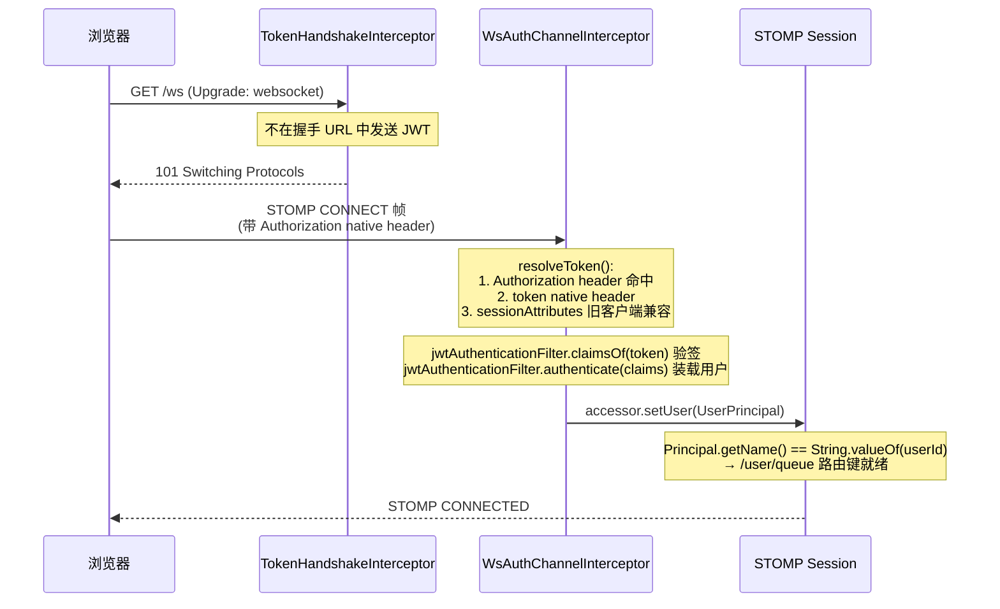
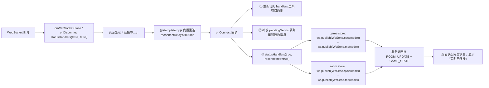

> 2026-10-29 版本提示：本文含早期狼人杀设计与操作示例。当前交付范围、规则和生产运行方式以 [当前状态](JIUJIU_CURRENT_STATUS.md)、[运行与部署](RELEASE_AND_OPERATIONS.md) 及对应阶段报告为准；旧的角色/人数/多数决、禁止 WebRTC 或删除卷升级等说法已被新需求覆盖。

# WebSocket / STOMP 协议文档

> 阶段 2 新增当前用户私有订阅 /user/queue/social，FRIEND_UPDATE表示好友关系或申请变化，需要重拉本人列表。

> 阶段 1：密码修改事务提交后关闭旧连接，WebSocket 关闭码4002（CREDENTIALS_CHANGED）；客户端停止重连、清理会话并使用新密码重新登录。4001仍代表其他设备登录。房间主题同时执行订阅与投递时成员校验。

> 本文档面向**前后端开发者与联调测试人员**，解决一个问题：**不用读代码就能准确订阅、发送、解析每一条实时报文**，并能在浏览器控制台里独立复现一次完整对局。

---

## 一、连接方式

### 1.1 端点

| 端点 | 传输 | 注册代码 | 说明 |
| --- | --- | --- | --- |
| `/ws` | **原生 WebSocket**（推荐） | `registry.addEndpoint("/ws").setAllowedOrigins(...).addInterceptors(new TokenHandshakeInterceptor())` | 前端默认走这条 |
| `/ws` | **SockJS**（兜底） | 同一个 `/ws` 再注册一次并 `.withSockJS()` | 企业代理拦截 WS 升级时使用 |

> `WsDestinations.NATIVE_ENDPOINT = "/ws-native"` 常量存在，但 `WebSocketConfig` 当前**只注册了 `/ws`**。切换 SockJS 靠前端环境变量 `VITE_USE_SOCKJS=true`，而不是换端点。

**完整连接 URL：**

```
ws://<host>/ws
wss://<host>/ws                    # HTTPS 站点必须用 wss
```

开发期（前端经 Vite 代理）：`ws://localhost:5173/ws`
生产期（Nginx 同源转发）：`wss://your-domain/ws`

### 1.2 在 STOMP CONNECT 中传递 token

**浏览器原生 WebSocket API 不允许自定义请求头：**

```javascript
// ❌ 这是不可能的：WebSocket 构造函数只接受 (url, protocols) 两个参数
const ws = new WebSocket('ws://host/ws', { headers: { Authorization: 'Bearer xxx' } })
```

`Sec-WebSocket-Protocol` 虽然可以塞数据，但它语义上是子协议名，且很多反向代理会校验格式，不可靠。

当前前端通过 STOMP CONNECT 的 `Authorization` header 传递 JWT，不将 token 拼到握手 URL，避免代理访问日志记录凭据。浏览器不能自定义的是 HTTP 握手头，STOMP 文本帧仍可携带认证头。服务端保留旧客户端兼容，优先级如下（`WsAuthChannelInterceptor.resolveToken`）：

| 优先级 | 位置 | 取值方式 | 谁在用 |
| --- | --- | --- | --- |
| 1 | STOMP `CONNECT` 帧的 `Authorization` native header | `accessor.getNativeHeader(HttpHeaders.AUTHORIZATION)` | `@stomp/stompjs` 的 `connectHeaders`（因为 STOMP 帧是文本协议，可以随意加 header） |
| 2 | STOMP `CONNECT` 帧的 `token` native header | `accessor.getNativeHeader("token")` | 自定义客户端 |
| 3 | **握手 URL 的 `?token=xxx`** | `TokenHandshakeInterceptor` 放入 session attribute | 仅兼容旧工具；当前前端不使用 |

链路：



> **鉴权失败**：STOMP `CONNECT` 必须携带有效 JWT。缺失、过期或无效时，服务端拒绝该帧，不建立已认证 STOMP 会话，也不会发送 `CONNECTED`。客户端应通过 STOMP 错误或连接关闭处理失败并重新登录；此时不能依赖 `/user/queue/error`，因为用户会话尚未建立。握手 URL 上带 token 只是传递凭据的一种方式，最终仍以 `CONNECT` 鉴权结果为准。

### 1.3 STOMP 帧格式

STOMP 是**基于文本帧**的协议，格式：

```
COMMAND
header1:value1
header2:value2

Body^@
```

`^@` 是 NULL 字符（`\u0000`）作为帧结束符。

**客户端 → 服务器（发送一条聊天）：**

```
SEND
destination:/app/chat/K7M2QP/send
content-type:application/json
content-length:45

{"content":"大家好","type":"PUBLIC"}^@
```

**服务器 → 客户端（推送房间状态）：**

```
MESSAGE
destination:/topic/room/K7M2QP
content-type:application/json
subscription:sub-0
message-id:abc-1

{"type":"ROOM_UPDATE","data":{...},"timestamp":1733558400000}^@
```

**订阅：**

```
SUBSCRIBE
id:sub-0
destination:/topic/room/K7M2QP

^@
```

### 1.4 客户端配置参数（`frontend/src/websocket/stomp.ts`）

| 参数 | 值 | 说明 |
| --- | --- | --- |
| `brokerURL` | `${protocol}//${host}/ws` | `VITE_WS_URL` 非空时用它；否则用当前页面 host；JWT 放 connectHeaders |
| `connectHeaders` | `{ Authorization: "Bearer " + token }` | 走优先级 1 的通道 |
| `reconnectDelay` | `3000` | 断线后 3 秒自动重连 |
| `heartbeatIncoming` | `10000` | 10 秒收不到心跳视为断开 |
| `heartbeatOutgoing` | `10000` | 每 10 秒发心跳 |
| `VITE_USE_SOCKJS=true` 时 | `webSocketFactory: () => new SockJS(resolveWsUrl())` | 切到 SockJS 传输 |

---

## 二、完整订阅地址表（服务器 → 客户端）

依据 `backend/src/main/java/com/werewolf/websocket/WsDestinations.java` 与 `LobbyController` 整理的客户端订阅地址：

| # | 目的地 | 常量 / 方法 | 范围 | 用途 | 主要报文 `type` |
| --- | --- | --- | --- | --- | --- |
| 1 | `/topic/rooms` | `TOPIC_ROOMS` | 已认证的主题订阅者 | 大厅房间列表变化**通知**（只带 `{"refresh":true}`，前端收到后再调 REST 拉全量） | `ROOM_UPDATE` |
| 2 | `/topic/room/{roomCode}` | `roomTopic(code)` | 已认证的主题订阅者 | 房间座位表、准备状态、系统提示 | `ROOM_UPDATE`、`NOTICE` |
| 3 | `/topic/room/{roomCode}/game` | `roomGame(code)` | 已认证的主题订阅者 | **公开**游戏状态（无身份版本，`me` 字段为 `null`） | `GAME_STATE` |
| 4 | `/topic/room/{roomCode}/event` | `roomEvent(code)` | 已认证的主题订阅者 | **公开**游戏事件（已裁剪掉敏感字段） | `GAME_EVENT` |
| 5 | `/topic/room/{roomCode}/chat` | `roomChat(code)` | 已认证的主题订阅者 | 公共与系统聊天消息 | `CHAT_MESSAGE` |
| 6 | `/user/queue/game` | `USER_QUEUE_GAME` | **单个用户** | **私有**游戏状态：含本人身份、药水、查验记录、可用行动、可选目标 | `GAME_STATE` |
| 7 | `/user/queue/event` | `USER_QUEUE_EVENT` | **单个用户** | **私密**游戏事件（预言家查验结果、女巫用药等） | `GAME_EVENT` |
| 8 | `/user/queue/error` | `USER_QUEUE_ERROR` | **单个用户** | 操作失败提示、被踢通知 | `ERROR`、`KICKED` |
| 9 | `/user/queue/lobby` | 无常量（`LobbyController` 里字面量） | **当前用户** | STOMP 请求房间列表时的回推快照 | `ApiResponse<List<RoomView>>` |
| 10 | `/user/queue/room` | `USER_QUEUE_ROOM` | **当前用户** | 含本人座位与准备状态的房间视图 | `ROOM_UPDATE` |
| 11 | `/user/queue/chat` | `USER_QUEUE_CHAT` | **当前用户** | 私聊与狼人频道消息 | `CHAT_MESSAGE` |

**前缀与实现细节：**

```java
// WebSocketConfig.configureMessageBroker
registry.enableSimpleBroker("/topic", "/queue");      // 内存 SimpleBroker
registry.setApplicationDestinationPrefixes("/app");   // 客户端发送前缀
registry.setUserDestinationPrefix("/user");           // 用户目的地转换前缀
```

> 客户端统一订阅 **`/user/queue/*`**，不拼入任何用户 ID。Spring 根据已认证会话的 `Principal` 把订阅映射到该会话的私有队列；服务端仍使用 `convertAndSendToUser(String.valueOf(userId), "/queue/game", ...)` 定向发送。`/user` 不能同时作为 SimpleBroker 前缀，否则用户目的地转换会被绕过。
>
> STOMP `SUBSCRIBE` 白名单只有 `/topic/rooms`、`/topic/room/{6 位房间码}` 及其 `/game`、`/event`、`/chat` 后缀，以及 `/user/queue/{game,event,error,lobby,room,chat}`。任意 `/user/{id}/...`、直接 `/queue/...` 及其它目的地均被拒绝。客户端 `SEND` 只允许发到 `/app/...`，不能直接向 broker 发消息。房间主题订阅现在必须由当前房间成员建立；投递时再次校验成员关系，退出或被移出后旧订阅停止接收房间消息。大厅列表仍通过 /topic/rooms 通知并走 REST 拉取公开元信息。个人身份与私聊仍走用户队列。

### 2.1 前端订阅地址常量（`frontend/src/websocket/stomp.ts`）

```typescript
export const WsTopic = {
  rooms: '/topic/rooms',
  room: (code: string) => `/topic/room/${code}`,
  game: (code: string) => `/topic/room/${code}/game`,
  event: (code: string) => `/topic/room/${code}/event`,
  chat: (code: string) => `/topic/room/${code}/chat`
} as const

export const WsUserQueue = {
  game: '/user/queue/game',
  event: '/user/queue/event',
  error: '/user/queue/error',
  lobby: '/user/queue/lobby',
  room: '/user/queue/room',
  chat: '/user/queue/chat'
} as const
```

用户队列订阅与当前 STOMP 会话绑定，调用方不传 `userId`。

---

## 三、完整发送地址表（客户端 → 服务器）

从 `backend/src/main/java/com/werewolf/websocket/RoomWsController.java` + `LobbyController.java` **完整抄录**：

| # | `@MessageMapping` | 完整目的地 | 请求体 | 服务器行为 | 成功反馈 | 失败反馈 |
| --- | --- | --- | --- | --- | --- | --- |
| 1 | `/room/{roomCode}/action` | `/app/room/{code}/action` | `ActionRequest`：`{action, targetSeatId?, speech?}` | `GameService.applyAction(userId, request)` → 引擎校验 → 落状态 → 广播事件与状态 | 广播 `GAME_EVENT` / `GAME_STATE`，并向本人补发一次 `/user/queue/game` 私有状态 | `/user/queue/error` 的 `ERROR` 报文，**游戏状态不变** |
| 2 | `/room/{roomCode}/vote-skip` | `/app/room/{code}/vote-skip` | `{}`（可为空） | `runtime.voteSkip(me.getSeatId())` → 等价于提交 `ABSTAIN` | 同上 | `/user/queue/error` |
| 3 | `/room/{roomCode}/ready` | `/app/room/{code}/ready` | `{ready: boolean}` | `roomService.setReady(userId, ready)` → 推送公开房间视图及各用户私有视图 | `/topic/room/{code}` + `/user/queue/room` 的 `ROOM_UPDATE` | `/user/queue/error` |
| 4 | `/room/{roomCode}/sync` | `/app/room/{code}/sync` | `{}` | 标记本人上线 → 广播房间面板 → **按本人座位补发一次全量状态** | `ROOM_UPDATE` + 私有 `GAME_STATE` | `/user/queue/error` |
| 5 | `/room/{roomCode}/heartbeat` | `/app/room/{code}/heartbeat` | `{}` | 只把本人标记为在线（`runtime.setOnline(seat, true)`），**不广播** | 无响应 | 无（异常直接向上抛） |
| 6 | `/room/{roomCode}/leave` | `/app/room/{code}/leave` | `{}` | `roomService.leaveRoom(userId)` + 广播房间列表变化 | `ROOM_UPDATE`（大厅） | `/user/queue/error` |
| 7 | `/room/{roomCode}/me` | `/app/room/{code}/me` | `{}` | 只按本人座位补发一次私有状态（不问「我是谁、我能做什么」） | 私有 `GAME_STATE` | `/user/queue/error` |
| 8 | `/chat/{roomCode}/send` | `/app/chat/{code}/send` | `ChatRequest`：`{content, receiverId?, type?}` | `chatService.send(userId, roomCode, request)` → 校验 → 落库 → 按频道投递 | 对应目的地的 `CHAT_MESSAGE` | `/user/queue/error` |
| 9 | `/lobby/rooms` | `/app/lobby/rooms` | `{}` | `roomService.listPublicRooms(userId)`，**返回值直接回给发送者** | `/user/queue/lobby`（`@SendToUser`，内容是 `ApiResponse<List<RoomView>>`） | 同上（`UNAUTHORIZED` 时回 `ApiResponse.fail(1001)`） |
| 10 | `/game/resync` | `/app/game/resync` | `{}` | 找当前用户所在房间 → `runtime.projectFor(mySeatId)` | `/user/queue/game`（contents 是 `ApiResponse<GameView>`） | `NOT_IN_ROOM` 时回 `ApiResponse.fail(3004)` |

**前端发送地址常量（`WsSend`）：**

```typescript
export const WsSend = {
  action: (code: string) => `/app/room/${code}/action`,
  ready: (code: string) => `/app/room/${code}/ready`,
  sync: (code: string) => `/app/room/${code}/sync`,
  heartbeat: (code: string) => `/app/room/${code}/heartbeat`,
  leave: (code: string) => `/app/room/${code}/leave`,
  me: (code: string) => `/app/room/${code}/me`,
  chat: (code: string) => `/app/chat/${code}/send`,
  voteSkip: (code: string) => `/app/room/${code}/vote-skip`,
  lobbyRooms: '/app/lobby/rooms',
  resync: '/app/game/resync'
} as const
```

### 3.1 `/action` 的去向分流

`RoomWsController.action()` 本身**不返回任何值**，它把结果通过广播推出去：

```
/app/room/{code}/action
  → GameService.applyAction(userId, request)
      → RoomRuntime.applyHumanAction(seatId, type, target, speech)
          → WerewolfGameEngine.applyAction(...)        // 唯一校验点
              → events 列表                               // 引擎产出事件
          → afterAction():
              publishEvents(events)   → SimpGameBroadcaster.broadcastEvents(...)
              broadcastState()        → SimpGameBroadcaster.broadcastGameState(...)
  → pushStateTo(runtime, userId)      → /user/queue/game 私有状态
```

**注意**：`RoomWsController` 的 `@MessageMapping` 方法返回值是 `void`，所以**不会**有 STOMP `RECEIPT` 或 `MESSAGE` 直接回给发送者；后续结果通过公共主题或当前用户的私有队列推送。

### 3.2 异常处理

| 异常类型 | 处理方式 | 目的地 |
| --- | --- | --- |
| `BizException` | `@MessageExceptionHandler(BizException.class)` 返回 `{code, message}` | `/user/queue/error`（`@SendToUser`） |
| 其它 `Exception` | `@MessageExceptionHandler(Exception.class)` 记 error 日志，返回 `{code:1004, message:"服务器内部错误"}` | `/user/queue/error` |

另外，`RoomWsController` 内部对可预期的 `BizException` 做了**显式 catch**，调用 `messenger.error(userId, code, message)`，避免依赖 `@SendToUser` 的默认目的地推导：

```java
} catch (BizException ex) {
    log.info("行动被拒绝 room={} user={} action={} reason={}", roomCode, userId,
            request.getAction(), ex.getMessage());
    messenger.error(userId, ex.getErrorCode().getCode(), ex.getMessage());
}
```

---

## 四、报文结构

### 4.1 统一信封

所有服务器推送都用 `GameEventMessenger.envelope()` 组装，结构固定为三个字段：

```json
{
  "type": "GAME_STATE",
  "data": { },
  "timestamp": 1733558400000
}
```

| 字段 | 类型 | 说明 |
| --- | --- | --- |
| `type` | string | 报文类型，见 4.2 |
| `data` | object / array / null | 具体内容，随 `type` 变化 |
| `timestamp` | number | 服务器生成报文的毫秒时间戳（`System.currentTimeMillis()`） |

### 4.2 `type` 取值表

| `type` | 常量 | 目的地 | `data` 结构 | 触发时机 |
| --- | --- | --- | --- | --- |
| `ROOM_UPDATE` | `TYPE_ROOM_UPDATE` | `/topic/room/{code}`、`/user/queue/room`、`/topic/rooms` | 公开/本人房间视图；大厅刷新通知为 `{"refresh": true}` | 创建/加入/离开/准备/踢人/解散房间 |
| `GAME_STATE` | `TYPE_GAME_STATE` | `/topic/room/{code}/game`、`/user/queue/game` | `GameView` 对象 | 每次行动后、每次阶段切换、开局、结束 |
| `GAME_EVENT` | `TYPE_GAME_EVENT` | `/topic/room/{code}/event`、`/user/queue/event` | `GameEvent` 对象：`{eventType, payload, timestamp, roomCode?}` | 引擎每次产出事件 |
| `CHAT_MESSAGE` | `TYPE_CHAT` | `/topic/room/{code}/chat`、`/user/queue/chat` | `Message` 对象；公共消息走前者，私聊与狼人频道走后者 | 有人发聊天消息 |
| `NOTICE` | `TYPE_NOTICE` | `/topic/room/{code}` | `{"message": "..."}` | 系统提示（玩家离开、被踢、本局结束） |
| `ERROR` | `TYPE_ERROR` | `/user/queue/error` | `{"code": 4004, "message": "..."}` | 操作被拒绝 |
| `KICKED` | `TYPE_KICKED` | `/user/queue/error` | `{"message": "你已被移出房间"}` | 被房主踢出 |

`/user/queue/lobby` 的请求响应是 `ApiResponse<List<RoomView>>`，不属于上述统一信封。

**前端分发逻辑**（`frontend/src/websocket/stomp.ts` 的 `dispatch`）：

```typescript
private dispatch(destination: string, envelope: WsEnvelope): void {
  if (envelope?.type === 'ERROR') {
    const data = envelope.data as { code?: number; message?: string }
    if (data?.code !== 1001) {          // 1001 由 axios 拦截器统一处理跳登录，不弹错
      ElMessage.error(data?.message || '操作失败')
    }
  }
  if (envelope?.type === 'KICKED') {
    const data = envelope.data as { message?: string }
    ElMessage.warning(data?.message || '你已被移出房间')
  }
  this.handlers.get(destination)?.forEach((handler) => { /* 分发给订阅者 */ })
}
```

### 4.3 `data` 的三种形态

**① `RoomView`（`ROOM_UPDATE`）** —— 字段说明见 [docs/API.md](API.md) 第 3.1 节。

**② `GameView`（`GAME_STATE`）** —— 字段说明见 [docs/API.md](API.md) 第 4.3 节。

> **关键差异**：公共频道（`/topic/room/{code}/game`）收到的是 `projectFor(null)`，**`me` 字段不存在**；私有频道（`/user/queue/game`）收到的是 `projectFor(seatId)`，**含本人的 `me`**。前端 `game` store 把两者分开存放再合并：

```typescript
const publicState = ref<GameView | null>(null)    // /topic/room/{code}/game
const privateState = ref<GameView | null>(null)   // /user/queue/game
// 合并时 players 以公开信息为准，me 以私有信息为准
```

**③ `GameEvent`（`GAME_EVENT`）**：

```json
{
  "eventType": "ROLE_SKILL",
  "payload": { "role": "WEREWOLF", "effect": "KILL", "actorSeatId": 2, "targetSeatId": 3 },
  "timestamp": 1733558400000,
  "roomCode": "K7M2QP"
}
```

| 字段 | 类型 | 说明 |
| --- | --- | --- |
| `eventType` | string | 事件类型，见第五节 |
| `payload` | object | 事件数据，随 `eventType` 变化 |
| `timestamp` | number | 事件产生的毫秒时间戳 |
| `roomCode` | string | 房间码。**只有走公共通道的副本才会被加上这个字段**（`SimpGameBroadcaster.publicCopy` 里 `copy.put("roomCode", room.getRoomCode())`），私密通道的原始事件没有它 |

> 注意：`GameEvent` 类本身有 `visibleSeats` / `broadcastToAll` 两个字段，但**它们没有 getter 会被 Jackson 序列化吗**？——`getVisibleSeats()` 与 `isBroadcastToAll()` 确实存在，但对 `Set<Integer>` 序列化后是数组。**实际下发时前端不需要这两个字段**，前端 `GameEvent` 类型（`src/types/index.ts`）也只声明了 `eventType / payload / timestamp / roomCode`，多出的字段被忽略即可。

---

## 五、GAME_EVENT 全部 eventType 表

从 `backend/src/main/java/com/werewolf/game/domain/GameEvent.java` 的 `EventType` 枚举**完整抄录**：

| # | `eventType` | payload 字段 | 可见范围 | 触发时机 | 前端特效素材 |
| --- | --- | --- | --- | --- | --- |
| 1 | `GAME_START` | `round`(0)、`playerCount`、`werewolfCount` | 🌐 全体 | `WerewolfGameEngine.startGame()` 发牌完成 | `GAME_START` → `/assets/roles/hidden-back.svg`（发牌动画） |
| 2 | `PHASE_CHANGE` | `phase`（新阶段名） | 🌐 全体 | 每次阶段切换 | 无素材，前端据此切换面板 |
| 3 | `NIGHT_START` | `round` | 🌐 全体 | `enterNight()` | `NIGHT_START` → 无素材，CSS 夜色渐变 + 文字「天黑了」 |
| 4 | `ROLE_SKILL` | `role`、`effect`（`"KILL"`）、`actorSeatId`、`targetSeatId`、`visibleTo`（`"WEREWOLF"`） | 🔒 **仅存活狼人**（`visibleTo(wolfSeats)`） | 狼人提交 `WOLF_KILL` | `WOLF_KILL` → `/assets/effects/wolf-kill.svg`。**非狼玩家只知道「狼人行动了」，公共副本里 `targetSeatId` 被剥离** |
| 5 | `SEER_RESULT` | `actorSeatId`、`targetSeatId`、`targetNickname`、`wolf`(boolean)、`effect`（`"CHECK"`） | 🔐 **仅预言家本人**（`privateTo(seat)`，不进公共频道） | 预言家提交 `SEER_CHECK` | `SEER_CHECK` → `/assets/effects/seer-check.svg` |
| 6 | `WITCH_ACTION` | `actorSeatId`、`effect`（`"HEAL"` / `"POISON"` / `"PASS"`）、`targetSeatId`（`PASS` 时无此字段） | 🔐 **仅女巫本人** | 女巫提交 `WITCH_HEAL` / `WITCH_POISON` / `WITCH_PASS` | `HEAL` → `/assets/effects/witch-heal.svg`；`POISON` → `/assets/effects/witch-poison.svg`；`PASS` → 无特效 |
| 7 | `DAWN` | `round`、`deaths`（座位号数组） | 🌐 全体 | 夜晚结算后有死亡 | `DAWN` → `/assets/effects/dawn.svg` |
| 8 | `PEACEFUL_NIGHT` | `round` | 🌐 全体 | 夜晚结算后**无人死亡** | 前端复用 `DAWN` 特效 + 文字「昨晚是平安夜」 |
| 9 | `SPEAK_TURN` | `seatId`、`nickname` | 🌐 全体 | 进入讨论阶段、或上一位发言结束 | 无素材，前端高亮当前发言人 |
| 10 | `SPEECH` | `round`、`seatId`、`nickname`、`content`、`ai`(boolean) | 🌐 全体 | 有人（或 AI）完成发言 | 无素材，进入发言列表 |
| 11 | `VOTE_START` | `round` | 🌐 全体 | `enterVoting()` | `VOTE_START` → `/assets/effects/vote.svg` |
| 12 | `VOTE_CAST` | `actorSeatId`、`actorNickname`，弃票时额外有 `abstain: true` | 🌐 全体 | 有人投票或弃票 | 无素材。**只广播投票人，不广播被投者**（避免信息泄露） |
| 13 | `VOTE_RESULT` | `tally`(`{"3":2,"4":1}`)、`abstainCount`、`tie`(boolean)；有人出局时额外有 `exiledSeatId`、`exiledNickname`、`votes` | 🌐 全体 | 投票结算 | 有人出局 → `VOTE_EXILE` → `/assets/effects/vote.svg`；平票 → 无特效 + 文字提示 |
| 14 | `PLAYER_DIED` | `seatId`、`nickname`、`cause`（`"NIGHT"` / `"VOTE"`） | 🌐 全体 | 夜晚结算死亡、或投票放逐 | `PLAYER_DIED` → 无素材，使用 💀 字符 + CSS |
| 15 | `GAME_OVER` | `winner`（`"VILLAGE"` / `"WEREWOLF"`） | 🌐 全体 | 胜负已分 | `WIN_GOOD` → `/assets/effects/win-good.svg`；`WIN_WEREWOLF` → `/assets/effects/win-werewolf.svg` |

### 5.1 「可见范围」的三种符号含义

| 符号 | 语义 | 实现 | 公共频道收到什么 | 私密频道收到什么 |
| --- | --- | --- | --- | --- |
| 🌐 **全体** | `visibleSeats == null`，`broadcastToAll == true` | 默认状态 | **完整 payload** | 不发 |
| 🔒 **白名单** | `visibleSeats != null`，`broadcastToAll == true`（用 `visibleTo(...)` 构造） | 事件通知广播给所有人，但**细节按座位私发** | **删掉 `targetSeatId` 的副本** | 白名单座位收到完整 payload |
| 🔐 **完全私密** | `visibleSeats != null`，`broadcastToAll == false`（用 `privateTo(...)` 构造） | 事件**只**发给白名单座位 | **收不到** | 白名单座位收到完整 payload |

**代码依据：**

```java
// GameEvent.java
public GameEvent visibleTo(Integer... seats) {          // 🔒
    this.visibleSeats = new HashSet<>(Arrays.asList(seats));
    return this;                                         // broadcastToAll 保持 true
}

public GameEvent privateTo(Integer... seats) {          // 🔐
    this.visibleSeats = new HashSet<>(Arrays.asList(seats));
    this.broadcastToAll = false;
    return this;
}
```

```java
// SimpGameBroadcaster.java
public void broadcastEvents(Room room, List<GameEvent> events, Map<Integer, Long> seatUserMap) {
    for (GameEvent event : events) {
        if (event.isPrivate()) {                                    // broadcastToAll == false
            sendToVisible(event, seatUserMap, event);               // 🔐 只走私密通道
        } else {
            messenger.gameEvent(room, publicCopy(event, room));     // 🌐/🔒 公共副本
            if (event.getVisibleSeats() != null) {
                sendToVisible(event, seatUserMap, event);           // 🔒 白名单私发完整版
            }
        }
    }
}
```

### 5.2 前端事件 → 特效映射（`EffectManager.vue`）

| 前端 `pushEffect` 的 key | 触发的事件 | 素材 / 呈现 | 时长（ms） |
| --- | --- | --- | --- |
| `GAME_START` | `GAME_START` | `/assets/roles/hidden-back.svg` +「正在发牌」 | 2400 |
| `NIGHT_START` | `NIGHT_START` | 无素材，CSS 夜色渐变 +「天黑了」 | 2000 |
| `WOLF_KILL` | `ROLE_SKILL`（`effect == "KILL"`） | `/assets/effects/wolf-kill.svg` +「X 号玩家」 | 1500 |
| `SEER_CHECK` | `SEER_RESULT` | `/assets/effects/seer-check.svg` +「目标：X 号」 | 2100 |
| `WITCH_HEAL` | `WITCH_ACTION`（`effect == "HEAL"`） | `/assets/effects/witch-heal.svg` +「目标：X 号」 | 2000 |
| `WITCH_POISON` | `WITCH_ACTION`（`effect == "POISON"`） | `/assets/effects/witch-poison.svg` +「目标：X 号」 | 2000 |
| `DAWN` | `DAWN` **和** `PEACEFUL_NIGHT` | `/assets/effects/dawn.svg` +「天亮了」 | 2400 |
| `VOTE_START` | `VOTE_START` | `/assets/effects/vote.svg` +「开始投票」 | 1200 |
| `VOTE_EXILE` | `VOTE_RESULT`（有 `exiledSeatId`） | `/assets/effects/vote.svg` +「X 号被放逐出局」 | 1800 |
| `PLAYER_DIED` | `PLAYER_DIED` | 无素材，💀 字符 + CSS | 1500 |
| `WIN_GOOD` | `GAME_OVER`（`winner != "WEREWOLF"`） | `/assets/effects/win-good.svg` +「好人阵营胜利」 | 3200 |
| `WIN_WEREWOLF` | `GAME_OVER`（`winner == "WEREWOLF"`） | `/assets/effects/win-werewolf.svg` +「狼人阵营胜利」 | 3200 |

> 特效是**串行播放**的：`EffectManager` 从 `game.pendingEffects` 队列里逐条取出，播完一条（`setTimeout` 到期）才播下一条，播放期间不会互相覆盖。未知 key 会被直接丢弃，避免队列卡死。

---

## 六、聊天消息结构

### 6.1 `Message` 实体（对齐 `websocket/entity/Message.java`）

`CHAT_MESSAGE` 报文的 `data` 就是 `Message` 序列化后的对象：

| 字段 | 类型 | 说明 |
| --- | --- | --- |
| `id` | number | 数据库主键 |
| `roomId` | number | 房间 ID（**是 id 不是 code**） |
| `senderId` | number | 发送者 userId；系统消息固定为 `0` |
| `receiverId` | number \| null | 私聊接收者 userId；非私聊时为 `null`（`non_null` 配置下该键不出现） |
| `content` | string | 内容（最长 500 字符，超出被服务端截断） |
| `messageType` | string | `PUBLIC` / `PRIVATE` / `WOLF` / `SYSTEM` |
| `channel` | string | `LOBBY`（阶段为 `WAITING` 时）/ `GAME`（对局中） |
| `senderNickname` | string | 发送者昵称；系统消息为 `"系统"` |
| `isAi` | boolean | 是否来自 AI NPC |
| `createdAt` | string | ISO 格式时间字符串 |

### 6.2 发送请求体（对齐 `ChatService.ChatRequest`）

```json
{
  "content": "3 号很可疑",
  "receiverId": null,
  "type": "PUBLIC"
}
```

| 字段 | 类型 | 必填 | 说明 |
| --- | --- | --- | --- |
| `content` | string | ✅ | 非空白；超过 500 字符被**截断**（不是报错） |
| `receiverId` | number \| null | 私聊必填 | **只要非空就按私聊处理**（即使 `type` 传的是 `PUBLIC`） |
| `type` | string | ❌ | `PUBLIC` / `PRIVATE` / `WOLF`，缺省 `PUBLIC`；大小写不敏感 |

### 6.3 三种频道的可见性规则

**判定逻辑（`ChatService.resolveType`，优先级从上到下）：**

| 顺序 | 条件 | 结果 | 额外校验 |
| --- | --- | --- | --- |
| 1 | `type == "WOLF"` | `WOLF` | 发送者必须是狼人，否则抛 `4004`（「你不是狼人，无法使用狼人频道」） |
| 2 | `type == "PRIVATE"` **或** `receiverId != null` | `PRIVATE` | `receiverId` 必须非空，且接收者**必须在当前房间内**，否则抛 `4006`（「私聊对象不在房间内」） |
| 3 | 其它 | `PUBLIC` | 无 |

**投递规则（`ChatService.broadcast`）：**

| 频道 | 投递目标 | 实现 | 第三人能否看到 |
| --- | --- | --- | --- |
| **PUBLIC** | 房间内所有人 | `messenger.chat(room, message)` → `/topic/room/{code}/chat`（广播） | ✅ 能 |
| **PRIVATE** | **仅**发送者与接收者 | `messenger.privateChat(userId, roomCode, message)` → `convertAndSendToUser` 投到 `/queue/chat`；客户端订阅 `/user/queue/chat` | ❌ 不能 |
| **WOLF** | 所有存活狼人且**非 AI**（`p.isWolf() && !p.isAi() && userId > 0`） | 逐个 `privateChat` | ❌ 好人不能 |
| **SYSTEM** | 房间内所有人 | 由 `ChatService.systemMessage()` 走 `messenger.chat` | ✅ 能 |

> 公共聊天使用 `/topic/room/{code}/chat`，私聊与狼人频道使用 `/user/queue/chat`。前端需要同时订阅两条通道；服务端通过 `/queue/chat` 定向投递给相应用户。
>
> 前端 `chat` store 在收到消息后会**再过滤一次**（`belongsToCurrentView`），作为双保险。

**历史记录的可见性过滤（`ChatService.history`）：**

| `messageType` | 谁能从 `GET /api/chat/{roomCode}/history` 里看到 |
| --- | --- |
| `PUBLIC` | 房间内所有人 |
| `SYSTEM` | 房间内所有人 |
| `WOLF` | 仅狼人（按**当前对局**的 `state.players` 判断） |
| `PRIVATE` | 仅 `sender_id == me` 或 `receiver_id == me` |

---

## 七、完整对局时序图

以下时序图描述**4 个真人玩家 + 2 个房间 AI NPC**（可选增强）的完整流程。**纯真人局（本轮交付默认）只是把步骤 13~16 的 AI 分支去掉**，其余完全一致。

```mermaid
sequenceDiagram
    autonumber
    actor P1 as 玩家1 (房主)
    actor P2 as 玩家2
    actor P3 as 玩家3
    actor P4 as 玩家4
    participant WS as STOMP 通道
    participant RC as RoomWsController
    participant GS as GameService
    participant RR as RoomRuntime
    participant ENG as WerewolfGameEngine
    participant BR as SimpGameBroadcaster
    participant AI as AiService (可选)

    Note over P1,P4: ========== 一、建立连接 ==========
    P1->>WS: CONNECT /ws + STOMP Authorization: Bearer JWT1
    WS->>WS: TokenHandshakeInterceptor 取 token<br/>WsAuthChannelInterceptor 验签 → setUser
    WS-->>P1: CONNECTED
    P1->>WS: SUBSCRIBE /topic/rooms, /user/queue/game, /user/queue/error ...
    P2->>WS: CONNECT + SUBSCRIBE（同上）
    P3->>WS: CONNECT + SUBSCRIBE
    P4->>WS: CONNECT + SUBSCRIBE

    Note over P1,P4: ========== 二、建房间与加入 ==========
    P1->>RC: POST /api/rooms {maxPlayers:6, werewolfCount:1, aiCount:2, allowAi:true}
    RC->>RR: RoomService.createRoom → 分配房间码 K7M2QP，占 1 号座
    RC->>BR: 按 aiCount 加 2 个 AI 座位（5、6 号，天生 ready=true）
    RC-->>P1: RoomView
    RC->>WS: /topic/rooms 广播 {"refresh":true}
    WS-->>P1: ROOM_UPDATE（刷新大厅）
    P2->>WS: SEND /app/room/K7M2QP/... 前先 REST 加入
    P2->>RC: POST /api/rooms/join {roomCode:"K7M2QP"}
    RC->>RR: addPlayer → 2 号座
    RC->>BR: broadcastRoom（公共快照 + 各用户私有 RoomView）
    WS-->>P1: ROOM_UPDATE（座位表现在有 2 号）
    WS-->>P2: ROOM_UPDATE
    P3->>RC: POST /api/rooms/join → 3 号座
    P4->>RC: POST /api/rooms/join → 4 号座

    Note over P1,P4: ========== 三、准备与开局 ==========
    P1->>WS: SEND /app/room/K7M2QP/ready {ready:true}
    P2->>WS: SEND /app/room/K7M2QP/ready {ready:true}
    P3->>WS: SEND /app/room/K7M2QP/ready {ready:true}
    P4->>WS: SEND /app/room/K7M2QP/ready {ready:true}
    WS->>RC: ready(...) ×4
    RC->>RR: setReady + broadcastRoom
    WS-->>P1: ROOM_UPDATE（readyCount=6, allReady=true）
    WS-->>P2: ROOM_UPDATE（同上）
    WS-->>P3: ROOM_UPDATE（同上）
    WS-->>P4: ROOM_UPDATE（同上）

    P1->>WS: SEND /app/room/K7M2QP/... 或 REST POST /api/game/start
    P1->>GS: POST /api/game/start
    GS->>RR: RoomService.startGame（校验房主/人数/全部准备）
    RR->>ENG: startGame(werewolfCount, events)
    ENG->>ENG: RoleAssigner.assign(6 人, 1 狼) → 打乱发牌
    ENG-->>RR: events = [GAME_START, PHASE_CHANGE(STARTING)]
    RR->>BR: broadcastEvents + broadcastState
    WS-->>P1: GAME_EVENT GAME_START + GAME_STATE（public + private）
    WS-->>P2: 同上（各自的 me.role 不同）
    WS-->>P3: 同上
    WS-->>P4: 同上

    Note over P1,P4: ========== 四、第一夜 ==========
    Note over RR: STARTING 倒计时结束（6s）
    RR->>ENG: tick → nextPhase() → enterNight()
    ENG-->>RR: events = [NIGHT_START, PHASE_CHANGE(NIGHT)]
    RR->>BR: 广播
    WS-->>P1: GAME_EVENT NIGHT_START
    WS-->>P2: GAME_EVENT NIGHT_START
    WS-->>P3: GAME_EVENT NIGHT_START
    WS-->>P4: GAME_EVENT NIGHT_START

    par 真人狼人行动（假设 P2 是狼）
        P2->>WS: SEND /app/room/K7M2QP/action {action:"WOLF_KILL", targetSeatId:3}
        WS->>GS: applyAction
        GS->>RR: applyHumanAction(seat2, WOLF_KILL, 3, null)
        RR->>ENG: applyAction（校验：NIGHT / isWolf / 未行动 / 目标存活 / 非同伴）
        ENG-->>RR: events = [ROLE_SKILL(visibleTo 狼座位)]
        RR->>BR: broadcastEvents
        WS-->>P1: GAME_EVENT ROLE_SKILL（**公共副本，无 targetSeatId**）
        WS-->>P3: GAME_EVENT ROLE_SKILL（同上）
        WS-->>P4: GAME_EVENT ROLE_SKILL（同上）
        WS-->>P2: /user/queue/event ROLE_SKILL（**完整，含 targetSeatId=3**）
        RR->>BR: broadcastState + pushStateTo(P2)
        WS-->>P2: /user/queue/game 私有 GAME_STATE
    and 真人预言家行动（假设 P3 是预言家）
        P3->>WS: SEND .../action {action:"SEER_CHECK", targetSeatId:4}
        RR->>ENG: seerCheck
        ENG-->>RR: events = [SEER_RESULT(privateTo 3)]
        RR->>BR: broadcastEvents
        Note over BR: isPrivate()==true → **不进公共频道**
        WS-->>P3: /user/queue/event SEER_RESULT（含 wolf=true/false）
    and 可选增强：AI 座位（5、6 号）
        Note over RR: scheduleAiForCurrentPhase() 登记 aiReadyAt = now + 900~2600ms
        RR->>AI: runDueAiActions() → decide(runtime, actor, actions, calls)
        AI-->>RR: AiDecision（LLM 或 RuleAgent）
        RR->>ENG: applyAction(GameAction.ai(...)) —— **与真人同一条校验路径**
        ENG-->>RR: 同上的事件与广播
    end

    Note over RR: NIGHT 倒计时到 0 或所有夜间角色已行动
    RR->>ENG: maybeResolveNight / nextPhase → resolveNight()
    ENG->>ENG: 解药优先于狼刀 → 毒药独立生效 → 排序死讯
    ENG->>ENG: checkWinnerInternal()
    alt 已分出胜负
        ENG-->>RR: PHASE_CHANGE(CHECK_WINNER) + GAME_OVER + PHASE_CHANGE(END)
        RR->>BR: 广播 + onGameEnd（落库 game_records + 更新战绩 + 揭示身份）
        WS-->>P1: GAME_EVENT GAME_OVER（winner）
    else 有人死亡
        ENG-->>RR: PLAYER_DIED×N + DAWN + PHASE_CHANGE(DAY)
        WS-->>P1: GAME_EVENT DAWN {deaths:[3]}
        WS-->>P2: GAME_EVENT DAWN {deaths:[3]}
        WS-->>P3: GAME_EVENT DAWN {deaths:[3]}
    else 平安夜
        ENG-->>RR: PEACEFUL_NIGHT + **直接进入 DISCUSSION**
        WS-->>P1: GAME_EVENT PEACEFUL_NIGHT
    end

    Note over P1,P4: ========== 五、白天讨论与投票 ==========
    Note over RR: DAY 倒计时 12s（仅当有人死亡时才经过 DAY）
    RR->>ENG: nextPhase → enterDiscussion()
    ENG->>ENG: buildSpeakOrder()（从上一晚第一个死者下一位开始）
    ENG-->>RR: PHASE_CHANGE(DISCUSSION) + SPEAK_TURN(seatId)
    WS-->>P1: GAME_EVENT SPEAK_TURN
    WS-->>P2: GAME_EVENT SPEAK_TURN
    WS-->>P3: GAME_EVENT SPEAK_TURN
    WS-->>P4: GAME_EVENT SPEAK_TURN

    loop 每个存活玩家依次发言
        P_x->>WS: SEND .../action {action:"SPEAK", speech:"..."}
        RR->>ENG: speak()（校验是否为当前发言人）
        ENG-->>RR: SPEECH + SPEAK_TURN（下一位）或直接 enterVoting
        WS-->>P1: GAME_EVENT SPEECH / SPEAK_TURN
        WS-->>P2: GAME_EVENT SPEECH / SPEAK_TURN
        WS-->>P3: GAME_EVENT SPEECH / SPEAK_TURN
        WS-->>P4: GAME_EVENT SPEECH / SPEAK_TURN
    end

    RR->>ENG: enterVoting()
    ENG-->>RR: VOTE_START + PHASE_CHANGE(VOTING)
    WS-->>P1: GAME_EVENT VOTE_START

    par 投票
        P1->>WS: SEND .../action {action:"VOTE", targetSeatId:2}
        P3->>WS: SEND .../action {action:"VOTE", targetSeatId:2}
        P4->>WS: SEND /app/room/K7M2QP/vote-skip {}
    and
        P2->>WS: SEND .../action {action:"VOTE", targetSeatId:4}
    end
    Note over ENG: 全部存活者都已投票 → resolveVoting()
    ENG->>ENG: 统计票数 → 最高票放逐；平票则无人出局
    ENG-->>RR: VOTE_RESULT + PLAYER_DIED(cause=VOTE) + PHASE_CHANGE(CHECK_WINNER)
    WS-->>P1: GAME_EVENT VOTE_RESULT {tally:{"2":2,"4":1}, exiledSeatId:2}
    WS-->>P2: 同上
    WS-->>P3: 同上
    WS-->>P4: 同上
    WS-->>P1: GAME_EVENT PLAYER_DIED {seatId:2, cause:"VOTE"}

    Note over P1,P4: ========== 六、循环或结束 ==========
    alt 未分出胜负
        RR->>ENG: nextPhase → enterNight()（进入第二夜）
    else 已分出胜负
        RR->>ENG: nextPhase → finish()
        ENG-->>RR: GAME_OVER + PHASE_CHANGE(END)
        RR->>BR: broadcastState（gameOver=true，players[].role 全部公开）
        WS-->>P1: GAME_STATE（含全部身份，用于复盘）
        WS-->>P2: GAME_STATE（同上）
        WS-->>P3: GAME_STATE（同上）
        WS-->>P4: GAME_STATE（同上）
        RR->>RR: onGameEnd() → RoomService.onGameEnd()
        Note over RR: persistSeats（回写身份）+ saveGameRecord + 更新 users 战绩
    end
```



### 7.1 三个必须记住的时序要点

| 要点 | 说明 |
| --- | --- |
| **状态双通道** | 每次行动后，公共频道收到无身份的 `GameView`，本人还额外收到一条带 `me` 的私有 `GameView`。前端必须**两个都订阅**才能渲染完整界面 |
| **`sync` 是断线重连的核心** | 前端 `onStatus` 回调在重连成功后**自动**发送 `/app/room/{code}/sync` 和 `/app/room/{code}/me` |
| **AI 与真人共用一条通道** | AI 的决策通过 `RoomRuntime.runDueAiActions()` 提交到同一个 `ENG.applyAction`，因此**事件与广播路径完全一致**，前端不需要区分 |

---

## 八、断线重连协议

### 8.1 三个重连入口

| 入口 | 目的地 / 路径 | 请求体 | 响应目的地 | 响应内容 | 适用场景 |
| --- | --- | --- | --- | --- | --- |
| 房间全量同步 | `/app/room/{roomCode}/sync` | `{}` | `/topic/room/{code}`（公开房间视图）+ `/user/queue/room`（本人房间视图）+ `/user/queue/game`（本人游戏状态） | `ROOM_UPDATE` + `GAME_STATE` | WebSocket 重连后 |
| 只问我自己的状态 | `/app/room/{roomCode}/me` | `{}` | `/user/queue/game` | 私有 `GAME_STATE` | 页面刚进入房间、切换标签页回来 |
| 全局对局重同步 | `/app/game/resync` | `{}` | `/user/queue/game` | `ApiResponse<GameView>` | **不知道房间码**时的兜底（服务端会查当前用户所在房间） |
| 心跳保活 | `/app/room/{roomCode}/heartbeat` | `{}` | 无 | 无 | 需要自己实现心跳时用；`@stomp/stompjs` 自带的 `heartbeatIncoming/Outgoing=10000` 已覆盖 |

### 8.2 `sync` 的服务端实现

```java
@MessageMapping("/room/{roomCode}/sync")
public void sync(@DestinationVariable String roomCode, SimpMessageHeaderAccessor accessor) {
    Long userId = requireUserId(accessor);
    try {
        RoomRuntime runtime = roomService.requireByCode(roomCode);
        PlayerState me = runtime.getState().byUser(userId);
        if (me != null) {
            runtime.setOnline(me.getSeatId(), true);   // ① 标记在线（掉线标记清除）
        }
        broadcastRoom(runtime);                        // ② 重新广播房间面板（含座位、准备状态）
        pushStateTo(runtime, userId);                  // ③ 按本人座位补发私有 GameView
    } catch (BizException ex) {
        messenger.error(userId, ex.getErrorCode().getCode(), ex.getMessage());
    }
}
```

### 8.3 前端自动重连流程



**关键代码（`frontend/src/websocket/stomp.ts`）：**

```typescript
client.onConnect = () => {
  const reconnected = this.everConnected
  this.everConnected = true
  // 重新订阅所有已注册的目的地
  this.handlers.forEach((_, destination) => this.subscribe(destination))
  // 补发离线期间积压的发送
  const queued = [...this.pendingSends]
  this.pendingSends = []
  queued.forEach((item) => this.publish(item.destination, item.body))
  this.statusHandlers.forEach((h) => h(true, reconnected))
}
```

**game store 的响应（`frontend/src/stores/game.ts`）：**

```typescript
offs.push(
  ws.onStatus((isConnected) => {
    connected.value = isConnected
    if (isConnected) {
      ws.publish(WsSend.sync(roomCode), {})
      ws.publish(WsSend.me(roomCode), {})
    }
  })
)
// 主动拉一次（防止连接建立前的状态丢失）
ws.publish(WsSend.sync(roomCode), {})
void refreshState()      // GET /api/game/state 作为第三重兜底
void loadSpeeches()      // GET /api/game/speeches
void loadMeta()          // GET /api/game/meta
```

**三重兜底**：WebSocket `sync` → WebSocket `me` → HTTP `GET /api/game/state`。任一条通就能恢复。

### 8.4 离线消息队列

`ws.publish()` 在未连接时**不会丢弃消息**，而是压入 `pendingSends` 并在 `connect()` 成功后自动补发：

```typescript
publish(destination: string, body: unknown): void {
  if (!this.client?.connected) {
    this.pendingSends.push({ destination, body })
    this.connect()
    return
  }
  this.client.publish({ destination, body: JSON.stringify(body ?? {}) })
}
```

> 这也是「进入房间页时立即 publish(sync) 但连接还没建好」也能正常工作的原因。

---

## 九、浏览器控制台测试片段

下面这段代码**可以直接粘贴到浏览器 DevTools 的 Console 里**，用 CDN 版的 `@stomp/stompjs` 独立验证 WebSocket 通道（不依赖前端项目）。

### 9.1 前置：先拿到 Token

在**已经登录的**狼人杀页面控制台里执行（同源，能读到 `localStorage`）：

```javascript
const TOKEN = localStorage.getItem('werewolf_token')
const ROOM  = 'K7M2QP'        // ← 改成你的房间码
console.log('token =', TOKEN ? TOKEN.slice(0, 30) + '...' : '❌ 未登录')
```

### 9.2 完整测试脚本（原生 WebSocket + STOMP over CDN）

```javascript
/* =====================================================================
 * 狼人杀 WebSocket 控制台测试脚本
 * 用法：登录后打开房间页 → F12 Console → 粘贴执行
 * ===================================================================== */
(async () => {
  // ---------- 0. 参数 ----------
  const TOKEN = localStorage.getItem('werewolf_token')
  const ROOM  = prompt('请输入房间码（例如 K7M2QP）')
  if (!TOKEN || !ROOM) { console.error('❌ 缺少 token 或房间码'); return }

  // ---------- 1. 动态加载 @stomp/stompjs 7.x（CDN）----------
  const CDN = 'https://cdn.jsdelivr.net/npm/@stomp/stompjs@7.0.0/bundles/stomp.umd.min.js'
  if (!window.StompJs) {
    console.log('正在从 CDN 加载 @stomp/stompjs ...')
    await new Promise((resolve, reject) => {
      const s = document.createElement('script')
      s.src = CDN
      s.onload = resolve
      s.onerror = () => reject(new Error('CDN 加载失败，请检查网络或改用下面 9.4 的内置客户端版本'))
      document.head.appendChild(s)
    })
  }
  const { Client } = window.StompJs

  // ---------- 2. 建立连接（JWT 放 STOMP CONNECT Authorization）----------
  const proto = location.protocol === 'https:' ? 'wss:' : 'ws:'
  const url = `${proto}//${location.host}/ws`
  console.log('连接:', url.replace(TOKEN, TOKEN.slice(0, 20) + '...'))

  const client = new Client({
    brokerURL: url,
    connectHeaders: { Authorization: `Bearer ${TOKEN}` },   // 走优先级更高的 CONNECT native header
    reconnectDelay: 3000,
    heartbeatIncoming: 10000,
    heartbeatOutgoing: 10000,
    debug: (msg) => { /* 需要看帧时改成 console.debug(msg) */ }
  })

  // ---------- 3. 统一报文打印 ----------
  const show = (tag) => (frame) => {
    let env
    try { env = JSON.parse(frame.body) } catch { console.warn(tag, '非 JSON:', frame.body); return }
    const t = env.type
    let brief = ''
    switch (t) {
      case 'ROOM_UPDATE':
        brief = env.data?.refresh ? '大厅刷新通知' :
          `房间 ${env.data?.roomCode} ${env.data?.playerCount}/${env.data?.maxPlayers} 人，已准备 ${env.data?.readyCount}`
        break
      case 'GAME_STATE':
        brief = `阶段=${env.data?.phase} 第${env.data?.round}轮 剩余${env.data?.phaseSecondsLeft}s ` +
                `存活${env.data?.aliveCount} 我的身份=${env.data?.me?.role ?? '(公共通道无 me)'}`
        break
      case 'GAME_EVENT':
        brief = `${env.data?.eventType} ${JSON.stringify(env.data?.payload)}`
        break
      case 'CHAT_MESSAGE':
        brief = `[${env.data?.messageType}] ${env.data?.senderNickname}: ${env.data?.content}`
        break
      case 'NOTICE':   brief = env.data?.message; break
      case 'ERROR':    brief = `code=${env.data?.code} ${env.data?.message}`; break
      case 'KICKED':   brief = env.data?.message; break
      default:         brief = JSON.stringify(env.data)?.slice(0, 200)
    }
    console.log(`%c[${tag}] ${t}`, 'color:#7c3aed;font-weight:bold', brief)
  }

  // ---------- 4. 连接成功 → 订阅 + 同步 ----------
  client.onConnect = () => {
    console.log('%c✅ CONNECTED', 'color:#22c55e;font-weight:bold')

    client.subscribe('/topic/rooms',                    show('大厅'))
    client.subscribe(`/topic/room/${ROOM}`,             show('房间'))
    client.subscribe(`/topic/room/${ROOM}/game`,        show('公开状态'))
    client.subscribe(`/topic/room/${ROOM}/event`,       show('公开事件'))
    client.subscribe(`/topic/room/${ROOM}/chat`,        show('公共聊天'))
    client.subscribe('/user/queue/game',                show('私有状态'))
    client.subscribe('/user/queue/event',               show('私密事件'))
    client.subscribe('/user/queue/error',               show('错误'))
    client.subscribe('/user/queue/room',                show('本人房间视图'))
    client.subscribe('/user/queue/chat',                show('私有聊天'))
    console.log('已订阅 10 个目的地')

    // 断线重连后必须重新同步，否则状态可能过期
    client.publish({ destination: `/app/room/${ROOM}/sync`, body: '{}' })
    client.publish({ destination: `/app/room/${ROOM}/me`,   body: '{}' })

    // ---------- 5. 发一条公共聊天 ----------
    setTimeout(() => {
      const payload = { content: '【控制台测试】大家好，我是通过 CDN STOMP 客户端发的消息', type: 'PUBLIC' }
      client.publish({
        destination: `/app/chat/${ROOM}/send`,
        body: JSON.stringify(payload)
      })
      console.log('已发送一条公共聊天:', payload)
    }, 800)

    // ---------- 6. 暴露到全局，方便手工试各种操作 ----------
    window.ww = {
      client,
      room: ROOM,
      /** 公共聊天 */
      say: (text, type = 'PUBLIC', receiverId = null) =>
        client.publish({
          destination: `/app/chat/${ROOM}/send`,
          body: JSON.stringify({ content: text, type, receiverId })
        }),
      /** 私聊 */
      whisper: (userId, text) => window.ww.say(text, 'PRIVATE', userId),
      /** 狼人频道 */
      wolf: (text) => window.ww.say(text, 'WOLF'),
      /** 提交行动 */
      act: (action, targetSeatId, speech) =>
        client.publish({
          destination: `/app/room/${ROOM}/action`,
          body: JSON.stringify({ action, targetSeatId: targetSeatId ?? null, speech: speech ?? null })
        }),
      /** 弃票 */
      abstain: () => client.publish({ destination: `/app/room/${ROOM}/vote-skip`, body: '{}' }),
      /** 准备 / 取消准备 */
      ready: (v = true) => client.publish({ destination: `/app/room/${ROOM}/ready`, body: JSON.stringify({ ready: v }) }),
      /** 断线重连模拟 */
      resync: () => {
        client.publish({ destination: `/app/room/${ROOM}/sync`, body: '{}' })
        client.publish({ destination: `/app/game/resync`, body: '{}' })
      },
      /** 主动断开 */
      close: () => client.deactivate()
    }
    console.log('%c可用命令:', 'color:#fbbf24;font-weight:bold')
    console.log('  ww.say("你好")                      公共聊天')
    console.log('  ww.whisper(3, "我是预言家")          私聊给 userId=3')
    console.log('  ww.wolf("今晚刀 3 号")               狼人频道')
    console.log('  ww.act("WOLF_KILL", 3)              狼人刀 3 号')
    console.log('  ww.act("SEER_CHECK", 4)             预言家查验 4 号')
    console.log('  ww.act("WITCH_POISON", 2)           女巫毒 2 号')
    console.log('  ww.act("WITCH_PASS")                女巫不用药')
    console.log('  ww.act("SPEAK", null, "我是 1 号")   发言')
    console.log('  ww.act("VOTE", 2)                   投票给 2 号')
    console.log('  ww.abstain()                        弃票')
    console.log('  ww.ready(true) / ww.ready(false)     准备 / 取消准备')
    console.log('  ww.resync()                         断线重连模拟')
    console.log('  ww.close()                          断开连接')
  }

  client.onStompError = (frame) => {
    console.error('%c❌ STOMP ERROR', 'color:#ef4444;font-weight:bold',
      frame.headers['message'], frame.body)
  }
  client.onWebSocketClose = () => {
    console.warn('%c⚠️ WebSocket 已关闭，3 秒后自动重连…', 'color:#f59e0b')
  }

  client.activate()
})()
```

### 9.3 预期输出

```
连接: ws://localhost:5173/ws；STOMP CONNECT 携带 Authorization
✅ CONNECTED
已订阅 10 个目的地
[私有状态] GAME_STATE  阶段=NIGHT 第1轮 剩余27s 存活4 我的身份=WEREWOLF
[房间]     ROOM_UPDATE 房间 K7M2QP 4/4 人，已准备 4
[公开状态] GAME_STATE  阶段=NIGHT 第1轮 剩余27s 存活4 我的身份=(公共通道无 me)
已发送一条公共聊天: {content: "【控制台测试】大家好…", type: "PUBLIC"}
[公共聊天] CHAT_MESSAGE [PUBLIC] 演示玩家: 【控制台测试】大家好…
可用命令:  ...
```

### 9.4 不联网时的替代方案（用页面自带的 STOMP 客户端）

如果 CDN 不可用，可以直接复用页面已经加载好的客户端封装（`window` 上没有暴露，但可以走 Vite 的模块图）。最省事的办法是**打开前端源码里的 `stomp.ts` 思路**，直接在 Pro 项目的 Console 里用已建立的连接：

```javascript
// 页面已经建立过连接的话，最简单的方式是看 Network → WS 面板：
// 1. F12 → Network → 筛选 WS → 点开 /ws 连接
// 2. 切到 Messages 标签，可以看到所有收发的 STOMP 帧
// 3. 在输入框里手动发帧测试：
//    SEND
//    destination:/app/chat/K7M2QP/send
//    content-type:application/json
//
//    {"content":"手动帧测试","type":"PUBLIC"}
```

### 9.5 常见测试结论对照

| 你看到的 | 说明 |
| --- | --- |
| 只有「公开状态」，没有「私有状态」 | 检查 `/user/queue/game` 订阅与连接时的认证状态；`/user/{id}/queue/game` 不属于客户端订阅地址 |
| STOMP 未收到 `CONNECTED`，收到错误或连接关闭 | 检查 JWT 是否缺失、过期或无效，重新登录后再连接 |
| `ERROR code=4004` | 你的角色不允许该操作（例如平民提交 `WOLF_KILL`）——**这是服务器权威生效的正确表现** |
| `ERROR code=4003` | 阶段不对（例如白天提交 `WOLF_KILL`） |
| 「公开事件」里的 `ROLE_SKILL` **没有** `targetSeatId` | 你不是狼人，公共副本已剥离敏感字段——**这是隐私裁剪生效的正确表现** |
| 只收到 1 条 `GAME_STATE`（公共的），没有私有那条 | 你不在房间内（观战），所以 `projectFor(null)` 不会有 `me` |
| 断开后 3 秒自动重连 | `reconnectDelay: 3000` 生效 |
| 重连后状态自动恢复 | 说明 `sync` + `me` 的自动补发生效 |
