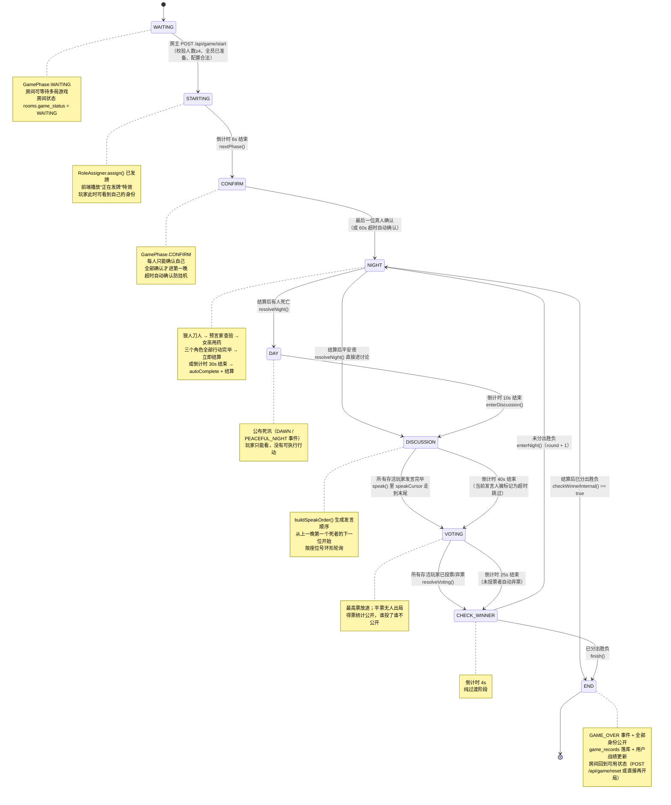

> 历史版本：13 人扩展前。多数决、女巫自救与人数等条目已失效；请使用 docs/GAME_RULES.md。

# 游戏规则与状态机（GAME_RULES）

> 本文档面向**全体组员、答辩评委与测试人员**，解决一个问题：**把狼人杀在这个系统里的每一条规则说清楚**——角色能做什么、阶段怎么流转、夜晚按什么顺序结算、投票怎么算、什么时候分胜负、超时了会发生什么。

> **所有规则的唯一权威是 `backend/src/main/java/com/werewolf/game/engine/WerewolfGameEngine.java`。** 前端与 AI 都只能「请求」行动，是否合法完全由引擎判定。本文档的每一条都能在代码里找到对应实现。

---

## 一、角色表

角色定义在 `backend/src/main/java/com/werewolf/game/domain/RoleType.java`：

```java
WEREWOLF("狼人",   Camp.WEREWOLF, true,  1, "夜晚与同伴共同猎杀一名玩家"),
SEER    ("预言家", Camp.VILLAGE,  false, 1, "夜晚查验一名玩家的阵营"),
WITCH   ("女巫",   Camp.VILLAGE,  false, 1, "拥有一瓶解药和一瓶毒药，各只能使用一次"),
VILLAGER("平民",   Camp.VILLAGE,  false, 1, "没有技能，依靠发言与投票找出狼人");
```

| 角色 | 阵营 | 技能 | 限制 | 卡牌素材 | 图标素材 | 标记素材 |
| --- | --- | --- | --- | --- | --- | --- |
| **狼人** `WEREWOLF` | 狼人阵营 | 夜晚与同伴共同选择一名好人击杀（**多数决**） | ① 只能击杀**存活的好人**，**不能击杀狼同伴**（`4006`）；② 每夜每人**只能行动一次**（`4007`）；③ 必须存活才能行动 | `/assets/roles/werewolf-card.svg` | `/assets/roles/werewolf-icon.svg` | `/assets/roles/werewolf-token.svg` |
| **预言家** `SEER` | 好人阵营 | 夜晚查验一名玩家的阵营，结果**仅本人可见** | ① **不能查验自己**（`4006`）；② **同一玩家不能重复查验**（`4006`）；③ 每夜只能查验一次（`4007`） | `/assets/roles/seer-card.svg` | `/assets/roles/seer-icon.svg` | `/assets/roles/seer-token.svg` |
| **女巫** `WITCH` | 好人阵营 | 一瓶**解药**（救当晚被狼刀的人）+ 一瓶**毒药**（毒杀一人），**各只能用一次** | ① 解药只有在**当晚确实有人被刀**时可用（否则 `4006`「今晚没有人被狼人击杀」）；② 药水用过再尝试使用 → `4008`；③ **不能毒杀自己**（`4006`）；④ 可以选 `WITCH_PASS` 本晚不用药；⑤ 每夜只能行动一次（`4007`） | `/assets/roles/witch-card.svg` | `/assets/roles/witch-icon.svg` | `/assets/roles/witch-token.svg` |
| **平民** `VILLAGER` | 好人阵营 | 无技能 | 夜晚**没有任何可用行动**（`availableActions` 返回空列表）；白天靠发言与投票 | `/assets/roles/villager-card.svg` | `/assets/roles/villager-icon.svg` | `/assets/roles/villager-token.svg` |
| （未公开身份时的卡背） | — | — | — | `/assets/roles/hidden-back.svg` | — | — |

**阵营枚举**（`RoleType.Camp`）：

| 枚举 | label | 胜负判定中的含义 |
| --- | --- | --- |
| `WEREWOLF` | 狼人阵营 | `isWolfSide() == true` 的角色都算 |
| `VILLAGE` | 好人阵营 | 其余全部（预言家、女巫、平民） |

> **注意**：`Camp.VILLAGE` 的字面量是 `VILLAGE`（不是 `VILLAGER`）。对局结束时的 `winner` 字段取值就是 `"VILLAGE"` 或 `"WEREWOLF"`。

---

## 二、完整状态机

### 2.1 阶段枚举

`backend/src/main/java/com/werewolf/game/domain/GamePhase.java`：

| 阶段 | label | 枚举默认秒数 | `application.yml` 默认值 | 配置项 |
| --- | --- | --- | --- | --- |
| `WAITING` | 等待开始 | `0` | `0` | — |
| `STARTING` | 发牌中 | `5` | **`6`** | `werewolf.phase.starting-seconds` |
| `CONFIRM` | 身份确认 | `60` | **`60`** | `werewolf.phase.confirm-seconds` |
| `NIGHT` | 夜晚 | `180` | **`180`** | `werewolf.phase.night-seconds` |
| `DAY` | 白天 | `20` | **`20`** | `werewolf.phase.day-seconds` |
| `DISCUSSION` | 讨论（**每人**） | `300` | **`300`** | `werewolf.phase.discussion-seconds` |
| `VOTING` | 投票 | `180` | **`180`** | `werewolf.phase.voting-seconds` |
| CHECK_WINNER | 结算 | 3 | **4** | werewolf.phase.check-winner-seconds |
| — | 预言家翻牌确认 | 30 | **30** | werewolf.phase.seer-confirm-seconds |
| `END` | 游戏结束 | `0` | `0` | — |

> **两套默认值的关系**：`GamePhase` 枚举里的 `defaultSeconds` 是**代码级兜底**；`AppProperties.Phase` 的字段默认值与 `application.yml` 一致，通过 `RoomRuntime.syncPhaseSeconds()` → `phaseConfig.secondsOf(phase)` **覆盖**枚举值。生效的是 `application.yml` 里的值。
>
> **演示时想跑快一点**：把 
ight-seconds 调到 30、discussion-seconds 调到 30、oting-seconds 调到 20，一局能在 5 分钟内打完。
>
> **注意阶段推进规则（F-16）**：夜晚与投票阶段**不会因为个别人行动完就推进**。
> 只有两种方式能让阶段前进：
> 1. 所有相关人员都点了「我完成了」→ 立即推进；
> 2. 倒计时走到 0 → 服务端补默认操作并强制推进（防挂机）。
>
> 因此上面的秒数是"最长等待时间"，大家一起点完成时可以快很多。

### 2.1.1 身份确认阶段（`CONFIRM`）详解

**为什么需要它**：身份一旦发下去就无法更改。如果有人在"低头看牌"时界面还没渲染出来，就会在第一晚毫无准备地行动（狼人不知道该刀谁、女巫不知道要救谁）。单独设一个确认阶段，可以保证**每个人都真的看到了自己的身份**再开始。

**规则**：

| 项 | 规则 |
| --- | --- |
| 进入条件 | `STARTING` 倒计时结束后自动进入 |
| 谁能确认 | 每个玩家**只能确认自己**（服务端用提交者的座位号解析 actor，客户端无法代他人确认） |
| 可用行动 | 尚未确认者：`CONFIRM_ROLE`；已确认者：无（只能等） |
| 触发进入第一晚 | **最后一位真人确认的那一刻立刻进入**，不需要等倒计时走完 |
| 重复确认 | 幂等：不报错、不重复计数 |
| AI 玩家 | 服务端直接视为已确认，不参与统计（否则永远等不到 AI 点确认） |
| 超时兜底 | 倒计时（默认 60 秒）结束后，**未确认者被自动确认**，并广播 `ROLE_CONFIRMED{auto:true}` —— 防止有人挂机把整个房间卡死 |
| 越权拦截 | 在非 `CONFIRM` 阶段提交 `CONFIRM_ROLE` 一律返回 `4003 GAME_WRONG_PHASE`（前端在发牌动画期间误点就会被拦下） |

**相关字段**（都在 `GameView`）：

| 字段 | 含义 |
| --- | --- |
| `confirmedCount` | 已确认的玩家数 |
| `confirmTargetCount` | 需要确认的总人数（只算真人） |
| `unconfirmedSeats` | 尚未确认的真人座位号，前端用来提示"还等 2、3 号" |
| `iConfirmed` | 我是否已确认（用于把按钮切成"✓ 已确认，等待其他人…"） |
| `players[].confirmed` | 每个座位是否已确认（座位网格上的小勾） |

**相关事件**：

| 事件 | 时机 | 载荷 |
| --- | --- | --- |
| `ROLE_CONFIRM_START` | 进入确认阶段 | `{playerCount, confirmedCount:0, secondsLeft}` |
| `ROLE_CONFIRMED` | 有人确认（含自动确认） | `{seatId, nickname, auto, confirmedCount, playerCount}` |

### 2.2 状态机图



### 2.3 阶段流转的两个「捷径」

正常的线性流转是 `STARTING → NIGHT → DAY → DISCUSSION → VOTING → CHECK_WINNER → NIGHT`，但代码里有**两条捷径**，容易漏看：

| 捷径 | 条件 | 代码位置 | 结果 |
| --- | --- | --- | --- |
| **平安夜跳过 DAY** | `resolveNight()` 后 `lastNightDeaths` 为空 | `WerewolfGameEngine.resolveNight()` 末尾：`if (peaceful) enterDiscussion(events);` | `NIGHT → DISCUSSION`，**不经过 DAY**，玩家直接开始发言 |
| **结算时提前结束** | `resolveNight()` 或 `resolveVoting()` 后 `checkWinnerInternal()` 返回 `true` | `resolveNight()` / `resolveVoting()` 里的 `finish(events)` 调用 | 先把 phase 设成 `CHECK_WINNER`，**立刻**调用 `finish()` 进入 `END`，不等待 4 秒倒计时 |

**为什么平安夜要跳过 DAY**：`DAY` 阶段的作用是「公布死讯」，没有人死就没什么可公布的，直接进讨论节奏更紧凑。前端会收到 `PEACEFUL_NIGHT` 事件并播放「平安夜」提示。

### 2.4 `nextPhase()` 的完整分支

```java
public GameActionResult nextPhase(List<GameEvent> events) {
    switch (state.getPhase()) {
        case WAITING       -> { return GameActionResult.fail(ErrorCode.GAME_WRONG_PHASE); }  // 不允许从 WAITING 推进
        case STARTING      -> { enterNight(events);       return success(true); }
        case NIGHT         -> { resolveNight(events);     return success(true); }  // 超时未行动者视为放弃
        case DAY           -> { enterDiscussion(events);  return success(true); }
        case DISCUSSION    -> { enterVoting(events);      return success(true); }
        case VOTING        -> { resolveVoting(events);    return success(true); }
        case CHECK_WINNER  -> { if (state.isFinished()) finish(events); else enterNight(events); return success(true); }
        default            -> { return GameActionResult.success(); }   // END：空操作
    }
}
```

> **`WAITING` 是唯一不能通过 `nextPhase()` 推进的阶段**——必须由房主显式调用 `POST /api/game/start`。

---

## 三、夜晚结算：顺序与边界

### 3.1 三个角色的行动顺序与「何时结算」

**规则上**夜晚是「狼人 → 预言家 → 女巫」的顺序，但系统**不强制串行等待**——三个角色可以**同时**提交行动，引擎用「是否全部行动完毕」来决定何时结算：

```java
/** 夜晚是否所有人都行动完毕：
 *  存活狼人全部选择 + 存活预言家已查验 + 存活女巫已决定用药。 */
private boolean maybeResolveNight(List<GameEvent> events) {
    if (state.getPhase() != GamePhase.NIGHT || nightSettled) return false;
    if (!allWolvesActed()) return false;
    if (state.hasAliveRole(RoleType.SEER)
            && !actedThisRound.containsKey(seatOfRole(RoleType.SEER))) return false;
    if (state.hasAliveRole(RoleType.WITCH)
            && !actedThisRound.containsKey(seatOfRole(RoleType.WITCH))) return false;
    resolveNight(events);
    return true;
}
```

> ⚠️ **调用方只有女巫的三个行动**：`maybeResolveNight()` 只在 `witchHeal()` / `witchPoison()` / `witchPass()` 的返回值里被调用（`wolfKill()` 与 `seerCheck()` 只更新 `nightActorsDone` 并 `return GameActionResult.success(nightActorsDone)`）。
>
> 因此：**女巫存活时，夜晚的「提前结算」总是由女巫提交用药决定的那一刻触发**——即使狼人和预言家早就行动完了，夜晚也要等女巫。如果**女巫已经出局**，则没有任何提前结算的触发点，夜晚必然走满 30 秒倒计时后由 `RoomRuntime.onPhaseTimeout()` 收尾（见 §7.1）。这是当前的实现特性，不影响正确性。

| 触发结算的条件 | 说明 |
| --- | --- |
| **所有存活狼人都已选择目标**（`allWolvesActed()`） | 双狼局必须两个狼都提交 |
| **存活预言家已查验**（若本局有预言家且存活） | 预言家死了就不检查 |
| **存活女巫已决定用药**（`WITCH_HEAL` / `WITCH_POISON` / `WITCH_PASS` 任一） | 女巫死了就不检查 |
| **或 `NIGHT` 倒计时归零** | `RoomRuntime.onPhaseTimeout()` → `autoCompleteCurrentPhase()` + `nextPhase()` |
| **或房主/AI 触发的任何一次 `nextPhase()`** | 管理接口或超时路径 |

> **重要细节**：狼人全部提交后，`nightActorsDone` 标志会被设为 `true`，但这只是「本晚行动已收集齐」的内部状态，**它是 `bool phaseAdvanced` 的返回值来源，不是结算开关**。真正的结算由女巫的行动（`maybeResolveNight()`）或超时兜底触发。

**狼人的「多数决」**（`tallyWolfTarget()`）：

```java
/** 多数决：出现票数最高者即锁定；平票时取最早达成的目标 */
private Integer tallyWolfTarget() {
    Map<Integer, Integer> counter = new LinkedHashMap<>();
    for (Integer target : state.getWolfVotes().values()) {
        counter.merge(target, 1, Integer::sum);
    }
    Integer best = null; int bestCount = 0;
    for (Map.Entry<Integer, Integer> e : counter.entrySet()) {
        if (e.getValue() > bestCount) { bestCount = e.getValue(); best = e.getKey(); }
    }
    return best;
}
```

> **双狼平票时的行为**：`LinkedHashMap` 保证遍历顺序 = 插入顺序（即先达成的目标先出现），且判断条件是**严格大于**（`>`），所以**平票时锁定的是最先达成的那个目标**。例如狼 A 先刀 3 号、狼 B 后刀 4 号 → 出现 `{3:1, 4:1}` 平票 → `best` 保持为 `3`（3 号先插入且 `1 > 0`；轮到 4 号时 `1 > 1` 为假）。

### 3.2 结算顺序（`resolveNight()` 完整逻辑）

```java
/** 夜晚结算：解药优先于狼刀，毒药独立生效。 */
private void resolveNight(List<GameEvent> events) {
    if (state.getPhase() != GamePhase.NIGHT || nightSettled) return;   // ① 幂等保护
    nightSettled = true;
    state.getLastNightDeaths().clear();

    // ② 狼刀结算：只有「女巫没用解药」时才生效
    Integer wolfTarget = state.getWolfTargetSeatId();
    if (wolfTarget != null && !state.isWitchUsedHeal()) {
        PlayerState victim = state.bySeat(wolfTarget);
        if (victim != null && victim.isAlive()) {
            victim.setAlive(false);
            state.getLastNightDeaths().add(victim.getSeatId());
        }
    }

    // ③ 毒药结算：独立生效，与解药/狼刀无关
    if (state.isWitchUsedPoison() && state.getWitchPoisonSeatId() != null) {
        PlayerState poisoned = state.bySeat(state.getWitchPoisonSeatId());
        if (poisoned != null && poisoned.isAlive()) {
            poisoned.setAlive(false);
            if (!state.getLastNightDeaths().contains(poisoned.getSeatId())) {
                state.getLastNightDeaths().add(poisoned.getSeatId());
            }
        }
    }

    // ④ 死讯按座位号排序，前端展示更稳定
    state.getLastNightDeaths().sort(Comparator.naturalOrder());

    // ⑤ 为每个死者发 PLAYER_DIED 事件
    for (Integer seat : state.getLastNightDeaths()) { /* ... cause = "NIGHT" ... */ }

    // ⑥ 区分平安夜 / 天亮
    boolean peaceful = state.getLastNightDeaths().isEmpty();
    boolean winnerDecided = checkWinnerInternal();
    if (peaceful) events.add(GameEvent.of(PEACEFUL_NIGHT).put("round", state.getRound()));
    else          events.add(GameEvent.of(DAWN).put("round", ...).put("deaths", ...));

    // ⑦ 已分出胜负 → 直接结束
    if (winnerDecided) { /* PHASE_CHANGE(CHECK_WINNER) → finish() */ return; }

    // ⑧ 未结束：平安夜直接讨论，有人死亡先进 DAY
    if (peaceful) enterDiscussion(events);
    else { state.setPhase(GamePhase.DAY); /* ... */ }
}
```

**结算顺序总结（严格按此顺序）：**

| 步骤 | 动作 | 关键判断 |
| --- | --- | --- |
| 1 | 幂等保护 | `if (nightSettled) return;` —— 重复结算被静默忽略 |
| 2 | **狼刀** | 仅当 `!isWitchUsedHeal()` 时把人设为死亡 |
| 3 | **毒药** | 独立生效；与狼刀是否成功无关；重复死讯去重 |
| 4 | 死讯排序 | 按座位号升序 |
| 5 | 发 `PLAYER_DIED` | `cause = "NIGHT"` |
| 6 | 判平安夜 | `lastNightDeaths.isEmpty()` |
| 7 | **判胜负**（在发 DAWN 之后） | `checkWinnerInternal()` |
| 8 | 阶段流转 | 赢了 → `END`；平安夜 → `DISCUSSION`；有人死 → `DAY` |

### 3.3 边界情况（逐个说清）

#### 边界 1：女巫救自己

**可以。** `witchHeal()` 的逻辑是：

```java
Integer victim = state.getWolfTargetSeatId();     // 今晚被狼刀的人
if (victim == null) return fail(GAME_TARGET_INVALID, "今晚没有人被狼人击杀");
PlayerState victimPlayer = state.bySeat(victim);
if (victimPlayer == null || !victimPlayer.isAlive()) return fail(GAME_TARGET_INVALID);
// 注意：这里没有「victim == actor」的判断 → 女巫可以救自己
```

唯一的前提是「今晚确实有人被刀」且那人还活着。**没有禁止救自己**，也没有禁止救任何人。

> **注意 `WITCH_HEAL` 忽略 `targetSeatId`**：解药的目标**固定为 `state.getWolfTargetSeatId()`**，客户端传什么都会被忽略。前端 `legalTargetsInternal()` 也会把 `selectableTargets` 设为只含那一个座位。

#### 边界 2：狼人空刀

**当前版本不支持主动空刀。** `wolfKill()` 强制要求 `targetSeatId` 非空：

```java
if (action.getTargetSeatId() == null) return fail(ErrorCode.GAME_TARGET_INVALID);
```

**狼人「不刀」的三种实际形态：**

| 场景 | 结果 |
| --- | --- |
| 狼人本夜未提交任何行动，且倒计时结束 | `autoCompleteCurrentPhase()` **随机刀一个好人**（`"timeout-random"`） |
| 狼人本夜未提交，但其他夜间角色都行动完了 | 不会结算——`allWolvesActed()` 返回 `false`，**必须等倒计时结束**，然后随机刀 |
| 存活好人已经为 0（理论上不可能，因为此时已判狼人胜） | `candidates.isEmpty()` → 跳过，不刀 |

> **如果要做「空刀」功能**：在 `ActionType` 加 `WOLF_PASS`，在 `wolfKill` 的同位置加分支，在 `resolveNight` 里判断 `wolfTargetSeatId == null` 时跳过狼刀。改动局限在引擎内。

#### 边界 3：预言家重复查验

**被明确禁止**，返回 `4006 GAME_TARGET_INVALID`，提示「同一玩家不能重复查验」：

```java
boolean alreadyChecked = actor.getCheckRecords().stream()
        .anyMatch(r -> r.targetSeatId() == target.getSeatId());
if (alreadyChecked) return fail(ErrorCode.GAME_TARGET_INVALID, "同一玩家不能重复查验");
```

**连带影响**：`RoomRuntime.legalTargetsInternal()` 会把已查验过的座位从 `selectableTargets` 里剔除，前端会自动置灰；`autoCompleteCurrentPhase()` 也只在「没查过的存活玩家」里随机选。

> **极限情况**：如果场上只剩预言家自己还没查（其他人都死了或都查过了），`candidates.isEmpty()` → 预言家**本夜无法行动**，`maybeResolveNight` 里 `!actedThisRound.containsKey(seerSeat)` 会一直为 `true`，导致**必须等倒计时结束**才能推进。这是一处设计上的粗糙点（正常情况下不会遇到，因为只剩预言家时游戏早就结束了）。

#### 边界 4：预言家查验自己

**被明确禁止**，返回 `4006`：

```java
if (target.getSeatId() == actor.getSeatId()) return fail(GAME_TARGET_INVALID, "不能查验自己");
```

#### 边界 5：女巫毒杀自己

**被明确禁止**，返回 `4006`：

```java
if (target.getSeatId() == actor.getSeatId()) return fail(GAME_TARGET_INVALID, "不能毒杀自己");
```

#### 边界 6：狼人刀同伴

**被明确禁止**，返回 `4006`，提示「不能击杀狼人同伴」：

```java
if (target.isWolf()) return fail(ErrorCode.GAME_TARGET_INVALID, "不能击杀狼人同伴");
```

**双狼局的影响**：两个狼互相不能刀，所以它们只能刀好人。如果场上只剩狼（`aliveWolves == alivePlayers`），此时早已判定狼人胜，不会进入这一分支。

#### 边界 7：同一个人被狼刀 + 被女巫毒

**只会死一次，死讯只出现一次。** 因为死亡设置在同一个 `resolveNight()` 内：

```java
// 狼刀设置 alive = false，加入 lastNightDeaths
// 毒药再检查时：if (poisoned != null && poisoned.isAlive())  ← 已经是 false，跳过
// 并且即使进入分支也有 if (!lastNightDeaths.contains(...)) 去重
```

#### 边界 8：女巫同时用解药和毒药

**允许**（当前版本没有「不能同夜双药」的限制）。执行顺序：

1. 女巫先提交 `WITCH_HEAL` → `actedThisRound[女巫] = WITCH_HEAL`，`witchUsedHeal = true`
2. 女巫**再提交** `WITCH_POISON` → **被拒绝**！`checkWitch()` 里 `actedThisRound.containsKey(actor.getSeatId())` 为 `true` → 返回 `4007 GAME_ALREADY_ACTED`

**结论**：**一个夜晚女巫只能使用一种药（或用 `WITCH_PASS` 空过）**。这是 `actedThisRound` 机制的自然结果，不是显式的规则判断。

> 如果将来要允许同夜双药，需要把 `actedThisRound` 的 key 从 `seatId` 改成 `(seatId, ActionType)` 组合。

#### 边界 9：狼人重复行动

**被禁止**。`actedThisRound` 以座位号为 key：

```java
if (actedThisRound.containsKey(actor.getSeatId())) return fail(ErrorCode.GAME_ALREADY_ACTED);
```

**双狼局里两个狼各自有独立记录**，互不影响。

#### 边界 10：女巫在狼人之前提交解药

**可以。** 因为所有真人行动都是独立并发提交的，女巫可能比狼人先提交。此时 `state.getWolfTargetSeatId()` 还是 `null`，`witchHeal()` 会返回 `4006`「今晚没有人被狼人击杀」。

**这是设计上的一个注意点**：女巫必须等狼人至少刀出一票之后才能用解药。前端通过 `me.selectableTargets` / `me.availableActions` 反映这一点——`availableActions` 里只有 `wolfTargetSeatId != null` 时才包含 `WITCH_HEAL`：

```java
if (p.getRole() == RoleType.WITCH && !actedThisRound.containsKey(seatId)) {
    if (p.isHealPotionAvailable() && state.getWolfTargetSeatId() != null) {
        list.add(ActionType.WITCH_HEAL);
    }
    if (p.isPoisonPotionAvailable()) list.add(ActionType.WITCH_POISON);
    list.add(ActionType.WITCH_PASS);
}
```

**AI 女巫**同样受这个限制：`RuleAgent.decide()` 只在 `allowedActions.contains(WITCH_HEAL)` 时才会考虑用解药。

#### 边界 11：重复结算

`nightSettled` 是**每次 `enterNight()` 都会被重置为 `false`** 的实例字段（同时 `nightActorsDone` 也被重置）：

```java
private void enterNight(List<GameEvent> events) {
    // ...
    nightActorsDone = false;
    nightSettled = false;
    // ...
}
```

> ⚠️ **历史缺陷提醒**：早期版本把这两个语义合并成一个 `nightResolved` 字段，导致「狼人全部行动」把标志置为 `true` 后，女巫行动触发 `resolveNight()` 时被开头的幂等判断直接 `return`——**表现为夜晚永远不结算**。这两个字段**必须保持独立**（见 [docs/TEST_PLAN.md](TEST_PLAN.md) 缺陷 F-01）。

`resolveNight()` 开头的 `if (state.getPhase() != GamePhase.NIGHT || nightSettled) return;` 保证了「真人行动触发结算」与「超时兜底触发结算」不会重复执行。这是并发安全的最后一道防线。

#### 边界 12：新一局的清理

`enterNight()` 会把所有夜晚临时数据清空：

```java
state.setWolfTargetSeatId(null);
state.setSeerTargetSeatId(null);
state.setWitchUsedHeal(false);
state.setWitchUsedPoison(false);
state.setWitchPoisonSeatId(null);
state.setPendingKilledSeatId(null);
state.setDayAnnounced(false);
state.getWolfVotes().clear();
state.getVotes().clear();
actedThisRound.clear();
voteCast.clear();
spokenThisRound.clear();
nightActorsDone = false;
nightSettled = false;
```

> **注意 `PlayerState` 上的字段不会被重置**：`healPotionAvailable` / `poisonPotionAvailable` / `checkRecords` 只在 **`RoleAssigner.assign()`**（新一局发牌时）里重置。所以「再来一局」必须先经过 `startGame()` 重新发牌，否则女巫的药水状态会残留。

---

## 四、投票规则

### 4.1 投票与弃票

| 行动 | `ActionType` | 要求 | 代码 |
| --- | --- | --- | --- |
| 投票 | `VOTE` | `targetSeatId` 必填；目标必须**存活**；**不能投自己**；本回合未投过票 | `vote()` |
| 弃票 | `ABSTAIN` | 无目标；本回合未投过票 | `abstain()` |

```java
private GameActionResult vote(PlayerState actor, GameAction action, List<GameEvent> events) {
    if (state.getPhase() != GamePhase.VOTING) return fail(GAME_WRONG_PHASE);
    if (voteCast.containsKey(actor.getSeatId()))  return fail(GAME_ALREADY_VOTED);
    if (action.getTargetSeatId() == null)         return fail(GAME_TARGET_INVALID);
    PlayerState target = state.bySeat(action.getTargetSeatId());
    if (target == null || !target.isAlive())      return fail(GAME_TARGET_INVALID);
    if (target.getSeatId() == actor.getSeatId())  return fail(GAME_TARGET_INVALID, "不能投票给自己");
    voteCast.put(actor.getSeatId(), target.getSeatId());
    state.getVotes().put(actor.getSeatId(), target.getSeatId());
    events.add(GameEvent.of(VOTE_CAST).put("actorSeatId", ...).put("actorNickname", ...));
    if (allAliveVoted()) { resolveVoting(events); return success(true); }
    return success(false);
}
```

**投票的可见性设计**：`VOTE_CAST` 事件**只包含投票人**（`actorSeatId` / `actorNickname`），**不包含被投者**。得票统计通过 `VOTE_RESULT` 的 `tally` 一次性公布。这样玩家无法实时推断「谁投了谁」。

### 4.2 结算规则（`resolveVoting()`）

```java
private void resolveVoting(List<GameEvent> events) {
    Map<Integer, Integer> counter = new LinkedHashMap<>();
    for (Integer target : state.getVotes().values()) {
        if (target != null) counter.merge(target, 1, Integer::sum);   // 弃票不计入
    }
    Integer exiled = null;
    boolean tie = false;
    int best = 0;
    for (Map.Entry<Integer, Integer> e : counter.entrySet()) {
        if (e.getValue() > best)      { best = e.getValue(); exiled = e.getKey(); tie = false; }
        else if (e.getValue() == best) { tie = true; }               // 出现并列最高票
    }
    // ...
    if (exiled != null && !tie) {
        target.setAlive(false);
        state.setLastExiledSeatId(exiled);
        result.put("exiledSeatId", exiled).put("exiledNickname", ...).put("votes", best);
        events.add(PLAYER_DIED.put("cause", "VOTE"));
    } else {
        state.setLastExiledSeatId(null);
    }
    events.add(result);   // VOTE_RESULT
    // → CHECK_WINNER（若已分胜负则立刻 finish）
}
```

| 规则 | 实现 | 结果 |
| --- | --- | --- |
| **最高票放逐** | 遍历 `counter` 取最大值 | 得票最多者出局，身份公开 |
| **平票无人出局** | 出现 `e.getValue() == best` 时把 `tie` 置为 `true` | `exiledSeatId` 不出现在 `VOTE_RESULT` 里，`tie=true`，**本轮无人出局**，直接进入 `CHECK_WINNER` |
| **弃票** | `target == null` 时不计入 `counter`，但计入 `abstainCount` | 弃票不影响结果，只体现在 `abstainCount` 里 |
| **超时自动弃票** | `autoCompleteCurrentPhase()` 对 `pendingVoters()` 逐个提交 `ABSTAIN`（`"timeout-abstain"`） | 未投票者视为弃票 |
| **全员弃票** | `counter` 为空 → `exiled == null`、`tie == false` | `VOTE_RESULT` 只有 `tally:{}`、`abstainCount:N`、`tie:false`，**无人出局** |

> **注意一个细节**：`tie` 的判定用的是「最终最高票数是否被多个目标共享」。如果 A 得 2 票、B 得 1 票、C 得 1 票，遍历顺序是 A(2) → B(1, 不大于 2) → C(1, 不大于 2)，`tie` 保持 `false`，**A 被放逐**。只有真正并列最高票才算平票。

> **另一个细节**：`tie` 一旦被置为 `true`，后续**不会**被重置（`tie = false` 只在 `e.getValue() > best` 分支里执行）。由于 `best` 只在严格更大时更新，实际上不会出现「先并列后反超」的情况，逻辑是自洽的。

### 4.3 前端展示

| 字段 | 来源 | 说明 |
| --- | --- | --- |
| `votedCount` | `state.getVotes().size()` | 已投票（含弃票）人数 |
| `abstainCount` | `state.getVotes().values()` 里 `null` 的数量 | 弃票数 |
| `voteCounts` | 遍历 `state.getVotes().values()` 统计 | `{"3": 2, "4": 1}` —— **只有被投座位号与票数，没有投票人** |
| `players[].voted` | `state.getVotes().containsKey(p.getSeatId())` | 该玩家是否已投票 |

---

## 五、胜负条件

```java
/** 胜负规则（服务器权威）：
 *  - 狼人全部出局 → 好人阵营胜；
 *  - 存活狼人数 >= 存活好人数 → 狼人阵营胜（屠边简化版：狼人达成人数压制）。
 *  @return 是否已分出胜负（内部会写入 state.winner/finished）
 */
private boolean checkWinnerInternal() {
    int wolves    = state.aliveWolves().size();
    int villagers = state.aliveVillagers().size();
    if (wolves == 0)        { state.setFinished(true); state.setWinner(RoleType.Camp.VILLAGE.name());   return true; }
    if (wolves >= villagers){ state.setFinished(true); state.setWinner(RoleType.Camp.WEREWOLF.name()); return true; }
    return false;
}
```

| 条件 | `winner` 取值 | 前端文案 | 特效素材 |
| --- | --- | --- | --- |
| **狼人全部出局**（`aliveWolves == 0`） | `"VILLAGE"` | 好人阵营胜利 | `/assets/effects/win-good.svg` |
| **存活狼数 ≥ 存活好人数**（`wolves >= villagers`） | `"WEREWOLF"` | 狼人阵营胜利 | `/assets/effects/win-werewolf.svg` |

**判定时机的三个位置：**

| 位置 | 触发场景 |
| --- | --- |
| `resolveNight()` 第 ⑦ 步 | **夜晚结算后**（狼刀 / 毒药导致有人出局） |
| `resolveVoting()` 末尾 | **投票放逐后** |
| `evaluateWinner()`（**只读**，不改状态） | 供测试与查询使用；`nextPhase()` 里的 `CHECK_WINNER` 分支靠 `state.isFinished()` 判断 |

> **注意 `evaluateWinner()` 与 `checkWinnerInternal()` 的区别**：前者是 `public` 且**不修改状态**，只返回结果字符串；后者是 `private` 且**会写入** `state.finished` / `state.winner`。二者判定逻辑完全一致。

**判定顺序的重要性**：先判「狼人全灭」，再判「狼人数量压制」。这在 4 人局有个有趣的结果——如果最后一狼被放逐时只剩 1 个好人，`wolves == 0` 先命中，仍然是**好人胜**。

### 5.1 「屠边简化版」是什么意思

标准狼人杀有「屠边」（杀光所有神职 或 杀光所有平民）和「屠城」（杀光所有好人）两种规则。本项目**都没有实现**，而是用了更简单的**人数压制**：

> 存活狼人数 ≥ 存活好人数 → 狼人胜。

这样做的理由：

1. 规则简单，玩家容易理解；
2. 不需要区分神职与平民（第一版只有 4 个角色，屠边意义不大）；
3. 判定逻辑只需一行 `wolves >= villagers`。

### 5.2 各人数的胜负临界点

| 初始人数 | 狼人 | 好人 | 狼人胜的关键节点 |
| --- | --- | --- | --- |
| 4 | 1 | 3 | 需要好人减到 1 人（即 2 人出局） |
| 5 | 2 | 3 | 需要好人减到 2 人（即 1 人出局）—— **狼人极易获胜** |
| 6 | 2 | 4 | 好人减到 2 人（即 2 人出局） |
| 6 | 1 | 5 | 好人减到 1 人（即 4 人出局）—— 对狼人极难 |
| 8 | 3 | 5 | 好人减到 3 人（即 2 人出局） |
| 12 | 5 | 7 | 好人减到 5 人（即 2 人出局） |

> **平衡性提示**：因为规则是「狼数 ≥ 好人数」，狼人比例越高，狼人越容易赢。`werewolfCount` 的上限是 `min(⌊(n-1)/2⌋, n-2)`（即**必须严格少于一半**，且**要为预言家和女巫各留 1 个座位**），在 `n=5, werewolfCount=2` 时已经非常不平衡——**演示建议用 4 人 1 狼，或 6 人 2 狼**。

---

## 六、角色配置约束

### 6.1 两层校验

配置校验在两个地方，**两层都要通过**：

| 层 | 位置 | 时机 | 错误码 |
| --- | --- | --- | --- |
| **第一层：建房/改房时** | `RoomService.validateConfig(maxPlayers, werewolfCount, aiCount)` | `POST /api/rooms`、`PUT /api/rooms/{code}` | `3008 ROOM_CONFIG_INVALID` |
| **第二层：开局时** | `RoleAssigner.validateConfig(totalPlayers, werewolfCount)` + `WerewolfGameEngine.startGame()` | `POST /api/game/start` | `3008`（Service 里先抛）/ `3008`（引擎里捕获 `IllegalArgumentException` 后转） |

### 6.2 完整约束公式

**第一层（`RoomService.validateConfig(maxPlayers, werewolfCount, aiCount)`）：**

```java
public static void validateConfig(int maxPlayers, int werewolfCount, int aiCount) {
    if (maxPlayers < 4 || maxPlayers > 12) {
        throw BizException.of(ErrorCode.ROOM_CONFIG_INVALID, "房间人数必须在 4~12 之间");
    }
    int maxWolves = RoleAssigner.maxWerewolfCount(maxPlayers);
    if (werewolfCount < 1 || werewolfCount > maxWolves) {
        throw BizException.of(ErrorCode.ROOM_CONFIG_INVALID,
                "狼人数量必须在 1~" + maxWolves + " 之间（需为预言家和女巫留出座位，且少于人数的一半）");
    }
    if (aiCount < 0 || aiCount > maxPlayers - 1) {
        throw BizException.of(ErrorCode.ROOM_CONFIG_INVALID,
                "AI 数量必须在 0~" + (maxPlayers - 1) + " 之间（至少留 1 个真人座位）");
    }
    // 开局时 AI 占用的也是真实座位，因此只需保证"总座位能放下 狼人+预言家+女巫"
    if (maxPlayers < werewolfCount + RoleAssigner.REQUIRED_SPECIAL_ROLES) {
        throw BizException.of(ErrorCode.ROOM_CONFIG_INVALID,
                "座位不足：需要为预言家和女巫各留 1 个座位，"
                        + maxPlayers + " 人局最多 " + (maxPlayers - RoleAssigner.REQUIRED_SPECIAL_ROLES)
                        + " 只狼");
    }
}
```

> ⚠️ **注意**：这里**没有** `n - ai ≥ w + 1` 这样的约束。原因见代码注释——**AI 占用的也是真实座位**，开局时 `total = 真人 + AI`，所以只需保证「总座位数能放下 w 个狼 + 2 个神职」即可。`maxPlayers=4, werewolfCount=1, aiCount=3`（房主 1 真人 + 3 AI）是**合法**配置，可以直接开局。

**第二层（`RoleAssigner.validateConfig(totalPlayers, werewolfCount)`，在开局时用「实际入座人数」再校验一次）：**

```java
public static void validateConfig(int totalPlayers, int werewolfCount) {
    if (totalPlayers < 4 || totalPlayers > 12) {
        throw new IllegalArgumentException("房间人数必须在 4 ~ 12 之间");
    }
    int maxWolves = maxWerewolfCount(totalPlayers);
    if (werewolfCount < 1 || werewolfCount > maxWolves) {
        throw new IllegalArgumentException(
                "狼人数量必须在 1 ~ " + maxWolves + " 之间（需为预言家和女巫留出座位）");
    }
}

/** 给定人数的狼人数量上限：同时满足"少于一半"和"放得下两个神职"。 */
public static int maxWerewolfCount(int totalPlayers) {
    return Math.max(0, Math.min((totalPlayers - 1) / 2, totalPlayers - REQUIRED_SPECIAL_ROLES));
}
```

**第三层（`RoomService.startGame` 的「实际座位数」校验）：**

```java
int total = runtime.getState().getPlayers().size();
// 开局必须校验"实际座位数"，而不只是房间容量：
// 3 人局（1 狼 + 2 神职）会出现"没有平民、好人一开始就少于狼人"的退化局面，
// 因此强制要求至少 4 个已入座玩家（真人 + AI）。
if (total < 4) {
    throw BizException.of(ErrorCode.ROOM_CONFIG_INVALID,
            "至少需要 4 名玩家（含 AI）才能开始，当前 " + total + " 人");
}
```

> **为什么需要第三层**：房间容量是 4 人，但**实际只坐了 3 个人**时，`RoleAssigner.buildDeck(3, 1)` 会得到 `[WEREWOLF, SEER, WITCH]`——**一个平民都没有**，而好人只有 2 人、狼人 1 人，狼人几乎必赢。因此开局时必须校验**实际入座人数 ≥ 4**，而不只是房间配置。

### 6.3 约束一览表

| 约束 | 公式 | 说明 |
| --- | --- | --- |
| **房间人数上限（配置）** | `4 ≤ n ≤ 12` | 同时也由 `CreateRoomRequest` 的 `@Min(4)` / `@Max(12)` 在参数层拦住（不合法 → `1000`） |
| **实际入座人数（开局）** | `total ≥ 4` | `RoomService.startGame()` 里校验；真人 + AI 都算座位 |
| **狼人数** | `1 ≤ w ≤ min(⌊(n-1)/2⌋, n-2)` | 两条约束同时生效：① 必须**严格少于一半**（`w*2 < n`）；② 必须**为预言家和女巫各留 1 个座位**（`w ≤ n-2`）。实现即 `RoleAssigner.maxWerewolfCount(n)` |
| **AI 数量** | `0 ≤ ai ≤ n - 1` | 至少保留 1 个真人座位（房主） |
| **AI 与角色配置的组合** | `ai` **不参与**角色约束 | AI 占的也是真实座位，开局时 `total = 真人 + AI`；只要 `n ≥ w + 2` 即可（第一层已经保证） |

### 6.4 各人数的合法配置速查

| `maxPlayers` | `maxWerewolfCount` | 允许的 `werewolfCount` | 预言家 / 女巫 | 建议搭配 |
| --- | --- | --- | --- | --- |
| 4 | `min(1, 2) = 1` | `1` | ✅ 恒定各 1 名 | **1 狼 + 1 预言家 + 1 女巫 + 1 平民**（本轮演示主配置） |
| 5 | `min(2, 3) = 2` | `1, 2` | ✅ 恒定各 1 名 | 1 狼 + 预言家 + 女巫 + 2 平民（平衡）；2 狼时狼人极易获胜 |
| 6 | `min(2, 4) = 2` | `1, 2` | ✅ 恒定各 1 名 | 2 狼 + 预言家 + 女巫 + 2 平民（推荐的中等规模） |
| 7 | `min(3, 5) = 3` | `1, 2, 3` | ✅ 恒定各 1 名 | 2 狼 + 预言家 + 女巫 + 3 平民 |
| 8 | `min(3, 6) = 3` | `1, 2, 3` | ✅ 恒定各 1 名 | 2 狼 + 预言家 + 女巫 + 4 平民 |
| 9 | `min(4, 7) = 4` | `1, 2, 3, 4` | ✅ 恒定各 1 名 | 3 狼 + 预言家 + 女巫 + 4 平民 |
| 10 | `min(4, 8) = 4` | `1, 2, 3, 4` | ✅ 恒定各 1 名 | 3 狼 + 预言家 + 女巫 + 5 平民 |
| 11 | `min(5, 9) = 5` | `1, 2, 3, 4, 5` | ✅ 恒定各 1 名 | 3 狼 + 预言家 + 女巫 + 6 平民 |
| 12 | `min(5, 10) = 5` | `1, 2, 3, 4, 5` | ✅ 恒定各 1 名 | 4 狼 + 预言家 + 女巫 + 6 平民 |

> **两个上界里哪一个是紧的？** 对 `n ≥ 3` 恒有 `⌊(n-1)/2⌋ ≤ n-2`（因为 `(n-1)/2 ≤ n-2 ⟺ n ≥ 3`），因此在 4~12 的全部合法规模上 `min` 的结果**总是** `⌊(n-1)/2⌋`——「必须严格少于一半」是真正的紧约束。
>
> 那为什么还要写 `min(..., n - REQUIRED_SPECIAL_ROLES)`？两个原因：
> 1. **表达业务规则**：把「必须为预言家和女巫各留 1 个座位」写进公式与错误提示文案里（提示会说「需为预言家和女巫留出座位」），而不是让它隐含在「少于一半」里；
> 2. **兜底**：`RoleAssigner.buildDeck()` 里有一条独立校验 `if (werewolfCount + REQUIRED_SPECIAL_ROLES > totalPlayers) throw ...`，即使有人绕过 `validateConfig` 直接调 `buildDeck`（单元测试就是这么做的），也不会出现「两个神职放不下」的退化配置。

### 6.5 发牌算法（`RoleAssigner`）

```java
/** 除狼人外必须保留的神职数量（预言家 + 女巫）。 */
public static final int REQUIRED_SPECIAL_ROLES = 2;

/** 生成一副牌（未打乱）。 */
public static List<RoleType> buildDeck(int totalPlayers, int werewolfCount) {
    if (totalPlayers < 4) {
        throw new IllegalArgumentException(
                "至少需要 4 名玩家（含 AI）才能开局，当前只有 " + totalPlayers + " 个座位");
    }
    if (werewolfCount + REQUIRED_SPECIAL_ROLES > totalPlayers) {
        throw new IllegalArgumentException(
                "狼人太多：需要为预言家和女巫各保留 1 个座位，当前 " + totalPlayers + " 人最多 "
                        + (totalPlayers - REQUIRED_SPECIAL_ROLES) + " 只狼");
    }
    List<RoleType> deck = new ArrayList<>();
    for (int i = 0; i < werewolfCount; i++) deck.add(RoleType.WEREWOLF);   // ① w 张狼
    deck.add(RoleType.SEER);                                                // ② 1 张预言家（恒定）
    deck.add(RoleType.WITCH);                                               // ③ 1 张女巫（恒定）
    while (deck.size() < totalPlayers) deck.add(RoleType.VILLAGER);         // ④ 剩余全是平民
    if (deck.size() > totalPlayers) throw new IllegalArgumentException(
            "角色数量(" + deck.size() + ")超过玩家人数(" + totalPlayers + ")");
    return deck;
}

public static void assign(List<PlayerState> players, int werewolfCount, Random random) {
    int total = players.size();
    if (total < 4) {
        throw new IllegalArgumentException("至少需要 4 名玩家才能开始游戏");
    }
    List<RoleType> deck = buildDeck(total, werewolfCount);
    Collections.shuffle(deck, random);        // ★ 打乱，避免"座位号 = 身份"的规律被利用
    for (int i = 0; i < total; i++) {
        PlayerState p = players.get(i);
        p.setRole(deck.get(i));
        p.setAlive(true);
        p.setHealPotionAvailable(true);       // 女巫药水重置
        p.setPoisonPotionAvailable(true);
        p.getCheckRecords().clear();          // 预言家查验记录清空
    }
}
```

**关键点：**

| 点 | 说明 |
| --- | --- |
| **预言家恒定 1 名** | 包括 4 人局。`deck.add(RoleType.SEER)` 无条件执行 |
| **女巫恒定 1 名** | 包括 4 人局。`deck.add(RoleType.WITCH)` 无条件执行。两者同为 P0 必选角色，**因此 4 人局的夜晚有 3 个角色需要行动**（狼人 + 预言家 + 女巫），而不是 2 个 |
| **4 人局 = 1 狼 + 1 预言家 + 1 女巫 + 1 平民** | `buildDeck(4, 1)` → `[WEREWOLF, SEER, WITCH, VILLAGER]` |
| **两个神职恒定 ⇒ 狼人上限收紧** | 由 `REQUIRED_SPECIAL_ROLES = 2` 推出 `w ≤ n - 2`，与「少于一半」取交集得到 `maxWerewolfCount(n)` |
| **发牌前打乱** | `Collections.shuffle(deck, random)`，座位号与身份无关 |
| **可复现** | `WerewolfGameEngineFactory.createWithSeed(state, seed)` 可以注入固定种子，**保证测试可复现**（`WerewolfGameEngineTest` 用 `new Random(20240501L)`） |
| **重置时机** | `assign()` 是唯一重置药水与查验记录的地方 |

---

## 七、超时兜底规则表

超时处理分两处：

| 处理器 | 位置 | 职责 |
| --- | --- | --- |
| **`RoomRuntime.onPhaseTimeout()`** | 每秒 tick 的入口 | 判断是讨论阶段（特殊处理）还是其它阶段（补默认行动 + 推进） |
| **`WerewolfGameEngine.autoCompleteCurrentPhase(events)`** | 引擎 | 为未行动者补一个**合法**的默认行动 |

### 7.1 每个阶段的超时行为

| 阶段 | 超时后发生什么 | 代码 |
| --- | --- | --- |
| `WAITING` | 不适用（没有倒计时，`tick()` 因 `!gameStarted` 直接返回） | — |
| `STARTING` | `autoCompleteCurrentPhase()` 无操作（不是 NIGHT/VOTING/DISCUSSION）→ `nextPhase()` → `enterNight()` | `onPhaseTimeout()` 的默认分支 |
| **`NIGHT`** | ① 未行动的**狼人**：从所有存活好人里**随机**选一个下刀（`"timeout-random"`）；② 未行动的**预言家**：从「没查过的存活玩家（排除自己）」里**随机**查验（`"timeout-random"`）；③ 未行动的**女巫**：提交 `WITCH_PASS`（`"timeout-pass"`）→ 然后 `nextPhase()` → `resolveNight()` | `autoCompleteCurrentPhase()` 的 `NIGHT` 分支 |
| `DAY` | 无操作（不是 NIGHT/VOTING/DISCUSSION）→ `nextPhase()` → `enterDiscussion()` | 默认分支 |
| **`DISCUSSION`** | **只跳过当前发言人**：`engine.autoCompleteCurrentPhase()` 给当前发言人补一条 `SPEAK`（内容为 `"（发言超时，跳过）"`，`"timeout-skip"`）→ **倒计时重置为完整的 `discussion-seconds`**，下一位重新获得完整时间 | `onPhaseTimeout()` 的 `DISCUSSION` 特判 |
| **`VOTING`** | 未投票者逐个提交 `ABSTAIN`（`"timeout-abstain"`）→ 然后 `nextPhase()` → `resolveVoting()` | `autoCompleteCurrentPhase()` 的 `VOTING` 分支 |
| `CHECK_WINNER` | 无操作 → `nextPhase()` → 已结束则 `finish()`，否则 `enterNight()` | 默认分支 |
| `END` | `tick()` 开头就 `return`（`if (state.getPhase() == GamePhase.END) return;`） | — |

### 7.2 为什么 `DISCUSSION` 要特殊处理

```java
private void onPhaseTimeout() {
    List<GameEvent> events = new ArrayList<>();
    GameState state = getState();
    if (state.getPhase() == GamePhase.DISCUSSION) {
        // 讨论超时：只跳过当前发言人，下一位重新拿到完整的发言时间，避免刷屏式连跳
        PlayerState current = state.currentSpeaker();
        if (current != null) {
            engine.autoCompleteCurrentPhase(events);
            state.setPhaseSecondsLeft(phaseConfig.getDiscussionSeconds());   // ★ 重置为完整时长
        }
        publishEvents(events);
        broadcastState();
        scheduleAiForCurrentPhase();
        return;                                    // ★ 注意：这里直接返回，不调用 nextPhase()
    }
    // 其它阶段（夜晚/投票）超时：给未行动者补默认行动，然后推进阶段
    engine.autoCompleteCurrentPhase(events);
    engine.nextPhase(events);
    // ...
}
```

**如果按其它阶段的方式处理**：6 个玩家讨论，每人 40 秒，如果大家一起超时，`nextPhase()` 会让整个 `DISCUSSION` 直接结束，所有人都没发言就进入投票——体验很差。

**现在的处理**：当前发言人超时 → 只跳过**他一个** → 重置 40 秒 → 下一位发言人有完整时间。这样最多只会「跳过一个」，而不是「全部跳过」。

### 7.3 超时后的数据一致性

| 保证 | 机制 |
| --- | --- |
| 不会重复结算 | **两个**独立标志：`nightActorsDone`（「本晚所有人的行动是否都收集完了」）+ `nightSettled`（「本晚是否已经结算过」的幂等开关，`resolveNight()` 开头判断）<br/>⚠️ 早期版本把两者合并成一个 `nightResolved` 布尔值，导致狼人行动后该标志被置为 `true`，女巫行动触发 `resolveNight()` 时被误判为「已结算」直接 `return`——**表现为夜晚永远不结算**。现已拆分（见 [docs/TEST_PLAN.md](TEST_PLAN.md) 的缺陷 F-01 与回归用例 `NightResolveDebugTest`） |
| 不会重复投票 | `voteCast` / `actedThisRound` 记录 |
| 不会卡在非法目标 | `autoCompleteCurrentPhase()` 用的目标都是通过 `legalTargets` 同源逻辑筛出来的合法目标 |
| 补的行动也走完整校验 | 补的行动通过 `applyAction(GameAction.ai(...))` 提交，**与真人走同一条校验路径** |
| 前端能看到发生了什么 | 所有超时补的行动都会产生正常事件（`ROLE_SKILL` / `SEER_RESULT` / `VOTE_CAST` / `SPEECH`）并广播 |

---

## 八、4 人局示例对局推演（4 个真人玩家）

> **本节场景**：4 个**真人**玩家，房间配置 `maxPlayers=4, werewolfCount=1, aiCount=0, allowAi=false`（**本轮交付的默认配置**）。全程不涉及任何 AI 行为。

### 8.1 开局设定

| 座位 | 玩家 | 真实身份 | 阵营 |
| --- | --- | --- | --- |
| 1 号 | 演示玩家（房主） | **狼人** `WEREWOLF` | 狼人阵营 |
| 2 号 | 1号玩家 | **预言家** `SEER` | 好人阵营 |
| 3 号 | 2号玩家 | **女巫** `WITCH` | 好人阵营 |
| 4 号 | 3号玩家 | **平民** `VILLAGER` | 好人阵营 |

**发牌过程**（`RoleAssigner.buildDeck(4, 1)`）：

```
deck = []                                       // 空牌堆
deck = [WEREWOLF]                               // ① 1 张狼
deck = [WEREWOLF, SEER]                         // ② 加预言家（恒定）
deck = [WEREWOLF, SEER, WITCH]                  // ③ 加女巫（恒定，4 人局也保留）
deck = [WEREWOLF, SEER, WITCH, VILLAGER]        // ④ 补足 4 张，剩余全是平民
Collections.shuffle(deck, random)               // ⑤ 打乱
→ 按座位 1..4 依次发牌
```

> **⚠️ 4 人局 = 1 狼 + 1 预言家 + 1 女巫 + 1 平民**。预言家与女巫是 P0 必选角色，`buildDeck` 里 `deck.add(RoleType.SEER); deck.add(RoleType.WITCH);` 是**无条件**执行的（常量 `REQUIRED_SPECIAL_ROLES = 2`）。
>
> 因此本局的夜晚**有 3 个角色需要行动**：**1 号（狼）刀人**、**2 号（预言家）查验**、**3 号（女巫）决定用不用药**；只有 4 号（平民）没有夜晚行动。

**开局后的视图差异**（这是隐私裁剪的直观体现）：

| 座位 | `me.role` | `me.wolfTeammates` | `me.checkRecords` | `me.healPotionAvailable` | `me.availableActions`（夜晚，狼人尚未刀人时） |
| --- | --- | --- | --- | --- | --- |
| 1 号 | `WEREWOLF` | `[]`（单人狼） | — | — | `["WOLF_KILL"]` |
| 2 号 | `SEER` | — | `[]` | — | `["SEER_CHECK"]` |
| 3 号 | `WITCH` | — | — | `true` | `["WITCH_POISON", "WITCH_PASS"]`（**还没有解药选项**，因为狼人还没刀人） |
| 4 号 | `VILLAGER` | — | — | — | `[]`（**空列表，无任何按钮**） |

狼人刀人落地后，3 号（女巫）的 `availableActions` 会变成 `["WITCH_HEAL", "WITCH_POISON", "WITCH_PASS"]`，`selectableTargets` 里出现**当晚被刀者**（这就是女巫「知道谁被刀了」的信息来源，见 `RoomRuntime.legalTargetsInternal` 的 `WITCH_HEAL` 分支）。

而公共频道 `/topic/room/{code}/game` 里，`players[].role` 对**全部 4 个座位都不存在**。

---

### 8.2 第一夜（`NIGHT`，30 秒）

**玩家行动：**

| 时间 | 座位 | 行动 | 结果 |
| --- | --- | --- | --- |
| t=3s | 1 号（狼） | `WOLF_KILL` target=2 | ✅ 成功。`wolfTargetSeatId = 2`，产出 `ROLE_SKILL` 事件 |
| t=6s | 2 号（预言家） | `SEER_CHECK` target=1 | ✅ 成功。产出 `SEER_RESULT` 事件（`wolf = true`），写入 `checkRecords` |
| t=9s | 3 号（女巫） | `WITCH_PASS`（本晚不用药） | ✅ 成功。产出 `WITCH_ACTION {effect:"PASS"}`，**并触发夜晚结算** |
| — | 4 号（平民） | 无可用行动 | 前端显示「天黑请闭眼」遮罩 |

**前端收到的事件：**

| 目的地 | 事件 | payload |
| --- | --- | --- |
| `/topic/room/CODE/event`（全体） | `ROLE_SKILL` | `{role:"WEREWOLF", effect:"KILL", actorSeatId:1, visibleTo:"WEREWOLF"}` —— **没有 `targetSeatId`** |
| `/user/queue/event`（**仅 1 号**，狼人自己） | `ROLE_SKILL` | `{...同上的完整版..., targetSeatId:2}` |
| `/user/queue/event`（**仅 2 号**） | `SEER_RESULT` | `{actorSeatId:2, targetSeatId:1, targetNickname:"演示玩家", wolf:true, effect:"CHECK"}` |
| `/user/queue/event`（**仅 3 号**） | `WITCH_ACTION` | `{actorSeatId:3, effect:"PASS"}` |

**4 号（平民）看到什么**：只有「狼人猎杀」的全屏特效（说明有人被刀了），**完全不知道目标是谁**。它不会收到 `SEER_RESULT`，也收不到女巫的 `WITCH_ACTION`（该事件 `privateTo` 女巫本人）。

**⚠️ 结算触发时机（重要实现细节）**：夜晚的提前结算由**女巫的行动**触发，而不是由狼人或预言家触发。

```java
// wolfKill / seerCheck 只更新 nightActorsDone，不调用 resolveNight()
return GameActionResult.success(nightActorsDone);

// witchHeal / witchPoison / witchPass 会尝试结算
return GameActionResult.success(maybeResolveNight(events));
```

`maybeResolveNight()` 的三个前置条件：① `allWolvesActed()`；② 若有存活预言家，则预言家已行动；③ 若有存活女巫，则女巫已行动。**三条全部满足才 `resolveNight()`**。

> **推论**：如果**女巫已经出局**（`hasAliveRole(WITCH) == false`），条件 ③ 自动满足，但此时**没有任何人会调用 `maybeResolveNight()`**——夜晚只能等 30 秒倒计时结束后由 `RoomRuntime.onPhaseTimeout()` → `autoCompleteCurrentPhase()` + `nextPhase()` → `resolveNight()` 收尾。也就是说：**女巫出局后，夜晚不会再提前结算**，一定会走满超时。这是当前的实现特性（不影响正确性，因为超时兜底一定会把夜晚推进），答辩时如被问到可以直接说明。

**本局的结算过程**（t=9s，女巫提交 `WITCH_PASS` 后立即发生）：

| 步骤 | 结果 |
| --- | --- |
| 狼刀（目标 2 号） | `witchUsedHeal == false` → **2 号 `alive = false`**，加入 `lastNightDeaths` |
| 毒药 | `witchUsedPoison == false` → 跳过 |
| 排序 | `lastNightDeaths = [2]` |
| 发事件 | `PLAYER_DIED {seatId:2, nickname:"1号玩家", cause:"NIGHT"}` |
| 平安夜？ | ❌ 否 → 发 `DAWN {round:1, deaths:[2]}`，**阶段进入 `DAY`** |
| 判胜负 | `aliveWolves = 1`（1 号），`aliveVillagers = 2`（3、4 号）→ `1 == 0` 为假，`1 >= 2` 为假 → **未结束** |
| 阶段流转 | `NIGHT → DAY`（`phaseSecondsLeft` 被 `syncPhaseSeconds()` 设为配置值 10 秒） |

> **注意** `resolveNight()` 的两个分支：**非平安夜** → `NIGHT → DAY`（用 10 秒公布死讯）；**平安夜** → 直接 `enterDiscussion()`，**跳过 `DAY`**（见 §8.7）。

**2 号的私有状态更新**（如果它还活着的话）：`me.checkRecords = [{round:1, seatId:1, nickname:"演示玩家", wolf:true, label:"狼人"}]`。但本局 2 号已被狼刀出局，这份关键信息**随它一起消失了**——这正是狼人首夜刀预言家的价值。

---

### 8.3 第一天白天（`DAY`，10 秒）

**这是纯展示阶段**，没有任何可执行行动。`availableActions` 对所有人都返回空列表（`WerewolfGameEngine.availableActions` 的 `switch` 只处理 `NIGHT` / `DISCUSSION` / `VOTING`）。

**4 个窗口看到的：**

| 座位 | 看到的内容 |
| --- | --- |
| 1 号（狼） | 「天亮了」特效 + 「昨晚死亡：2 号」+ 知道自己刀中了预言家 |
| 2 号（预言家，**已出局**） | 同上 + 自己已出局的提示。**它验到「1 号是狼」这条关键信息随它一起消失了** |
| 3 号（女巫） | 同上，只知道死了一个人，**不知道 2 号是预言家** |
| 4 号（平民） | 同上，完全不知道 1 号是狼 |

**10 秒后**：`RoomRuntime.tick()` 倒计时归零 → `autoCompleteCurrentPhase()`（`DAY` 不在处理范围内，无操作）→ `nextPhase()` → `enterDiscussion()`。

---

### 8.4 讨论阶段（`DISCUSSION`，40 秒）

**发言顺序生成**（`buildSpeakOrder()`）：

```java
alive = [1, 3, 4]                    // 存活玩家座位号（2 号已出局）
alive.sort(naturalOrder) → [1, 3, 4]

// 从上一晚第一个死亡座位（2 号）开始，找第一个 > 2 的存活座位
firstDead = 2
// 遍历 alive：1 > 2? 否；3 > 2? 是 → startIndex = 1
// 环形轮询：speakOrder = [3, 4, 1]
```

**发言顺序 = 3 号 → 4 号 → 1 号**

> 为什么从上一晚第一个死者的**下一位**开始？这是狼人杀的经典规则，让死者的下家在信息最全的位置发言。
>
> 边界情况：如果 `lastNightDeaths` 为空（平安夜）或死者的座位号大于所有存活座位，`startIndex` 保持 `0`，即**从座位号最小的存活玩家开始**。

**发言过程：**

| 顺序 | 座位 | 发言内容（示例） | 服务端校验 |
| --- | --- | --- | --- |
| 1 | 3 号（女巫） | 「我是 3 号。2 号昨晚倒了，场上还有 3 个人，我没什么信息，先听后面的。」 | ✅ `currentSpeaker` 是 3 号，通过 |
| 2 | 4 号（平民） | 「我是 4 号。场上 3 个人里肯定有 1 匹狼，我怀疑 1 号——他昨天话最少。」 | ✅ 通过 |
| 3 | 1 号（狼） | 「我是 1 号，我是好人。4 号上来就泼我脏水，我看他更像狼，我投 4 号。」 | ✅ 通过（**狼人在说谎，系统不做任何拦截**——发言内容完全不参与规则判定） |

**如果 1 号抢先发言**：`speak()` 会返回 `4002 GAME_NOT_YOUR_TURN`，提示「当前应由 3 号发言」。

**发言内容的两条硬约束**（`WerewolfGameEngine.speak`）：

| 约束 | 不满足时 |
| --- | --- |
| 阶段必须是 `DISCUSSION` | `4003 GAME_WRONG_PHASE` |
| 必须轮到该座位 | `4002 GAME_NOT_YOUR_TURN` |
| 内容不能为空（`trim()` 后） | `1000 BAD_REQUEST`（「发言内容不能为空」） |
| 内容超过 500 字 | **不报错，静默截断到 500 字** |

**发言结束后**：`state.setSpeakCursor(speakCursor + 1)`，当 `currentSpeaker()` 返回 `null`（游标走到末尾）→ `speak()` 内部**自动调用 `enterVoting()`**，不用等 40 秒。

**前端的 `SPEAK_TURN` 事件**让所有窗口都能看到「轮到 X 号发言」，只有当前发言人的窗口出现输入框（`me.availableActions` 里含 `SPEAK`）。

> **已出局玩家**：`applyAction()` 的第一道校验就是 `!actor.isAlive()` → `4005 GAME_PLAYER_DEAD`。因此 2 号即使刷新页面回到对局页，也无法发言——前端应把它显示为「观战」状态。

---

### 8.5 投票阶段（`VOTING`，25 秒）

**投票（存活玩家 = 1、3、4 号）：**

| 座位 | 投票 | 理由 |
| --- | --- | --- |
| 3 号（女巫） | `VOTE` target=4 | 被 1 号带偏：「4 号昨天话最少」 |
| 4 号（平民） | `VOTE` target=3 | 反击：「3 号一直在附和 1 号，我觉得他俩是一伙的」 |
| 1 号（狼） | `VOTE` target=3 | 狼人的目标很明确：**把票集中到同一个人身上** |

**`VOTE_CAST` 事件的可见性**：

```
/topic/room/CODE/event 收到：
  {eventType:"VOTE_CAST", payload:{actorSeatId:3, actorNickname:"2号玩家"}}
  {eventType:"VOTE_CAST", payload:{actorSeatId:4, actorNickname:"3号玩家"}}
  {eventType:"VOTE_CAST", payload:{actorSeatId:1, actorNickname:"演示玩家"}}
```

**注意：没有 `targetSeatId`**——没人能实时知道谁投了谁。前端只能显示「X 号已完成投票」和 `votedCount`。

**全部投完后自动结算**（`vote()` / `abstain()` 末尾都会判断 `allAliveVoted()`）：

```java
counter = {4: 1, 3: 2}        // 3 号得 2 票，4 号得 1 票
// 遍历：
//   e = (4, 1): 1 > 0 → best=1, exiled=4, tie=false
//   e = (3, 2): 2 > 1 → best=2, exiled=3, tie=false
// 结果：exiled = 3, tie = false
```

**结算结果：**

| 项目 | 值 |
| --- | --- |
| `tally` | `{"4": 1, "3": 2}`（JSON 对象的 key 是字符串形式的座位号） |
| `abstainCount` | `0` |
| `tie` | `false` |
| `exiledSeatId` | `3` |
| `exiledNickname` | `"2号玩家"` |
| `votes` | `2` |

**产出的事件：**

1. `PLAYER_DIED {seatId:3, nickname:"2号玩家", cause:"VOTE"}` → 3 号 `alive = false`
2. `VOTE_RESULT {tally:{...}, abstainCount:0, tie:false, exiledSeatId:3, exiledNickname:"2号玩家", votes:2}`

**胜负判定**（`checkWinnerInternal()`）：

```java
aliveWolves    = 1     // 1 号
aliveVillagers = 1     // 4 号
// 先判「狼人全灭」，再判「人数压制」
if (wolves == 0)        → false
if (wolves >= villagers) → 1 >= 1 为真 → state.setFinished(true);
                                          state.setWinner("WEREWOLF"); return true;
```

**✅ 狼人阵营胜利！** 一匹狼在只剩 2 人的残局里达成了人数压制。

> **平票的情况**：如果 `counter` 里最高票有并列（例如 `{3:1, 4:1}`），`tie` 会被置为 `true`，且**没有人出局**（`lastExiledSeatId = null`），阶段仍然进入 `CHECK_WINNER`；`checkWinnerInternal()` 判定未结束 → `nextPhase()` → `enterNight()` 进入下一轮。

---

### 8.6 游戏结束（`END`）

**产出的事件：**

1. `PHASE_CHANGE {phase:"CHECK_WINNER"}`
2. `GAME_OVER {winner:"WEREWOLF"}`
3. `PHASE_CHANGE {phase:"END"}`

**4 个窗口同时看到：**

| 内容 | 来源 |
| --- | --- |
| 「狼人阵营胜利」全屏特效 | `GAME_OVER` → `pushEffect('WIN_WEREWOLF')` → `/assets/effects/win-werewolf.svg` |
| 全部 4 个玩家的真实身份 | `GameView.players[].role`（**只有 `gameOver=true` 时才填充**） |
| 完整复盘数据 | `game_records.detail_json`（含全部发言） |
| **「再来一局」按钮** | `POST /api/game/reset`（仅房主，`GameController.reset`） |

**落库（`RoomRuntime.onGameEnd()` → `RoomService.onGameEnd()`）：**

| 表 | 写入内容 |
| --- | --- |
| `room_players` | 重建座位快照，**此时 `phase == END`，`role` 字段被回写**（`revealRoles = runtime.getState().getPhase() == GamePhase.END`） |
| `game_records` | 1 条记录：`winner="WEREWOLF"`、`rounds=1`、`detail_json`（含 players + speeches） |
| `users` | 4 个真人的 `total_games` 各 +1；**只有 1 号（狼人阵营）的 `win_games` +1**（判定条件：`p.getRole().getCamp().name().equals(state.getWinner())`） |

> ⚠️ **已知缺陷（`game_records.result` 文案恒为「好人阵营胜利」）**：`RoomService.saveGameRecord` 里写的是
> ```java
> record.setResult("狼人阵营".equals(label(state.getWinner())) ? "狼人阵营胜利" : "好人阵营胜利");
> ```
> 而 `label()` 只是把 `winner` 原样返回（`"WEREWOLF"` / `"VILLAGE"`），**永远不等于中文字符串 `"狼人阵营"`**，因此 `result` 列**无论谁赢都会被写成「好人阵营胜利」**。
> 影响范围：**只有 `result` 这一列的文案**。`winner` 列（`"VILLAGE"` / `"WEREWOLF"`）是**正确的**，前端也以 `winner` / `winnerLabel` 为准渲染，所以不影响对局与胜负展示。
> 修复方式（留给业务负责人）：把比较对象改成 `RoleType.Camp.WEREWOLF.name()` 或直接复用 `RoleType.Camp.WEREWOLF.getLabel()`。详见 [docs/TEST_PLAN.md](TEST_PLAN.md) 缺陷清单 **D-10**。

**`detail_json` 内容示例：**

```json
{
  "players": [
    { "seatId": 1, "nickname": "演示玩家", "role": "WEREWOLF", "alive": true,  "ai": false },
    { "seatId": 2, "nickname": "1号玩家",  "role": "SEER",     "alive": false, "ai": false },
    { "seatId": 3, "nickname": "2号玩家",  "role": "WITCH",    "alive": false, "ai": false },
    { "seatId": 4, "nickname": "3号玩家",  "role": "VILLAGER", "alive": true,  "ai": false }
  ],
  "speeches": [
    { "round": 1, "seatId": 3, "nickname": "2号玩家", "content": "我是 3 号。2 号昨晚倒了……",
      "ai": false, "phase": "DISCUSSION" },
    { "round": 1, "seatId": 4, "nickname": "3号玩家", "content": "我是 4 号。场上 3 个人里肯定有 1 匹狼……",
      "ai": false, "phase": "DISCUSSION" },
    { "round": 1, "seatId": 1, "nickname": "演示玩家", "content": "我是 1 号，我是好人……",
      "ai": false, "phase": "DISCUSSION" }
  ]
}
```

> `detail_json` 由 `ObjectMapper.writeValueAsString(detail)` 生成，其中 `speeches` 直接序列化 `GameState.SpeechRecord` record，因此字段是 `round / seatId / nickname / content / ai / phase`。

---

### 8.7 另一条分支：女巫首夜用解药 → 好人阵营胜利

同样是上面这局，只把 3 号（女巫）在 t=9s 的操作从 `WITCH_PASS` 换成 `WITCH_HEAL`：

```
t=9s  3 号女巫 WITCH_HEAL（targetId 可以留空，引擎忽略它，直接用 wolfTargetSeatId = 4）
      → witchUsedHeal = true，healPotionAvailable = false
      → maybeResolveNight()：狼已行动 ✓、预言家已行动 ✓、女巫已行动 ✓ → resolveNight()
```

**结算差异：**

| 步骤 | 结果 |
| --- | --- |
| 狼刀（目标 4 号） | `witchUsedHeal == true` → **跳过击杀**，4 号存活 |
| 毒药 | 未使用 → 跳过 |
| `lastNightDeaths` | `[]`（空） |
| 发事件 | `PEACEFUL_NIGHT {round:1}`（**不是 `DAWN`**） |
| 判胜负 | `aliveWolves = 1`，`aliveVillagers = 3` → 未结束 |
| 阶段流转 | **平安夜 → 直接 `enterDiscussion()`，跳过 `DAY`** |

> ⚠️ **这是必须记住的阶段流转差异**：`resolveNight()` 里 `if (peaceful) enterDiscussion(events); else { 进入 DAY }`。所以**平安夜不会经过「白天公布死讯」阶段**，玩家会从「夜晚」直接切到「讨论」。前端如果要播放「天亮了」特效，应该同时处理 `DAWN` 与 `PEACEFUL_NIGHT` 两个事件。

**平安夜的发言顺序**：`lastNightDeaths` 为空 → `startIndex` 保持 `0` → `speakOrder = [1, 2, 3, 4]`。

**投票（4 人全部存活）：**

| 座位 | 投票 | 理由 |
| --- | --- | --- |
| 2 号（预言家） | `VOTE` target=1 | 昨晚验出 1 号是狼，跳出来报查验 |
| 3 号（女巫） | `VOTE` target=1 | 相信预言家 |
| 4 号（平民） | `VOTE` target=1 | 相信预言家 |
| 1 号（狼） | `VOTE` target=2 | 反投预言家 |

```java
counter = {1: 3, 2: 1}
→ exiled = 1, tie = false

aliveWolves    = 0     // 唯一的狼被放逐
aliveVillagers = 3
if (wolves == 0) → state.setFinished(true); state.setWinner("VILLAGE"); return true;
```

**✅ 好人阵营胜利！**

**两条分支的对照：**

| 分支 | 女巫首夜选择 | 夜晚结果 | 阶段流转 | 最终胜负 |
| --- | --- | --- | --- | --- |
| §8.2 ~ §8.6（主线） | `WITCH_PASS` | 预言家出局 | `NIGHT → DAY → DISCUSSION` | **狼人胜**（1 狼 vs 1 好人） |
| §8.7（本分支） | `WITCH_HEAL` | 平安夜 | `NIGHT → DISCUSSION`（跳过 `DAY`） | **好人胜**（狼人被放逐） |

> 这正是 4 人局的关键博弈点：**女巫的解药只有一瓶**。首夜救下被刀者可以让预言家多活一轮、把查验结果传递出去；但也会把解药一次性用掉。这局里女巫保守地省下了解药，代价是预言家的死讯无法被验证——**决策本身没有对错，这正是狼人杀的乐趣所在**。

---

### 8.8 一局的关键时间线（对应 §8.2 ~ §8.6 的主线：狼人胜）

```
t=0s     房主 POST /api/game/start
         → STARTING（starting-seconds = 6s）发牌特效
t=6s     → NIGHT（night-seconds = 30s）
t=9s     1 号狼人刀 2 号（ROLE_SKILL：公共频道无 targetSeatId，仅 1 号私有队列有）
t=12s    2 号预言家验 1 号（SEER_RESULT，仅 2 号可见，wolf=true）
t=15s    3 号女巫 WITCH_PASS
         → maybeResolveNight() 三条前置全部满足 → 立即 resolveNight()
t=15s    PLAYER_DIED(2) + DAWN{deaths:[2]}
         → wolves=1, villagers=2 → 未结束 → DAY（day-seconds = 10s）公布死讯
t=25s    → DISCUSSION（discussion-seconds = 40s）
         speakOrder = [3, 4, 1]（从死者 2 号的下一位 3 号开始）
t=55s    3 号、4 号、1 号依次发言完毕 → speak() 内部立即 enterVoting()
         → VOTING（voting-seconds = 25s）
t=70s    3 号投 4 号、4 号投 3 号、1 号投 3 号
         → allAliveVoted() 为真 → 立即 resolveVoting()
t=70s    VOTE_RESULT{tally:{"4":1,"3":2}, abstainCount:0, tie:false, exiledSeatId:3, votes:2}
         PLAYER_DIED(3, cause=VOTE)
         → checkWinnerInternal() → wolves=1, villagers=1 → 1 >= 1 → winner=WEREWOLF
         → CHECK_WINNER（check-winner-seconds = 4s）→ finish() → END
t=70s    GAME_OVER{winner:"WEREWOLF"} + 全部身份公开
         狼人阵营胜利特效 + game_records 落库 + 战绩更新
```

**实际耗时约 70 秒**——每次「全员已行动 / 全员已投票 / 全部发言完毕」都会**立即推进**，不用等满倒计时。

**如果所有人都不操作**（纯超时兜底走完一局）：

| 阶段 | 配置时长 | 累计 |
| --- | --- | --- |
| `STARTING` | 6s | 6s |
| `NIGHT` | 30s | 36s |
| `DAY` | 10s | 46s |
| `DISCUSSION` | 40s × 人数（**讨论超时只跳过当前发言人并重置计时**） | 46 + 40×N |
| `VOTING` | 25s | +25s |
| `CHECK_WINNER` | 4s | +4s |

4 人局一个人都不动时：`6 + 30 + 10 + 40×4 + 25 + 4 = 235 秒`（约 4 分钟）走完一轮；每多一轮再加约 `30 + 10 + 40×存活人数 + 25 + 4` 秒。**关键结论：对局永远不会卡死**，只是慢。

> 各阶段时长的配置项在 `application.yml` 的 `werewolf.phase.*`（`AppProperties.Phase`），`RoomRuntime.syncPhaseSeconds()` 会在每次阶段变化后把配置值写回 `GameState.phaseSecondsLeft`，覆盖 `GamePhase` 枚举里的默认值。演示时把 `night-seconds`/`discussion-seconds` 调小可以让一局跑得更快。

---

## 九、规则实现清单（便于对照代码）

| 规则 | 实现位置（方法） |
| --- | --- |
| 阶段枚举与默认时长 | `game/domain/GamePhase.java` |
| 角色定义与阵营 | `game/domain/RoleType.java` |
| 角色分配与配置校验 | `game/domain/RoleAssigner.assign/buildDeck/validateConfig` |
| 行动类型枚举 | `game/domain/ActionType.java` |
| 行动请求对象（含 `fromAi`） | `game/domain/GameAction.java` |
| 一局完整内存状态 | `game/domain/GameState.java` |
| 玩家状态（含查验记录、药水） | `game/domain/PlayerState.java` |
| 事件与可见性 | `game/domain/GameEvent.java` |
| **开局 / 阶段推进 / 行动入口** | `WerewolfGameEngine.startGame/nextPhase/applyAction` |
| 夜晚三个角色技能 | `WerewolfGameEngine.wolfKill/seerCheck/witchHeal/witchPoison/witchPass` |
| 狼人多数决 | `WerewolfGameEngine.tallyWolfTarget/allWolvesActed` |
| 夜晚结算（解药优先、毒药独立） | `WerewolfGameEngine.resolveNight/maybeResolveNight` |
| 发言顺序生成 | `WerewolfGameEngine.buildSpeakOrder` |
| 发言校验与推进 | `WerewolfGameEngine.speak` |
| 投票与弃票 | `WerewolfGameEngine.vote/abstain/allAliveVoted` |
| 投票结算（最高票 / 平票） | `WerewolfGameEngine.resolveVoting` |
| 胜负判定 | `WerewolfGameEngine.checkWinnerInternal/evaluateWinner` |
| 可执行行动计算（前端按钮 + AI 约束共用） | `WerewolfGameEngine.availableActions` |
| 待行动者查询 | `WerewolfGameEngine.pendingNightActors/pendingVoters` |
| 超时兜底补行动 | `WerewolfGameEngine.autoCompleteCurrentPhase` |
| 阶段时长配置覆盖 | `RoomRuntime.syncPhaseSeconds` + `AppProperties.Phase.secondsOf` |
| 超时调度入口 | `RoomRuntime.tick/onPhaseTimeout` |
| 每秒 tick 驱动 | `RoomRuntimeScheduler.tickAll`（`@Scheduled(fixedDelay=1000)`） |
| 合法目标集合 | `RoomRuntime.legalTargetsInternal` |
| 对局结束落库 | `RoomService.onGameEnd/persistSeats/saveGameRecord` |

**测试入口**：引擎是纯内存、无框架依赖的，可以直接：

```java
GameState state = new GameState(1L, "TEST01");
WerewolfGameEngine engine = new WerewolfGameEngine(state, new Random(42));  // 固定种子，可复现
List<GameEvent> events = new ArrayList<>();
engine.startGame(1, events);        // 1 狼
// ... 构造玩家、逐步 applyAction / nextPhase ...
assertEquals(RoleType.Camp.VILLAGE.name(), engine.evaluateWinner());
```

参考用例清单见 [docs/TEST_PLAN.md](TEST_PLAN.md)。
